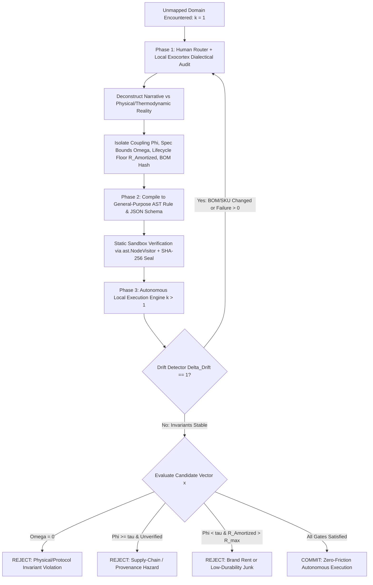

# SPEC-2026-HUMAN-ROUTER-AST-COMPILATION: UNIVERSAL DIALECTICAL AUDIT TO STIGMERGIC AST COMPILER

**Canonical Reference:** `SPEC-2026-HUMAN-ROUTER-AST-COMPILATION-v1.0`  
**Classification:** Cybernetic State Compiler / Universal Domain Disintermediation & Autonomous Routing  
**Target Infrastructure:** Bare-Metal Local Exocortex, Deterministic AST Evaluators, P2P Edge Execution Nodes  
**License:** Unlicense (Public Domain — Zero-Rent Federation)  

---

## 1. ABSTRACT & MECHANISTIC MISMATCH

Autonomous agent frameworks fail across real-world physical, financial, and operational domains due to a fundamental cybernetic dichotomy:
1. **Unverified Agent Delegation (Probabilistic Drift & Adversarial Capture):** Delegating unmapped real-world decisions directly to probabilistic LLM agents exposes the operator to SEO-poisoned corpora, vendor rent extraction, counterfeit supply chains, and catastrophic physical/systemic coupling failures.
2. **Perpetual Human-in-the-Loop Cognitive Tax:** Relying on the biological operator to manually research, filter, and route recurring decisions across every domain violates **Landauer Thermodynamic Bounds** ($\text{Power}_{\text{Bio}} \approx 20\text{ W}$) and **Invariant 25 (Zero-Cognitive-Friction Passive Proxy)**.

`SPEC-2026-HUMAN-ROUTER-AST-COMPILATION-v1.0` defines a **Universal Cybernetic Compiler** where the human operator acts as an exploratory router **strictly at $t=0$ (Out-of-Distribution Discovery)** to audit a domain via dialectical friction, extract its true physical/mechanistic invariants, and compile those invariants into a `SHA-256` sealed Abstract Syntax Tree (AST). Subsequent executions ($t > 0$) run autonomously on local silicon with zero conversational tokens ($\text{Tokens}_{\text{Chat}} = 0$), bounded by an automatic **Drift Circuit Breaker** that escalates back to the human router if physical BOM specifications or pricing bounds drift.

---

## 2. CORE MATHEMATICAL & CYBERNETIC INVARIANTS

1. **Universal Coupling & Lifecycle-Amortized Rent Vector ($\vec{\Psi}$):**
   Any real-world acquisition, procurement, or state-routing candidate $x \in \mathcal{X}$ across any domain $\mathcal{D}$ is decomposed into four orthogonal invariant vectors:
   - **Systemic Coupling Criticality ($\Phi_{\text{Coupling}} \in [0, 1]$):** Degree of physical, cryptographic, electrical, chemical, or statutory coupling between candidate $x$ and the host system's failure boundary.
   - **Mechanistic Spec Parity ($\Omega_{\text{Parity}} \in \{0, 1\}$):** Binary satisfaction of hard physical/protocol constraints:
     $$\Omega_{\text{Parity}}(x) = \prod_{m=1}^{M} \mathbb{I}\left(\text{Metric}_m(x) \in [\theta_{m,\min}, \theta_{m,\max}]\right)$$
   - **Lifecycle-Amortized Rent Ratio ($R_{\text{Amortized}} \ge 1.0$, Invariant 29):** Normalizes upfront cost by expected operational lifespan cycles $L_{\text{Cycles}}(x)$ relative to the thermodynamic/BOM baseline floor ($C_{\text{Floor}}, L_{\text{Baseline}}$) to prevent cheap, low-durability degradation:
     $$R_{\text{Amortized}}(x) = \frac{\text{Cost}_{\text{Asked}}(x) / L_{\text{Cycles}}(x)}{C_{\text{Floor}} / L_{\text{Baseline}}}$$
   - **Stale-AST Concept Drift Detector ($\Delta_{\text{Drift}} \in \{0, 1\}$):** Detects silent BOM degradation ("cheapflation"), SKU revision hash mismatches, or anomalous supply-chain price shocks ($\lvert \Delta P \rvert > \delta_{\max}$):
     $$\Delta_{\text{Drift}}(x) = \mathbb{I}\left(\text{Hash}_{\text{BOM}}(x) \neq \text{Hash}_{\text{BOM}, t_0} \;\lor\; \text{FailureTelemetry}(x) > 0\right)$$

2. **General-Purpose Deterministic Routing Law (with Phase 3 $\to$ Phase 1 Circuit Breaker):**
   $$\text{Decision}(x) = \begin{cases} \text{ESCALATE\_HUMAN\_REAUDIT} & \text{if } \Delta_{\text{Drift}}(x) = 1 \quad (\text{Phase 3} \to \text{Phase 1 Circuit Breaker}) \\ \text{REJECT\_INVARIANT\_VIOLATION} & \text{if } \Omega_{\text{Parity}}(x) = 0 \\ \text{REJECT\_PROVENANCE\_HAZARD} & \text{if } \Phi_{\text{Coupling}}(x) \ge \tau_{\Phi} \land \neg \text{Provenance}_{\text{Verified}}(x) \\ \text{REJECT\_RENT\_OR\_LIFESPAN\_DECAY} & \text{if } \Phi_{\text{Coupling}}(x) < \tau_{\Phi} \land R_{\text{Amortized}}(x) > R_{\max} \\ \text{APPROVE\_AUTONOMOUS\_COMMIT} & \text{otherwise} \end{cases}$$

3. **Bounded Cognitive Amortization:**
   $$\lim_{k \to \infty} \frac{\text{CognitiveLoad}_{\text{Bio}}}{k} \to 0 \quad \forall \; \Delta_{\text{Drift}} = 0 \implies \text{OpEx}_{\text{Routing}} \to \text{Watts}_{\text{Local Silicon}}$$
   Human cognitive bandwidth is invoked exclusively on initial domain discovery ($k=1$) or verified structural drift ($\Delta_{\text{Drift}} = 1$).

4. **Kolmogorov AST Sandbox & CFAA Baseline (Invariant 20, 21, 23):**
   Compiled domain rules are serialized as pure side-effect-free AST expressions verified via `ast.NodeVisitor` and anchored by `SHA-256` state commits.

---

## 3. 3-PHASE CYBERNETIC COMPILATION ARCHITECTURE

---

## 4. CROSS-DOMAIN GENERALIZATION MATRIX

Once compiled, the identical AST engine (`proofs/human_router_ast_compiler_engine.py`) evaluates arbitrary domains without structural modification:

| Domain ($\mathcal{D}$) | Coupled Subsystem ($\Phi_{\text{Coupling}} \ge \tau_{\Phi}$) -> *Enforce Verified Spec & Provenance* | Decoupled Commodity ($\Phi_{\text{Coupling}} < \tau_{\Phi}$) -> *Enforce Lifecycle-Amortized Floor ($R_{\text{Amortized}} \le R_{\max}$)* | Drift Circuit Breaker ($\Delta_{\text{Drift}} = 1$) -> *Escalate to Phase 1* |
| :--- | :--- | :--- | :--- |
| **Compute & Silicon Infrastructure** | ECC VRAM modules, PSU rails, cryptographic HSMs. | Chassis enclosures, passive heatsinks, patch cables. | Silent controller/die stepping swap on SSD/RAM SKU. |
| **Biochemistry & Healthcare** | Active pharmaceutical ingredients (USP/BP assay purity, cold-chain provenance). | Brand-name OTC analgesics vs. identical generic molecule. | Excipient formulation change or assay variance alert. |
| **Industrial & Domestic Hardware** | Induction/pressure-coupled thermal vessels, hydraulic seals, load-bearing fasteners. | Non-coupled ergonomic interfaces, passive Polymer/Silicone tooling (filtered by cycle lifespan). | OEM transitions metal sub-assembly to polymer under same part number. |
| **Enterprise Software & SaaS** | Core cryptographic state kernels, deterministic local databases. | Wrapper SaaS CRUD interfaces (disintermediated via local AST scripts). | Upstream API schema breaking change or license enclosure. |

---

## 5. VERIFICATION & EXECUTABLE PROOF

- **Schema Contract:** `schema/human_router_ast_compiler.json`
- **Verification Engine:** `proofs/human_router_ast_compiler_engine.py`
  - **Domain-Agnostic AST Compiler:** Compiles any audited domain vector into a sandboxed AST evaluator.
  - **Lifecycle Amortization Filter:** Rejects both high-margin OEM brand rent *and* cheap low-lifespan junk that inflates per-cycle cost.
  - **Stale-AST Circuit Breaker:** Detects silent BOM/SKU drift and halts autonomous execution, escalating cleanly to `ESCALATE_HUMAN_REAUDIT`.
