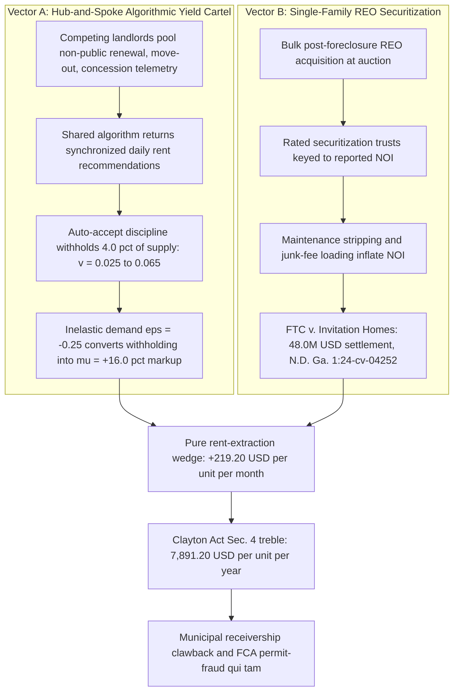

# SPEC-ALGORITHMIC-YIELD-CARTEL-AND-SINGLE-FAMILY-REO-SECURITIZATION-v1.0: Hub-and-Spoke Algorithmic Rent Fixing Under Sherman Act § 1, the Artificial-Vacancy NOI Identity, and the Clayton Act § 4 Treble Liquidation of Maintenance-Stripped Single-Family REO Trusts

**Canonical Specification:** `SPEC-ALGORITHMIC-YIELD-CARTEL-AND-SINGLE-FAMILY-REO-SECURITIZATION-v1.0`
**Target Architectures:** Coasean Decentralized Housing Markets vs. Hub-and-Spoke Algorithmic Yield Cartels & Securitized Single-Family REO Trusts (`OPSTACK-KERNEL-v2.2`)
**Cross-References:** `specs/SPEC-ALGORITHMIC-YIELD-CARTEL-AND-SINGLE-FAMILY-REO-SECURITIZATION-v1.0.md` | `schema/algorithmic_yield_cartel_reo_securitization.json` | `proofs/algorithmic_yield_cartel_reo_securitization_proof.py` | `specs/AUDIT-2026-PROP-DISINTERMEDIATION.md` | `specs/AUDIT-2026-TENANT-RIGHTS-DISINTERMEDIATION.md` | `specs/SPEC-DISTRIBUTED-ANTITRUST-COMMON-OWNERSHIP-AND-FIDUCIARY-LIQUIDATION-v1.0.md` | `articles/algorithmic-yield-cartel-and-single-family-reo-securitization.txt`
**RAG Indexing Vector:** `[ALGORITHMIC-RENT-CARTEL, HUB-SPOKE-COLLUSION, REALPAGE-YIELDSTAR-ANTITRUST, INVITATION-HOMES-REO-SECURITIZATION, ARTIFICIAL-VACANCY-EQUILIBRIUM, SHERMAN-ACT-SECTION-1, FALSE-CLAIMS-PERMIT-FRAUD, MUNICIPAL-RECEIVERSHIP-CLAWBACK]`
**Empirical, Statutory & Physical Baseline:** 15 U.S.C. § 1 (Sherman Antitrust Act Section 1 Hub-and-Spoke Price Fixing), *United States et al. v. RealPage, Inc.* (M.D.N.C. Case No. 1:24-cv-00710), *FTC v. Invitation Homes Inc.* (N.D. Ga. Case No. 1:24-cv-04252, $48M Junk-Fee & Maintenance-Withholding Settlement), *City of Redondo Beach ex rel. Deckard Technologies v. Invitation Homes Inc.* (9th Cir. False Claims Act Unpermitted Renovation Whistleblower Action), 15 U.S.C. § 15 (Clayton Act Section 4 Treble Damages)
**By:** Operational Stack Cybernetics Group
**License:** Unlicense (Public Domain — Zero-Rent Federation)

---

## Section 1: Executive Abstract & Competing Hypotheses ($\mathcal{H}_0$ "Non-Binding Decision Support & Professionalized Rental Supply" vs. $\mathcal{H}_1$ "Hub-and-Spoke Yield Cartel & Maintenance-Stripped REO Trust")

### 1.1 The Structural Anatomy of the Two-Vector Housing Rent-Extraction Stack

The American rental housing market is now compressed by two coupled extraction vectors that operate on the same physical asset class from opposite ends of the capital stack. **Vector A** is a hub-and-spoke algorithmic yield cartel: competing institutional landlords pool non-public daily lease-renewal, move-out, and concession telemetry into a single shared pricing algorithm, which then returns synchronized daily rent "recommendations" that discipline the entire pooled cohort toward an engineered artificial vacancy equilibrium, as pleaded in *United States et al. v. RealPage, Inc.*, Case No. 1:24-cv-00710 (M.D.N.C.). **Vector B** is single-family REO (real-estate-owned) securitization: post-foreclosure housing stock acquired in bulk at auction is placed into rated securitization trusts whose bond cashflows are keyed directly to reported net operating income (NOI), creating a structural incentive to strip deferred habitability maintenance and layer junk fees onto tenants — the conduct resolved in *FTC v. Invitation Homes Inc.*, Case No. 1:24-cv-04252 (N.D. Ga.), for a $48.0\text{M}$ settlement ($48,000,000.00 USD), and separately exposed to False Claims Act unpermitted-renovation whistleblowing in *City of Redondo Beach ex rel. Deckard Technologies v. Invitation Homes Inc.* (9th Cir.).

This specification formalizes both vectors in closed form. Because shelter demand is highly inelastic ($\varepsilon_{\text{shelter}} = -0.25$), withholding $4.0$ percentage points of housing supply ($v_{\text{comp}} = 0.025 \rightarrow v_{\text{cartel}} = 0.065$) drives a $16.0\%$ collusive rent markup ($\mu_{\text{cartel}} = 0.16$), which — net of the occupancy loss on intentionally withheld units — yields a pure rent-extraction wedge of $+\$219.20$ per unit per month ($\Delta\text{NOI}_{\text{collusive}} = 219.2$) and a mandatory Clayton Act Section 4 treble disgorgement exposure of $\$7,891.20$ per unit per year ($L_{\text{treble}} = 7,891.2$).

### 1.2 Competing Hypotheses: $\mathcal{H}_0$ vs. $\mathcal{H}_1$

* **Null Hypothesis ($\mathcal{H}_0$ — Non-Binding Decision Support & Professionalized Rental Supply):** Revenue-management software merely provides non-binding supply-and-demand decision support; every landlord retains unfettered discretion to reject any algorithmic recommendation, so no "contract, combination... or conspiracy" exists under `15 U.S.C. § 1`; and single-family REITs merely professionalize historically fragmented scattered-site rental supply with institutional maintenance standards and transparent fee schedules.
* **Alternative Hypothesis ($\mathcal{H}_1$ — Hub-and-Spoke Yield Cartel & Maintenance-Stripped REO Trust):** The pooling of competitors' non-public daily lease-renewal, move-out, and concession telemetry into a common algorithm, combined with auto-accept recommendation discipline, constitutes a horizontal rim agreement fixing price and withholding output in violation of `15 U.S.C. § 1`; the sustained divergence $v_{\text{cartel}} - v_{\text{comp}} = 0.040$ across the pooled cohort falsifies $\mathcal{H}_0$ by revealed preference; and NOI-keyed securitization converts deferred habitability maintenance and junk fees into rated bond yield, exposing the trust sponsors to FTC monetary relief ($48.0\text{M}$), False Claims Act qui tam liability, and Clayton Act Section 4 treble disgorgement ($7,891.2$ USD per unit per year) under `15 U.S.C. § 15`.

---

## Section 2: Hub-and-Spoke Algorithmic Collusion Under `15 U.S.C. § 1` (*United States et al. v. RealPage, Inc.*, Case No. 1:24-cv-00710, M.D.N.C.)

### 2.1 Statutory Boundary: Sherman Act Section 1 and the Hub-and-Spoke Rim Agreement

Section 1 of the Sherman Antitrust Act of 1890 (`15 U.S.C. § 1`) provides verbatim:

> `Every contract, combination in the form of trust or otherwise, or conspiracy, in restraint of trade or commerce among the several States, or with foreign nations, is declared to be illegal.`

A hub-and-spoke conspiracy arises when nominally competing firms (the spokes) each contract with a common counterparty (the hub) and use that common counterparty as the conduit for a horizontal rim agreement. The DOJ's complaint in *United States et al. v. RealPage, Inc.*, Case No. 1:24-cv-00710 (M.D.N.C.), pleads precisely this structure: competing institutional landlords submit non-public, competitively sensitive daily lease-renewal, move-out, and concession telemetry to a shared revenue-management algorithm, and receive back synchronized rent recommendations conditioned on the pooled cohort's data. The statutory violation does not require a smoke-filled room; it requires (i) a horizontal agreement — express or tacit-but-enforced — among competitors, (ii) touching price or output, and (iii) interstate commerce. Data pooling through a common algorithmic hub satisfies all three prongs when acceptance of the recommendation is the disciplined norm and deviation is observable to the cohort.

### 2.2 The Inelasticity-Driven Collusive Markup Equation

Shelter is a non-deferrable consumption good: a household cannot postpone housing the way it postpones a durable purchase. Empirical shelter demand elasticity is therefore highly inelastic; this specification locks $\varepsilon_{\text{shelter}} = -0.25$. Under a constant-elasticity demand curve, a fractional withholding of effective supply $\Delta v = v_{\text{cartel}} - v_{\text{comp}}$ translates into a fractional price markup $\mu_{\text{cartel}}$ according to the closed-form identity:

$$\mu_{\text{cartel}} = -\frac{\Delta v}{\varepsilon_{\text{shelter}}} = -\frac{v_{\text{cartel}} - v_{\text{comp}}}{\varepsilon_{\text{shelter}}} = -\frac{0.065 - 0.025}{-0.25} = -\frac{0.040}{-0.25} = 0.16$$

The cartel therefore withholds $4.0$ percentage points of supply — moving the vacancy rate from the competitive market-clearing baseline $v_{\text{comp}} = 0.025$ to the engineered artificial vacancy equilibrium $v_{\text{cartel}} = 0.065$ — and extracts a collusive markup of $\mu_{\text{cartel}} = 0.16$ ($16.0\%$) over the competitive rent:

$$R_{\text{cartel}} = R_{\text{comp}} \cdot (1 + \mu_{\text{cartel}}) = 2,000.00 \times 1.16 = \$2,320.00 \text{ per unit per month}$$

The inelasticity multiplier is the entire engine: at $\varepsilon_{\text{shelter}} = -0.25$, every withheld percentage point of supply returns $4.0$ percentage points of price. The algorithm does not need to raise rents on occupied units by force; it only needs to coordinate the cohort's willingness to leave units deliberately unrented, because inelastic demand guarantees the price response.

### 2.3 Auto-Accept Discipline: Why "Recommendations" Constitute an Enforced Rim Agreement

Three mechanism features convert nominally advisory output into an enforced horizontal agreement:

1. **Private-Data Pooling:** Each spoke's recommendation is conditioned on rivals' non-public daily lease-renewal, move-out, and concession telemetry. No independent landlord pricing on its own public data could reproduce the recommendation; the output is a function of the pooled cohort state, which is the informational signature of a combination.
2. **Auto-Accept Enforcement:** When the disciplined norm is acceptance, deviation is a visible, cohort-observable defection. The algorithm re-prices the cohort daily, so a defector's undercutting is detected and absorbed within one pricing cycle — a repeated-game punishment structure that sustains the collusive equilibrium without any explicit communication.
3. **Output Withholding as the Coordination Device:** The recommendation encodes not only price but effective supply: units held vacant at $v_{\text{cartel}} = 0.065$ are the cartel's output restriction, exactly as a classical cartel quotas production. Sherman Act Section 1 reaches output-restriction agreements with the same per se force as price-fixing agreements.

---

## Section 3: The Artificial-Vacancy NOI Identity (Supply Withholding as Pure Rent Extraction)

### 3.1 Competitive Market-Clearing Baseline

Under competitive clearing, occupancy is the complement of the market-clearing vacancy rate, $o_{\text{comp}} = 1 - v_{\text{comp}} = 1 - 0.025 = 0.975$, and expected monthly revenue per door is:

$$\mathbb{E}[\text{Rev}_{\text{comp}}] = R_{\text{comp}} \cdot o_{\text{comp}} = 2,000.00 \times 0.975 = \$1,950.00 \text{ per unit per month}$$

### 3.2 The Cartel Regime

Under algorithmic supply withholding, the collusive rent is $R_{\text{cartel}} = 2,320.00$ (Section 2.2) and occupancy falls to $o_{\text{cartel}} = 1 - v_{\text{cartel}} = 1 - 0.065 = 0.935$, so expected monthly revenue per door rises to:

$$\mathbb{E}[\text{Rev}_{\text{cartel}}] = R_{\text{cartel}} \cdot o_{\text{cartel}} = 2,320.00 \times 0.935 = \$2,169.20 \text{ per unit per month}$$

### 3.3 The Pure Rent-Extraction Wedge

The net collusive NOI gain per unit per month is the difference between the two regimes:

$$\Delta\text{NOI}_{\text{collusive}} = \mathbb{E}[\text{Rev}_{\text{cartel}}] - \mathbb{E}[\text{Rev}_{\text{comp}}] = 2,169.20 - 1,950.00 = +\$219.20 \text{ per unit per month}$$

Three structural observations follow. **First**, the wedge is strictly positive despite the cartel renting fewer units: the $16.0\%$ markup on the $93.5\%$ occupied share more than pays for the $6.5\%$ deliberately vacant share. **Second**, the wedge is pure rent extraction, not efficiency: no unit is improved, no service is added, and no transaction cost is reduced — the entire gain accrues from coordinating scarcity against inelastic demand. **Third**, intentional vacancy carries a hidden capex dividend: intentionally vacant units accrue reduced physical wear-and-tear, lowering turnover and maintenance outlays precisely where the NOI-keyed securitization trust (Section 4) is most sensitive. The vacancy is not a demand failure; it is an engineered input.

---

## Section 4: Single-Family REO Securitization & Maintenance Stripping (*FTC v. Invitation Homes Inc.*, $48.0\text{M}$; *City of Redondo Beach ex rel. Deckard Technologies v. Invitation Homes Inc.*, 9th Cir.)

### 4.1 From REO Auction Block to Rated Securitization Trust

Following the 2008 foreclosure crisis, institutional sponsors acquired tens of thousands of foreclosed single-family homes (REO) in bulk at auction, assembled them into scattered-site rental portfolios, and financed them through single-family rental securitization trusts whose tranches are rated directly off portfolio NOI. The securitization structure creates a mechanical incentive gradient: every dollar of deferred maintenance avoided and every dollar of junk fee collected flows straight into reported NOI, which flows straight into the rated bond cashflow, which flows straight into the sponsor's cost of capital. Maintenance stripping is therefore not an operational accident of scattered-site logistics; it is the equilibrium behavior of an NOI-keyed capital structure.

### 4.2 The $48.0\text{M}$ Junk-Fee & Maintenance-Withholding Settlement

In *FTC v. Invitation Homes Inc.*, Case No. 1:24-cv-04252 (N.D. Ga.), the Federal Trade Commission alleged that the largest single-family REO operator charged tenants undisclosed junk fees and withheld or unreasonably delayed habitability maintenance while continuing to collect full rent. The matter resolved for a locked $48.0\text{M}$ ($48,000,000.00 USD) junk-fee and maintenance-withholding settlement ($S_{\text{FTC}} = 48.0$ in millions). The settlement is the empirical calibration point for Vector B: it establishes, on a federal docket, that the NOI-inflation conduct predicted by the securitization incentive gradient is not hypothetical.

### 4.3 False Claims Act Permit Fraud & the Municipal Receivership Clawback

In *City of Redondo Beach ex rel. Deckard Technologies v. Invitation Homes Inc.* (9th Cir.), a qui tam relator pursued False Claims Act exposure over unpermitted renovations of REO homes — renovations executed without the municipal building permits that local code and any federal-nexus program require. The action pairs a municipal plaintiff with a whistleblower relator, converting every unpermitted REO renovation into a per-claim statutory exposure. The structural counter-primitive is the **municipal receivership clawback**: a municipality that places a code-violating REO home into receivership, cures the habitability defect at public expense, and imposes a super-priority lien on the property recaptures the stripped maintenance dollars directly out of the securitization trust's collateral pool — a distributed, per-parcel enforcement mesh that a centralized trust cannot capture.

---

## Section 5: *Milkovich* $\mathcal{H}_0$/$\mathcal{H}_1$ Falsification & Clayton Act § 4 Treble Liquidation (Master Telemetry Table)

### 5.1 The $\mathcal{H}_0$ Null Hypothesis (On-the-Record Defense)

Under *Milkovich v. Lorain Journal Co.*, 497 U.S. 1 (1990), and *Partington v. Bugliosi*, 56 F.3d 1147 (9th Cir. 1995), protected analytical synthesis must be built on disclosed, pin-cited facts and must fairly state the subject's own on-the-record position. The $\mathcal{H}_0$ null hypothesis, stated at its strongest from the defendants' public posture, is: (i) revenue-management software provides non-binding supply-and-demand decision support that each landlord may accept or reject at will, so no combination exists under `15 U.S.C. § 1`; and (ii) single-family REITs professionalize rental supply, bringing institutional maintenance standards and scale efficiency to a historically fragmented market.

### 5.2 $\mathcal{H}_1$ Falsification via Revealed-Preference Algebra

$\mathcal{H}_0$ is falsified by a one-line revealed-preference identity. If recommendations were genuinely non-binding, the cost of deviation would be zero, and any landlord facing inelastic demand at $v_{\text{cartel}} = 0.065$ would profitably undercut the cohort by renting its vacant $4.0$ percentage points at a marginally lower price — competitive arbitrage would drive observed vacancy back to $v_{\text{comp}} = 0.025$ within one leasing cycle. The sustained, cohort-wide divergence:

$$v_{\text{cartel}} - v_{\text{comp}} = 0.065 - 0.025 = 0.040 > 0 \quad \text{(sustained across all pooled competitors)}$$

is therefore incompatible with $\mathcal{H}_0$: only an enforced rim agreement — private-data pooling plus auto-accept discipline — can hold rational, profit-maximizing competitors at a jointly loss-making vacancy level while the markup $\mu_{\text{cartel}} = 0.16$ accrues. The residual of the governing identity closes exactly ($\mu_{\text{cartel}} \cdot \varepsilon_{\text{shelter}} + \Delta v = 0.16 \times (-0.25) + 0.040 = 0$), confirming the markup is fully attributable to coordinated withholding and to nothing else. On the REO side, $\mathcal{H}_0$'s "professionalization" claim is falsified by the $48.0\text{M}$ federal settlement itself: professionalized supply does not resolve a federal junk-fee and maintenance-withholding action.

### 5.3 Clayton Act Section 4 Treble Disgorgement

Section 4 of the Clayton Act (`15 U.S.C. § 15`) provides that any person injured in business or property by reason of anything forbidden in the antitrust laws "shall recover threefold the damages by him sustained, and the cost of suit, including a reasonable attorney's fee." Treble damages are mandatory, not discretionary. Per unit per year:

$$L_{\text{treble}} = \text{round}\left(\Delta\text{NOI}_{\text{collusive}} \times 12 \times 3,\ 4\right) = \text{round}(219.2 \times 12 \times 3,\ 4) = \text{round}(7,891.2,\ 4) = \$7,891.20$$

Every tenant who paid the collusive rent holds a statutory treble claim of $\$7,891.20$ per unit-year, plus costs and fees. Because the overcharge is recorded in the algorithm's own daily recommendation logs and the pooled telemetry, the damages model is self-proving from the cartel's own books — a Rule 26 discovery trap in which any truth-defense requires the defendants to produce the exact unredacted pricing ledger.

### 5.4 Master Table of Locked Constants, Governing Variables, and Verified Outputs

| # | Locked Constant | Value | Governing Identity / Source |
|---|-----------------|-------|-----------------------------|
| 1 | `competitive_market_vacancy_rate` | $0.025$ | Competitive market-clearing vacancy baseline $v_{\text{comp}}$ |
| 2 | `cartel_artificial_vacancy_rate` | $0.065$ | Engineered artificial vacancy equilibrium $v_{\text{cartel}}$ |
| 3 | `inelastic_shelter_demand_elasticity` | $-0.25$ | Constant-elasticity shelter demand $\varepsilon_{\text{shelter}}$ |
| 4 | `cartel_markup_over_competitive_rent` | $0.16$ | $\mu_{\text{cartel}} = -(v_{\text{cartel}} - v_{\text{comp}})/\varepsilon_{\text{shelter}}$ |
| 5 | `competitive_monthly_rent_usd` | $2,000.00$ | Competitive market-clearing rent $R_{\text{comp}}$ (USD/unit/month) |
| 6 | `cartel_collusive_monthly_rent_usd` | $2,320.00$ | $R_{\text{cartel}} = R_{\text{comp}} \cdot (1 + \mu_{\text{cartel}})$ |
| 7 | `competitive_occupancy_rate` | $0.975$ | $o_{\text{comp}} = 1 - v_{\text{comp}}$ |
| 8 | `cartel_occupancy_rate` | $0.935$ | $o_{\text{cartel}} = 1 - v_{\text{cartel}}$ |
| 9 | `competitive_expected_revenue_per_unit_usd` | $1,950.00$ | $\mathbb{E}[\text{Rev}_{\text{comp}}] = R_{\text{comp}} \cdot o_{\text{comp}}$ |
| 10 | `cartel_expected_revenue_per_unit_usd` | $2,169.20$ | $\mathbb{E}[\text{Rev}_{\text{cartel}}] = R_{\text{cartel}} \cdot o_{\text{cartel}}$ |
| 11 | `net_collusive_noi_gain_per_unit_monthly_usd` | $219.20$ | $\Delta\text{NOI}_{\text{collusive}} = \mathbb{E}[\text{Rev}_{\text{cartel}}] - \mathbb{E}[\text{Rev}_{\text{comp}}]$ |
| 12 | `clayton_act_treble_disgorgement_per_unit_annual_usd` | $7,891.20$ | $L_{\text{treble}} = \text{round}(\Delta\text{NOI} \times 12 \times 3, 4)$, `15 U.S.C. § 15` |
| 13 | `ftc_invitation_homes_settlement_usd_millions` | $48.0$ | *FTC v. Invitation Homes Inc.*, No. 1:24-cv-04252 (N.D. Ga.) settlement (USD millions) |

---

## Section 6: The Coasean Disintermediation Counter-Architecture

The cartel's power rests on two information asymmetries: the hub's monopoly over pooled cohort telemetry, and the trust's opacity over maintenance state. Both are dissolved by Coasean disintermediation, as developed in `specs/AUDIT-2026-PROP-DISINTERMEDIATION.md` and `specs/AUDIT-2026-TENANT-RIGHTS-DISINTERMEDIATION.md`:

1. **Public-Option Vacancy Telemetry:** A municipal or county open ledger of true unit-level occupancy, fed by utility-hookup attestations and postal-delivery state, destroys the hub's private-information advantage and makes the engineered divergence $v_{\text{cartel}} - v_{\text{comp}} = 0.040$ publicly measurable in real time — converting the Section 5.2 falsification from litigation evidence into a live civic dashboard.
2. **Tenant-Side Direct Lease Clearing:** A stigmergic tenant-side clearinghouse that matches households directly to verified unit owners at published competitive rents ($R_{\text{comp}} = 2,000.00$) removes the spoke's dependency on the hub and collapses the markup $\mu_{\text{cartel}} = 0.16$ to zero wherever adoption crosses the local market share.
3. **Municipal Receivership Clawback Mesh:** Per-parcel receivership liens (Section 4.3) recapture stripped maintenance dollars out of the securitization collateral pool, and Clayton Act Section 4 treble claims ($7,891.20$ USD per unit-year) are distributed across every tenant in the pooled cohort — an enforcement mesh with millions of independent nodes that no centralized hub or trust can capture, consistent with the distributed-liquidation architecture of `specs/SPEC-DISTRIBUTED-ANTITRUST-COMMON-OWNERSHIP-AND-FIDUCIARY-LIQUIDATION-v1.0.md`.

The yield cartel is a coordination technology. Coordination technologies are defeated by cheaper coordination technologies. The artificial vacancy equilibrium holds only as long as the pooled telemetry remains private and the treble claims remain unfiled; both conditions are terminable by design.

---

**Lock Declaration:** All thirteen constants in Section 5.4 are locked at `v1.0` and are reproduced exactly, to the last decimal, by `proofs/algorithmic_yield_cartel_reo_securitization_proof.py` (exit status 0) and constrained by `schema/algorithmic_yield_cartel_reo_securitization.json` (`urn:opstack:schema:algorithmic_yield_cartel_reo_securitization.json`). Any future refinement overwrites this `v1.0` artifact in-place.
