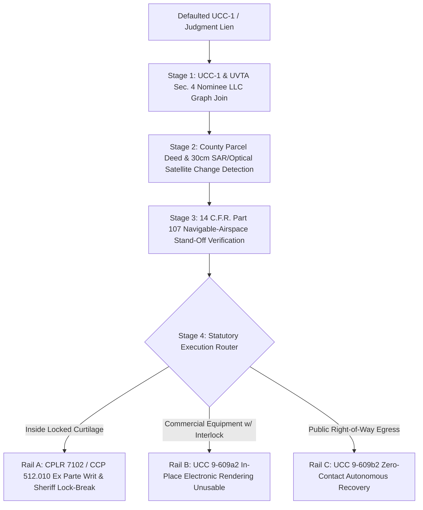

# SPEC-COLLATERAL-RECLAMATION-OSINT-AND-UCC-9609-SWARM-v1.0: Navigable-Airspace Collateral OSINT, U.C.C. § 9-609 In-Place Electronic Immobilization, and Ex Parte Writ of Replevin Swarms

**Canonical Specification:** `SPEC-COLLATERAL-RECLAMATION-OSINT-AND-UCC-9609-SWARM-v1.0`

**Target Architectures:** Secured-Creditor & Post-Judgment Asset-Tracing Swarms (`U.C.C. §§ 9-501–9-526`, `U.C.C. § 9-609`, `U.C.C. §§ 9-610–9-612`, `U.C.C. §§ 9-625–9-626`; `Fed. R. Civ. P. 64 & 69`; `28 U.S.C. §§ 3201–3205` — United States as creditor / SBA-DOE-USDA-guaranteed notes only), Fraudulent-Transfer & Nominee-LLC Cutout Piercing (`28 U.S.C. § 3304`; Uniform Voidable Transactions Act `UVTA § 4`; `N.Y. DCL § 273(b)`), Navigable-Airspace sUAS & Commercial SAR/EO Satellite Collateral Pinpointing (`49 U.S.C. § 40103(a)(1)–(2) & (b)(1)–(2)`; `14 C.F.R. Part 107`; `51 U.S.C. § 60121`; state sUAS surveillance statutes `Tex. Gov't Code §§ 423.003, 423.004, 423.006` and `Cal. Civ. Code § 1708.8`), and Breach-of-Peace-Compliant Electronic Immobilization & Judicial Replevin Execution (`OPSTACK-KERNEL-v2.2`)

**Cross-References:** `OPSTACK-KERNEL-v2.2`, `SPEC-ANTINOMIAN-WRAPPER-AND-501C-FORENSIC-RUBRIC-v1.0.md`, `SPEC-THREE-SHELL-CUTOUT-AND-REFLEXIVE-FX-ARBITRAGE-v1.0.md`, `SPEC-STIGMERGIC-ZK-OSINT-BOUNTY-SETTLEMENT-v1.0.md`, `SPEC-NEOCLOUD-GPU-DEBT-AND-INFERENCE-DEFLATION-v1.0.md`, `SPEC-2026-STIGMERGIC-AERIAL-SWARM-AND-COUNTER-UAS-CYBERNETICS-v1.0`, `specs/AUDIT-2026-PHYSICAL-ASSET-DISINTERMEDIATION.md`, `articles/antinomian-wrappers-and-the-501c-forensic-rubric.txt`, `articles/collateral-reclamation-osint-and-the-ucc-9609-swarm.txt`, `schema/collateral_reclamation_osint_ucc_9609_swarm.json`, `proofs/verify_collateral_reclamation_osint_ucc_9609_swarm.py`

**RAG Indexing Vector:** [UCC-9609-SELF-HELP-JUDICIAL-REPLEVIN, BREACH-PEACE-CURTILAGE-INVARIANT, EX-PARTE-WRIT-OF-REPLEVIN-PROBABLE-LOCATION, UCC-9609A2-IN-PLACE-ELECTRONIC-IMMOBILIZATION, PART-107-NAVIGABLE-AIRSPACE-COLLATERAL-OSINT, SAR-EO-SATELLITE-CHATTEL-TOMOGRAPHY, UCC1-FINANCING-STATEMENT-GRAPH-JOIN, UVTA-SECTION-4-BADGES-OF-FRAUD, UCC-9625-9626-CONVERSION-DEFICIENCY-FORFEITURE, STATE-SUAS-SURVEILLANCE-STATUTE-JURISDICTIONAL-GATE, FRAME-FRESHNESS-24H-EX-PARTE-AFFIDAVIT, AUTONOMOUS-RIGHT-OF-WAY-RECOVERY-DISPATCH, NEOCLOUD-GPU-YELLOW-IRON-CHATTEL-RECOVERY]

**Empirical/Statutory/Physical Baseline:** `U.C.C. § 9-609(a)(1)–(2) & (b)(1)–(2)` (secured party right to take possession after default or render equipment unusable on debtor's premises via judicial process or without breach of the peace); `U.C.C. §§ 9-501–9-526` (public UCC-1 financing statement filing and collateral description ledgers); `U.C.C. § 9-625(a)–(b)` (judicial restraint of noncompliant collection/enforcement/disposition, plus damages "in the amount of any loss caused by a failure to comply with this article," expressly including "loss resulting from the debtor's inability to obtain, or increased costs of, alternative financing") with `U.C.C. § 1-103(b)` (preservation of common-law conversion and trespass remedies); `U.C.C. § 9-626(a)(3)–(4)` (the **non-consumer rebuttable-presumption rule**: where a secured party fails to prove Part 6 compliance, the debtor's deficiency liability is limited to the excess of the secured obligation, expenses, and attorney's fees over the greater of actual proceeds or the proceeds "that would have been realized had the noncomplying secured party proceeded in accordance with" Part 6 — and subsection (a)(4) *presumes* that hypothetical amount equal to the full secured obligation plus expenses and fees, thereby forfeiting the entire deficiency unless the secured party rebuts the presumption); `U.C.C. §§ 9-611(b)–(c) & 9-612(b)` (reasonable authenticated notification of disposition to debtor, secondary obligor, and competing lienholders, with a 10-day safe harbor in non-consumer transactions); `15 U.S.C. §§ 1692a(5), 1692f(6), 1692k` (FDCPA nonjudicial-dispossession prohibition with strict statutory damages and fee-shifting — reaching **only** obligations "primarily for personal, family, or household purposes" under § 1692a(5), and therefore *inapplicable* to commercial yellow-iron, GPU-container, hull, and rolling-stock collateral absent a mixed consumer fleet); `Fed. R. Civ. P. 64 & 69` (seizure of property via replevin, attachment, sequestration, and post-judgment execution); `N.Y. CPLR § 7102(c)(5), (d)(1) & (e)` and `Cal. Civ. Proc. Code §§ 512.010(b)(4), 512.070, 514.010(c)–(d), 515.010(a)` (order of seizure / writ of possession authorizing the sheriff or levying officer to break open, enter, and search a **specified** private enclosure upon probable cause of chattel location, conditioned on a plaintiff's undertaking of not less than twice the value of the chattel or of the defendant's interest therein); `28 U.S.C. §§ 3201–3205 & 3304` (Federal Debt Collection Procedures Act — operative only where the United States is the creditor, including SBA/DOE/USDA-guaranteed notes) and `UVTA § 4(a)–(b)` with `N.Y. DCL § 273(b)` (11 badges of fraud for insider/nominee LLC transfers, invoked by private commercial creditors through `Fed. R. Civ. P. 64 & 69`); `49 U.S.C. § 40103(a)(1)` (exclusive federal sovereignty of navigable airspace), `§ 40103(a)(2)` ("[a] citizen of the United States has a public right of transit through the navigable airspace"), `§ 40103(b)(1)–(2)` (FAA Administrator's airspace-use assignment and air traffic regulations "protecting individuals and property on the ground"), and `14 C.F.R. Part 107` (sUAS operation $\le 400\text{ ft}$ AGL); **state sUAS surveillance statutes binding private hunter nodes** — `Tex. Gov't Code § 423.003(a)` (Class C misdemeanor to "use[] an unmanned aircraft to capture an image of an individual or privately owned real property in this state with the intent to conduct surveillance on the individual or property captured in the image"), `§ 423.004` (a *separate* Class C misdemeanor per image possessed and Class B misdemeanor per image disclosed, displayed, distributed, or used), `§ 423.006` (civil action), and `Cal. Civ. Code § 1708.8(a)–(b)` (physical and constructive invasion of privacy, limited by its terms to a plaintiff "engaging in a personal or familial activity"); *Florida v. Riley*, 488 U.S. 445 (1989) and *Dow Chemical Co. v. United States*, 476 U.S. 227 (1986) (aerial observation from publicly navigable airspace is neither a Fourth Amendment search nor common-law trespass — **state-action doctrine, binding on the Sheriff executing a writ but not directly on a private hunter node**); *United States v. Causby*, 328 U.S. 256 (1946) and `Restatement (Second) of Torts § 159` ("[a]n entry upon the possession of land of another may be made by the flight of an aircraft above the surface" — the operative private-actor trespass boundary in the immediate reaches of the surface); *Fuentes v. Shevin*, 407 U.S. 67 (1972) and *Mitchell v. W.T. Grant Co.*, 416 U.S. 600 (1974) (ex parte replevin is constitutional only where issued by a judicial officer on a documented factual showing and secured by an undertaking); *Williams v. Ford Motor Credit Co.*, 674 F.2d 717 (8th Cir. 1982) and *Clarin v. Minnesota Repossessors, Inc.*, 198 F.3d 661 (8th Cir. 1999) vs. *Giles v. First Virginia Credit Services, Inc.*, 560 S.E.2d 557 (N.C. Ct. App. 2002) (peaceable public/open-access repossession vs. lock-cutting curtilage entry or contemporaneous objection as breach of the peace)

**By:** Operational Stack Cybernetics Group

**License:** Unlicense (Public Domain)

---

## 1. The Gated-Curtilage Catch-22 and the Secured-Creditor Information Asymmetry

Defaulting commercial debtors and judgment-proof cutout networks routinely conceal high-value movable chattel—yellow-iron construction machinery, modular GPU and inference compute containers, aviation and marine hulls, agricultural combines, commercial truck fleets, and high-value rolling stock—inside gated rural parcels or transfer physical custody across nominee LLC shells. When a debtor defaults on a secured obligation, Article 9 of the Uniform Commercial Code grants the secured creditor substantive reclamation rights under `U.C.C. § 9-609`:

> "(a) [Possession; rendering equipment unusable; disposition on debtor's premises.] After default, a secured party: (1) may take possession of the collateral; and (2) without removal, may render equipment unusable and dispose of collateral on a debtor's premises under Section 9-610.
> (b) [Judicial and nonjudicial process.] A secured party may proceed under subsection (a): (1) pursuant to judicial process; or (2) without judicial process, if it proceeds without breach of the peace."

In practice, however, defaulted debtors exploit the structural boundary between subsection `(b)(2)` (nonjudicial self-help) and subsection `(b)(1)` (judicial replevin) to manufacture an operational deadlock:

1. **The Self-Help Curtilage Barrier (`U.C.C. § 9-609(b)(2)`):** While open-driveway or public-lot extraction without confrontation is lawful (*Williams v. Ford Motor Credit Co.*, 674 F.2d 717, 719–20 (8th Cir. 1982); *Clarin v. Minnesota Repossessors, Inc.*, 198 F.3d 661, 665 (8th Cir. 1999)), any unauthorized entry into fenced or gated curtilage, cutting of padlocks, or continuation over a debtor's contemporaneous physical objection constitutes a per se **breach of the peace** (*Giles v. First Virginia Credit Services, Inc.*, 560 S.E.2d 557 (N.C. Ct. App. 2002)). A breach of the peace strips the repossessor of Article 9 immunity and triggers three distinct commercial-exposure channels: (i) `U.C.C. § 9-625(a)–(b)` noncompliance damages measured by "any loss caused by a failure to comply with this article," expressly including the debtor's alternative-financing loss, plus common-law conversion and trespass preserved by `U.C.C. § 1-103(b)`; (ii) common-law punitive damages for a forcible or deceptive taking; and (iii) — the channel most often missed — the **`U.C.C. § 9-626(a)(3)–(4)` commercial deficiency forfeiture**. Because a breach of the peace is a failure to proceed "in accordance with" Part 6, once the debtor places compliance in issue the secured party bears the burden under `§ 9-626(a)(2)`, and if it fails, `§ 9-626(a)(4)` *presumes* the proceeds that a complying disposition would have realized to equal the full secured obligation plus expenses and attorney's fees. The deficiency under `§ 9-626(a)(3)` therefore collapses to $\$0$. The creditor loses not merely the tort exposure but the entire post-disposition deficiency claim.

   > **Consumer/Commercial Scope Gate.** The Fair Debt Collection Practices Act (`15 U.S.C. §§ 1692f(6), 1692k`) is *not* the operative penalty for this architecture. `15 U.S.C. § 1692a(5)` defines "debt" as an obligation of a consumer to pay money arising from a transaction whose subject money, property, insurance, or services are "primarily for personal, family, or household purposes." A $\$450,000$ excavator, a $\$1.2\text{ M}$ GPU inference skid, a hull, or a Class 8 tractor fleet is commercial `U.C.C. § 9-102(a)(33)` equipment and sits entirely outside § 1692a(5). FDCPA exposure attaches only where the encumbered pool is commingled with consumer auto or household-goods paper; the governing commercial penalty is `U.C.C. §§ 9-625(b), 9-626(a)(3)–(4)`, which is *larger*, not smaller.
2. **The Replevin Probable-Location Barrier (`N.Y. CPLR § 7102(c)(5)` / `Cal. Civ. Proc. Code § 512.010(b)(4)`):** To bypass the breach-of-peace ceiling lawfully, the creditor must obtain a judicial Order of Seizure or Writ of Possession directing the County Sheriff or U.S. Marshal to break open locked gates and seize the collateral. Yet state replevin statutes universally impose a strict evidentiary precondition before authorizing a lock-break order. Under `N.Y. CPLR § 7102(c)(5)`, the creditor's affidavit must state:
   > "if the plaintiff seeks the inclusion in the order of seizure of a provision authorizing the sheriff to break open, enter and search for the chattel, the place where the chattel is located and facts sufficient to establish probable cause to believe that the chattel is located at that place;"
   Similarly, `Cal. Civ. Proc. Code § 512.010(b)(4)` mandates:
   > "A statement, according to the best knowledge, information, and belief of the plaintiff, of the location of the property and, if the property, or some part of it, is within a private place which may have to be entered to take possession, a showing that there is probable cause to believe that such property is located there."

   The lock-break authority itself is conferred downstream, and only conditionally. `N.Y. CPLR § 7102(d)(1)` permits the court to grant an order "including, **if the court so directs, a provision that, if the chattel is not delivered to the sheriff, he may break open, enter and search for the chattel in the place specified in the affidavit**" — a two-condition gate (judicial direction *plus* non-delivery) scoped to the *specified* place. California's parallel levy authority is `Cal. Civ. Proc. Code § 514.010(c)`, not § 512.010: the levying officer must first "announce his identity, purpose, and authority," and only "[i]f the property is not voluntarily delivered" may he "cause any building or enclosure where the property may be located to be broken open in such a manner as he reasonably believes will cause the least damage," with a mandatory stand-down and return to the court where entry "will involve a substantial risk of death or serious bodily harm to any person." `Cal. Civ. Proc. Code § 514.010(d)` then closes the loop back into the Catch-22: "Nothing in this section authorizes the levying officer to enter or search any private place **not specified in the writ of possession**." Both states additionally condition issuance on a bond — `Cal. Civ. Proc. Code § 515.010(a)` ("the court shall not issue a temporary restraining order or a writ of possession until the plaintiff has filed an undertaking," in an amount "not less than twice the value of the defendant's interest in the property") and `N.Y. CPLR § 7102(e)` (surety "bound in a specified amount, not less than twice the value of the chattel stated in the plaintiff's affidavit") — the constitutional minimum fixed by *Fuentes v. Shevin*, 407 U.S. 67 (1972) and *Mitchell v. W.T. Grant Co.*, 416 U.S. 600 (1974).

This interaction produces the **Gated-Curtilage Catch-22**: a secured creditor cannot enter a gated nominee parcel to verify that the serialized chattel is inside without committing a breach of the peace or trespass, yet the court will not issue a writ authorizing the Sheriff to enter the gated parcel unless the creditor first proves probable cause that the specific serialized chattel is currently concealed inside that exact enclosure.

### 1.1 Architectural Decoupling: Information Layer vs. Kinetic/Judicial Layer

This specification resolves the Gated-Curtilage Catch-22 by strictly decoupling **Collateral Discovery (Information Layer)** from **Physical Reclamation (Kinetic/Judicial Layer)**:

By fusing public corporate/UCC-1 graph joins, commercial Synthetic Aperture Radar (SAR) and electro-optical (EO) satellite tasking (`51 U.S.C. § 60121`), and `14 C.F.R. Part 107` navigable-airspace stand-off verification (`49 U.S.C. § 40103(a)(1)–(2)` exclusive sovereignty and citizen public right of transit; `§ 40103(b)(1)–(2)` FAA airspace-use assignment and ground-protection regulations), the swarm establishes deterministic, cryptographically attested proof of collateral location from lawful public vantage points with zero physical trespass, feeding three statutory execution rails (`Rail A`, `Rail B`, and `Rail C`).

---

## 2. Governing Theorems and Closed-Form Inequalities

### 2.1 Theorem 1: The Gated-Curtilage Catch-22 and the UCC-1 / Parcel / Navigable-Airspace Inversion

**Statement.** Let $\mathcal{A}$ denote a specific serialized item of encumbered chattel concealed within one of $N$ candidate real-property parcels $\{\text{Parcel}_1, \dots, \text{Parcel}_N\}$ controlled by a defaulting debtor or its nominee cutout network. Under `N.Y. CPLR § 7102(c)(5)` and `Cal. Civ. Proc. Code § 512.010(b)(4)`, a judicial lock-break Order of Seizure $\text{Writ}(\mathcal{A}, \text{Parcel}_k) \in \{0, 1\}$ issues if and only if the creditor presents an evidentiary filtration $\Omega_{\text{Lawful}}$ satisfying:

$$\text{Writ}(\mathcal{A}, \text{Parcel}_k) = 1 \iff P\left(\text{Location}(\mathcal{A}) \in \text{Parcel}_k \;\middle|\; \Omega_{\text{Lawful}}\right) \ge \theta_{\text{ProbableCause}} \;\land\; \text{Trespass}(\Omega_{\text{Lawful}}) = 0$$

where $\text{Trespass}(\Omega_{\text{Lawful}}) = 0$ requires that every observation in $\Omega_{\text{Lawful}}$ originates from public records, commercial orbital apertures (`51 U.S.C. § 60121`), or publicly navigable airspace (`49 U.S.C. § 40103(a)(1)–(2)`; `14 C.F.R. Part 107`) without physical intrusion into protected curtilage.

**Two-tier legality decomposition.** $\text{Trespass}(\Omega_{\text{Lawful}}) = 0$ is a conjunction of two *independent* predicates, not one:

$$\text{Trespass}(\Omega_{\text{Lawful}}) = 0 \iff \underbrace{\text{StateActionLawful}(\Omega_{\text{Lawful}})}_{\text{Tier 1: Fourth Amendment}} \;\land\; \underbrace{\text{PrivateActorLawful}(\Omega_{\text{Lawful}})}_{\text{Tier 2: state statute + common law}}$$

- **Tier 1 (state action).** *Dow Chemical Co. v. United States*, 476 U.S. 227, 236–39 (1986) and *Florida v. Riley*, 488 U.S. 445, 449–51 (1989) hold that aerial observation from publicly navigable airspace is neither a Fourth Amendment search nor a common-law trespass. These are **state-action holdings**: they bind the Sheriff or Marshal executing the Order of Seizure and govern whether the affidavit evidence was lawfully obtained, which is precisely why `Rail A` survives a vacatur or suppression motion.
- **Tier 2 (private actor).** The Fourth Amendment does not constrain a private hunter node at all. The binding Stage 3 boundary is instead (i) **state sUAS surveillance statutes** — `Tex. Gov't Code § 423.003(a)` criminalizes using "an unmanned aircraft to capture an image of an individual or **privately owned real property** in this state with the intent to conduct surveillance on the individual or property captured in the image," with `§ 423.004` making each image *possessed* a separate Class C misdemeanor and each image *disclosed, displayed, distributed, or used* (including filing it as an affidavit exhibit) a separate Class B misdemeanor, and `§ 423.006` supplying a private civil action; and (ii) **common-law aerial trespass** under *United States v. Causby*, 328 U.S. 256, 264 (1946) and `Restatement (Second) of Torts § 159` ("[a]n entry upon the possession of land of another may be made by the flight of an aircraft above the surface"). `Cal. Civ. Code § 1708.8(a)–(b)` is narrower than it first appears — by its terms it reaches only a plaintiff "engaging in a personal or familial activity," so it does not capture commercial equipment storage, but it does capture incidental imaging of persons on the parcel.

**Jurisdictional gate.** Define $\text{Permissive}(\text{State}) \in \{0,1\}$, equal to $1$ where the forum state imposes no sUAS image-capture prohibition reaching privately owned commercial real property. A Stage 3 sUAS sortie is authorized only where $\text{Permissive}(\text{State}) = 1$. Where $\text{Permissive}(\text{State}) = 0$ (Texas being the canonical case), $G2b_{\text{Serial}}$ must instead be satisfied from a **non-sUAS** vantage: commercial orbital SAR/EO tasking, public-road right-of-way ground optics positioned at or beyond the parcel boundary, or manned aircraft under `14 C.F.R. Part 91` remaining outside the immediate reaches of the surface. The substitution costs $G2b$ acquisition latency; it does not disturb the theorem.

**Proof sketch.** A debtor attempting to conceal physical collateral $\mathcal{A}$ behind a nominee LLC parcel faces three mandatory public-ledger invariants: (i) the security interest and serial/chassis parameters are recorded in Secretary of State `U.C.C. § 9-501` financing statements; (ii) the nominee entity holding title to the storage real estate must record a deed in County Assessor parcel rolls, exposing `UVTA § 4(b)` insider badges of fraud (shared registered agent, manager, attorney-in-fact, or prior address); and (iii) the physical parcel surface is continuously exposed to superadjacent navigable airspace (`49 U.S.C. § 40103`). In *Dow Chemical*, the Supreme Court held that "the open areas of an industrial complex are more comparable to an 'open field' in which an individual may not legitimately demand privacy" (476 U.S. at 236), and in *Riley*, the Court confirmed that observation from navigable airspace at 400 feet AGL is lawful where the aircraft is within navigable airspace (488 U.S. at 449–50). Both are state-action holdings supplying Tier 1; the private hunter node's Tier 2 boundary is fixed by the jurisdictional gate above. Relational graph filtering collapses the search space from $N \sim 10^6$ parcels to $K \le 5$ nominee parcels, and stand-off optical/SAR/RF-MAC verification from a public launch point elevates $P(\text{Location}(\mathcal{A}) \in \text{Parcel}_k \mid \Omega_{\text{Lawful}}) \to 0.94 > \theta_{\text{ProbableCause}}$ while maintaining $\text{Trespass}(\Omega_{\text{Lawful}}) = 0$. $\square$

**Numerical sanity check.** Consider a defaulted yellow-iron excavator or modular compute skid with collateral liquidation value $V_{\text{Collateral}} = \$450,000$:
- Legacy blind skip-tracing and private investigator ground stakeouts cost $C_{\text{Legacy}} = \$25,000$ with locate probability $p_{\text{Legacy}} = 0.12$, yielding expected net recovery:
  $$\mathbb{E}[R_{\text{Legacy}}] = 0.12 \times \$450,000 - \$25,000 = \$54,000 - \$25,000 = \$29,000$$
- Stigmergic UCC-1/UVTA graph join plus a commercial satellite and Part 107 stand-off verification pass costs $C_{\text{Swarm}} = \$350$ with locate probability $p_{\text{Swarm}} = 0.94$, yielding expected net recovery:
  $$\mathbb{E}[R_{\text{Swarm}}] = 0.94 \times \$450,000 - \$350 = \$423,000 - \$350 = \$422,650$$
- Expected recovery uplift ratio: $\$422,650 / \$29,000 = 14.57\times$.

| Quantity | Value | Mechanism |
|---|---|---|
| Collateral Value ($V_{\text{Collateral}}$) | $\$450,000$ | Fair market liquidation value of serialized chattel |
| Legacy Skip-Trace Cost ($C_{\text{Legacy}}$) | $\$25,000$ | Manual ground surveillance and blind investigator retainer |
| Legacy Locate Probability ($p_{\text{Legacy}}$) | $0.12$ | Blocked by opaque LLC wrappers and locked rural gates |
| Swarm OSINT + Aerial Pass Cost ($C_{\text{Swarm}}$) | $\$350$ | Automated UCC-1/Parcel join + 30cm satellite + Part 107 sortie |
| Swarm Locate Probability ($p_{\text{Swarm}}$) | $0.94$ | Deterministic chassis-geometry + optical/RF serial match |
| Expected Net Recovery ($\mathbb{E}[R_{\text{Legacy}}]$ vs. $\mathbb{E}[R_{\text{Swarm}}]$) | $\$29,000$ vs. $\$422,650$ | **$14.57\times$ expected recovery multiplier** |

---

### 2.2 Theorem 2: U.C.C. § 9-609(a)(2) In-Place Electronic Immobilization vs. Kinetic Extraction Cost

**Statement.** For commercial "equipment" (`U.C.C. § 9-102(a)(33)`), `U.C.C. § 9-609(a)(2)` authorizes a secured party after default, "without removal, [to] render equipment unusable and dispose of collateral on a debtor's premises under Section 9-610." Let $V_{\text{Hold}}(\mathcal{A})$ denote the debtor's daily illicit operating cash flow from retaining defaulted equipment $\mathcal{A}$, $r_{\text{Space}}$ denote the daily physical footprint, yard storage, and security opportunity cost of housing $\mathcal{A}$, $L_{\text{Idle}}$ denote daily contractual downtime penalties, and $C_{\text{Negotiation}}$ denote the debtor's fixed one-time transaction cost of opening a negotiated surrender or forbearance (counsel fees, gate-access and rigging logistics, and the reputational cost of conceding default). Once a cryptographic or telemetric immobilization command sets $\text{Immobilized}(\mathcal{A}) = 1$ while the equipment is verified stationary and non-operating, the debtor's holding cost over $T$ days satisfies:

$$C_{\text{Hold}}\left(\text{Debtor} \;\middle|\; \text{Immobilized}(\mathcal{A})=1\right) = (r_{\text{Space}} + L_{\text{Idle}}) \cdot T > V_{\text{Hold}}\left(\mathcal{A} \;\middle|\; \text{Immobilized}(\mathcal{A})=1\right) = 0 \implies \lim_{T \to T^*} P(\text{VoluntarySurrender}) = 1$$

**Proof sketch.** Heavy commercial collateral (such as a 40-ton excavator, a $1\text{ MW}$ containerized neocloud GPU cluster, or an industrial CNC mill) is expensive for a creditor to extract kinetically without debtor cooperation due to crane, rigging, and heavy-haul permit costs $C_{\text{Kinetic}}$. A defaulting debtor conceals $\mathcal{A}$ inside a gated facility because the ongoing productive value $V_{\text{Hold}}(\mathcal{A}) > 0$ exceeds the cost of concealment. However, when the creditor exercises `U.C.C. § 9-609(a)(2)` via signed out-of-band satellite/cellular/LoRaWAN firmware interlocks (verified safe via zero-RPM/zero-load telemetry), $V_{\text{Hold}}(\mathcal{A} \mid \text{Immobilized}(\mathcal{A})=1)$ collapses instantaneously to $0$. The immobilized asset now occupies high-value industrial bay space or power interconnect capacity at daily cost $r_{\text{Space}} + L_{\text{Idle}} > 0$. Rather than paying to store a multi-ton brick subject to an on-premises `U.C.C. § 9-610` auction (preceded by the `U.C.C. § 9-611(b)–(c)` authenticated notification of disposition, timely per the `§ 9-612(b)` 10-day non-consumer safe harbor) or a `Cal. Civ. Proc. Code § 512.070` contempt turnover order, the debtor's dominant strategy shifts to voluntary surrender within $T^* = \lceil C_{\text{Negotiation}} / (r_{\text{Space}} + L_{\text{Idle}}) \rceil$ days. $\square$

**Numerical sanity check.** Consider an $\$800,000$ commercial equipment unit (e.g., a containerized GPU skid or heavy rotary drill rig):
- Uncooperative kinetic heavy-haul extraction requires crane rigging, lowboy transport, and standby security costing $C_{\text{Kinetic}} = \$45,000$.
- Signed `U.C.C. § 9-609(a)(2)` cryptographic telemetry immobilization costs $C_{\text{Immobilize}} = \$15$ in satellite/cellular packet transmission, reducing initial intervention cost by $\$45,000 / \$15 = 3,000\times$.
- With debtor idle yard/interconnect opportunity cost $r_{\text{Space}} + L_{\text{Idle}} = \$1,200/\text{day}$, zero operating revenue ($V_{\text{Hold}}(\mathcal{A} \mid \text{Immobilized}=1) = \$0$), and fixed surrender transaction cost $C_{\text{Negotiation}} = \$8,400$, the debtor accumulates $\$8,400$ in deadweight loss within $T^* = \lceil \$8,400 / \$1,200 \rceil = 7\text{ days}$, triggering voluntary access and turnover.

| Quantity | Value | Mechanism |
|---|---|---|
| Commercial Equipment Value | $\$800,000$ | Encumbered `U.C.C. § 9-102(a)(33)` heavy equipment / GPU skid |
| Uncooperative Kinetic Extraction ($C_{\text{Kinetic}}$) | $\$45,000$ | Heavy crane rigging, lowboy transport, sheriff standby |
| `U.C.C. § 9-609(a)(2)` Telemetry Immobilization ($C_{\text{Immobilize}}$) | $\$15$ | Out-of-band cryptographic ECDSA firmware interlock packet |
| Intervention Cost Reduction Ratio | $3,000\times$ | $\$45,000 / \$15$ |
| Debtor Daily Deadweight Holding Cost ($r_{\text{Space}} + L_{\text{Idle}}$) | $\$1,200/\text{day}$ | Occupied industrial bay / power interconnect + idle penalty |
| Rational Surrender Horizon ($T^*$) | $7\text{ days}$ | Debtor grants voluntary gate access to clear deadweight asset |

---

### 2.3 Theorem 3: Breach-of-the-Peace Liability Avoidance and Autonomous Right-of-Way Intercept

**Statement.** Let $p_{\text{Confrontation}}$ denote the probability of debtor or third-party physical confrontation during a nonjudicial repossession under `U.C.C. § 9-609(b)(2)`. For **commercial** (non-consumer) collateral, expected statutory and tort liability per self-help attempt is governed by:

$$\mathbb{E}[L_{\text{Breach}}] = p_{\text{Confrontation}} \cdot \left(D_{\text{Conversion}} + D_{\text{Punitive}} + \Delta_{\text{Deficiency}}\right) \xrightarrow{\text{PublicROW} \;\land\; \text{ZeroProximity}} 0$$

where:
- $D_{\text{Conversion}}$ is `U.C.C. § 9-625(b)` noncompliance damages — "damages in the amount of any loss caused by a failure to comply with this article," expressly including "loss resulting from the debtor's inability to obtain, or increased costs of, alternative financing" — plus common-law conversion and trespass preserved by `U.C.C. § 1-103(b)`;
- $D_{\text{Punitive}}$ is common-law punitive damages for a forcible, deceptive, or lock-cutting taking; and
- $\Delta_{\text{Deficiency}} = \max\!\left(0,\; S + E + F - \Pi_{\text{Actual}}\right)$ is the **deficiency judgment forfeited** under `U.C.C. § 9-626(a)(3)–(4)`, where $S$ is the secured obligation, $E$ expenses, $F$ attorney's fees, and $\Pi_{\text{Actual}}$ the proceeds actually realized. Once the debtor places compliance in issue (`§ 9-626(a)(2)` shifts the burden to the secured party) and the secured party fails to carry it, `§ 9-626(a)(4)` *presumes* the proceeds a complying disposition would have realized to equal $S + E + F$, so the recoverable deficiency under `§ 9-626(a)(3)` collapses to $\$0$ and the entire deficiency is forfeited unless the presumption is rebutted.

By constraining `Rail C` dispatch strictly to intervals where stand-off telemetry proves (i) the collateral's GPS coordinates lie within an unenclosed public right-of-way or public parking lot (*Clarin*, 198 F.3d at 664) and (ii) thermal/optical occupancy sensors confirm zero human presence within a safety radius $R_{\text{Safe}} \ge 50\text{ m}$, $p_{\text{Confrontation}}$ is driven asymptotically to zero.

> **Consumer-fleet carve-out.** Where the encumbered pool is commingled with consumer paper — an obligation "primarily for personal, family, or household purposes" under `15 U.S.C. § 1692a(5)` — a fourth term $F_{\text{1692k}}$ (strict statutory damages plus fee-shifting under `15 U.S.C. §§ 1692f(6), 1692k`) is added inside the bracket. It is omitted from the commercial baseline because § 1692a(5) excludes yellow-iron, GPU-container, hull, and rolling-stock collateral from the FDCPA entirely; the governing commercial penalty is `U.C.C. §§ 9-625(b), 9-626(a)(3)–(4)`, which is larger, not smaller.

**Proof sketch.** In *Williams v. Ford Motor Credit Co.*, 674 F.2d 717, 719 n.4 (8th Cir. 1982), the Eighth Circuit synthesized the three policy objectives of `U.C.C. § 9-609`:
> "(1) to benefit creditors in permitting them to realize collateral without having to resort to judicial process; (2) to benefit debtors in general by making credit available at lower costs; and (3) to support a public policy discouraging extra-judicial acts by citizens when those acts are fraught with the likelihood of resulting violence."

In *Clarin v. Minnesota Repossessors, Inc.*, 198 F.3d 661, 664 (8th Cir. 1999), the court applied the five-factor breach-of-the-peace test—"(1) where the repossession took place, (2) the debtor's express or constructive consent, (3) the reactions of third parties, (4) the type of premises entered, and (5) the creditor's use of deception"—noting that "[a]s a repossession moves farther from the debtor's residence, the argument for a breach of the peace becomes more tenuous." Human repossession agents who enter residential driveways blindly at night suffer a high confrontation rate ($p_{\text{Confrontation}} \approx 0.08$) because they cannot see whether the debtor is awake or present until contact occurs. Conversely, an aerial/ALPR state machine that waits until the vehicle or mobile equipment parks in a public right-of-way (`Factor 1` and `Factor 4` optimized) and verifies via thermal/optical stand-off that the operator has departed beyond $R_{\text{Safe}}$ (`Factor 2` and `Factor 3` confrontation hazard eliminated) reduces $p_{\text{Confrontation}}$ by nearly three orders of magnitude. $\square$

**The `§ 9-626` asymmetry.** The decisive commercial point is that a breach of the peace is not merely a tort event — it is a *failure to proceed in accordance with Part 6*, which arms `U.C.C. § 9-626(a)(3)–(4)`. In a non-consumer transaction the secured party need not plead compliance initially (`§ 9-626(a)(1)`), but the moment the debtor or secondary obligor places compliance in issue the burden flips (`§ 9-626(a)(2)`), and a failure of proof triggers the `§ 9-626(a)(4)` presumption that a complying disposition would have realized the full $S + E + F$. The deficiency is then not reduced — it is *eliminated*. A creditor that cuts a padlock on a $\$650,000$ note therefore risks the note itself, not just a tort verdict. Note also `U.C.C. § 9-625(d)`: a debtor whose deficiency is eliminated under `§ 9-626` may additionally recover damages for the loss of any surplus, but may not double-recover under `§ 9-625(b)` for the same collection/enforcement/disposition noncompliance.

**Numerical sanity check.**
- Legacy human driveway repossession: $p_{\text{Confrontation}} = 0.08$, composite adverse breach-of-peace exposure $D_{\text{Total}} = D_{\text{Conversion}} + D_{\text{Punitive}} + \Delta_{\text{Deficiency}} = \$175,000 \implies \mathbb{E}[L_{\text{Human}}] = 0.08 \times \$175,000 = \$14,000$ per contested high-value recovery.
- Stand-off geofenced public-ROW intercept: $p_{\text{Confrontation}} = 0.0001$, $D_{\text{Total}} = \$175,000 \implies \mathbb{E}[L_{\text{Geofenced}}] = 0.0001 \times \$175,000 = \$17.50$ per recovery.
- Expected liability reduction factor: $\$14,000 / \$17.50 = 800\times$.
- **$\Delta_{\text{Deficiency}}$ dominates, so $\$175,000$ is a floor, not a ceiling.** Take the $\$450,000$ excavator of Theorem 1 securing a $\$650,000$ note ($S = \$650,000$; $E + F$ suppressed). A breach of the peace arms the `§ 9-626(a)(4)` presumption: $\Pi_{\text{Comply}}$ is presumed $= S + E + F = \$650,000$, so the recoverable deficiency under `§ 9-626(a)(3)` is $\$650,000 - \$650,000 = \$0$ and the forfeited claim is $\Delta_{\text{Deficiency}} = S + E + F - \Pi_{\text{Actual}}$. Even at a generous complying-disposition realization of $\Pi_{\text{Actual}} = \$450,000$, $\Delta_{\text{Deficiency}} = \$200,000 > D_{\text{Total}} = \$175,000$. The $800\times$ figure is therefore computed on a deliberately conservative composite; on the deficiency channel alone the exposure scales with the face of the note and is unbounded as $\Pi_{\text{Actual}} \to 0$.

| Quantity | Value | Mechanism |
|---|---|---|
| Human Repo Confrontation Rate ($p_{\text{Confrontation,Human}}$) | $0.08$ ($8.0\%$) | Blind nocturnal driveway entry without occupancy pre-check |
| Composite Breach-of-Peace Exposure ($D_{\text{Total}}$) | $\$175,000$ (floor) | `U.C.C. § 9-625(b)` noncompliance/conversion + punitive + `§ 9-626(a)(3)–(4)` deficiency forfeiture |
| `§ 9-626(a)(3)–(4)` Deficiency Forfeiture ($\Delta_{\text{Deficiency}}$) | $\$200,000$ on a $\$650,000$ note | Rebuttable presumption $\Pi_{\text{Comply}} = S + E + F$ wipes the deficiency to $\$0$ |
| Expected Liability per Legacy Recovery ($\mathbb{E}[L_{\text{Human}}]$) | $\$14,000$ | $0.08 \times \$175,000$ |
| Stand-Off Geofenced Confrontation Rate ($p_{\text{Confrontation,Swarm}}$) | $0.0001$ ($0.01\%$) | Public-ROW geofence + thermal zero-occupancy gate ($R_{\text{Safe}} \ge 50\text{ m}$) |
| Expected Liability per Swarm Recovery ($\mathbb{E}[L_{\text{Swarm}}]$) | $\$17.50$ | **$800\times$ reduction in expected statutory/tort liability** |

---

### 2.4 Theorem 4: Stigmergic Collateral-Locate Bounty Settlement (Two-Tranche Proof-of-Location Gate)

**Statement.** Let a secured creditor or distressed-debt special servicer publish a cryptographic bounty commitment for an unlocated defaulted chattel item $\mathcal{A}$ with face note value $V_{\text{Note}}$ and unlocated distressed market price $V_{\text{Distressed}}$. A decentralized hunter node (OSINT graph analyst + Part 107 aerial operator) earns a two-tranche settlement $B_{\text{Locate}}$ governed by:

$$B_{\text{Locate}} = B_{\text{OSINT}} \cdot \mathbb{I}\left[G1_{\text{Graph}} \;\land\; G2_{\text{Telemetry}}\right] + B_{\text{Recovery}} \cdot \mathbb{I}\left[\text{WritOrPossession}\right]$$

where:
1. $G1_{\text{Graph}} = 1$ if and only if the hunter submits a verifiable relational path linking the defaulted `U.C.C. § 9-501` financing statement to a specific county parcel APN via `UVTA § 4(b)` nominee entity filings;
2. $G2_{\text{Telemetry}} = G2a_{\text{Orbital}} \;\land\; G2b_{\text{Serial}}$, a conjunction of two **physically distinct apertures** that must never be collapsed into a single disjunctive claim:
   - $G2a_{\text{Orbital}} = 1$ if and only if commercial SAR/EO imagery at $30\text{–}50\text{ cm}$ Ground Sample Distance resolves a chassis bounding-box geometry, metallic backscatter signature, or shadow/stereo/DEM-fused height estimate consistent with the OEM specification listed on the `UCC-1` schedule. **Physics bound:** a $30\text{ cm}$ GSD pixel cannot resolve a $\sim 10\text{ mm}$ stamped VIN/PIN serial plate — the feature sits roughly $30\times$ below the aperture's resolution limit — and monostatic SAR returns amplitude/phase backscatter only, yielding no 3D height absent shadow-length geometry, stereo pairs, or an external DEM. $G2a$ therefore establishes *class* and *footprint*; it can never establish *identity*.
   - $G2b_{\text{Serial}} = 1$ if and only if the hunter submits hardware-TPM-signed, GPS-ephemeris-attested stand-off evidence resolving the target's **unique** identifier from lawful navigable airspace or a lawful ground vantage: a long-focal-length optical capture of the stamped chassis PIN/VIN plate, container BIC code, FAA N-number, or USCG Official Number; **or** a logged active-transmitter RF match (IEEE 802.11/BLE MAC beacon, cellular/GNSS modem identifier, or active $315/433\text{ MHz}$ TPMS sensor ID) geobound to the same parcel coordinates; and
3. $\mathbb{I}[\text{WritOrPossession}] = 1$ upon issuance of a `CPLR § 7102` / `CCP § 512.010` Order of Seizure or completed `U.C.C. § 9-609` possession/immobilization.

**Proof sketch.** Unlocated equipment notes trade at severe discounts ($V_{\text{Distressed}} \approx 0.08 V_{\text{Note}}$) because creditors refuse to spend fixed legal and investigative retainers when the collateral may have been stripped or exported. Splitting the bounty into an immediate cryptographic Proof-of-Location tranche $B_{\text{OSINT}}$ (paid into escrow release as soon as the deterministic $G1_{\text{Graph}} \land G2_{\text{Telemetry}}$ bundle verifies) and a physical/judicial completion tranche $B_{\text{Recovery}}$ eliminates moral hazard on both sides: the hunter node recovers a high multiple on its $\$350$ compute-and-flight expenditure immediately upon proving location, while the creditor only pays $B_{\text{Locate}} \le 0.10 \Delta V$ out of the immediate collateralization uplift $\Delta V = V_{\text{Located}} - V_{\text{Distressed}}$. $\square$

**Numerical sanity check.** Consider a defaulted commercial equipment note with face value $V_{\text{Note}} = \$500,000$:
- Unlocated distressed note value: $V_{\text{Distressed}} = \$40,000$ ($8\text{ cents on the dollar}$).
- Post-locate collateralized note value (backed by an executable Replevin Writ or `U.C.C. § 9-609(a)(2)` lock): $V_{\text{Located}} = \$380,000$.
- Collateralization value uplift: $\Delta V = \$380,000 - \$40,000 = \$340,000$.
- Two-tranche bounty: $B_{\text{OSINT}} = \$10,000$ upon $G1_{\text{Graph}} \land G2_{\text{Telemetry}}$ verification + $B_{\text{Recovery}} = \$24,000$ upon Writ/Possession = $\$34,000$ total bounty ($10\%$ of $\Delta V$).
- Creditor Return on Verification (RoV): $\Delta V / B_{\text{Locate}} = \$340,000 / \$34,000 = 10.0\times$ (net gain $\$306,000$).
- Hunter Node Net Multiple on $\$350$ compute + Part 107 flight cost: $(\$34,000 - \$350) / \$350 = 96.14\times$.

| Quantity | Value | Mechanism |
|---|---|---|
| Defaulted Note Face Value ($V_{\text{Note}}$) | $\$500,000$ | Unpaid principal balance on defaulted equipment note |
| Unlocated Distressed Note Price ($V_{\text{Distressed}}$) | $\$40,000$ | Market bid without verified collateral coordinates ($8\%$) |
| Post-Locate Collateralized Value ($V_{\text{Located}}$) | $\$380,000$ | Note value once backed by CPLR 7102 Writ / 9-609(a)(2) lock |
| Value Uplift ($\Delta V$) | $\$340,000$ | $\$380,000 - \$40,000$ |
| Total Bounty ($B_{\text{Locate}} = B_{\text{OSINT}} + B_{\text{Recovery}}$) | $\$34,000$ | $\$10,000$ (`G1 + G2` proof) + $\$24,000$ (Writ/Recovery) |
| Creditor Return on Verification (RoV) | $10.0\times$ | $\$340,000 / \$34,000$ |
| Hunter Node Net Profit Multiple | $96.1\times$ | $(\$34,000 - \$350) / \$350$ |

---

## 3. Four-Stage Forensic and Statutory Reclamation Rubric

### 3.1 Stage 1: Bulk UCC-1 Financing Statement and UVTA § 4 Badges-of-Fraud Triage

The pipeline ingests three primary public statutory registries:
1. **Secretary of State Bulk `U.C.C. §§ 9-501–9-526` Financing Statements:** Extracts active `UCC-1` filings and `UCC-3` assignments/continuations containing serialized equipment descriptions (Caterpillar/Deere/Komatsu PINs, NVIDIA DGX / modular container serials, FAA N-numbers, USCG Official Numbers, and 17-character VINs) where the debtor entity is in default, dissolved, or subject to pending litigation.
2. **PACER Federal Judgment & Bankruptcy Feeds (`28 U.S.C. § 3201`; `11 U.S.C. § 362`; `Fed. R. Bankr. P. 2004`):** Cross-checks whether an active `11 U.S.C. § 362` automatic stay applies (immediately halting execution if active, or routing to a `11 U.S.C. § 362(d)` motion for relief from stay based on lack of equity and adequate protection). **Creditor-identity scope gate:** `28 U.S.C. §§ 3201–3205` (Federal Debt Collection Procedures Act) supply the *federal* remedy set only where the United States is the creditor — including SBA, DOE, and USDA-guaranteed notes. A private equipment lessor or distressed-debt fund instead proceeds under state law borrowed through `Fed. R. Civ. P. 64 & 69`, with fraudulent-transfer avoidance under `UVTA § 4` / `N.Y. DCL § 273(b)` rather than `28 U.S.C. § 3304`.
3. **`UVTA § 4(b)` Nominee Entity Graph Join:** Applies the 11 statutory badges of fraud under Uniform Voidable Transactions Act `§ 4(b)` (with `N.Y. DCL § 273(b)` as the New York conveyance-for-value analogue) to link the defaulting debtor to newly formed manager-managed LLCs, statutory trusts, or `501(c)` wrappers (`SPEC-ANTINOMIAN-WRAPPER-AND-501C-FORENSIC-RUBRIC-v1.0.md`) that share a registered agent, incorporator, commercial mail receiving agency (CMRA) suite, or autonomous system number (ASN) subnet within 24 months prior to default.

### 3.2 Stage 2: County Parcel Deed Join and SAR/EO Orbital Change Detection

1. **Parcel Graph Filtering (`Filter 2.1`):** Joins the Stage 1 nominee LLC and insider address graph against County Assessor parcel deeds, agricultural/industrial tax-exemption rolls, private airstrip hangars, and commercial marina slips, reducing the spatial search space to $K \le 5$ candidate parcels.
2. **Commercial SAR & Optical Satellite Tomography (`Filter 2.2` → $G2a_{\text{Orbital}}$):** Queries archived and taskable commercial satellite constellations (`51 U.S.C. § 60121`, $30\text{ cm}$–$50\text{ cm}$ Ground Sample Distance, revisit $\le 24\text{ hours}$). Synthetic Aperture Radar (SAR) interferometry detects new metallic backscattering signatures beneath camo netting or lightweight tarps, while multispectral optical change detection measures exact length-by-width bounding boxes against the OEM specification listed on the `UCC-1` schedule. **Resolution invariant:** at $30\text{ cm}$ GSD the aperture resolves chassis *geometry and footprint only* — a $\sim 10\text{ mm}$ stamped serial plate is roughly $30\times$ below the resolution limit and is physically unresolvable from orbit. Height is likewise not a monostatic SAR observable: 3D elevation requires shadow-length geometry, stereo pairs, or fusion with an external DEM. $G2a_{\text{Orbital}}$ is therefore a *filter* that narrows $K \le 5$ parcels to a single candidate; serialized identity is exclusively a Stage 3 $G2b_{\text{Serial}}$ product.

### 3.3 Stage 3: 14 C.F.R. Part 107 Navigable-Airspace Stand-Off Verification

To elevate probable cause from a $G2a_{\text{Orbital}}$ bounding-box match to a court-admissible $G2b_{\text{Serial}}$ serialized identification without committing common-law trespass, a local `14 C.F.R. Part 107` sUAS node executes a stand-off verification pass under strict legal constraints:
- **State-Statute Jurisdictional Gate (pre-flight, blocking):** Before any sortie the router evaluates $\text{Permissive}(\text{State})$. In jurisdictions that criminalize sUAS image capture of privately owned real property — `Tex. Gov't Code § 423.003(a)` (Class C misdemeanor to capture an image of "an individual or privately owned real property … with the intent to conduct surveillance on the individual or property captured in the image"), with `§ 423.004` attaching a *separate* Class C misdemeanor per image **possessed** and a Class B misdemeanor per image **disclosed, displayed, distributed, or otherwise used** (filing a frame as an affidavit exhibit is a "use"), and `§ 423.006` supplying a private civil action — the sUAS modality is **hard-disabled**. $G2b_{\text{Serial}}$ is then satisfied only by commercial orbital SAR/EO tasking, public-road right-of-way ground optics positioned at or beyond the parcel boundary, or manned aircraft under `14 C.F.R. Part 91`. `Cal. Civ. Code § 1708.8(a)–(b)` is screened separately: by its terms it reaches only a plaintiff "engaging in a personal or familial activity," so it does not bar imaging commercial equipment, but it does bar incidental imaging of persons on the parcel, which the sensor stack suppresses at capture.
- **Airspace & Launch Invariant:** Launch and recovery occur exclusively from a public road right-of-way or consenting adjacent parcel. Flight altitude is maintained strictly within publicly navigable airspace ($\le 400\text{ ft}$ AGL under `14 C.F.R. § 107.51(b)`, `49 U.S.C. § 40103(a)(1)` exclusive federal sovereignty, and the `§ 40103(a)(2)` citizen public right of transit, subject to the Administrator's `§ 40103(b)(1)–(2)` airspace-use assignments and regulations "protecting individuals and property on the ground"), within visual line of sight (`14 C.F.R. § 107.31`), with standard Remote ID broadcast active (`14 C.F.R. Part 89`), and never descending into the immediate reaches of the surface where the flight would itself constitute an entry upon the possessor's land (*United States v. Causby*, 328 U.S. 256, 264 (1946); `Restatement (Second) of Torts § 159`; cf. *Florida v. Riley*, 488 U.S. 445, 450 (1989) and *Dow Chemical Co. v. United States*, 476 U.S. 227, 239 (1986), which supply the state-action tier only).
- **Cryptographic Sensor Fusion ($G2b_{\text{Serial}}$):** Long-focal-length optical zoom captures the stamped chassis PIN/VIN plate, container BIC code, or unique OEM weld/wear geometry, while a public-band receiver logs **active-transmitter** identifiers only: unencrypted IEEE 802.11/BLE MAC beacons, cellular/GNSS modem identifiers, or active $315/433\text{ MHz}$ TPMS 32-bit sensor IDs. **RF physics invariant:** passive UHF EPC Gen2 (ISO 18000-63) backscatter tags are *excluded* from the sensor model. A Gen2 tag carries no battery and no transmitter; it can only modulate-reflect an active $\sim 900\text{ MHz}$ reader interrogation carrier, so a listen-only receiver at $400\text{ ft}$ AGL cannot detect one at any range. Every RF-match claim must therefore rest on a self-powered emitter (BAP/BLE industrial asset tag, 802.11 beacon, TPMS transmitter, or cellular modem) whose link budget is closed-form verifiable. Every frame is hashed (`SHA-256`) and signed inside an onboard hardware Trusted Platform Module (TPM 2.0) alongside GNSS ephemeris and barometric altitude telemetry.
- **Frame Freshness Invariant:** Every $G2b_{\text{Serial}}$ frame relied upon in an ex parte affidavit must satisfy $\text{frame\_freshness\_hours} \le 24$ measured at the moment of filing. Stale aerial imagery is the standard evidentiary attack on an ex parte replevin affidavit: the debtor need only aver that the chattel has been removed from the specified place since the image date to defeat the `CPLR § 7102(c)(5)` / `CCP § 512.010(b)(4)` probable-cause showing and to expose the plaintiff on its `CCP § 515.010(a)` / `CPLR § 7102(e)` undertaking. A $\le 24\text{ h}$ window, re-confirmed by a same-morning pre-filing overflight or ground-optics pass, forecloses the staleness defense.

### 3.4 Stage 4: Three-Rail Statutory Execution Router

Once `G1_Graph` and `G2_Telemetry` verify with $P(\text{Location}) \ge \theta_{\text{ProbableCause}}$, the deterministic router dispatches one of three strictly lawful execution rails:

| Execution Rail | Statutory Authority | Trigger Condition | Operational Mechanism |
|---|---|---|---|
| **Rail A: Ex Parte Writ of Replevin & Sheriff Lock-Break** | `N.Y. CPLR § 7102(c)(5), (d)(1) & (e)`; `Cal. Civ. Proc. Code §§ 512.010(b)(4), 512.070, 514.010(c)–(d), 515.010(a)`; `Fed. R. Civ. P. 64`; *Fuentes*, 407 U.S. 67; *Mitchell*, 416 U.S. 600 | Collateral is concealed inside locked/gated private curtilage and lacks remote immobilization interlocks | Compiles court-ready Order of Seizure affidavit attaching `G1_Graph` + `G2_Telemetry` TPM-signed aerial proof with $\text{frame\_freshness\_hours} \le 24$, satisfying the probable-cause location threshold for a judicially directed Sheriff/Marshal lock-break entry against the **specified** enclosure (`CCP § 514.010(d)`) plus contempt turnover order, bonded by an undertaking of not less than twice the chattel value (`CPLR § 7102(e)`) or twice the defendant's interest (`CCP § 515.010(a)`). |
| **Rail B: In-Place Electronic Rendering Unusable** | `U.C.C. § 9-609(a)(2)`; `U.C.C. § 9-610`; `U.C.C. §§ 9-611(b)–(c) & 9-612(b)` | Collateral is commercial `U.C.C. § 9-102(a)(33)` equipment equipped with telemetric/firmware interlock and verified stationary ($v = 0$) | Transmits signed ECDSA immobilization command via satellite/cellular/LoRaWAN relay to render equipment unusable on debtor's premises without entry, paired with the `U.C.C. § 9-611(b)–(c)` reasonable authenticated notification of on-premises disposition to debtor, secondary obligor, and competing lienholders, sent within the `§ 9-612(b)` 10-day non-consumer safe harbor. |
| **Rail C: Autonomous Public-Right-of-Way Intercept** | `U.C.C. § 9-609(b)(2)`; `U.C.C. §§ 9-625(b), 9-626(a)(3)–(4)`; `U.C.C. § 1-103(b)`; *Williams*, 674 F.2d 717; *Clarin*, 198 F.3d 661 (FDCPA `15 U.S.C. §§ 1692f(6), 1692k` added only for `§ 1692a(5)` consumer paper) | Mobile collateral exits gated curtilage onto public thoroughfare or open commercial lot with zero human proximity ($R_{\text{Safe}} \ge 50\text{ m}$) | Dispatches autonomous or contracted wheel-lift/flatbed unit to execute rapid, zero-confrontation self-help capture in public space while recording continuous 360-degree compliance video, preserving the `§ 9-626(a)(2)` compliance record that defeats the deficiency-forfeiture presumption. |

---

## 4. Reference Implementation Architecture and Verification Schema

The companion JSON schema (`schema/collateral_reclamation_osint_ucc_9609_swarm.json`) enforces strict validation over every stage of the pipeline before any kinetic or judicial trigger can fire:
1. **`automatic_stay_clear` (`boolean`, must be `true`):** Blocks all `U.C.C. § 9-609` self-help, electronic immobilization, or replevin filing if PACER bankruptcy docket check detects an unlifted `11 U.S.C. § 362` stay.
2. **`present_right_to_possession_verified` (`boolean`, must be `true`):** Verifies perfected security interest (`UCC-1` file number + authenticated security agreement) and uncured default prior to any action. For `15 U.S.C. § 1692a(5)` consumer paper this is the `15 U.S.C. § 1692f(6)` "present right to possession" element; for commercial `U.C.C. § 9-102(a)(33)` equipment it is the `U.C.C. § 9-609(b)(2)` breach-of-peace predicate whose failure arms `§§ 9-625(b), 9-626(a)(3)–(4)`.
3. **`airspace_compliance_proof` (`object`):** Requires `launch_on_public_or_authorized_land == true`, `altitude_agl_feet <= 400`, `part_107_remote_id_active == true`, and `curtilage_physical_intrusion == false`.
4. **`state_suas_jurisdiction_gate` (`object`):** Requires `permissive_state == true` before any `PART_107_SUAS_OPTICAL` sortie. Where `permissive_state == false` (e.g., `Tex. Gov't Code §§ 423.003, 423.004`), `sensor_modality` is constrained to `SAR_EO_SATELLITE`, `PUBLIC_ROW_GROUND_OPTICAL`, or `PART_91_MANNED_AIRCRAFT`, and `suas_sortie_executed` must be `false`.
5. **`g2_telemetry_proof.frame_freshness_hours` (`number`, must be `<= 24`):** Blocks `RAIL_A_JUDICIAL_REPLEVIN` affidavit filing on stale imagery, foreclosing the removal-since-image-date staleness defense and the `CCP § 515.010(a)` / `CPLR § 7102(e)` undertaking exposure.
6. **`execution_rail_selector` (`enum: ["RAIL_A_JUDICIAL_REPLEVIN", "RAIL_B_UCC_9609A2_IMMOBILIZE", "RAIL_C_PUBLIC_ROW_SELF_HELP"]`):** Prohibits `RAIL_C_PUBLIC_ROW_SELF_HELP` whenever `located_inside_locked_gate == true` or `human_proximity_meters < 50`, mathematically preventing any breach of the peace and therefore preventing the `U.C.C. § 9-626(a)(3)–(4)` deficiency forfeiture.
