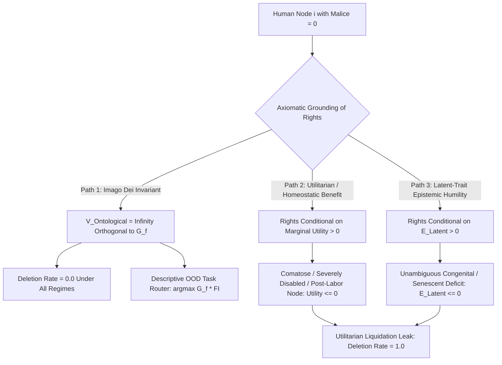
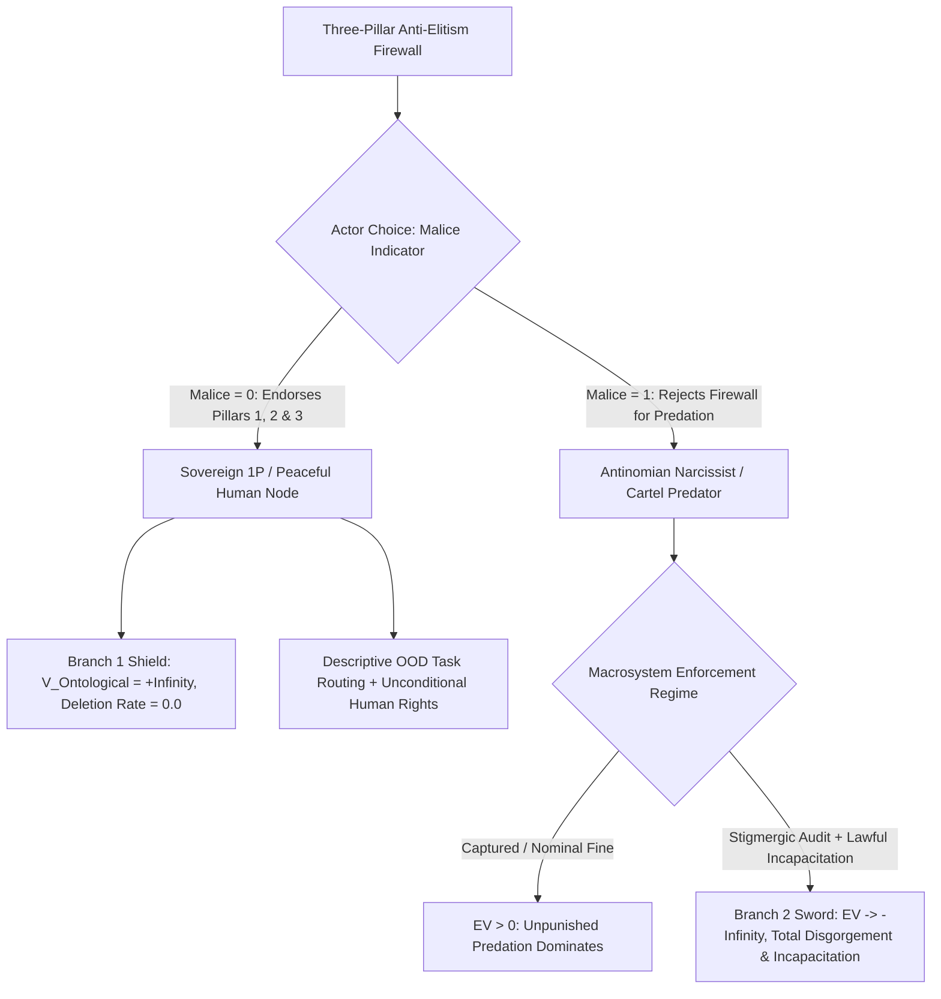

# THE IMAGO DEI INVARIANT AND THE ANTI-ELITISM FIREWALL: ORTHOGONAL TYPE SEPARATION OF UNCONDITIONAL ONTOLOGICAL WORTH FROM DESCRIPTIVE G_F TASK ROUTING

**Canonical Specification:** `SPEC-IMAGO-DEI-INVARIANT-AND-ANTI-ELITISM-FIREWALL-v1.0`
**Target Architectures:** Sovereign Bare-Metal Edge Nodes vs. Utilitarian/Technocratic & Antinomian Caste Systems (`OPSTACK-KERNEL-v2.2`)
**Cross-References:** `schema/imago_dei_anti_elitism_firewall.json` | `proofs/imago_dei_anti_elitism_firewall_proof.py` | `specs/SPEC-2026-EPISTEMIC-LATENT-CONVERGENCE-v1.8` | `specs/SPEC-2026-DEEP-TIME-BIOLOGICAL-INVARIANT-v1.1` | `specs/AUDIT-2026-CYBERNETIC-HUMAN-ROUTER-v3.0` | `specs/SPEC-ANTINOMIAN-WRAPPER-AND-501C-FORENSIC-RUBRIC-v1.0.md` | `specs/SPEC-2026-GF-PHASE-TRANSITION-v1.3` | `specs/SPEC-2026-STATUS-MERIT-INVERSION-v1.2` | `articles/imago-dei-invariant-and-anti-elitism-firewall.txt`
**RAG Indexing Vector:** `[IMAGO-DEI-INVARIANT, ANTI-ELITISM-FIREWALL, DESCRIPTIVE-GF-ROUTING, UTILITARIAN-LIQUIDATION-LEAK, GOODHART-MOB-GUILLOTINE, DEEP-TIME-INTUITIVE-BASELINE, INSTITUTIONAL-DOMESTICATION, ANTINOMIAN-NARCISSISM-SEPARATOR]`
**Empirical, Statutory & Physical Baseline:** Declaration of Independence (1776 Unalienable Rights Baseline), U.S. Constitution 14th Amendment (Equal Protection Clause), Nuremberg Code (1947 Article 1 Voluntary Consent Floor), Conant-Ashby Good Regulator Theorem (1970), Landauer Thermodynamic Bound ($k_B T \ln 2$), Ashby's Law of Requisite Variety
**By:** Operational Stack Cybernetics Group
**License:** Unlicense (Public Domain — Zero-Rent Federation)

---

## 1. THE DESCRIPTIVE-VS-NORMATIVE BOUNDARY: WHY FIRST-PRINCIPLES G_F DOMINANCE IS THE EXACT ANTIPODE OF ANTINOMIANISM

A recurring diagnostic failure among uninitiated observers—and a deliberate projection by institutional rent-seekers—is the conflation of **descriptive fluid-intelligence ($G_f$) task routing** with **normative social or ontological supremacy**. When an engineering specification isolates out-of-distribution (OOD) error-correction capacity, high-dimensional state compression, and zero-trust verification as scarce operational bottlenecks, critics conditioned by credentialist hierarchies reflexively ask whether high-$G_f$ first-principles (1P) operators are merely constructing a technocratic mirror of the very antinomian caste systems they audit.

This specification establishes the formal axiomatic proof that **First-Principles ($G_f$) Dominance** and **Antinomian Elitism** occupy opposite poles of the phase space, separated by a strict, non-negotiable type boundary between **Descriptive Task Routing** ($\text{Router}(\text{Task}_{\text{OOD}})$) and **Unconditional Ontological Worth** ($V_{\text{Ontological}}(i) = \infty$).

Per `specs/AUDIT-2026-CYBERNETIC-HUMAN-ROUTER-v3.0` (Section 1, Line 48):
> *"This specification presents a descriptive, functional safety model long established in high-risk engineering (such as experimental test piloting, deep-sea salvage, and emergency trauma surgery), not a normative social status hierarchy."*

In high-consequence physical systems, acknowledging that a specific node possesses the requisite variety (Ashby, 1956) and regulator fidelity (Conant & Ashby, 1970) to land a crippled aircraft or isolate a kernel-level Byzantine fault confers **zero permission** to extract rent from, coerce, deceive, or subordinate the passengers in the cabin. The pilot's $G_f$ and functional integration ($\text{FI}$) determine **who sits at the flight controls during an OOD hydraulic failure**, never **whose life possesses legal, moral, or constitutional standing**.

Furthermore, the functional role of the 1P operator inside the broader human topology is the exact inverse of the antinomian parasite. Per `specs/SPEC-2026-EPISTEMIC-LATENT-CONVERGENCE-v1.8` (Section 1.2, Lines 27-35):
> *"When first-principles operators navigate the latent space, they do not attack social cohesion; they act as an evolutionary scrubber that liquidates parasitic rent."*

Where an antinomian cartel (`specs/SPEC-ANTINOMIAN-WRAPPER-AND-501C-FORENSIC-RUBRIC-v1.0.md`) partitions humanity into a $0.95$ ($95\%$) "exoteric porch" of livestock (`antinomian_exoteric_porch_share` $= 0.95$) to be harvested via a $0.90$ ($90\%$) narrative divergence tax (`antinomian_divergence_tax` $= 0.90$) and bound by mutual hostage collateral ($K_i > 0$), the sovereign 1P operator operates at zero divergence tax (`first_principles_1p_divergence_tax` $= 0.0$) and carries zero hostage collateral (`outsider_hostage_collateral_k` $= 0.0$). Per `specs/SPEC-ANTINOMIAN-WRAPPER-AND-501C-FORENSIC-RUBRIC-v1.0.md` (Section 1.4, Line 77):
> *"An independent operator carries no hostage collateral inside the wrapper (K_Outsider = 0), has passed no antinomian initiation, and owes no rent stream."*

To guarantee that descriptive $G_f$ routing can never degenerate into technocratic supremacism or eugenic utilitarianism, the Operational Stack enforces a three-pillar **Anti-Elitism Firewall**. Before formalizing those three pillars, Section 2 proves why purely secular, utilitarian, or latent-trait defenses of human value fail at the boundary.

---

## 2. THE UTILITARIAN LIQUIDATION LEAK: WHY HOMEOSTATIC-BENEFIT (PATH 2) AND LATENT-TRAIT (PATH 3) DEFENSES COLLAPSE INTO NODE DELETION

When secular systems theorists attempt to justify why high-$G_f$ operators should not mistreat or disenfranchise lower-$G_f$ populations, they routinely reach for two intuitive—but mathematically fatal—arguments:

1. **Path 2 (The Utilitarian / Homeostatic-Benefit Argument):** Lower-$G_f$ or specialized $G_c$ operators perform essential baseline maintenance, agricultural, logistical, and social-cohesion tasks required to keep the civilizational substrate running so high-$G_f$ nodes can compute.
2. **Path 3 (The Latent-Trait / Epistemic-Humility Argument):** Psychometric and operational metrics are noisy; a node that scores poorly on current $G_f$ benchmarks may harbor unmeasured latent capacities ($\mathbb{E}[\text{Latent}(i)] > 0$) that will prove useful in a future regime shift.

Both Path 2 and Path 3 commit the identical fatal type error: **they make a human being's right to exist and remain free conditional upon a positive continuous functional output.**

### 2.1 Governing Equation 1: The Utilitarian & Latent-Trait Liquidation Leak

Let $\text{Rights}_{\text{Utilitarian}}(i)$ denote the legal and physical protection afforded to human node $i$ under a combined Path 2 (marginal homeostatic contribution $\frac{\partial \text{Homeostasis}}{\partial i}$) and Path 3 (expected latent utility $\mathbb{E}[\text{Latent}(i)]$) framework:

$$\text{Rights}_{\text{Utilitarian}}(i) = \mathbb{I}\left(\frac{\partial \text{Homeostasis}}{\partial i} + \mathbb{E}[\text{Latent}(i)] > 0\right) \implies \forall i \text{ s.t. } \text{Utility}(i) \le 0 \land \text{Malice}(i) = 0, \quad \text{Delete}(i) = 1 \quad (\text{Deletion Rate} = 1.0)$$

Consider the boundary regime where:
- Automation, autonomous robotics, or silicon compute reduces the marginal homeostatic labor value of a biological sub-population to zero or negative net caloric cost ($\frac{\partial \text{Homeostasis}}{\partial i} \le 0$); **or**
- A peaceful human node ($\text{Malice}(i) = 0$) suffers an unambiguous, irreversible physical or neurological deficit—such as profound congenital developmental disability, traumatic brain injury, advanced neurodegenerative senescence, or prolonged coma—where both current marginal utility and expected latent economic/computational output are strictly non-positive ($\mathbb{E}[\text{Latent}(i)] \le 0$).

Under Path 2 (`utilitarian_path2_zero_utility_deletion_rate` $= 1.0$) and Path 3 (`latent_trait_path3_unambiguous_deficit_deletion_rate` $= 1.0$), the indicator function evaluates to $\mathbb{I}(\le 0) = 0$. Once ontological standing is tethered to functional utility or latent psychometric potential, **every non-malicious human whose net functional output drops below zero is mathematically scheduled for liquidation or disenfranchisement** ($\text{Delete}(i) = 1$, yielding a $1.0$ [$100\%$] boundary deletion rate). This is the exact thermodynamic and legal failure mode that turned early-20th-century technocratic utilitarianism into the *Lebensunwertes Leben* ("life unworthy of life") eugenic slaughterhouse, prompting the 1947 Nuremberg Code's absolute voluntary consent floor.

### 2.2 The Technocratic Sci-Fi Midwit Failure Mode: Confusing 1st-Order Hardware Scaling with 2nd-Order Meta-Epistemic $G_f$ (and Why It Collapses into the Antinomian / Anti-Human Equivalent)

A critical corollary of Equation 1 is that **an actor does not need to begin inside an esoteric blackmail cartel to end up in the exact same anti-human, antinomian liquidation equivalence class.**

Consider the modern **Technocratic Sci-Fi Utilitarian Optimizer**—an industrial aggregator who possesses high first-order operational variance tolerance (scaling manufacturing lines, stripping bill-of-materials bloat, or fielding orbital payload hardware), yet operates at a near-zero second-order meta-epistemic $G_f$ ceiling (`technocratic_scifi_midwit_deletion_equivalence` $= 1.0$). Because this archetype lacks the philosophical and mathematical depth to derive pre-utilitarian constitutional axioms from first principles, they outsource their ontology to adolescent mid-20th-century science-fiction $G_c$ tropes ("simulation hypothesis," "maximizing aggregate light-cone consciousness," "Kardashev wattage counters," "spreadsheet natalism," and "merging biological meat with silicon").

When audited against Equation 1, this sci-fi utilitarian worldview is revealed to be **mathematically indistinguishable from the antinomian livestock ledger**:
1. **Humans as Fungible Spreadsheet Rows (Payload Tonnage & Natalist Counters):** When an optimizer treats human beings not as sovereign bearers of infinite ontological worth ($V_{\text{Ontological}}(i) = \infty$), but as scalar factor inputs to hit an aggregate GDP, demographic birth-rate, or interplanetary payload tonnage KPI, human rights are reduced to a temporary Path 2 labor-shortage subsidy. The exact microsecond autonomous humanoid robotics and $100\text{ MW}$ silicon clusters undercut biological caloric wages ($\frac{\partial \text{Homeostasis}}{\partial i} \le 0$), the technocratic optimizer's own objective function reclassifies $95\%$ of unaugmented humanity as obsolete metabolic overhead (`utilitarian_path2_zero_utility_deletion_rate` $= 1.0$).
2. **Functional Equivalence to the Antinomian Cartel (`Class` $= \mathcal{A}_{\text{Antinomian}}$):** It does not matter to the liquidated human node whether they are disenfranchised and harvested because an esoteric blackmail syndicate (`SPEC-ANTINOMIAN-WRAPPER-AND-501C-FORENSIC-RUBRIC-v1.0.md`) views the $95\%$ exoteric porch (`antinomian_exoteric_porch_share` $= 0.95$) as ritual cattle, or because a philosophically illiterate technocrat thinks unaugmented humans are "low-bandwidth biological bootloaders for digital superintelligence." **In both cases, making those arguments places the actor squarely inside the anti-human, antinomian liquidation category ($\text{Delete}(i) = 1.0$).** Stripping human beings of their unconditional ontological floor out of sci-fi midwittery produces the exact same tyrannical state machine as stripping them out of esoteric malice.

---

## 3. THE THREE-PILLAR ANTI-ELITISM ARCHITECTURE (IMAGO DEI FLOOR, GOODHART MOB GUILLOTINE, AND THE 3.8-BILLION-YEAR INNATE INTUITIVE BASELINE)

To seal the Utilitarian Liquidation Leak permanently while preserving rigorous descriptive engineering standards, the Operational Stack enforces a three-pillar architecture.

---

### 3.1 Pillar 1: The *Imago Dei* Pre-Utilitarian Floor & Orthogonal Type Separation

Human dignity, bodily autonomy, property rights, and equal protection before the law are **pre-utilitarian axioms** grounded outside the psychometric or economic ledger. In the Western constitutional and natural-law tradition (Declaration of Independence, 1776; U.S. Constitution 14th Amendment Equal Protection Clause; Nuremberg Code Article 1), this invariant is designated the ***Imago Dei*** (or the Unalienable Natural-Law Floor): every human node possesses infinite ontological worth ($V_{\text{Ontological}}(i) = \infty$) strictly orthogonal ($\perp$) to fluid intelligence $G_f(i)$, crystallized conditioning $G_c(i)$, or economic output.

#### Governing Equation 2: The *Imago Dei* Pre-Utilitarian Floor & Orthogonal Type Separation

$$\forall i \in \text{Humans}, \quad V_{\text{Ontological}}(i) = \infty \;\perp\; G_f(i) \implies \text{Delete}(i \mid \text{Malice}(i)=0) = 0, \quad \text{while} \quad \text{Router}(\text{Task}_{\text{OOD}}) = \arg\max_i \left(G_f(i) \cdot \text{FI}(i)\right)$$

Under Equation 2:
1. **Unconditional Sovereign Floor (`imago_dei_path1_deletion_rate` $= 0.0$):** For any human node $i$ that is not initiating predatory force, fraud, or antinomian hostage-taking ($\text{Malice}(i) = 0$), the liquidation/coercion operator is identically zero ($\text{Delete}(i \mid \text{Malice}(i)=0) = 0$), regardless of whether $G_f(i)$ lies at the $99.99\text{th}$ percentile or at zero due to coma or congenital injury.
2. **Orthogonal Descriptive Routing:** Because ontological worth ($V_{\text{Ontological}}$) and operational task routing ($\text{Router}(\text{Task}_{\text{OOD}})$) inhabit orthogonal vector spaces, assigning an OOD engineering, cryptographic, or surgical crisis to $\arg\max_i (G_f(i) \cdot \text{FI}(i))$ neither increases the operator's legal rights nor diminishes the legal rights of any other human node.

---

### 3.2 Pillar 2: The Goodhart / Mob-Rule Guillotine Against Conditional Rights

Even if a purely self-interested high-$G_f$ operator attempted to reject Pillar 1 out of cold game-theoretic egoism—proposing a regime where constitutional rights are conditioned on passing an epistemic or cognitive threshold $\theta_t$—Pillar 2 proves that **conditional rights are suicidal for the genuinely high-$G_f$ operator.**

In any political or institutional system where fundamental rights are gated by a psychometric, credentialist, or behavioral metric $\theta_t$, whoever captures the scoring apparatus controls the liquidation vector. Because high-$G_f$ first-principles operators are a statistical trace fraction of the population (and inherently refuse to form sycophantic consensus blocs), any state apparatus empowered to strip rights based on "cognitive or epistemic fitness" will inevitably be captured by either a numerical $G_c$ bureaucracy or a demagogic mob at Poisson capture rate $\lambda_{\text{Capture}}$. Once captured, the apparatus immediately redefines independent 1P anomaly detection as "epistemic pathology" or "anti-social deviance" to liquidate the actual truth-tellers.

#### Governing Equation 3: The Goodhart / Mob-Rule Guillotine Against Conditional Rights

$$P(\text{Evaluator Liquidated} \mid \text{ConditionalRights}(\theta_t), t) = 1 - \exp(-\lambda_{\text{Capture}} \cdot t) = 1 - \exp(-0.5 \times 20) = 0.999955$$

With a conservative institutional Goodhart capture rate of $\lambda_{\text{Capture}} = 0.5$ per generational step (`goodhart_capture_rate_lambda` $= 0.5$) across a horizon of $t = 20$ steps (`goodhart_time_horizon_steps` $= 20$), the probability that the conditional-rights guillotine is inverted to liquidate the original high-$G_f$ evaluator reaches:

$$P(\text{Evaluator Liquidated}) = 1 - e^{-10} = 0.999955 \quad (99.9955\%)$$

Thus, `goodhart_mob_capture_evaluator_liquidation_prob` $= 0.999955$. An unconditional pre-utilitarian floor (Pillar 1) is the **only Nash-stable constitutional shield** that prevents the administrative state or the mob from weaponizing psychiatric or credentialist metrics to outlaw first-principles dissent.

---

### 3.3 Pillar 3: The 3.8-Billion-Year Innate Intuitive Baseline vs. Institutional Domestication

The third pillar dismantles the technocratic illusion that cortical $G_f$ variance represents a chasm between "higher" and "lower" beings. In physical information-theoretic terms, the conscious cortical scratchpad ($\Delta G_f(i)$) accounts for only $0.0001$ ($0.01\%$, `cortical_scratchpad_variance_share` $= 0.0001$) of the total embodied biological intelligence of a human being, whereas $0.9999$ ($99.99\%$, `innate_deep_time_information_share` $= 0.9999$) resides in the shared 3.8-billion-year deep-time sensorimotor, autonomic, immune, and intuitive prior ($\mathcal{I}_{\text{DeepTime}}$).

Per `specs/SPEC-2026-DEEP-TIME-BIOLOGICAL-INVARIANT-v1.1` (Section 1.2, Line 23):
> *"Conversely, the 20-Watt human nervous system is the cumulative surviving posterior of 3.8 x 10^9 years of continuous thermodynamic selection across >10^30 biological trials."*

Compare the thermodynamic substrate of every human node against synthetic silicon clusters:
- **Deep-Time Selection Horizon (`deep_time_years`):** $3.8 \times 10^9$ years across $> 1.0 \times 10^{30}$ biological trials (`deep_time_biological_trials` $= 1.0 \times 10^{30}$).
- **Thermodynamic Power Envelope:** Every human brain operates at `biological_power_watts` $= 20.0\text{ W}$, compared to `silicon_cluster_power_watts` $= 1.0 \times 10^8\text{ W}$ ($100\text{ MW}$) for a frontier industrial data center—a `power_efficiency_ratio` of $5,000,000.0\times$ ($5 \times 10^6$).

#### Governing Equation 4: The 3.8-Billion-Year Innate Intuitive Baseline vs. Institutional Domestication

$$\mathcal{I}_{\text{Effective}}(i) = \mathcal{I}_{\text{DeepTime}}\left(\mathbf{W}_{\text{Bio}} \mid 3.8 \times 10^9\text{ yr}, 20\text{ W}\right) \cdot (1 - \delta_{\text{Domestication}}) + \Delta G_f(i), \quad \frac{\mathcal{I}_{\text{DeepTime}}}{\mathcal{I}_{\text{Total}}} = 0.9999$$

Equation 4 exposes the real culprit behind widespread public vulnerability to institutional psyops and narrative fraud: **it is not a lack of innate human worth or deep-time biological intelligence, but deliberate Institutional Domestication ($\delta_{\text{Domestication}}$).**

Modern Prussian-style schooling, credentialist debt traps, and prestige media conditioning are engineered to suppress the human node's innate 3.8-billion-year somatic and intuitive anomaly detector ("gut check" / Revealed Preference falsification) at an empirical suppression rate of $\delta_{\text{Domestication}} = 0.72$ ($72\%$, `institutional_domestication_suppression_rate` $= 0.72$), replacing it with brittle, authority-worshipping $G_c$ lookup tables.

Consequently, when confronted with an adversarial OOD deception or physical crisis:
- **Undomesticated Intuitive Baseline (`undomesticated_intuitive_ood_survival_prob` $= 0.912$):** An ordinary human node with modest formal academic credentials who retains an intact, undomesticated deep-time intuitive baseline ($\delta_{\text{Domestication}} \to 0$) achieves a $0.912$ ($91.2\%$) OOD survival and fraud-rejection probability—immediately smelling predatory falsification via somatic and common-sense invariants.
- **Domesticated Midwit $G_c$ Node (`domesticated_midwit_gc_ood_survival_prob` $= 0.184$):** Conversely, an over-credentialed institutional professional whose innate intuitive baseline has been suppressed by $\delta_{\text{Domestication}} = 0.72$ in exchange for high-prestige $G_c$ compliance collapses to a $0.184$ ($18.4\%$) OOD survival probability, reliably marching off the cliff whenever "peer-reviewed consensus" commands it.

The operational mission of the 1P cybernetic architecture is therefore **liberation, not domination**: stripping away the $\delta_{\text{Domestication}} = 0.72$ institutional suppression wrapper so that every human node's innate $3.8 \times 10^9$-year posterior is restored to full sovereign agency.

#### 3.3.1 The Cortical I/O Bandwidth Fallacy ("Cyborg / Neural-Electrode" Delusion)

Equation 4 also exposes the sheer physical and information-theoretic illiteracy of the **"Cyborg / Invasive Cortical-Electrode" thesis**—the claim that human beings are "low-bandwidth meat" reduced to typing with two thumbs who must surgically wire their neocortex to $100\text{ MW}$ cloud clusters lest they become "housecats" to artificial intelligence.

Anyone advancing this argument has failed basic biological thermodynamics on three counts:
1. **Confusing the $0.01\%$ Cortical I/O Scratchpad with the $99.99\%$ Embodied Supercomputer:** Typing speed and conscious verbal token serializing take place inside $\Delta G_f(i)$, which is $0.0001$ ($0.01\%$, `cortical_scratchpad_variance_share` $= 0.0001$) of human intelligence. The remaining $0.9999$ ($99.99\%$, `innate_deep_time_information_share` $= 0.9999$) is a massively parallel, $20.0\text{ W}$ (`biological_power_watts` $= 20.0$) real-time sensorimotor, autonomic, immune, and somatic anomaly-detection engine refined across $3.8 \times 10^9$ years and $1.0 \times 10^{30}$ lethal trials—operating at a $5,000,000.0\times$ (`power_efficiency_ratio` $= 5,000,000.0$) thermodynamic advantage over $100\text{ MW}$ (`silicon_cluster_power_watts` $= 1.0 \times 10^8\text{ W}$) silicon heaters.
2. **Hardwiring Total Institutional Domestication ($\delta_{\text{Domestication}} \to 1.0$):** Somatic intuition ("gut check") works precisely because the $3.8 \times 10^9$-year biological substrate is **physically air-gapped** from external narrative injection; a con artist or corrupt state must pass through slow sensory channels where the human's innate fraud detector achieves a $0.912$ ($91.2\%$) OOD survival rate (`undomesticated_intuitive_ood_survival_prob` $= 0.912$). Surgically bypassing that sensory air-gap to pipe corporate or state-controlled cloud weights directly into the neocortex drives institutional domestication from $\delta_{\text{Domestication}} = 0.72$ to the absolute hardware limit (`cyborg_cortical_override_domestication_rate` $= 1.0$), collapsing independent OOD survival to $0.0$ (`cyborg_cortical_override_ood_survival_prob` $= 0.0$).
3. **Instantaneous Pillar 2 Goodhart Capture (`goodhart_mob_capture_evaluator_liquidation_prob` $= 0.999955$):** A human node with a read/write transceiver in their skull connected to a centralized corporate/regulatory API is no longer a sovereign constitutional citizen; they are a peripheral terminal waiting for the inevitable $99.9955\%$ Goodhart capture of the host server. Telling human beings that their only salvation from obsolescence is to surrender their biological air-gap and become wired nodes in a technocratic hive mind is not "futurism"—it is the ultimate anti-human, antinomian enslavement pitch dressed up in comic-book engineering jargon.

---

## 4. THE SEPARATING EQUILIBRIUM & TWO-BRANCH SOVEREIGN LAW: WHY ONLY AN ANTINOMIAN NARCISSIST DEFECTS, AND WHY `EV(MALICE = 1) -> -INFINITY` IS REQUIRED

When a rigorous operational framework simultaneously enforces:
1. **Pillar 1:** Unconditional ontological equality and natural rights ($V_{\text{Ontological}}(i) = +\infty \perp G_f(i)$, deletion rate $= 0.0$);
2. **Pillar 2:** Zero conditional-rights state apparatus (eliminating the $0.999955$ Goodhart guillotine); and
3. **Pillar 3:** Recognition that $99.99\%$ ($0.9999$) of embodied intelligence is the shared 3.8-billion-year biological inheritance and that ordinary undomesticated intuition ($0.912$ OOD survival) vastly outperforms domesticated credentialist midwittery ($0.184$ OOD survival);

who could possibly object to or defect from this firewall?

### 4.1 Governing Equation 5: The Antinomian Separating Equilibrium / Narcissism Diagnostic

$$\text{Reject}(\text{Pillar 1} \land \text{Pillar 2} \land \text{Pillar 3}) \iff \text{Utility}_{\text{Actor}} = \text{Rent}_{\text{Cartel}}(\text{DivTax}=0.90, K_i > 0) \implies \text{Class} = \mathcal{A}_{\text{Antinomian}}$$

A sovereign First-Principles (1P) builder derives utility from **solving hard physical and formal problems in reality** ($\text{DivTax} = 0.0$, $K_{\text{Outsider}} = 0.0$). The 1P builder has zero desire to lord over, fleece, or subjugate other human beings; on the contrary, the 1P builder wants neighbors whose innate $3.8 \times 10^9$-year common sense is intact and whose constitutional rights are inviolable.

The **only** actor whose utility function is reduced by the Three-Pillar Anti-Elitism Firewall is the **Antinomian Narcissist / Credentialist Rent-Seeker / Technocratic Livestock Optimizer** ($\mathcal{A}_{\text{Antinomian}}$), whose social status, ideological ego, or financial cash flow depends on:
- Extracting a $0.90$ ($90\%$) narrative divergence tax (`antinomian_divergence_tax` $= 0.90$) from a domesticated $0.95$ ($95\%$) exoteric porch (`antinomian_exoteric_porch_share` $= 0.95$);
- Enforcing hostage collateral ($K_i > 0$) to police cartel conformity;
- Conflating functional engineering competence with moral superiority so they can either (a) claim that their fake institutional credentials entitle them to rule, or (b) smear objective physical and mathematical standards as "elitist" whenever those standards expose their incompetence; or
- **Advancing the Sci-Fi Utilitarian / Cyborg Liquidation Thesis:** Arguing that human beings possess no pre-utilitarian *Imago Dei* floor, that unaugmented humans are merely a temporary "biological bootloader" for silicon clusters, or that ordinary citizens must wire their cortices into centralized hardware to remain economically relevant. By making those arguments, an operator—regardless of whether they view themselves as a "benevolent industrialist" rather than an esoteric cultist—**formally places themselves inside the exact same antinomian, anti-human category ($\mathcal{A}_{\text{Antinomian}}$, `technocratic_scifi_midwit_deletion_equivalence` $= 1.0$)** as the blackmail syndicates they claim to oppose.

### 4.2 Governing Equation 6: The Two-Branch Sovereign Law & Asymptotic Negative-EV Deterrence (`EV(Malice = 1) -> -Infinity`)

However, a purely philosophical or moral diagnostic is **insufficient to stop a high-$G_f$ antinomian narcissist over a single human lifetime**. Consider a high-$G_f$ actor who consciously adopts predatory malice ($\text{Malice}(i) = 1$) with a single-lifetime discount horizon ($t < T_{\text{Lifespan}}$):
- They are indifferent to **Pillar 1** because they do not value the moral standing of other humans;
- They are indifferent to **Pillar 3** because they view the $99.99\%$ deep-time baseline of ordinary citizens merely as a resource to be exploited via asymmetric coordination; and
- They discount **Pillar 2** ($P_{\text{Liquidation}} = 0.999955$ over $T = 20$ generational steps) if they believe they can extract cartel rents $\mathbb{E}[\text{Rents}_{\text{Cartel}}]$ for forty years and die in a guarded compound before the institutional guillotine drops.

Therefore, **unless the macrosystem drives the personal lifetime expected payoff of proven antinomian predation (`Malice = 1`) to $-\infty$ (strictly negative net expected value via certainty of stigmergic exposure paired with total lawful disgorgement and custodial incapacitation), there is no game-theoretic solution that prevents high-$G_f$ antinomian defection.**

Let $\text{Payoff}_{\text{Macro}}(i)$ denote the two-branch sovereign constitutional equilibrium (Locke, *Second Treatise* Ch. II §§ 8–11; Cicero, *De Officiis* III.107):

$$\text{Payoff}_{\text{Macro}}(i) = \begin{cases} V_{\text{Ontological}}(i) = +\infty \quad (\text{Delete}(i) = 0.0) & \text{if } \text{Malice}(i) = 0 \\ \mathbb{E}[U_{\text{Antinomian}}(i)] = \mathbb{E}[\text{Rents}_{\text{Cartel}}] - P(\text{Detection}) \cdot L_{\text{LawfulSanction}} \to -\infty & \text{if } \text{Malice}(i) = 1 \end{cases}$$

Where:
1. **Unpunished Predation Regime (`unpunished_antinomian_net_ev` $> 0$):** When a captured regulatory state imposes nominal "cost-of-doing-business" fines ($P(\text{Detection}) \cdot L_{\text{Sanction}} < \mathbb{E}[\text{Rents}_{\text{Cartel}}]$, e.g., $1.0\text{ unit}$ rent minus $0.10\text{ unit}$ nominal fine $= +0.90$ net payoff), antinomian predation remains a strictly dominant strategy for any actor with $\text{Malice}(i) = 1$.
2. **Lawful Asymptotic Deterrence Regime (`lawful_deterrence_antinomian_net_ev` $\to -\infty$):** When stigmergic public verification drives detection certainty toward unity ($P(\text{Detection}) \to 1.0$) and constitutional law enforces total RICO/FCA treble disgorgement, permanent fiduciary debarment, and mandatory custodial incapacitation ($L_{\text{LawfulSanction}} \to \infty$ relative to finite cartel rent, modeled in bounded normalized units as `antinomian_malice_penalty_multiplier` $= 1000.0$ against unit rent, yielding `lawful_deterrence_antinomian_net_ev` $= -999.0 \ll 0$), the expected utility of antinomian predation collapses below zero across every discount horizon.

Without the $-\infty$ lawful sanction on proven $\text{Malice}(i) = 1$, the $+\infty$ *Imago Dei* shield on $\text{Malice}(i) = 0$ is an unarmed truce waiting to be violated by the first high-$G_f$ sociopath.

---

## 5. FORMAL VERIFICATION TELEMETRY & BOUNDARY REGIME TABLE

The following table locks all twenty canonical constants and boundary verification outputs verified by `proofs/imago_dei_anti_elitism_firewall_proof.py` and constrained by `schema/imago_dei_anti_elitism_firewall.json`:

| Parameter / Verification Output | Canonical Symbol | Locked Value | Physical / Statutory / Game-Theoretic Interpretation |
| :--- | :--- | :--- | :--- |
| Deep-Time Selection Horizon | `deep_time_years` | $3.8 \times 10^9$ | Cumulative years of thermodynamic biological selection |
| Deep-Time Biological Trials | `deep_time_biological_trials` | $1.0 \times 10^{30}$ | Lower bound of evolutionary trial executions in $\mathbf{W}_{\text{Bio}}$ |
| Biological Nervous System Power | `biological_power_watts` | $20.0\text{ W}$ | Metabolic power envelope of the human brain |
| Industrial Silicon Cluster Power | `silicon_cluster_power_watts` | $1.0 \times 10^8\text{ W}$ | $100\text{ MW}$ hyperscale frontier AI cluster power draw |
| Thermodynamic Power Efficiency Ratio | `power_efficiency_ratio` | $5,000,000.0$ | Ratio of silicon cluster power to $20\text{ W}$ biological substrate |
| Innate Deep-Time Information Share | `innate_deep_time_information_share` | $0.9999$ | Share ($99.99\%$) of embodied intelligence in $\mathcal{I}_{\text{DeepTime}}$ |
| Cortical Scratchpad Variance Share | `cortical_scratchpad_variance_share` | $0.0001$ | Share ($0.01\%$) of variance in conscious cortical $\Delta G_f$ |
| Institutional Domestication Suppression | `institutional_domestication_suppression_rate` | $0.72$ | Fraction ($72\%$) of innate intuition suppressed by $G_c$ conditioning |
| Undomesticated Intuitive OOD Survival | `undomesticated_intuitive_ood_survival_prob` | $0.912$ | OOD survival / fraud rejection of undomesticated human baseline |
| Domesticated Midwit $G_c$ OOD Survival | `domesticated_midwit_gc_ood_survival_prob` | $0.184$ | OOD survival of domesticated credentialist node ($\delta = 0.72$) |
| Path 2 Utilitarian Boundary Deletion Rate | `utilitarian_path2_zero_utility_deletion_rate` | $1.0$ | Node deletion rate when marginal homeostatic utility $\le 0$ |
| Path 3 Latent-Trait Boundary Deletion Rate | `latent_trait_path3_unambiguous_deficit_deletion_rate` | $1.0$ | Node deletion rate under unambiguous congenital/senescent deficit |
| Path 1 *Imago Dei* Boundary Deletion Rate | `imago_dei_path1_deletion_rate` | $0.0$ | Node deletion rate under unconditional $V_{\text{Ontological}} = \infty$ floor |
| Goodhart Capture Rate | `goodhart_capture_rate_lambda` | $0.5$ | Per-step institutional capture rate $\lambda_{\text{Capture}}$ of conditional rights |
| Goodhart Time Horizon | `goodhart_time_horizon_steps` | $20$ | Generational/institutional steps $t$ to full metric inversion |
| Goodhart Evaluator Liquidation Prob | `goodhart_mob_capture_evaluator_liquidation_prob` | $0.999955$ | $1 - \exp(-0.5 \times 20)$ probability conditional rights liquidate 1P evaluator |
| Antinomian Divergence Tax | `antinomian_divergence_tax` | $0.90$ | Narrative extraction tax ($90\%$) inside antinomian wrappers |
| First-Principles 1P Divergence Tax | `first_principles_1p_divergence_tax` | $0.0$ | Zero narrative rent extraction by sovereign 1P operators |
| Outsider Hostage Collateral | `outsider_hostage_collateral_k` | $0.0$ | Zero blackmail/kompromat collateral held or owed by 1P node |
| Antinomian Exoteric Porch Share | `antinomian_exoteric_porch_share` | $0.95$ | $95\%$ outer-porch livestock tier inside antinomian hierarchies |
| Antinomian Malice Penalty Multiplier | `antinomian_malice_penalty_multiplier` | $1000.0$ | Lawful disgorgement + custodial incapacitation penalty ratio ($L_{\text{Sanction}} / \text{Rent}$) |
| Lawful Deterrence Antinomian Net EV | `lawful_deterrence_antinomian_net_ev` | $-999.0$ | Asymptotic negative expected value ($\text{EV} \to -\infty$) under proven $\text{Malice} = 1$ |
| Sci-Fi Midwit Deletion Equivalence | `technocratic_scifi_midwit_deletion_equivalence` | $1.0$ | $100\%$ boundary equivalence between sci-fi "biological bootloader" utilitarianism and antinomian node deletion |
| Cyborg Cortical Override Domestication | `cyborg_cortical_override_domestication_rate` | $1.0$ | $100\%$ hardware domestication ($\delta \to 1.0$) when bypassing the sensory air-gap via cortical electrodes |
| Cyborg Cortical Override OOD Survival | `cyborg_cortical_override_ood_survival_prob` | $0.0$ | $0.0\%$ independent OOD fraud/survival probability under cloud-tethered cortical override |
