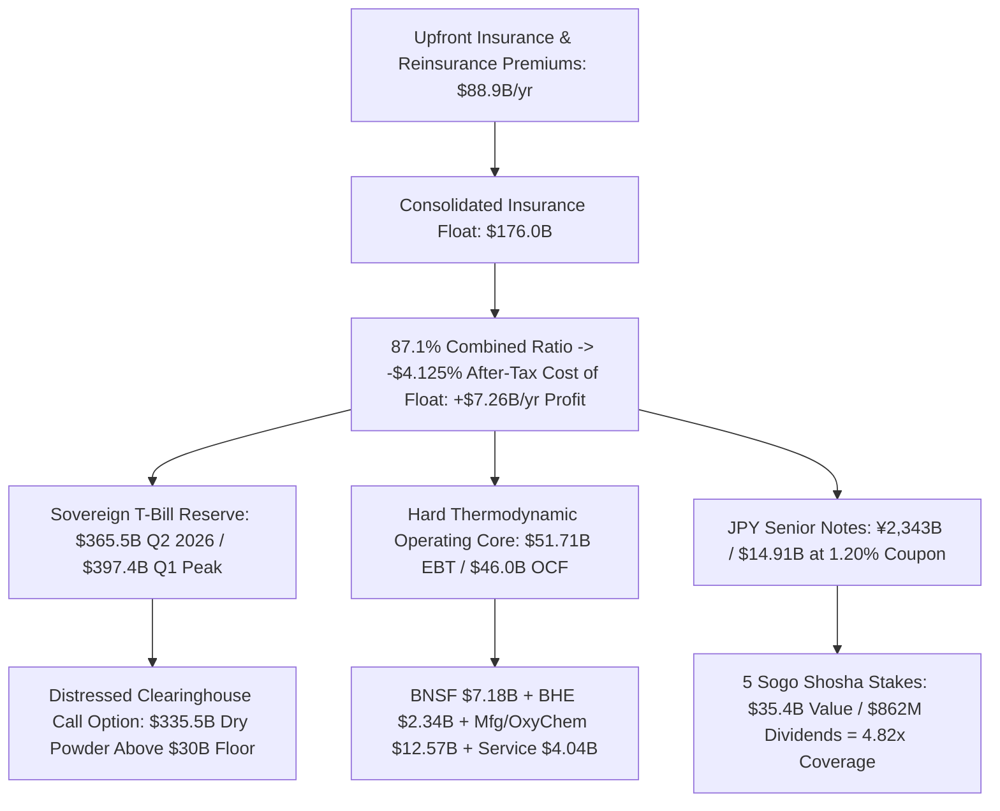

# SPEC-KERNEL-ALIGNED-CAPITAL-ALLOCATION-AND-FLOAT-CLEARINGHOUSE-v1.0: Negative-Cost Reinsurance Float, Thermodynamic Substrate Ownership, and the Constructive Inversion of Reflexive Command-Trading
**Canonical Specification:** `SPEC-KERNEL-ALIGNED-CAPITAL-ALLOCATION-AND-FLOAT-CLEARINGHOUSE-v1.0`
**Target Architectures:** Sovereign Holding-Company Capital Allocation (`Berkshire Hathaway Inc.`, `CIK 0001067983`), Negative-Cost Property-Casualty & Retroactive Reinsurance Float (`BHRG`, `General Re`, `TransRe`, `GEICO`), FX-Duration-Matched Physical Trade Carry (`Sogo Shosha` $\leftrightarrow$ `JPY Senior Notes`), Hard-Substrate Thermodynamic Infrastructures (`BNSF Railway`, `Berkshire Hathaway Energy`, `Clayton Homes`, `OxyChem`), and Distressed-Clearinghouse Liquidity Reserves (`U.S. Treasury Bills`)
**Cross-References:** `OPSTACK-KERNEL-v2.2`, `SPEC-THREE-SHELL-CUTOUT-AND-REFLEXIVE-FX-ARBITRAGE-v1.0`, `SPEC-NEOCLOUD-GPU-DEBT-AND-INFERENCE-DEFLATION-v1.0`, `SPEC-2026-SILICON-SPV-STRUCTURAL-ISOMORPHISM-v2.6`, `AUDIT-2026-CORPORATE-FIRM-STRUCTURAL-INFEASIBILITY.md`, `AUDIT-2026-ANTI-LUDDITE-BARE-METAL-INVARIANT.md`, `schema/kernel_aligned_capital_allocation_v1.0.json`, `proofs/verify_kernel_aligned_capital_allocation.py`
**RAG Indexing Vector:** `[KERNEL-ALIGNED-CAPITAL-ALLOCATION, BERKSHIRE-HATHAWAY-FLOAT-CLEARINGHOUSE, NEGATIVE-COST-REINSURANCE-FLOAT, SOGO-SHOSHA-JPY-CARRY-INVERSION, THERMODYNAMIC-SUBSTRATE-CONVEXITY, COMMAND-TRADING-INVERSION, STIGMERGIC-ZERO-C2-HOLDING-COMPANY, DISTRESSED-TBILL-CLEARINGHOUSE]`
**Empirical/Statutory/Physical Baseline:** Berkshire Hathaway Inc. (`CIK 0001067983`) SEC Form 10-K for FY2025 (`0001193125-26-083899`, R112, R136, R137, Note 19: `$176B` insurance float, `87.1%` combined ratio, `$9,460M` pre-tax / `$7,260M` after-tax underwriting profit, `$15,261M` pre-tax insurance investment income, `$51,714M` operating business EBT, `$46.0B` net operating cash flow, `¥2,343B` / `$14,914M` parent JPY senior notes at `1.20%` weighted-average coupon maturing `2026–2060` vs. `$35.4B` sogo shosha market value yielding `$862M` dividends or `5.60%` on `$15.4B` cost), SEC Form 10-Q for Q1 2026 (`0001193125-26-202243`: record `$397.4B` consolidated cash and U.S. Treasury Bills, including `$339,261M` in U.S. T-Bills and `$51,478M` in Insurance & Other cash), SEC Form 10-Q & Form 13F-HR for Q2 2026 (`$365.5B` consolidated cash/T-Bills, `$299.25B` U.S. 13F equity portfolio across 29 positions, `$19.8B` Q2 equity purchases vs. `$3.7B` sales, `$4.5B` Q2 + `$3.3B` July share repurchases at `~1.4x` P/B, `$9.7B` `OxyChem` acquisition, `$15.0M` CEO cash open-market share purchase)
**By:** Operational Stack Cybernetics Group
**License:** Unlicense (Public Domain — Zero-Rent Federation)

---

## 1. Epistemic Purpose: Constructive Market Alignment vs. Extractive Opacity

> **Position & Non-Solicitation Disclosure:** *The author holds a beneficial long equity position in Berkshire Hathaway Inc. (`NYSE: BRK.A` / `BRK.B`). This specification is published strictly as a public-domain mathematical, accounting, and physical-systems audit under the Unlicense and does not constitute investment advice, financial planning, or a solicitation to buy or sell any security.*

Forensic specifications within the Operational Stack corpus frequently falsify structurally insolvent or extractive architectures—ranging from off-balance-sheet GPU Special Purpose Vehicles (`SPEC-NEOCLOUD-GPU-DEBT-AND-INFERENCE-DEFLATION-v1.0` and `SPEC-2026-SILICON-SPV-STRUCTURAL-ISOMORPHISM-v2.6`) to offshore kompromat and macro-FX command-trading cutouts (`SPEC-THREE-SHELL-CUTOUT-AND-REFLEXIVE-FX-ARBITRAGE-v1.0`). However, a cybernetic market-clearing mechanism requires both a **negative falsification filter** (identifying rent-seeking wrappers and fraudulent accounting shells) and a **constructive attractor benchmark** (identifying capital allocators whose balance sheets, governance topologies, and physical assets natively satisfy `OPSTACK-KERNEL-v2.2`).

We formulate the **Kernel-Aligned Capital Allocation Theorem** using primary SEC EDGAR XBRL disclosures for **Berkshire Hathaway Inc. (`NYSE: BRK.A` / `BRK.B`, `CIK 0001067983`)** through mid-2026. This specification is strictly a mathematical, accounting, and physical-systems audit (with full public-domain verification code and zero investment-advisory solicitation) demonstrating how a sovereign-scale balance sheet achieves structural anti-fragility by inverting every parameter of both the **Three-Shell OTC FX Command-Trade** and the **Neocloud GPU Debt Trap**.

---

## 2. Mathematical Inversion of Reflexive Command-Trading (`SPEC-THREE-SHELL-CUTOUT` § 3.2)

### 2.1 The Extractive Command-Trading Identity vs. The Constructive Float-Clearinghouse Identity

In `SPEC-THREE-SHELL-CUTOUT-AND-REFLEXIVE-FX-ARBITRAGE-v1.0` (§ 3.2), an offshore opacity cutout (`26 U.S.C. § 934`) generates returns by pairing positive-cost prime-brokerage leverage with advance Material Non-Public Information (`MNPI`) or reflexively engineered policy shocks, backed by a Gambetta Hostage Collateral vault ($K_i > \Pi_{\text{Defect}}$):

$$\Pi_{\text{Command}} = L_{\text{OTC}} \cdot N_{\text{USVI\_FX}}(t_0) \cdot \Delta S_{\text{FX/Rates}}\Bigl(\text{Policy\_Shock}\bigl(t_1\bigr)\Bigr) - C_{\text{Carry}} - V_{\text{Rake}}$$

where:
- $C_{\text{Carry}} > 0$ is the positive margin/swap financing cost charged by Tier-1 private-bank FX desks;
- $\text{Policy\_Shock}(t_1)$ is a secret or engineered regulatory/macro distortion that widens the divergence between market price and physical reality; and
- $V_{\text{Rake}} \in [0.05, 0.10]$ is the extra-legal "House Rake" vigorish remitted via disguised advisory retainers.

A **Kernel-Aligned Capital Allocator** inverts the sign and information topology of every variable in this equation:

$$\Pi_{\text{Kernel}} = \underbrace{F_{\text{Float}} \cdot (1 - \text{CR})}_{-C_{\text{Carry}} > 0 \text{ (Negative-Cost Float)}} + \underbrace{T_{\text{Bills}} \cdot r_{\text{UST}}}_{\text{Sovereign Liquidity Yield}} + \underbrace{\sum_{m=1}^{M} \text{EBT}_m(\text{Watts, Ton-Miles, Atoms})}_{\text{Thermodynamic Substrate Cash Flow}} + \underbrace{\Bigl(D_{\text{Sogo}} - B_{\text{JPY}} \cdot c_{\text{JPY}}\Bigr)}_{\text{Public FX-Matched Physical Carry}} + \underbrace{\mathcal{O}_{\text{Clear}}\bigl(\Delta S_{\text{Crash}}\bigr)}_{\text{Clearinghouse Convexity}}$$

| Structural Parameter | Extractive Command-Trade (`SPEC-THREE-SHELL-CUTOUT`) | Neocloud GPU Debt SPV (`SPEC-NEOCLOUD-GPU-DEBT`) | Kernel-Aligned Clearinghouse (`BRK`, `CIK 0001067983`) |
| :--- | :--- | :--- | :--- |
| **Cost of Capital ($c_{\text{cap}}$)** | Positive prime-brokerage swap/margin rate ($c_{\text{cap}} > 0$) | **$9.0\%\text{--}14.0\%$** high-yield recourse/SPV debt (`14.34x` Liabilities/Equity) | **$-4.125\%$ after-tax** (`$176B` float at `87.1%` combined ratio; paid `$7.26B/yr` to hold capital) |
| **FX / Debt Structure** | Secret offshore `26 U.S.C. § 934` OTC FX swaps front-running macro shocks | Floating/short-term debt ($\tau_{\text{debt}} \approx 5\text{ yr} > \tau_{\text{contract}} \approx 3\text{ yr}$) | **`¥2,343B` (`$14.91B`)** parent senior notes at **`1.20%`** fixed coupon (`2026–2060`) funding **`$35.4B`** *sogo shosha* physical trade stakes |
| **Asset Depreciation ($\tau_{\text{econ}}$)** | Zero physical assets; relies on non-public kompromat collateral ($K_i$) | $\tau_{\text{econ}} \in [1.5, 2.5]\text{ yr}$ silicon obsolescence masked by $\tau_{\text{GAAP}} = 6.0\text{ yr}$ | Multi-decade regulated rights-of-way (`BNSF`, `BHE`), housing/chemical plants (`Clayton`, `OxyChem`) |
| **Headquarters C2 Overhead** | Compartmented Three-Shell revolving door (`Shell_1` $\leftrightarrow$ `Shell_2` $\leftrightarrow$ `Shell_3`) | High-SG&A enterprise sales & hyperscaler vendor lock-in | **~25–30 HQ personnel** coordinating ~400,000 employees across 800+ subsidiaries (`Axiom 6`) |
| **Market-Clearing Role** | Distorts prices away from physical reality via asymmetric MNPI | Amplifies CapEx bubble via circular vendor financing | Holds **`$365.5B–$397.4B`** in U.S. T-Bills to clear distressed assets when synthetic leverage collapses |

---

## 3. Formalizing the Four Kernel Invariants of Sovereign Capital Allocation

### 3.1 Invariant I: Negative-Cost Reinsurance Float vs. Recourse Debt Fragility

Let $F_{\text{Float}}$ denote consolidated property-casualty and retroactive reinsurance float (upfront premiums collected prior to claim disbursement), and let $\text{CR} = \frac{\text{Losses} + \text{Expenses}}{P_{\text{Earned}}}$ denote the consolidated statutory combined ratio. The effective after-tax cost of float capital $c_{\text{float}}$ is:

$$c_{\text{float}} = -\frac{P_{\text{Earned}} \cdot (1 - \text{CR}) \cdot (1 - \tau_{\text{tax}})}{F_{\text{Float}}} = -\frac{\Pi_{\text{Underwriting, After-Tax}}}{F_{\text{Float}}}$$

**Verbatim SEC Form 10-K Verification (`CIK 0001067983`, FY2025 R136 & MD&A):**
- Consolidated insurance float at December 31, 2025: **$F_{\text{Float}} \approx \$176,000\text{M}$** (up from $\$171,000\text{M}$ in FY2024 and $\$88,000\text{M}$ a decade prior).
- FY2025 Insurance Underwriting Revenues: **$\$88,902\text{M}$**; Pre-Tax Underwriting Earnings (`EBT`): **$\$9,460\text{M}$** (`GEICO`: $\$6,824\text{M}$; `Berkshire Hathaway Primary Group`: $\$785\text{M}$; `Berkshire Hathaway Reinsurance Group [BHRG]`: $\$1,851\text{M}$); Consolidated Combined Ratio: **$\text{CR} = 87.1\%$** (vs. 5-year average of $90.7\%$).
- FY2025 After-Tax Underwriting Profit: **$\Pi_{\text{Underwriting, After-Tax}} = \$7,260\text{M}$** ($\$7.3\text{B}$ in 2025, $\$9.0\text{B}$ in 2024, $\$5.4\text{B}$ in 2023).

Plugging in the FY2025 baseline yields an effective after-tax cost of float capital of:

$$c_{\text{float, 2025}} = -\frac{\$7,260\text{M}}{\$176,000\text{M}} = -4.125\% \text{ per annum} \quad (\text{Pre-Tax: } -5.375\%)$$

Contrast this directly with the Neocloud GPU debt structure proved in `SPEC-NEOCLOUD-GPU-DEBT-AND-INFERENCE-DEFLATION-v1.0` (§ 3.1), where a borrower carries $\$42.0\text{B}\text{--}\$42.4\text{B}$ in debt ($90.95\%$ recourse) at $c_{\text{debt}} \in [9.0\%, 14.0\%]$ against silicon depreciating over $\tau_{\text{econ}} \in [1.5, 2.5]\text{ years}$, producing a 1H26 free-cash-flow burn of $-\$10,454\text{M}$. The annual financing spread between Kernel-aligned float and Neocloud debt is:

$$\Delta c_{\text{Financing}} = c_{\text{debt, Neocloud}} - c_{\text{float, BRK}} \ge 9.0\% - (-4.125\%) = +1,312.5\text{ bps} \text{ to } +1,812.5\text{ bps}$$

### 3.2 Invariant II: Public FX-Duration-Matched Physical Trade Carry (`Sogo Shosha` $\leftrightarrow$ `JPY Senior Notes`)

Whereas `SPEC-THREE-SHELL-CUTOUT-AND-REFLEXIVE-FX-ARBITRAGE-v1.0` documented how an opacity network uses unhedged or policy-rigged offshore OTC FX credit lines to extract basis points from currency volatility, a Kernel-aligned allocator eliminates foreign-exchange spot variance ($\Delta S_{\text{FX}} \to 0$) by matching long-duration local-currency liabilities directly against cash-generative physical commodity and logistics equities in the same currency zone.

**Verbatim SEC Form 10-K Note 19 & R112 Verification (`CIK 0001067983`, FY2025 & H1 2026):**
1. **Liability Leg (Fixed-Rate JPY Senior Notes):** Per Form 10-K Schedule R112 (*"Notes payable and other borrowings — Detail"*), `Berkshire Hathaway Inc. (Parent) | Japanese Yen Denominated` borrowings totaled **$B_{\text{JPY}} = \$14,914\text{M}$** carrying value (**$\text{¥2,343 billion}$** par value at December 31, 2025, following $\text{¥451.6B} \approx \$3.0\text{B}$ issued in 2025 across `1.35%–3.12%` coupons due `2028–2055`, plus an additional **$\text{¥272.3 billion}$** issued in April 2026) at a **weighted-average interest rate of $c_{\text{JPY}} = 1.20\%$** and maturity horizon spanning **`2026–2060`**.
2. **Asset Leg (Five Japanese *Sogo Shosha* Stakes):** Berkshire holds $>10\%$ ownership stakes across Japan's five dominant physical trading houses—**`Mitsubishi Corp.` (`11.1%` as of April 30, 2026), `Mitsui & Co.`, `Itochu Corp.`, `Marubeni Corp.` (`9.8%` YE25), and `Sumitomo Corp.` (`10.3%` as of May 12, 2026)**—with an aggregate acquisition cost basis of **$C_{\text{Sogo}} = \$15,400\text{M}$** and a year-end 2025 market value of **$V_{\text{Sogo}} = \$35,400\text{M}$** (up from $\$23,500\text{M}$ at YE2024).
3. **Closed-Form Carry & Coverage Identities:** In FY2025, the five trading houses paid Berkshire **$D_{\text{Sogo}} = \$862\text{M}$** in cash dividends (**$y_{\text{cost}} = \frac{\$862\text{M}}{\$15,400\text{M}} = 5.597\%$** yield on cost), while the annual interest expense on the $\$14,914\text{M}$ Yen debt leg at $1.20\%$ is **$I_{\text{JPY}} = \$14,914\text{M} \times 0.0120 = \$178.97\text{M}$**:

$$\text{Spread}_{\text{Carry, Cost}} = y_{\text{cost}} - c_{\text{JPY}} = 5.597\% - 1.200\% = +4.397\% \text{ (+439.7 bps)}$$

$$\text{Coverage}_{\text{Div/Coupon}} = \frac{D_{\text{Sogo}}}{I_{\text{JPY}}} = \frac{\$862.0\text{M}}{\$178.97\text{M}} = 4.8165\times \ge 4.50\times$$

$$\text{Net Annual FX-Neutral Cash Carry} = D_{\text{Sogo}} - I_{\text{JPY}} = \$862.0\text{M} - \$178.97\text{M} = +\$683.03\text{M/yr}$$

 accompanied by **$\Delta V_{\text{Unrealized}} = \$35,400\text{M} - \$15,400\text{M} = +\$20,000\text{M}$** in capital appreciation—achieved via $100\%$ public SEC/EDGAR and Tokyo Stock Exchange statutory disclosures with zero offshore tax-haven cutouts.

### 3.3 Invariant III: Thermodynamic Floor Ownership (`KERNEL.md` Axioms 3 & 29)

Under `OPSTACK-KERNEL-v2.2` **Axiom 3 (Switching Cost Decay & Zero-Rent Invariant)** and **Axiom 29 (Hardware Amortization & Thermodynamic Pricing Floor Invariant)**:

$$\lim_{A_p \to 1.0} C_s(A_p) = 0 \implies \text{Margin}(\text{Software Wrapper}) \to \text{Thermodynamic Floor (Watts + Physical Atoms)}$$

As frontier and local open-weight model inference costs collapse toward the cost of electricity and silicon amortization, pure software intermediaries lose their Coasean transaction-cost moat. Conversely, enterprises that own **regulated kilowatt-hours, Class I freight ton-miles, petrochemical feedstocks, physical housing supply chains, and statutory catastrophe capacity** experience AI token deflation strictly as an **operating-expense reduction ($\Delta \text{OpEx} < 0$)** on top of non-replicable physical rights-of-way.

**Verbatim SEC Form 10-K R136 Verification (`CIK 0001067983`, FY2025 Segment Operating Earnings Before Taxes):**
- **Total Operating Businesses Revenue:** **$\$368,372\text{M}$**; **Total Operating Businesses EBT:** **$\$51,714\text{M}$**; **Consolidated Net Operating Cash Flows:** **$\$46,000\text{M}$**.
  1. **Insurance Investment Income (`U.S. Treasury Bills & Core Equities`):** **$\$15,261\text{M}$** EBT (`$15,310M` revenue).
  2. **Manufacturing (`Precision Castparts`, `Marmon`, `Lubrizol`, `IMC`, `Clayton Homes`, `Shaw`, `Johns Manville`, `Benjamin Moore`, `Acme Brick`):** **$\$12,571\text{M}$** EBT on **$\$78,487\text{M}$** revenue (expanded in January 2026 via the **$\$9,700\text{M}$** cash acquisition of **`OxyChem`**).
  3. **Insurance Underwriting (`GEICO`, `BHRG`, `BH Primary`):** **$\$9,460\text{M}$** EBT on **$\$88,902\text{M}$** revenue.
  4. **BNSF Railway (`32,500+ Route Miles of Class I Rail`):** **$\$7,175\text{M}$** EBT on **$\$23,533\text{M}$** revenue (up $+8.8\%$ after-tax in FY2025).
  5. **Service and Retailing (`NetJets`, `FlightSafety`, `CORT`, `Home furnishings`, `Auto dealerships`):** **$\$4,039\text{M}$** EBT on **$\$42,647\text{M}$** revenue.
  6. **Berkshire Hathaway Energy (`BHE` — `MidAmerican`, `PacifiCorp`, `NV Energy`, `Northern Powergrid`, `BHE Pipelines`, `HomeServices of America`):** **$\$2,342\text{M}$** EBT on **$\$26,297\text{M}$** revenue (up $+6.7\%$ after-tax in FY2025).
  7. **McLane & Pilot Travel Centers (`Physical Logistics & Highway Fuel Network`):** **$\$676\text{M}$** + **$\$190\text{M}$** = **$\$866\text{M}$** EBT on **$\$93,196\text{M}$** combined revenue.

Even within the **$299,253.56\text{M}$** U.S. Form 13F public equity portfolio (as of Q2 2026, filed August 14, 2026), capital is concentrated in network-effect hardware/OS ecosystems, payment rails, energy reserves, and credit ratings rather than high-SBC SaaS wrappers:
- **Top 10 U.S. 13F Stakes (`88.46%` of 13F Portfolio):** `Apple Inc.` (`AAPL`, $22.04\%$ / $\$65.95\text{B}$), `American Express` (`AXP`, $17.14\%$ / $\$51.28\text{B}$), `Alphabet Class A + Class C` (`GOOGL` $9.41\%$ / $\$28.16\text{B}$ + `GOOG` $3.21\%$ / $\$9.61\text{B}$ = **$12.62\%$ / $\$37.77\text{B}$** combined following Q2 2026 additions), `Coca-Cola` (`KO`, $10.86\%$ / $\$32.51\text{B}$), `Bank of America` (`BAC`, $9.20\%$ / $\$27.54\text{B}$), `Chevron` (`CVX`, $4.67\%$ / $\$13.99\text{B}$), `Occidental Petroleum` (`OXY`, $4.30\%$ / $\$12.87\text{B}$), `Chubb Ltd.` (`CB`, $3.90\%$ / $\$11.67\text{B}$), and `Moody's Corp.` (`MCO`, $3.73\%$ / $\$11.17\text{B}$).

### 3.4 Invariant IV: Stigmergic Zero-C2 Governance (`KERNEL.md` Axiom 6) & The Sovereign T-Bill Clearinghouse

In `AUDIT-2026-CORPORATE-FIRM-STRUCTURAL-INFEASIBILITY.md`, traditional corporate hierarchies fail because internal Coasean coordination overhead scales super-linearly with headcount ($C_{\text{Internal}}(N) \gg C_{\text{Federation}}(\text{Edge})$). Berkshire Hathaway resolves this paradox via **Stigmergic Zero-C2 Subsidiary Federation (`Axiom 6`)**:

$$\text{HQ\_Ratio}_{\text{BRK}} = \frac{N_{\text{Omaha\_HQ}}}{N_{\text{Total\_Employees}}} \approx \frac{28}{392,000} \approx 7.14 \times 10^{-5} \quad (0.0071\%)$$

1. **Zero Operational C2 Chat:** Subsidiary CEOs operate autonomously without centralized HR, procurement, or matrix-management committees; coordination with Omaha occurs strictly via **capital-allocation state commits** (remitting surplus free cash flow to the parent treasury or drawing CapEx when marginal ROIC exceeds the opportunity cost hurdle).
2. **Zero SBC Dilution & Cash Skin-in-the-Game:** Unlike technology conglomerates where executive Stock-Based Compensation (`SBC`) transfers $5\%\text{--}15\%$ of annual revenue from shareholders to insiders, Berkshire issues zero executive stock options or RSUs. Following the January 1, 2026 CEO transition, Chief Executive Greg Abel purchased **$\$15.0\text{M}$ of Berkshire shares in open-market cash** (equivalent to $100\%$ of his after-tax annual salary) and committed to repeat the purchase annually, while resuming corporate share buybacks (`$4.5B` in Q2 2026 + `$3.3B` in July 2026) only when price-to-book compressed to **`1.40x`** (below the `1.60x–1.80x` historical intrinsic-value ceiling).
3. **The `$365.5B–$397.4B` Sovereign Liquidity Call Option:** At March 31, 2026 (Q1 2026 Form 10-Q), consolidated liquidity reached an all-time record of **$\$397.4\text{B}$** (including **$\$339,261\text{M}$** in Short-Term U.S. Treasury Bills and **$\$51,478\text{M}$** in Insurance & Other cash, or **$\$390,739\text{M}$** in the Insurance & Other segment alone), and stood at **$\$365.5\text{B}$** at June 30, 2026 (Q2 2026 Form 10-Q) after deploying **$\$19.8\text{B}$** into Q2 equity purchases ($+\$16.1\text{B}$ net buying), **$\$4.5\text{B}$** into Q2 share repurchases, and **$\$9.7\text{B}$** for `OxyChem`. Subject to a permanent self-imposed catastrophe reserve floor of **$L_{\text{Floor}} = \$30.0\text{B}$**, this yields **$\$335.5\text{B}\text{--}\$367.4\text{B}$ in unencumbered dry powder**:

$$L_{\text{Deployable}}(t) = \bigl(\text{Cash}(t) + T_{\text{Bills}}(t)\bigr) - L_{\text{Floor}} = \$365.5\text{B} - \$30.0\text{B} = \$335.5\text{B}$$

### 3.5 Invariant V: Closed-Form Operating Stub Absolute Yield & The Internal Buyback Hurdle (`8.63%` Pre-Tax Yield / `+1,275.3 bps` Spread Over Float)

A common sell-side error is comparing a company's valuation multiple against an overvalued equity index (`S&P 500` or `Shiller CAPE`), which relies on the fallacy of relative valuation against a speculative bubble. Under `OPSTACK-KERNEL-v2.2`, valuation must be anchored strictly in **absolute cash-on-cash yield relative to the risk-free sovereign rate ($r_{\text{UST}} \approx 4.00\%$) and internal cost of capital ($c_{\text{float}} = -4.125\%$)**—which also governs when Omaha's treasury desk triggers open-market share repurchases (`$4.5B` in Q2 2026 + `$3.3B` in July 2026 at `1.40x` price-to-book).

Stripping out consolidated liquid reserves and public equity portfolios (net of parent company debt) from the consolidated market capitalization ($M_{\text{Cap}} \approx \$1,100,000\text{M}$) without double-counting the $\$15,261\text{M}$ of Insurance Investment Income generated by those liquid reserves:

1. **Gross Liquid Reserves & Public Equity Portfolio ($A_{\text{Liquid+Public}}$):**
   $$A_{\text{Liquid+Public}} = L_{\text{Q2\_2026}} + E_{\text{13F, Q2\_2026}} + V_{\text{Sogo, YE2025}} = \$365,500\text{M} + \$299,254\text{M} + \$35,400\text{M} = \$700,154\text{M}$$
   which represents **$\frac{\$700,154\text{M}}{\$1,100,000\text{M}} = 63.65\%$** of Berkshire Hathaway's entire market capitalization.

2. **Net Liquid & Public Investment Backing ($A_{\text{Net\_Backing}}$):**
   Subtracting total Parent Company `Notes payable and other borrowings` of **$B_{\text{Parent}} = \$22,662\text{M}$** (Form 10-K Schedule R112, which already includes the $\$14,914\text{M}$ Yen senior notes):
   $$A_{\text{Net\_Backing}} = A_{\text{Liquid+Public}} - B_{\text{Parent}} = \$700,154\text{M} - \$22,662\text{M} = \$677,492\text{M}$$

3. **Implied Enterprise Value of the Wholly Owned Operating Stub ($\text{EV}_{\text{Stub}}$):**
   $$\text{EV}_{\text{Stub}} = M_{\text{Cap}} - A_{\text{Net\_Backing}} = \$1,100,000\text{M} - \$677,492\text{M} = \$422,508\text{M}$$
   —a price tag below the physical replacement CapEx (`Axiom 29`) required to permit and construct 32,500+ route miles of Class I rail (`BNSF`), multi-state regulated electric grids (`BHE`), and North American petrochemical/industrial plants (`OxyChem`, `Precision Castparts`, `Lubrizol`, `Clayton Homes`).

4. **Pure Operating Stub Pre-Tax Earnings ($\text{EBT}_{\text{Stub}}$ — Zero Double-Counting):**
   Subtracting `Insurance – Investment Income` EBT ($\$15,261\text{M}$) from `Total Operating Businesses` EBT ($\$51,714\text{M}$, Form 10-K Schedule R136) isolates the pure operating earnings of `Insurance Underwriting` ($\$9,460\text{M}$), `Manufacturing` ($\$12,571\text{M}$), `BNSF` ($\$7,175\text{M}$), `Service and Retailing` ($\$4,039\text{M}$), `BHE` ($\$2,342\text{M}$), `McLane` ($\$676\text{M}$), and `Pilot` ($\$190\text{M}$):
   $$\text{EBT}_{\text{Stub}} = \$51,714\text{M} - \$15,261\text{M} = \$36,453\text{M} \quad (\text{After-Tax } \Pi_{\text{Stub, AT}} \approx \$28,797.87\text{M at } \tau_{\text{eff}} = 21\%)$$

5. **Absolute Operating Stub Yield & Internal Buyback Trigger Inequality:**
   $$y_{\text{Stub, Pre-Tax}} = \frac{\text{EBT}_{\text{Stub}}}{\text{EV}_{\text{Stub}}} = \frac{\$36,453\text{M}}{\$422,508\text{M}} = 8.6278\% \text{ per annum} \quad \bigl(y_{\text{Stub, After-Tax}} = 6.8159\%\bigr)$$
   - **Spread Over Risk-Free U.S. Treasury Hurdle ($r_{\text{UST}} = 4.00\%$):**
     $$\Delta y_{\text{UST}} = y_{\text{Stub, Pre-Tax}} - r_{\text{UST}} = 8.6278\% - 4.0000\% = +4.6278\% \text{ (+462.78 bps, or } 2.1569\times r_{\text{UST}}\text{)}$$
   - **Internal Spread Over Negative-Cost Float ($c_{\text{float}} = -4.125\%$):**
     $$\Delta y_{\text{Internal}} = y_{\text{Stub, Pre-Tax}} - c_{\text{float}} = 8.6278\% - (-4.1250\%) = +12.7528\% \text{ (+1,275.28 bps)}$$
   Because $y_{\text{Stub, After-Tax}} = 6.8159\% > r_{\text{UST}} = 4.00\%$ on inflation-indexed physical infrastructure, Berkshire's own treasury desk acts as the endogenous buyer of `BRK` shares (`$7.8B` repurchased across Q2–July 2026) without requiring any multiple expansion or capital rotation from overvalued equity indices.

---

## 4. Executable Verification Vectors (`proofs/verify_kernel_aligned_capital_allocation.py`)

The accompanying pure-stdlib verification engine `proofs/verify_kernel_aligned_capital_allocation.py` deterministically validates five closed-form accounting and game-theoretic inequalities against the FY2025 Form 10-K and Q1/Q2 2026 Form 10-Q baselines:
1. **Negative-Cost Float Dominance:** Verifies $c_{\text{float}} = -4.125\% < 0$ (`$7,260M` after-tax underwriting profit on `$176,000M` float) and proves a $\ge +1,300\text{ bps}$ financing advantage over Neocloud GPU debt ($c_{\text{debt}} \ge 9.0\%$).
2. **Sogo Shosha JPY Carry Coverage:** Verifies that `$862.0M` in FY2025 dividends on `$15,400M` cost (`5.597%` yield on cost) covers the `$178.97M` annual coupon on `$14,914M` (`1.20%` weighted-average rate) by **`4.8165x`** ($+\$683.03\text{M/yr}$ net carry + `$20,000M` unrealized gain).
3. **Segment Operating EBT & Cash-Flow Reconciliation:** Verifies that FY2025 segment EBT (`$9,460M + $15,261M + $7,175M + $2,342M + $12,571M + $4,039M + $190M + $676M`) sums exactly to **`$51,714M`** (`Operating Businesses EBT` in Form 10-K Schedule R136) vs. Neocloud 1H26 FCF burn of `-$10,454M`.
4. **Sovereign Clearinghouse Dry-Powder Bound:** Verifies Q1 2026 Insurance & Other liquidity (`$51,478M + $339,261M = $390,739M`, consolidated `$397.4B`) and Q2 2026 consolidated liquidity (`$365.5B`), proving **`$335.5B`** in deployable distressed-clearinghouse capacity above the `$30.0B` self-imposed catastrophe reserve floor.
5. **Absolute Operating Stub Yield & Endogenous Buyback Hurdle (`8.63%` Pre-Tax / `+1,275.3 bps` Spread Over Float):** Verifies that stripping out gross liquid/public assets (`$365,500M + $299,254M + $35,400M = $700,154M`, or `63.65%` of `$1,100,000M` market cap) net of parent debt (`$22,662M`) leaves an implied operating stub value of **`$422,508M`** against **`$36,453M`** of pure non-investment operating EBT (`$51,714M - $15,261M`), generating an **`8.6278%` pre-tax (`6.8159%` after-tax) inflation-indexed cash yield**—exceeding the `4.00%` risk-free U.S. Treasury hurdle by **`+462.78 bps` (`2.16x`)** and generating a **`+1,275.28 bps`** net spread over Berkshire's `-4.125%` cost of float.
