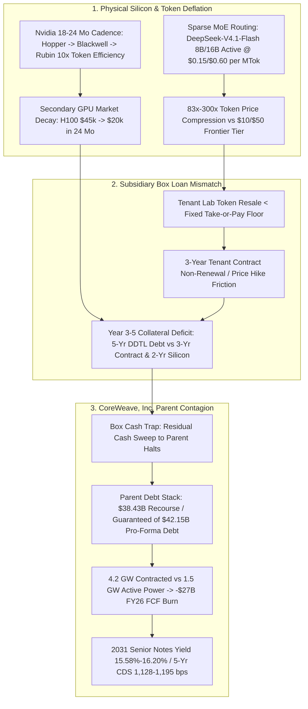

# SPEC-NEOCLOUD-GPU-DEBT-AND-INFERENCE-DEFLATION-v1.0: Neocloud Collateral Duration Mismatch, Recourse Box-Loan Contagion, and Sparse-MoE Inference Deflation

**Canonical Specification:** `SPEC-NEOCLOUD-GPU-DEBT-AND-INFERENCE-DEFLATION-v1.0`
**Target Architectures:** Leveraged Neocloud GPU Landlords (`CRWV`), Delayed-Draw Term Loan (`DDTL`) Box Subsidiaries, Unintegrated Frontier Pre-Training Labs, and Passive Equity Index Vehicles (`SPX` vs. `SPXT`)
**Cross-References:** `SPEC-2026-SILICON-SPV-STRUCTURAL-ISOMORPHISM-v2.6`, `AUDIT-2026-CENTRAL-COMPUTE-MODEL-DECAY`, `SPEC-2026-ATTRITION-SWARM-MOE-AND-EW-ZUGZWANG-v1.0`
**RAG Indexing Vector:** `[NEOCLOUD-CREDIT-CONTAGION, COREWEAVE-CRWV, DELAYED-DRAW-TERM-LOAN-DDTL, GPU-DEPRECIATION-MISMATCH, ASC-360-IMPAIRMENT, SPARSE-MOE-INFERENCE-DEFLATION, DEEPSEEK-V41-FLASH, ONEROUS-CONTRACT-CONVERSION, SPX-EX-TECHNOLOGY-SPXT]`
**Empirical/Statutory/Physical Baseline:** CoreWeave (`NASDAQ: CRWV`, `SEC CIK 0001769628`) Q2 2026 Form 10-Q (`0001769628-26-000366`) & Form 8-K Ex-99.1 (`0001769628-26-000362`) ($2,575M Q2 Revenue; $(49)M GAAP Operating Loss; $1,393M Q2 D&A; $640M Q2 Net Interest Expense / $592M Contractual Interest vs. $(626)M Net Loss; $1,510M / 58.6% Adj. EBITDA vs. $128M / 5.0% Adj. Operating Income; $31,405M Net / $31,832M Gross Recourse Debt vs. $3,663M Net / $3,719M Gross Non-Recourse Debt; $16,540M Recognized Lease PV + $50,200M Off-Balance-Sheet Uncommenced Leases; $72,046M Total Liabilities vs. $5,024M Stockholders' Equity; $(14,117)M 1H26 CapEx), Post-Q2 8-K Debt Stack (`0001769628-26-000357` $2.6B `DDTL 5.5` & `0001769628-26-000432` $4.2B `2033 Converts` -> $42.15B–$43.55B Pro-Forma Debt Principal; $38.43B / 91.18% Parent-Recourse vs. $3.72B / 8.82% Non-Recourse; $58.69B–$60.09B Debt + Recognized Leases; -$27B FY26 Est. FCF on $35B–$39B FY26 CapEx; 1.5 GW Active vs. 3.7–4.2 GW Contracted Power), Distressed Credit Tape (9.75% Senior Unsecured Notes due Oct 2031 at 78.65–80.60 cents / 15.58%–16.20% Yield; 5-Year CDS at 1,128–1,195 bps; Equity at $62.13 Close / $57.24 Low, down ~30% MoM and 55.1%–56.2% off $138.25–$141.79 High), Sparse-MoE Pricing (`DeepSeek-V4.1-Flash-1017` 552B MoE / 8B–16B Active at $0.15/$0.60 Off-Peak and $0.30/$1.20 Peak per MTok vs. $10/$50 Frontier Dense Tier), and CME/ProShares Index Telemetry (`SPX` 39.6% IT Weight vs. `SPXT` S&P 500 Ex-Information Technology Index)
**By:** Operational Stack Cybernetics Group
**License:** Unlicense (Public Domain)

---

## 1. Executive Summary

> **Position & Non-Solicitation Disclosure:** *The author holds beneficial long positions in Alphabet Inc. (`NASDAQ: GOOGL` / `GOOG`) and the ProShares S&P 500 Ex-Technology ETF (`NYSE Arca: SPXT`), and holds no position (long, short, or derivative) in CoreWeave, Inc. (`NASDAQ: CRWV`). This specification is published strictly as a public-domain mathematical, accounting, and physical-systems audit under the Unlicense and does not constitute investment advice, financial planning, or a solicitation to buy or sell any security.*

The leveraged neocloud business model operates on a three-way duration and cash-flow mismatch that is now breaking in public credit markets—with direct transmission into passive capitalization-weighted equity benchmarks (`SPX`, where Information Technology sector concentration has expanded from $6.7\%$ in 1990 to $39.6\%$, versus the S&P 500 Ex-Information Technology Index `SPXT`):

1. **Accounting vs. Physical Silicon Duration Mismatch ($\tau_{\text{GAAP}} \gg \tau_{\text{econ}}$):** Leveraged GPU landlords depreciate graphics processing units over a $\tau_{\text{GAAP}} = 6.0\text{ year}$ straight-line accounting schedule to manufacture positive adjusted operating income ($5.0\%$ adjusted operating margin against a $58.6\%$ adjusted EBITDA margin), whereas Nvidia's architectural release cadence (Hopper $\to$ Blackwell $\to$ Rubin, with Rubin delivering up to $10\times$ lower cost-per-token and $5\times$ inference throughput over Blackwell) compresses the competitive economic half-life of frontier training and inference silicon to $\tau_{\text{econ}} \in [1.5, 2.5]\text{ years}$.
2. **Debt Maturity vs. Customer Contract Tenor Mismatch ($\tau_{\text{debt}} > \tau_{\text{contract}}$):** Subsidiary "box loans" (such as Delayed-Draw Term Loan `DDTL 5.5`) carry maturities of $\tau_{\text{debt}} \approx 5.0\text{ years}$ secured against customer take-or-pay contracts averaging $\tau_{\text{contract}} \approx 3.0\text{ years}$. The debt principal outlives the contracted cash flow stream pledged to amortize it, leaving years 4 and 5 exposed to spot re-leasing rates on obsolete silicon that has already lost $50\%\text{--}60\%$ of its secondary market value (used H100 units falling from $\$40,000\text{--}\$50,000$ peak pricing to $\$18,000\text{--}\$22,000$).
3. **Parent Recourse Contagion Across the "Box" Capital Structure:** Although equity narratives frame subsidiary `DDTL` facilities as isolated, self-amortizing project-finance "boxes," Note 10 of CoreWeave's Q2 2026 Form 10-Q (`0001769628-26-000366`) proves that out of $\$35,551\text{M}$ in June 30 gross debt principal ($\$35,068\text{M}$ net carrying value, or $\$51,608\text{M}$ carrying / $\$52,091\text{M}$ principal including $\$16,540\text{M}$ of recognized GAAP lease liabilities), only **$\$3,719\text{M}$ gross / $\$3,663\text{M}$ net** ($10.46\%$ of Q2 principal)—comprising $\$2,837\text{M}$ under the Moody's `A3` / DBRS `A (low)` rated `DDTL 4.0` facility and $\$882\text{M}$ of non-recourse OEM/software financing—is non-recourse to `CoreWeave, Inc.` Pro forma for Q3 issuances (`$4,200M` of $2.875\%$ 2033 Convertible Notes per `8-K 0001769628-26-000432` and the `$2,600M` `DDTL 5.5` facility per `8-K 0001769628-26-000357` with an estimated $\$1,200\text{M}$ initial draw alongside a modeled $\$1,200\text{M}$ revolver draw, bringing pro-forma debt principal to $\$42,151\text{M}\text{--}\$43,551\text{M}$ and debt plus recognized leases to $\$58.69\text{B}\text{--}\$60.09\text{B}$), **$\$38,432\text{M}$ ($91.18\%$ of $\$42,151\text{M}$)** is recourse to the Parent, while only $\$3,719\text{M}$ ($8.82\%$) is non-recourse.
4. **Sparse-MoE Inference Deflation & Onerous Contract Conversion:** Simultaneously, high-sparsity Mixture-of-Experts (MoE) architectures—exemplified by `DeepSeek-V4.1-Flash-1017` ($552\text{B}$ total parameters with an asymmetric causal encoder-decoder activating $8\text{B}$ input and $16\text{B}$ output parameters)—price inference at $\$0.15/\$0.60\text{ per MTok}$ off-peak ($\$0.30/\$1.20$ peak), representing an $83\times$ to $300\times$ compression against frontier dense-model tiers ($\$10/\$50\text{ per MTok}$). Under `SPEC-2026-SILICON-SPV-STRUCTURAL-ISOMORPHISM-v2.6`, when market token resale prices collapse below the fixed take-or-pay compute lease floor, tenant AI labs suffer negative gross margins, transforming take-or-pay compute commitments into onerous contract liabilities and impairing the credit quality of the neocloud landlord's `$103.7B` backlog.

---

## 2. Empirical Baseline & Capital Structure Forensics

### 2.1 SEC Note 10 Facility-by-Facility Debt Waterfall (`crwv-20260630.htm` p. 26 & Q3 8-Ks)

Rather than relying on aggregated balance-sheet summaries, Table 2.1A reconstructs CoreWeave's complete facility-by-facility debt stack directly from **Note 10 (Debt, p. 26)** of the June 30, 2026 Form 10-Q (`0001769628-26-000366`) paired with the August 7, 2026 Form 8-K (`0001769628-26-000357`, `DDTL 5.5`) and September 22, 2026 Form 8-K (`0001769628-26-000432`, `2033 Convertible Senior Notes`):

| Facility (SEC Note 10 & Post-Q2 8-Ks) | Borrower / Agent | Maturity | Effective Rate / Coupon | Carrying / Principal 6/30/26 ($M) | 12/31/25 ($M) | Recourse & Guarantee Status |
| :--- | :--- | :--- | :--- | :--- | :--- | :--- |
| **`DDTL 1.0 Facility`** | `CCAC II, LLC` (Up to $\$2.3\text{B}$) | Mar 2028 | **$15\%$ eff.** | $\$1,300\text{M}$ | $\$1,553\text{M}$ | **Recourse** (Unconditionally guaranteed by Parent) |
| **`DDTL 2.0 Facility`** | `CCAC IV, LLC` (Up to $\$7.6\text{B}$) | Aug 2030 | **$11\%$ eff.** | $\$3,190\text{M}$ | $\$5,037\text{M}$ | **Recourse** (Unconditionally guaranteed by Parent) |
| **`DDTL 2.1 Facility`** | `CCAC IV, LLC` (Up to $\$3.0\text{B}$) | Mar 2031 | **$9\%$ eff.** | $\$3,000\text{M}$ | $\$2,741\text{M}$ | **Recourse** (Unconditionally guaranteed by Parent) |
| **`DDTL 3.0 Facility`** | `CCAC V & VII, LLC` (Up to $\$2.6\text{B}$) | Aug 2030 | **$9\%$ eff.** | $\$2,215\text{M}$ | $\$340\text{M}$ | **Recourse** (Unconditionally guaranteed by Parent) |
| **`DDTL 5.0 Facility`** | `CFD V, LLC` / Morgan Stanley ($\$3.1\text{B}$) | Nov 2031 | **$9\%$ eff.** ($\text{SOFR}+4.50\%$) | $\$1,101\text{M}$ | — | **Recourse** (Unconditionally guaranteed by Parent) |
| **`2030 Senior Notes`** | `CoreWeave, Inc.` (Senior Unsecured) | Jun 2030 | **$10\%$ eff.** | $\$2,000\text{M}$ | $\$2,000\text{M}$ | **Direct Parent Unsecured** |
| **`2031 9.00% Senior Notes`** | `CoreWeave, Inc.` (`9.00%` coupon) | Feb 2031 | **$10\%$ eff.** ($15.6\%$ YTM) | $\$1,750\text{M}$ | $\$1,750\text{M}$ | **Direct Parent Unsecured** ($79.9\text{c}$ on dollar) |
| **`2031 9.75% Senior Notes`** | `CoreWeave, Inc.` (`9.75%` coupon) | Oct 2031 | **$10\%$ eff.** ($15.58\%\text{--}16.2\%$ YTM) | $\$2,750\text{M}$ | — | **Direct Parent Unsecured** ($78.65\text{c}\text{--}80.6\text{c}$) |
| **`2032 9.625% Senior Notes`** | `CoreWeave, Inc.` (`9.625%` coupon) | Jul 2032 | **$10\%$ eff.** | $\$1,250\text{M}$ | — | **Direct Parent Unsecured** |
| **`2032 EUR Senior Notes`** | `CoreWeave, Inc.` (Cross-ccy swapped) | Jul 2032 | **$9\%$ eff.** | $\$2,279\text{M}$ | — | **Direct Parent Unsecured** |
| **`2031 Convertible Senior Notes`** | `CoreWeave, Inc.` (`1.75%` coupon) | Dec 2031 | **$2\%$ eff.** | $\$2,588\text{M}$ | $\$2,588\text{M}$ | **Direct Parent Convertible** |
| **`2032 Convertible Senior Notes`** | `CoreWeave, Inc.` (`1.75%`, $\$119.60$ strike) | Oct 2032 | **$2\%$ eff.** | $\$4,000\text{M}$ | — | **Direct Parent Convertible** ($\$492\text{M}$ capped call) |
| **`OEM & Software Financing (Recourse)`** | Vendor / OEM bilateral facilities | Dec 2026–Jul 2030 | **$11\%$ eff.** | $\$4,220\text{M}$ | $\$3,518\text{M}$ | **Recourse** (Direct / Parent guaranteed) |
| **`Magnetar Loan`** | `CoreWeave, Inc.` | Jan 2029 | **$12\%$ eff.** | $\$189\text{M}$ | $\$273\text{M}$ | **Recourse** |
| **`Revolving Credit Facility`** | `CoreWeave, Inc.` ($\$2.5\text{B}$ cap, $\$533\text{M}$ LCs) | Nov 2029 | **$7\%$ eff.** | $\$0\text{M}$ ($6/30$) | $\$1,000\text{M}$ | **Direct Parent Secured** ($\$1.2\text{B}$ drawn Aug 2026) |
| *Less: Unamortized discount (Recourse)* | — | — | — | $\$(427)\text{M}$ | $\$(242)\text{M}$ | — |
| **Total GAAP Recourse Debt, Net** | **June 30, 2026 Balance Sheet** | — | — | **$\$31,405\text{M}$** | **$\$20,726\text{M}$** | **$\$6,235\text{M}$ Current / $\$25,170\text{M}$ Non-Current** |
| **`DDTL 4.0 Facility` (Non-Recourse)** | `CCAC VIII, LLC` / MUFG ($\$8.5\text{B}$ cap) | Mar 2032 | **$7\%$ eff.** ($\text{SOFR}+2.25\%$) | $\$2,837\text{M}$ | — | **Non-Recourse** (Moody's `A3` / $3\text{-mo}$ cash reserve) |
| **`OEM & Software (Non-Recourse)`** | Subsidiary equipment arrangements | Aug 2026–Aug 2028 | **$9\%$ eff.** | $\$882\text{M}$ | $\$647\text{M}$ | **Non-Recourse** |
| *Less: Unamortized discount (Non-Rec.)* | — | — | — | $\$(56)\text{M}$ | — | — |
| **Total GAAP Non-Recourse Debt, Net** | **June 30, 2026 Balance Sheet** | — | — | **$\$3,663\text{M}$** | **$\$647\text{M}$** | **$\$1,278\text{M}$ Current / $\$2,385\text{M}$ Non-Current** |
| **Total June 30, 2026 Debt** | **Carrying Net / Gross Principal** | — | **$\$592\text{M}$ Q2 contr. int. ($6.66\%$)** | **$\$35,068\text{M}$ / $\$35,551\text{M}$** | **$\$21,373\text{M}$** | **$\$31,832\text{M}$ ($89.54\%$) Gross Recourse at Q2** |
| **Post-Q2: `DDTL 5.5 Facility` (`8-K`)** | `CF DDTL V-V, LLC` / JPMorgan ($\$2.6\text{B}$ cap) | Sep 2031 | **$\text{Term SOFR}+5.50\%$** | $+\$1,200\text{M}$ est. draw ($\le \$2.6\text{B}$ `8-K`) | — | **Recourse** (Unconditional Parent Guarantee; **$\text{DSCR}\ge 1.35\times$**) |
| **Post-Q2: `Revolver Draw` (Aug est.)** | `CoreWeave, Inc.` ($\$2.0\text{B}$ avail. at Q2) | Nov 2029 | **$7\%$ eff.** | $+\$1,200\text{M}$ est. draw | — | **Direct Parent Secured** |
| **Post-Q2: `2033 Converts` (`8-K`)** | `CoreWeave, Inc.` (`2.875%`, $\$97.85$ strike) | Apr 2033 | **$2.875\%$ coupon** | $+\$4,200\text{M}$ (`8-K` verified) | — | **Direct Parent Convertible** ($\$566.2\text{M}$ capped call) |
| **Pro-Forma Consolidated Debt** | **Post-Aug/Sep 2026 Draws** | — | **$\$2.37\text{B}$ Q2 run-rate ($\sim \$2.69\text{B}$ PF)** | **$\$42,151\text{M}\text{--}\$43,551\text{M}$** | — | **$\$38,432\text{M}$ ($91.18\%$) Recourse vs. $\$3,719\text{M}$ ($8.82\%$) Non-Rec.** |

### 2.2 SEC Note 10 Principal Maturity Schedule & Note 8 Lease Commitments (`crwv-20260630.htm` pp. 23, 27)

Contrary to equity commentary claiming CoreWeave faces no debt maturities until 2030, **Note 10 (p. 27)** and **Note 8 (p. 23)** reveal a massive near-term amortization cliff alongside a $\$50.2\text{B}$ off-balance-sheet lease overhang:

| Maturity / Commitment Year | Note 10 Debt Principal ($M) | Share of Q2 Debt Principal | Note 8 Recognized Operating Leases ($M) | Note 8 Recognized Finance Leases ($M) | Combined On-B/S Cash Debt + Lease Principal ($M) |
| :--- | :--- | :--- | :--- | :--- | :--- |
| **Remainder of 2026 (6 Mos.)** | $\$4,413\text{M}$ | $12.41\%$ | $\$1,028\text{M}$ | $\$12\text{M}$ | **$\$5,453\text{M}$** |
| **2027** | $\$6,184\text{M}$ | $17.39\%$ | $\$2,116\text{M}$ | $\$223\text{M}$ | **$\$8,523\text{M}$** |
| **2028** | $\$4,416\text{M}$ | $12.42\%$ | $\$2,306\text{M}$ | $\$0\text{M}$ | **$\$6,722\text{M}$** |
| **2029** | $\$2,421\text{M}$ | $6.81\%$ | $\$2,373\text{M}$ | $\$0\text{M}$ | **$\$4,794\text{M}$** |
| **2030** | $\$3,221\text{M}$ | $9.06\%$ | $\$2,289\text{M}$ | $\$0\text{M}$ | **$\$5,510\text{M}$** |
| **Thereafter (2031+)** | $\$14,896\text{M}$ | $41.90\%$ | $\$19,023\text{M}$ | $\$0\text{M}$ | **$\$33,919\text{M}$** |
| **Total Undiscounted** | **$\$35,551\text{M}$** (Pre-Q3 draws) | **$100.00\%$** | **$\$29,135\text{M}$** ($\$(12,816)\text{M}$ imp. int.) | **$\$235\text{M}$** ($\$(14)\text{M}$ imp. int.) | **$\$64,921\text{M}$** ($\$51,608\text{M}$ Carrying PV) |
| **Off-B/S: Executed Uncommenced Leases (Note 8, p. 23)** | — | — | **$\$35,500\text{M}$** (Commencing 2026–2029, 7–16 yr terms) | — | **$+\$35,500\text{M}$ Off-Balance-Sheet** |
| **Off-B/S: 393 MW Single-Site Lease Cap (Note 8, p. 23)** | — | — | **$\$14,700\text{M}$** (Phased 2026–2028, 16-yr max cap) | — | **$+\$14,700\text{M}$ Off-Balance-Sheet** |
| **Total Including Q3 Debt & Uncommenced Leases** | **$\$42,151\text{M}\text{--}\$43,551\text{M}$** | — | **$\$79,335\text{M}$ Undiscounted Operating** | **$\$235\text{M}$** | **$\$121,721\text{M}\text{--}\$123,121\text{M}$ ($\$121.72\text{B}\text{--}\$123.12\text{B}$)** |

### 2.3 Five Primary-Filing Forensic Discoveries (`10-Q` & `8-K` Verbatim Evidence)

1. **The 18-Month `$10.60B` Scheduled Amortization Drain vs. the 2030–2032 Bullet Wall (`Note 10`, p. 27):**
   - While CoreWeave's $\$10.0\text{B}$ of Senior Unsecured Notes and $\$10.8\text{B}$ of Convertible Notes are bullet maturities due in 2030–2033 (which is why credit commentators state that near-term 2026–2027 bond default risk was pre-funded by the September raise), the subsidiary `DDTL` box facilities (`DDTL 1.0` at $15\%$ effective rate, `DDTL 2.0` at $11\%$, `DDTL 2.1/3.0/5.0` at $9\%$) and `OEM` facilities ($11\%$ recourse / $9\%$ non-recourse) **amortize principal monthly**. Consequently, Note 10's schedule requires **$\$4,413\text{M}$ of principal repayments in H2 2026** and **$\$6,184\text{M}$ in 2027**—a cumulative **$\$10,597\text{M}$ ($29.81\%$ of June 30 debt principal) within 18 months**, and **$\$15,013\text{M}$ ($42.23\%$) within 30 months** (by December 31, 2028). Including recognized lease payments ($\$1,040\text{M}$ in H2 2026 and $\$2,339\text{M}$ in 2027), mandatory 18-month debt principal and lease outflows reach **$\$13,976\text{M}$ ($\$13.98\text{B}$)** before contractual interest ($\$592\text{M}$ in Q2 alone). Even when serviced out of box-level EBITDA and recent financing proceeds, this scheduled amortization traps operating cash flow inside the subsidiary boxes, leaving zero organic cash flow at the Parent to fund the $\$35\text{B}\text{--}\$39\text{B}$ FY26 CapEx buildout.
2. **The `$50.2B` Off-Balance-Sheet Uncommenced Lease Overhang (`Note 8`, p. 23):**
   - *Verbatim 10-Q (Note 8, p. 23):* `"As of June 30, 2026, the Company executed additional lease agreements, primarily for data centers, equipment, and office buildings, that had not yet commenced. The aggregate amount of estimated future undiscounted lease payments associated with such leases is $35.5 billion. These leases will commence between 2026 and 2029 with estimated lease terms of seven to sixteen years."`
   - *Single-Site `$14.7B` Exclusion (Note 8, p. 23):* Note 8 further discloses an excluded data center lease with **393 MW undelivered** (phased 2026–2028) where rent is tied to lessor construction costs `"subject to a contractual maximum of $14.7 billion over the sixteen year term"`, plus **355 MW undelivered** at other sites, $\$500\text{M}\text{--}\$1.2\text{B}$ in data center equipment procurement commitments, and $\sim \$1.8\text{B}$ in committed Equipment Lessor payments. Off-balance-sheet uncommenced leases ($\$35.5\text{B} + \$14.7\text{B} = \$50.2\text{B}$) represent a **$3.04\times$ step-up** over the $\$16,540\text{M}$ lease liability currently recognized on the balance sheet.
3. **`+325 bps` Box-Loan Spread Blowout & `1.35x DSCR` Covenant (`Form 8-K 0001769628-26-000357`, Aug 7, 2026):**
   - *Verbatim MD&A (p. 46):* `"All obligations under the DDTL Facilities, other than the DDTL 4.0 Facility, are unconditionally guaranteed by us."` While `DDTL 4.0` (`CCAC VIII, LLC`, MUFG agent, March 2026) priced at `SOFR + 2.25%` ($7\%$ effective rate) on a non-recourse basis (requiring a restricted cash reserve equal to 3 months of forward principal, interest, swap settlements, and OpEx), credit terms deteriorated rapidly across subsequent facilities:
     - `DDTL 5.0` (`CFD V, LLC`, Morgan Stanley agent, Q2 2026, $\$3.1\text{B}$): priced at **`SOFR + 4.50%`** (+225 bps wider) and required an **unconditional Parent guarantee**.
     - `DDTL 5.5` (`CoreWeave Financing DDTL V-V, LLC`, JPMorgan agent, August 7, 2026 `8-K`, $\$2.6\text{B}$): priced at **`Term SOFR + 5.50%`** (+325 bps wider than `DDTL 4.0`, or $\sim 10.0\%\text{--}10.5\%$ all-in floating), required an **unconditional Parent guarantee**, pledged $100\%$ of borrower equity and assets, and imposed a hard **Debt Service Coverage Ratio maintenance covenant of $\text{DSCR} \ge 1.35\times$** beginning the first full month after commitments are drawn or December 31, 2026.
4. **`$1,058.2M` Cash Incinerated on Out-of-the-Money Capped Calls (`Note 10`, p. 30 & `Form 8-K 0001769628-26-000432`, Sep 22, 2026):**
   - To mask equity dilution on its convertible debt, CoreWeave spent **$\$492.0\text{M}$** of cash in Q2 2026 purchasing capped calls on its $\$4.0\text{B}$ `1.75% 2032 Convertible Notes` (strike $\$119.60$, cap $\$230.00$) and another **$\$566.2\text{M}$** of cash in September 2026 purchasing capped calls on its $\$4.2\text{B}$ `2.875% 2033 Convertible Notes` (strike $\$97.85$, cap $\$199.70$). With `CRWV` shares closing at $\$62.13$ (after hitting a 52-week intraday low of $\$57.24$), those options sit $36.5\%\text{--}48.1\%$ out-of-the-money at close ($41.5\%\text{--}52.1\%$ at the $\$57.24$ low)—representing **$\$1,058.2\text{M}$ ($\$1.06\text{B}$) of cash permanently drained from liquidity** into expiring derivative premiums.
5. **The October 17, 2026 `35,000,000`-Share ATM Dilution Lockup Expiration (`Form 8-K 0001769628-26-000429`, Sep 17, 2026):**
   - Alongside the September convertible offering, CoreWeave executed an **Equity Distribution Agreement for up to `35,000,000 shares`** via collared forward and at-the-market sales, subject to a 30-day lockup covenant after the September 17 notes purchase agreement. That 30-day restriction expired on **October 17, 2026**—injecting a $35\text{M}$-share ($\sim \$2.17\text{B}$ at the $\$62.13$ close) equity supply overhang directly into the October credit and equity selloff.
6. **Note 5 Accounting Opacity (Missing GPU Useful-Life & Purchase-Commitment Schedules):**
   - In **Note 5 (Property and Equipment, p. 20)**, `Technology equipment` surged from $\$20,903\text{M}$ at year-end 2025 to **$\$33,823\text{M}$** at June 30, 2026, plus **$\$11,918\text{M}$ in `Construction in progress`** ($\$52,622\text{M}$ gross property and equipment, less $\$(5,886)\text{M}$ accumulated depreciation = $\$46,736\text{M}$ net). Notably, the Q2 2026 Form 10-Q omits any quantitative GPU useful-life table or aggregate GPU purchase commitment schedule in Note 5, disclosing only qualitative reliance on management's 6-year useful-life estimate.

---

## 3. Mathematical Formalization & Governing Inequalities

### 3.1 Primitive 1: GAAP Depreciation Distortion & True Economic EBIT Margin

Let $R$ denote quarterly revenue, $\text{EBITDA}_{\text{adj}}$ denote adjusted EBITDA before capital depreciation, and $K_{\text{GPU}}$ denote the gross depreciable GPU capital base. Under management's straight-line accounting life $\tau_{\text{GAAP}} = 6.0\text{ years}$, the reported depreciation charge fraction of revenue is:

$$d_{\text{GAAP}} = \frac{D_{\text{GAAP}}}{R} = m_{\text{EBITDA}} - m_{\text{EBIT,GAAP}}$$

Substituting CoreWeave's Q2 empirical margins ($m_{\text{EBITDA}} = 0.586$, $m_{\text{EBIT,GAAP}} = 0.050$):

$$d_{\text{GAAP}} = 0.586 - 0.050 = 0.536 \quad (53.6\% \text{ of revenue})$$

When the accounting depreciation life $\tau_{\text{GAAP}}$ is replaced by the true economic replacement life $\tau_{\text{econ}} \in [2.5, 4.0]\text{ years}$ imposed by an 18–24 month silicon cadence, the true economic depreciation charge scales by the duration ratio $\frac{\tau_{\text{GAAP}}}{\tau_{\text{econ}}}$, yielding the **True Economic Operating Margin** ($m_{\text{EBIT,econ}}$):

$$m_{\text{EBIT,econ}}(\tau_{\text{econ}}) = m_{\text{EBITDA}} - d_{\text{GAAP}} \left(\frac{\tau_{\text{GAAP}}}{\tau_{\text{econ}}}\right)$$

**Solvency Boundary (Operating Breakeven $\tau_{\text{crit}}$):** Operating margin before interest turns strictly negative whenever $\tau_{\text{econ}}$ falls below the critical depreciation horizon:

$$\tau_{\text{crit}} = \tau_{\text{GAAP}} \left(\frac{d_{\text{GAAP}}}{m_{\text{EBITDA}}}\right) = 6.0 \times \left(\frac{0.536}{0.586}\right) = 5.488\text{ years}$$

- **Compliant / Solvent Regime ($\tau_{\text{econ}} = 6.0\text{ yr}$):** $m_{\text{EBIT,econ}}(6.0) = 0.586 - 0.536(1.0) = +5.00\%$.
- **Moderate Obsolescence Regime ($\tau_{\text{econ}} = 4.0\text{ yr}$):** $m_{\text{EBIT,econ}}(4.0) = 0.586 - 0.536(1.5) = -21.80\%$.
- **Physical Cadence Regime ($\tau_{\text{econ}} = 3.0\text{ yr}$):** $m_{\text{EBIT,econ}}(3.0) = 0.586 - 0.536(2.0) = -48.60\%$.

Because $5.488\text{ years}$ exceeds both the average newer customer contract tenor ($\tau_{\text{contract}} \approx 3.0\text{ years}$) and the physical Hopper-to-Blackwell-to-Rubin cycle ($\sim 1.5\text{--}2.5\text{ years}$), GAAP operating profitability is entirely an artifact of deferring capital consumption beyond the revenue contract window.

### 3.2 Primitive 2: Box-Loan Collateral Coverage & Tail Refinancing Deficit

Consider a subsidiary box loan (modeled on `DDTL 5.5`) with loan-to-cost ratio $\alpha_{\text{LTC}} \in (0, 1]$, debt maturity $\tau_{\text{debt}} = 5.0\text{ years}$, customer contract tenor $\tau_{\text{contract}} = 3.0\text{ years}$, and exponential hardware resale decay rate $\lambda_{\text{GPU}}$ calibrated to observed H100 secondary market prices ($V(0) = \$45,000 \to V(2) = \$20,000 \implies \lambda_{\text{GPU}} = \frac{1}{2}\ln(45/20) \approx 0.4055\text{ yr}^{-1}$).

At contract expiration $t = \tau_{\text{contract}}$, the unamortized principal fraction on a 5-year straight-line amortizing facility is:

$$P_{\text{rem}}(\tau_{\text{contract}}) = \alpha_{\text{LTC}} K_0 \left(1 - \frac{\tau_{\text{contract}}}{\tau_{\text{debt}}}\right)$$

while the secondary-market liquidation value of the GPU collateral is:

$$V_{\text{GPU}}(\tau_{\text{contract}}) = K_0 e^{-\lambda_{\text{GPU}} \tau_{\text{contract}}}$$

The **Box Collateral Coverage Ratio at Contract Rollover** ($\text{CCR}_{\text{roll}}$) is:

$$\text{CCR}_{\text{roll}} = \frac{V_{\text{GPU}}(\tau_{\text{contract}})}{P_{\text{rem}}(\tau_{\text{contract}})} = \frac{e^{-\lambda_{\text{GPU}} \tau_{\text{contract}}}}{\alpha_{\text{LTC}} \left(1 - \frac{\tau_{\text{contract}}}{\tau_{\text{debt}}}\right)}$$

For a standard $\alpha_{\text{LTC}} = 0.80$ box loan at $\tau_{\text{contract}} = 3.0\text{ years}$ and $\tau_{\text{debt}} = 5.0\text{ years}$:
- Remaining debt fraction: $0.80 \times (1 - 3/5) = 0.320$ ($32.0\%$ of initial hardware cost $K_0$).
- Remaining GPU liquidation value fraction: $e^{-0.4055 \times 3} = (20/45)^{1.5} = 0.2963$ ($29.63\%$ of $K_0$).
- **Resulting Coverage Ratio:** $\text{CCR}_{\text{roll}} = \frac{0.2963}{0.3200} = 0.9259 < 1.0$.

Because $\text{CCR}_{\text{roll}} < 1.0$ and $91.18\%$ ($\$38,432\text{M} / \$42,151\text{M}$ pro-forma principal, or $89.54\%$ at June 30) of the consolidated debt stack carries parent recourse, the uncollateralized tail deficit $\Delta L_{\text{box}} = P_{\text{rem}}(\tau_{\text{contract}}) - V_{\text{GPU}}(\tau_{\text{contract}})$ pierces the subsidiary box and crystallizes on `CoreWeave, Inc.` at the parent level. Attempting to offset this decay by raising compute prices on existing/rolling customers (CoreWeave hiked compute prices by $+25\%$ in July 2026 and $+10\%$ in October 2026, a cumulative $1.25 \times 1.10 - 1 = +37.5\%$ increase) accelerates customer defection to hyperscale or sparse-MoE alternatives.

### 3.3 Primitive 3: CDS-Implied Default Hazard & 2030–2033 Refinancing Wall

Let $S_{\text{CDS}}$ denote the 5-year credit default swap spread (in decimal per annum) and $R_{\text{rec}} \in [0, 1)$ denote the expected unsecured recovery rate in restructuring. Under the standard reduced-form credit model, the market-implied constant annual default hazard rate $h$ and cumulative $T$-year default probability $\mathbb{P}_{\text{def}}(T)$ are:

$$h = \frac{S_{\text{CDS}}}{1 - R_{\text{rec}}}, \qquad \mathbb{P}_{\text{def}}(T) = 1 - e^{-h T}$$

Evaluating at $T = 5\text{ years}$ across the October 15–20, 2026 CDS tape ($S_{\text{CDS}} \in [0.1128, 0.1195]$) with standard unsecured subordinated recovery $R_{\text{rec}} = 0.40$ (given $\$18,727\text{M}$ of Q2 senior DDTL, OEM, and Magnetar claims sitting ahead of unsecured notes):
- **At $S_{\text{CDS}} = 1,128\text{ bps}$ ($0.1128$):** $h = \frac{0.1128}{0.60} = 0.1880\text{ yr}^{-1} \implies \mathbb{P}_{\text{def}}(5) = 1 - e^{-0.9400} = 60.94\%$.
- **At $S_{\text{CDS}} = 1,195\text{ bps}$ ($0.1195$):** $h = \frac{0.1195}{0.60} = 0.1992\text{ yr}^{-1} \implies \mathbb{P}_{\text{def}}(5) = 1 - e^{-0.9958} = 63.06\%$.

Per Note 10 (p. 27), CoreWeave's Q2 contractual cash interest was $\$592\text{M}$ ($\$2,368\text{M}/\text{yr}$ annualized on $\$35,551\text{M}$ principal, or $r_{\text{old}} = \frac{2,368}{35,551} = 6.6609\%$), while its verified `2030+` principal maturity bucket comprises $D_{\text{wall}} = \$3,221\text{M}\text{ (2030)} + \$14,896\text{M}\text{ (2031+)} + \$4,200\text{M}\text{ (Sept 2033 Converts)} = \$22,317\text{M}$ ($\$22.317\text{B}$, of which $\$20,817\text{M}$ sits in 2030–2033 Senior Unsecured and Convertible bullet notes). Refinancing that $\$22.317\text{B}$ 2030–2033 principal wall from $r_{\text{old}} = 6.6609\%$ to the prevailing unsecured market yield $r_{\text{new}} = 15.58\%$ increases annual cash interest expense by:

$$\Delta I_{\text{wall}} = D_{\text{wall}} (r_{\text{new}} - r_{\text{old}}) = \$22.317\text{B} \times (0.1558 - 0.066609) = +\$1.990\text{B}/\text{yr}$$

Even before 2030, Note 10's **18-Month Amortization Schedule** requires $A_{18\text{m}} = \$4,413\text{M} + \$6,184\text{M} = \$10,597\text{M}$ ($29.81\%$ of June 30 principal) of mandatory debt principal repayments plus $L_{18\text{m}} = \$1,040\text{M} + \$2,339\text{M} = \$3,379\text{M}$ of recognized lease obligations (**$\$13,976\text{M}$ combined**) by December 31, 2027, while `DDTL 5.5` (`Term SOFR + 5.50%`, $\approx 10.0\%$ all-in rate, 5-year amortization $= 20\%/\text{yr}$ principal paydown $\implies \sim 30.0\%$ annual debt service constant $k_{\text{DS}}$) imposes a hard maintenance covenant of $\text{DSCR} \ge 1.35\times$, requiring box-level net operating cash flow after power and rent to exceed $1.35 \times k_{\text{DS}} \approx 40.5\%$ of initial loan principal every month starting January 2027.

### 3.4 Primitive 4: Sparse-MoE Inference Deflation & Onerous Take-or-Pay Conversion

Let $p_{\text{dense}} = (p_{\text{in,dense}}, p_{\text{out,dense}})$ denote the frontier dense-model API price vector and $p_{\text{MoE}} = (p_{\text{in,MoE}}, p_{\text{out,MoE}})$ denote the sparse-MoE commodity floor established by `DeepSeek-V4.1-Flash-1017` ($552\text{B}$ total parameters, $8\text{B}$ active input / $16\text{B}$ active output parameters). For a standard production workload with output-to-input token ratio $\rho = \frac{N_{\text{out}}}{N_{\text{in}}}$, the blended price per million total tokens is:

$$\bar{P}(\rho) = \frac{p_{\text{in}} + \rho \, p_{\text{out}}}{1 + \rho}$$

Evaluating at a standard agentic/coding ratio $\rho = 0.50$ ($2:1$ input-to-output):
- **Frontier Max-Capability Dense Tier ($\$10.00 / \$50.00\text{ per MTok}$):** $\bar{P}_{\text{dense,max}} = \frac{10.00 + 0.5(50.00)}{1.5} = \$23.333\text{ per MTok}$.
- **Frontier Mid-Tier Dense (`Sonnet 5.5` / `GPT-6 Sol` at $\$2.00 / \$10.00\text{ per MTok}$):** $\bar{P}_{\text{dense,mid}} = \frac{2.00 + 0.5(10.00)}{1.5} = \$4.667\text{ per MTok}$.
- **Sparse-MoE Peak (`DeepSeek-V4.1-Flash-1017` at $\$0.30 / \$1.20\text{ per MTok}$):** $\bar{P}_{\text{MoE,peak}} = \frac{0.30 + 0.5(1.20)}{1.5} = \$0.600\text{ per MTok}$.
- **Sparse-MoE Off-Peak (`DeepSeek-V4.1-Flash-1017` at $\$0.15 / \$0.60\text{ per MTok}$):** $\bar{P}_{\text{MoE,off}} = \frac{0.15 + 0.5(0.60)}{1.5} = \$0.300\text{ per MTok}$.

The **Bertrand Deflation Compression Factor** ($\Phi_{\text{deflation}}$) is:

$$\Phi_{\text{deflation}} = \frac{\bar{P}_{\text{dense,max}}}{\bar{P}_{\text{MoE,off}}} = \frac{23.333}{0.300} = 77.78\times \quad \left(\text{and } \frac{p_{\text{out,dense}}}{p_{\text{in,MoE,off}}} = \frac{50.00}{0.15} = 333.3\times\text{ spread}\right)$$

Simultaneously, when next-generation silicon (Nvidia Rubin) lowers physical cost-per-token by $\eta_{\text{gen}} = 10\times$ ($5\times$ inference throughput), a tenant AI lab bound to a fixed dollar take-or-pay contract $C_{\text{ToP}}$ on legacy Hopper/Blackwell clusters experiences an immediate **Onerous Contract Deficit** (`SPEC-2026-SILICON-SPV-STRUCTURAL-ISOMORPHISM-v2.6`) whenever:

$$\bar{P}_{\text{MoE}} \cdot Q_{\text{tokens}} < C_{\text{ToP}} \implies \text{Gross Margin}_{\text{Tenant}} = \bar{P}_{\text{MoE}} \cdot Q_{\text{tokens}} - C_{\text{ToP}} < 0$$

---

## 4. Index Concentration & Portfolio De-Risking (`SPX` vs. `SPXT`)

When an AI infrastructure credit cycle transitions from equity-multiple expansion to distressed debt repricing, passive capitalization-weighted indices transmit neocloud and semiconductor CapEx contagion directly into broad equity portfolios:

1. **Information Technology Weight Saturation in `SPX`:** Per CME Group benchmark telemetry, the Information Technology sector weight in the S&P 500 (`SPX`) has risen from $6.7\%$ in 1990 to $w_{\text{IT,SPX}} = 39.6\%$ ($0.396$) in 2026. If a CapEx and GPU-order mean-reversion imposes a $\Delta_{\text{IT}} = -30.0\%$ drawdown across the Information Technology sector (as leveraged neoclouds halt $2.7\text{ GW}$ of unenergized buildouts and unintegrated labs curtail frontier pre-training runs), the direct mechanical drag on `SPX` is:

$$\text{Drag}_{\text{SPX,IT}} = w_{\text{IT,SPX}} \cdot \Delta_{\text{IT}} = 0.396 \times (-0.30) = -11.88\%$$

2. **Structural Filtering via `SPXT` (S&P 500 Ex-Information Technology Index):** By rotating out of `SPX` into `SPXT` ($w_{\text{IT,SPXT}} = 0.00\%$), an allocator eliminates direct exposure to semiconductor vendor CapEx cyclicality and IT hardware multiple compression, reweighting across the remaining $60.4\%$ of the S&P 500 capitalization (`P/E` of $24.33\times$).
3. **GICS Sector Reclassification Nuance (Hyperscaler Balance Sheet Survivorship):** Under GICS taxonomy, `SPXT` strips out $100\%$ of Information Technology (Nvidia, Broadcom, Microsoft, Apple, Oracle), while retaining Communication Services (`GOOGL` $4.92\%$, `GOOG` $3.94\%$, `META` $3.79\%$) and Consumer Discretionary (`AMZN` $6.28\%$). Crucially, those retained entities are self-funding cash-flow hyperscalers that finance compute out of operating cash flow rather than $15.58\%$ junk debt—and stand as the natural distressed-asset acquirers of neocloud power interconnects ($1.5\text{ GW}$ active / $4.2\text{ GW}$ contracted) during a Chapter 11 restructuring.

---

## 5. Verification & Falsification Conditions

The analytical bounds in `SPEC-NEOCLOUD-GPU-DEBT-AND-INFERENCE-DEFLATION-v1.0` are falsified if and only if empirical filings demonstrate:

1. **Unlevered Rollover Pricing Parity:** Secondary 3-year-old Hopper/Blackwell clusters re-lease at $\ge 85\%$ of initial contract day-rates without parent capital injections, restoring $\text{CCR}_{\text{roll}} \ge 1.25$.
2. **Organic Free Cash Flow Self-Funding:** CoreWeave bridges its $2.7\text{ GW}$ unenergized power gap ($1.5\text{ GW} \to 4.2\text{ GW}$) with positive consolidated free cash flow ($\text{FCF} > 0$) and senior unsecured bond yields compressing below $8.00\%$ ($\text{CDS} < 350\text{ bps}$).
3. **Dense Frontier Pricing Power Restoration:** Enterprise API routing share reverses away from sub-$\$1.00/\text{MTok}$ sparse-MoE weights (`DeepSeek-V4.1-Flash-1017`) back toward $\$10/\$50\text{ per MTok}$ dense frontier models with positive net dollar retention after removing promotional equity subsidies.

### 5.1 Verification Artifacts

- **Machine-Readable Schema:** `schema/neocloud-gpu-debt-and-inference-deflation-v1.0.json` encodes the pro-forma capital structure, GAAP vs. economic depreciation parameters, box-loan collateral coverage, CDS hazard quotes, refinancing-wall interest step-up, sparse-MoE blended pricing, and `SPX`/`SPXT` allocation weights as closed-form constants.
- **Deterministic Proof Engine:** `proofs/neocloud_gpu_debt_and_inference_deflation_proof.py` (pure standard library) recomputes every primitive above and asserts the governing inequalities: $\tau_{\text{crit}} = 5.488\text{ yr}$, $\text{CCR}_{\text{roll}} = 0.9259 < 1.0$, $\mathbb{P}_{\text{def}}(5) \in [60.94\%, 63.06\%]$, $\Delta I_{\text{wall}} = +\$1.990\text{B}/\text{yr}$, $\Phi_{\text{deflation}} = 77.78\times$, and $\text{Drag}_{\text{SPX,IT}} = -11.88\%$.
