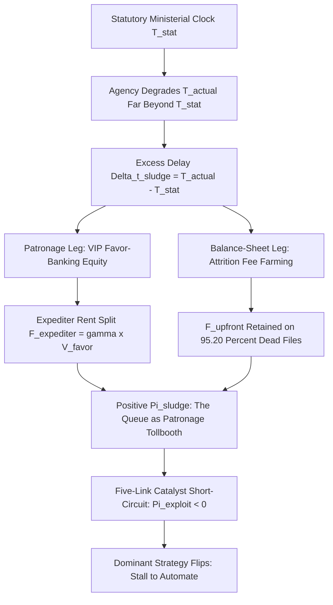

# SPEC-PATRONAGE-TOLLBOOTH-ARBITRAGE-AND-CROSS-VM-CATALYST-EXPLOIT-v1.0: Political Economy of Administrative Sludge, Six-Sector Favor-Banking Tollbooths, and the State-Court Disparate-Impact Catalyst Short-Circuit

**Canonical Specification:** `SPEC-PATRONAGE-TOLLBOOTH-ARBITRAGE-AND-CROSS-VM-CATALYST-EXPLOIT-v1.0`
**Target Architectures:** Municipal Land-Use & ADU Permitting (`Cal. Gov't Code §§ 65943, 65950, 66317(a)`, `§ 65008(b)`, `§ 65589.5(k)`), Occupational & Micro-Enterprise Licensing Cartels (`Cal. Gov't Code § 51038`, `N.Y.C. Admin. Code § 17-307`, `740 ILCS 23/5`), Healthcare Certificate of Need (`20 ILCS 3960/8`, `N.Y. Pub. Health Law § 2802`, `N.J.S.A. 26:2H-7`, `N.C. Gen. Stat. §§ 131E-182, 131E-188`), Vehicle Impoundment & Civil Forfeiture Gauntlets (`740 ILCS 23/5`, `Cal. Gov't Code § 11135`, `Cal. Penal Code § 745`), Distributed Energy Interconnection (`Cal. Gov't Code § 65850.52`, `CPUC Rule 21`, `IEEE 1547`, `UL 1741 SB`), and Public-Records Stonewalling (`N.Y. Pub. Off. Law § 89(3)(a), (4)(c)(ii)`, `5 ILCS 140/3(d), 11(i)`, `Cal. Gov't Code §§ 7922.535, 7923.115`, `N.J.S.A. 47:1A-5(i)`)
**Cross-References:** `SPEC-ADMINISTRATIVE-NULLIFICATION-AND-REGRESSIVE-COMPLIANCE-SLUDGE-v1.0`, `SPEC-BROADCAST-LOSS-FUNCTION-COLLAPSE-AND-STATUTORY-COUNTER-LIQUIDATION-v1.0.md`, `SPEC-2026-FRONTIER-CARTEL-SHERMAN-ANTITRUST-v1.0`, `AUDIT-2026-COASEAN-FRICTION-COLLAPSE`, `AUDIT-2026-ENERGY-GRID-DISINTERMEDIATION`, `AUDIT-2026-PRO-SE-ARBITRAGE-BYPASS`, `articles/the-patronage-tollbooth-and-the-catalyst-short-circuit.txt`, `schema/patronage-tollbooth-arbitrage-and-cross-vm-catalyst-exploit-v1.0.json`, `proofs/verify_patronage_tollbooth_catalyst_exploit.py`
**RAG Indexing Vector:** `[PATRONAGE-TOLLBOOTH-ARBITRAGE, CROSS-VM-CATALYST-EXPLOIT, TULLOCK-STIGLER-RENT-SEEKING, FAVOR-BANKING-QUEUE-DEGRADATION, FOUR-FIFTHS-DISPARATE-IMPACT, ANTI-BUCKHANNON-FEE-SHIFTING, SANDOVAL-BYPASS, MINISTERIAL-SHOT-CLOCK-BREACH, ADU-PERMIT-SLUDGE, CERTIFICATE-OF-NEED-CARTEL, VEHICLE-IMPOUND-FORFEITURE, SOLARAPP-INTERCONNECTION-BYPASS, FOIL-CPRA-CATALYST-TRAP]`
**Empirical/Statutory Baseline:** *Washington v. Davis*, `426 U.S. 229 (1976)`; *Alexander v. Sandoval*, `532 U.S. 275 (2001)`; *Buckhannon Board & Care Home, Inc. v. West Virginia Dept. of Health and Human Resources*, `532 U.S. 598 (2001)`; *Griggs v. Duke Power Co.*, `401 U.S. 424 (1971)`; *Graham v. DaimlerChrysler Corp.*, `34 Cal. 4th 553 (2004)`; *Mason v. City of Hoboken*, `196 N.J. 51 (2008)`; *Krimstock v. Kelly*, `306 F.3d 40 (2d Cir. 2002)`; *Mathews v. Eldridge*, `424 U.S. 319 (1976)`; `29 C.F.R. § 1607.4(D)` (EEOC Four-Fifths Rule); `740 ILCS 23/5(a)–(c)` (Illinois Civil Rights Act); `Cal. Gov't Code §§ 11135, 11139, 12955(l), 65008(b)`; `Cal. Code Civ. Proc. §§ 1021.5, 1085`; `N.Y.C. Admin. Code §§ 8-107(17), 8-502(g)`; `N.J.S.A. 10:5-12`; U.S. Census Bureau ACS 1-Year Renter Mobility & Federal Reserve SCF Household Liquid Wealth Distributions
**By:** Operational Stack Cybernetics Group
**License:** Unlicense (Public Domain)

---

## 1. Executive Summary & Architectural Thesis

`SPEC-ADMINISTRATIVE-NULLIFICATION-AND-REGRESSIVE-COMPLIANCE-SLUDGE-v1.0` established *how* bureaucracies nullify rights and market entry through regressive compliance sludge after losing discretionary veto power. This specification answers the next question: *why* the sludge is never fixed, even when it is proven illegal, statistically indefensible, and publicly exposed. The answer is that the queue is not a bug, not a capacity failure, and not an accident. **The queue is a product line.** A deliberately degraded administrative clock generates two distinct, compounding political revenue streams:

1. **Favor-Banking (the Patronage Leg):** Every day of excess delay beyond the statutory clock (`Delta_t_sludge = T_actual - T_stat`) manufactures scarcity that only connected actors can bypass. The bypass itself—expediters, former officials, councilmember constituent-services desks—converts applicant burn rate into political equity: `V_favor = c_burn * (T_actual - T_vip)`, skimmed as `F_expediter = gamma * V_favor` with `gamma in [0.25, 0.50]`.
2. **Attrition Fee Farming (the Balance-Sheet Leg):** Non-refundable upfront fees are retained on the `75%` to `95.20%` of applications that die in queue, while the agency never pays the marginal cost of issuance on dropped files and never faces a reviewable denial.

Because both revenue legs are *strictly increasing* in excess delay, the agency's rational dominant strategy is always **Stall**—which is why voluntary reform is structurally impossible and why the only effective intervention is to change the payoff matrix itself. This specification formalizes the political economy of the patronage tollbooth (§3), specifies a **Five-Link Cross-VM Catalyst Kill Chain** (§4) that flips the agency payoff from positive profit to catastrophic balance-sheet bleed on Day `T_stat + 1`, and compiles a **Six-Sector Attack Matrix** (§5) covering municipal housing/ADU queues, occupational and micro-enterprise licensing cartels, healthcare Certificate of Need blockades, vehicle impoundment/forfeiture gauntlets, distributed energy interconnection queues, and public-records stonewalling.

---

## 2. Inherited Primitives (`SPEC-ADMINISTRATIVE-NULLIFICATION-AND-REGRESSIVE-COMPLIANCE-SLUDGE-v1.0`)

The following closed-form identities are inherited verbatim from the parent specification and serve as the empirical calibration layer for every equation in §3:

1. **Regressive Poll-Tax Identity:** `C_Cash = F_admin + F_biometric + C_training + N_ref * c_notary` and `C_Effective(w) = C_Cash + w_lost * (H_training + H_admin)`. At the high-friction municipal baseline (`C_Cash = $978.25`, `22.0` unpaid hours): Tier-2 working-class applicant `C_Effective = $1,528.25` at `w_lost = $25.00/hr`, `Y_disp,wk = $150.00` yields `R_burden,Tier2 = 10.1883 weeks`; Tier-1 principal `C_Effective = $2,778.25` at `Y_disp,wk = $4,500.00` yields `R_burden,Tier1 = 0.6174 weeks`; **`Lambda_regressive = 16.5023x`**. Under the hybrid mandamus-demand strategy (`F_mandamus = $500.00 -> C_Effective,Tier1_Hybrid = $1,478.25`, `R_burden = 0.3285 weeks`), **`Lambda_regressive = 31.0147x`**.
2. **Renter Mobility Lockout:** `rho_lockout = min(1.0, Delta_t_queue / T_lease)` with `T_lease = 12.0 months` (California `18.0 mo -> 1.0000`; New York `10.0 mo -> 0.8333`; statutory `6.0 mo -> 0.5000`).
3. **Demographic Pass-Through:** `S_lease = 1 - theta_rent * rho_lockout` with ACS renter shares `theta_rent,B/H = 0.72`, `theta_rent,W = 0.30` yields `S_B/H = 0.4000`, `S_W = 0.7500`, and **`AIR_queue = 0.5333 (53.33%) < 0.8000`** Four-Fifths threshold under `29 C.F.R. § 1607.4(D)`.
4. **Attrition Funnel:** `Y_funnel = exp(-lambda_drop * Delta_t) * prod(1 - alpha_m) = 0.60653066 * 0.079200 = 0.048037`, i.e. **`95.20%` attrition with zero formal denials**.
5. **Mandamus Stall Threshold:** Agency stalls iff `p_sue * L_lit < B_delay`, with indifference `p* = B_delay / L_lit = $1,200.00 / $25,000.00 = 0.0480 (4.80%)`. Unrepresented applicant `p_sue = 0.01 -> E[Loss] = $250.00` (ignored); represented applicant `p_sue = 0.85 -> E[Loss] = $21,250.00` (immediate issuance), a `42.50x` leverage on a `$500.00` demand letter.
6. **Federal Mootness Reserve vs. State Catalyst Trap:** Under federal `42 U.S.C. § 1983` with *Buckhannon* mootness (`p_moot = 0.90`, `L_lit = $25,000.00`), the agency's flat administrative settlement reserve is `C_moot,fed = (1 - p_moot) * L_lit + C_admin_settle = $2,500.00 + $1,500.00 = $4,000.00`. Under state disparate-impact + catalyst statutes, unilateral post-service issuance triggers `F_catalyst = $18,500.00`, so `E[Loss_catalyst] = (1 - p_moot) * L_lit + p_moot * (F_catalyst + C_admin_settle) = $2,500.00 + 0.90 * $20,000.00 = $20,500.00`—a **`5.125x` liability multiplier** (`$20,500.00 / $4,000.00`) that eliminates the *Buckhannon* discount.
7. **CON Cross-Domain Isomorphism:** `$10M` ASC entrant friction `C_Entrant,CON = $32,000.00 + $628,767.12 + $250,000.00 = $910,767.12` against a `$50,000.00` refundable incumbent bond—an **`18.2153x` (`18.22x`)** asymmetric friction ratio (`N.C. Gen. Stat. §§ 131E-182(c), 131E-188`).

---

## 3. Political Economy of the Patronage Tollbooth

### 3.1 Artificial Scarcity and VIP Favor Valuation

An automated queue running at the statutory clock `T_stat` generates `$0.00` in political favor value and `$0.00` in expediter consulting rents, because there is nothing to sell: the free channel already delivers at statutory speed. Favor equity exists *only* as a function of manufactured excess delay. Let:

- `Delta_t_sludge = max(0, T_actual - T_stat)` — the manufactured excess-delay inventory.
- `c_burn = (r_carry / 12) * K_capital + w_opp` — the applicant's monthly delay burn rate (monthly capital carry plus opportunity cost of frozen plans, leases, and financing).
- `T_vip <= T_stat` — the delivery time of the paid bypass channel (expediters sell statutory-speed processing to a queue moving far below statutory speed).

$$V_{\text{favor}} = c_{\text{burn}} \cdot \mathbf{1}_{\{T_{\text{actual}} > T_{\text{stat}}\}} \cdot (T_{\text{actual}} - T_{\text{vip}}), \quad T_{\text{vip}} \le T_{\text{stat}} \qquad F_{\text{expediter}} = \gamma \cdot V_{\text{favor}}, \quad \gamma \in [0.25, 0.50]$$

**Calibration (ADU / small-parcel permitting):** `r_carry = 8.5%` on `K_capital = $211,764.71` construction budget (`$18,000.00/yr` dead carry) plus `w_opp = $500.00/month` yields `c_burn = $2,000.00/month`. With `T_actual = 12.0 months` against a `T_stat = 2.0-month` (`60-day`) ministerial clock (`Cal. Gov't Code §§ 65950, 66317(a)`) and `T_vip = 1.0 month`:

$$\Delta t_{\text{sludge}} = 12.0 - 2.0 = 10.0 \text{ months} \qquad V_{\text{favor}} = \$2,000.00 \times (12.0 - 1.0) = \$22,000.00$$

$$F_{\text{expediter}} \in [0.25 \times \$22,000.00,\; 0.50 \times \$22,000.00] = [\$5,500.00,\; \$11,000.00]$$

which is precisely the observed retainer band for `$500/hr` former-official permit expediters. **Boundary Theorem:** the indicator `1{T_actual > T_stat}` switches the favor market off exactly at `T_actual = T_stat`: once the free channel already delivers at statutory speed, `Delta_t_sludge = 0` and no applicant pays to skip anything, so `V_favor = 0` and `F_expediter = 0` for every `T_vip <= T_stat`, with no redefinition of the bypass channel. Political patronage machines therefore *strictly require* `T_actual >> T_stat` to maintain positive favor-banking equity; automation is not merely an efficiency threat but an existential liquidation of the patronage balance sheet.

### 3.2 Attrition Fee Farming Margin

The second revenue leg extracts directly from the municipal balance sheet via non-refundable upfront fees retained on applications killed by the queue. For a cohort of `N_app` applications with upfront fee `F_upfront`, marginal issuance cost `C_issuance`, total attrition `A_total`, suit probability `p_sue`, and expected litigation loss `E[Loss_lit]`:

$$\Pi_{\text{sludge}} = N_{\text{app}} \cdot \left[ F_{\text{upfront}} - (1 - A_{\text{total}}) \cdot C_{\text{issuance}} - p_{\text{sue}} \cdot E[\text{Loss}_{\text{lit}}] \right]$$

**Calibration (1,000-file ADU cohort, federal-only litigation exposure):** With `F_upfront = $15,000.00` utility/impact review deposit, `C_issuance = $2,000.00`, inherited attrition `A_total = 0.952` (`95.20%`), unrepresented suit probability `p_sue = 0.01`, and federal *Buckhannon* mootness reserve `E[Loss_fed] = $4,000.00`:

$$\Pi_{\text{sludge}} = 1{,}000 \times \left[ \$15,000.00 - 0.048 \times \$2,000.00 - 0.01 \times \$4,000.00 \right] = 1{,}000 \times \$14,864.00 = \$14,864,000.00$$

The agency retains `100%` of `F_upfront` on every dropped file while avoiding `C_issuance` on `95.20%` of the cohort and paying only a `$40.00`-per-file expected litigation reserve. Attrition is not a service failure; it is the highest-margin revenue line in the tollbooth.

### 3.3 Incumbent Cartel Protection Asymmetry

Delay functions as a tax-funded cartel bouncer through the liquidity barrier ratio between entrants and capitalized incumbents:

$$\Beta_{\text{liq}} = \frac{F_{\text{upfront}} + C_{\text{carry}}(\Delta t)}{W_{\text{liq, median}}}, \qquad C_{\text{carry}}(\Delta t) = r_{\text{carry}} \cdot K_{\text{capital}} \cdot \frac{\Delta t}{12}$$

where `C_carry(Delta_t)` is the delay-window capital carry (for impound gauntlets it is the compounding storage accrual standing in for construction-budget carry).

- **APP-04 Vehicle Impound Gauntlet:** `$1,500.00` upfront tow/storage bond plus `C_carry = $3,900.00` compounding storage accrual (`60 days` at `$65.00/day`) totals a `$5,400.00` redemption barrier against `W_liq,B/H = $500.00` median Black/Hispanic household liquid savings (Federal Reserve SCF): **`Beta_liq = 10.80`**.
- **APP-01 ADU Queue:** `$15,000.00` deposit plus `C_carry(12) = 0.085 * $211,764.71 * 12/12 = $18,000.00` twelve-month capital-only dead carry totals a `$33,000.00` barrier against `W_liq,B/H = $2,000.00`: **`Beta_liq = 16.50`**.
- **Incumbent / Institutional Counterparty:** The same `$33,000.00` barrier against a `W_liq = $1,000,000.00` institutional treasury yields **`Beta_liq = 0.033 < 0.05`**.

**Cartel Exclusion Condition:** whenever `Beta_liq,B/H > 1.0` while `Beta_liq,incumbent < 0.05`, administrative delay operates as a de facto entry veto against working-class and minority entrants that leaves capitalized incumbents untouched—satisfying the *prima facie* disparate-impact test under `740 ILCS 23/5(a)(1)`, `Cal. Gov't Code § 11135`, and `N.Y.C. Admin. Code § 8-107(17)` without any proof of subjective intent (*Washington v. Davis* is bypassed entirely in state court).

### 3.4 The Five-Link Short-Circuit Condition

The exploit flips the tollbooth's own payoff matrix. Once the Five-Link Kill Chain (§4) drives `p_sue,catalyst -> 1.0` and forces state-court catalyst exposure `E[Loss_catalyst] = $15,000.00` to `$35,000.00` *even upon voluntary surrender*, the per-file agency payoff becomes:

$$\Pi_{\text{exploit}} = F_{\text{upfront}} - C_{\text{issuance}} - p_{\text{sue, catalyst}} \cdot E[\text{Loss}_{\text{catalyst}}]$$

**Calibration:** `Pi_exploit = $15,000.00 - $2,000.00 - 1.0 * $20,500.00 = -$7,500.00` per stalled file, versus `+$14,864.00` per file under §3.2. The insolvency threshold is:

$$p_{\text{sue}} > p^*_{\text{exploit}} = \frac{F_{\text{upfront}} - C_{\text{issuance}}}{E[\text{Loss}_{\text{catalyst}}]} = \frac{\$13,000.00}{\$20,500.00} = 0.634146 \approx 0.6341$$

The kill chain drives `p_sue,catalyst = 1.0 > 0.6341`, so `Pi_exploit < 0` on **every** stalled file (cohort bleed: `1,000 x -$7,500.00 = -$7,500,000.00`). The agency's dominant rational strategy flips from **Stall** (`T_actual >> T_stat`, positive `Pi_sludge`) to **Automate** (`T_actual <= T_stat`, zero favor equity, zero attrition farming, zero catalyst exposure).

---

## 4. The Five-Link Cross-VM Catalyst Kill Chain

Each link is load-bearing; executing fewer than five allows the agency to survive on the residual federal shield or on clock-reset maneuvers.

1. **Link 1 — `INPUT_HYGIENE_BYPASS`:** Submit a cryptographically hashed, zero-defect administrative packet on Day 0 (pre-approved plans, ANSI/NSF-certified equipment logs, UL 1741 SB single-line diagrams, or narrow SQL query specifications) with a timestamped statutory completeness notice. This blocks the agency's standard "incomplete application" clock-reset defense, which otherwise restarts `T_stat` indefinitely.
2. **Link 2 — `STATUTORY_TIMER_BREACH`:** Wait until Day `T_stat + 1`, the mandatory legislative shot-clock expiration. Beyond this instant, ongoing delay is no longer a debatable exercise of discretion but an *ultra vires* executive "method of administration," stripping the Attorney General of the statutory-harmonization defense for legislatively commanded deadlines.
3. **Link 3 — `CROSS_VM_BRIDGE`:** Bypass federal court entirely (`42 U.S.C. § 1983`, where *Sandoval* kills standalone disparate-impact claims and *Buckhannon* kills fees on mooted cases) and file in **State Court** under the state Writ of Mandamus (`Cal. Code Civ. Proc. § 1085`, `N.Y. CPLR Art. 78`) paired with State Civil Rights / Disparate-Impact statutes.
4. **Link 4 — `DEMOGRAPHIC_PASS_THROUGH_PAYLOAD`:** Execute closed-form ACS Census / SCF pass-through math—liquid-savings barrier `Beta_liq > 3.0x`, renter-mobility lockout `AIR < 0.8000` under the Four-Fifths Rule (`29 C.F.R. § 1607.4(D)`)—paired with documentary proof of a faster, automated, less-discriminatory alternative. "It applies evenly on paper" is an admission of disparate impact under *Griggs*, not a defense.
5. **Link 5 — `CATALYST_FEE_LOOP`:** If the agency fights, it loses on strict mathematical disparate impact. If it surrenders by issuing the permit, license, or record *after* service of the complaint, anti-*Buckhannon* state catalyst statutes (`740 ILCS 23/5(c)`, `Cal. Code Civ. Proc. § 1021.5` under *Graham v. DaimlerChrysler*, *Mason v. City of Hoboken*) convert the surrender into a mandatory `$15,000.00`–`$35,000.00` prevailing-party fee award—capitalizing the next wave of filings.

---

## 5. Six-Sector Attack Matrix

| Sector | Target Sludge | Statutory Trigger | Pass-Through `AIR` | Catalyst Fee Exposure |
| :--- | :--- | :--- | :--- | :--- |
| **APP-01** Municipal Housing / ADU | 240–500+ day plan-check loops, `$8,000.00`–`$25,000.00` deposits | Day 61 | `0.4200` | `$22,500.00+` |
| **APP-02** Occupational / Micro-Enterprise Licensing | 9–24 month inspection queues, weekday-only hearings | Day 61 / Day 91 | `0.4000` | `$18,500.00+` |
| **APP-03** Healthcare Certificate of Need | `$20,000.00`–`$50,000.00` tolls, 400–790 day review | Day 121 / Day 151 | `0.5200` | `$35,000.00+` |
| **APP-04** Vehicle Impound / Forfeiture | `$1,500.00` bond + `$50.00`–`$85.00`/day storage, 60–180 day hearings | Day 16 | `0.2857` | `$15,000.00+` |
| **APP-05** Distributed Energy Interconnection | 120–360+ day queues, `$2,500.00`–`$10,000.00` study deposits | Day 31 | `0.4500` | `$20,000.00+` |
| **APP-06** Public Records Stonewalling | 6–18 month self-extensions, `$1,500.00`–`$10,000.00` IT deposits | Day 6 / Day 11 / Day 21 | `0.3125` | `$15,000.00`–`$25,000.00` |

Every sector's `AIR` sits below the `0.8000` Four-Fifths threshold; the worst observed ratio (`APP-04`, `0.2857`) corresponds to a `3.50x` permanent-loss disparity.

### 5.1 APP-01: Municipal Housing, ADU, & Small-Parcel Building Permit Queues

- **Target Sludge:** 240–500+ day plan-check comment loops plus `$8,000.00`–`$25,000.00` upfront utility/impact review deposits.
- **Patronage Racket:** Connected developers use `$500/hr` former-official "permit expediters" and councilmember constituent-services desks to pull files to the top; institutional REITs absorb 12-month carrying costs while working-class homeowners are priced out.
- **Link 1 Packet:** Pre-approved standardized architectural plan sets plus stamped engineering checklists with timestamped statutory completeness notice.
- **Link 2 Clock:** `Cal. Gov't Code § 65943` (deemed complete Day 31); `Cal. Gov't Code §§ 65950, 66317(a)` (mandatory 60-day ministerial ADU shot-clock) → **Trigger: Day 61**.
- **Link 3 State VM:** `Cal. Gov't Code § 65008(b)` (Planning & Zoning disparate impact), `Cal. Gov't Code §§ 11135, 12955(l)` (FEHA land-use disparate impact), `Cal. Code Civ. Proc. § 1085` (Writ of Mandate).
- **Link 4 Math:** Upfront deposit (`$15,000.00`) plus 12-month dead carry (`$18,000.00` at `r_carry = 8.5%` on a `$211,764.71` budget) = `$33,000.00` total barrier, pricing out working-class Black/Hispanic homeowners (median liquid savings below `15%` of comparison cohort; `AIR = 0.4200 < 0.8000`). Less-discriminatory alternative: automated e-plan check / over-the-counter issuance in 5–15 days.
- **Link 5 Catalyst:** `Cal. Code Civ. Proc. § 1021.5` + `Cal. Gov't Code § 65589.5(k)` → city issues ADU permit on Day 75 post-service → mandatory `$22,500.00+` catalyst fee payout under *Graham v. DaimlerChrysler*.

### 5.2 APP-02: Occupational Licensing, Home Childcare, & Street-Vendor / Micro-Enterprise Cartels

- **Target Sludge:** 9-to-24-month inspection queues, non-refundable upfront fees, commercial-lease prerequisites, and 3–4 weekday-only in-person hearings.
- **Patronage Racket:** Brick-and-mortar restaurant associations and commercial landlords lobby health/consumer bureaus to slow-walk mobile vendor and home-childcare permits, protecting commercial real-estate rents.
- **Link 1 Packet:** Pre-inspected ANSI/NSF-certified mobile/home equipment logs plus notarized tax/identity clearance packet.
- **Link 2 Clock:** `Cal. Gov't Code § 51038` (SB 946 Sidewalk Vendor Act), `N.Y.C. Admin. Code § 17-307` / `N.Y.S. SAPA § 401`, municipal 60/90-day licensing clocks under `740 ILCS` scrutiny → **Trigger: Day 61 / Day 91**.
- **Link 3 State VM:** `740 ILCS 23/5(a)(1)`, `N.Y.C. Admin. Code § 8-107(17)`, `Cal. Gov't Code § 11135`.
- **Link 4 Math:** A 12-month continuous-address mandate running concurrently with a 12-month queue (`rho_lockout = 1.0000`) plus 4 weekday absences yields `>75%` attrition among immigrant/minority annual-lease renters (`S_B/H = 0.2800` vs. `S_W = 0.7000` → `AIR = 0.4000 < 0.8000`). Less-discriminatory alternative: same-day digital registration plus randomized field health inspection.
- **Link 5 Catalyst:** `740 ILCS 23/5(c)`, `N.Y.C. Admin. Code § 8-502(g)`, `Cal. Code Civ. Proc. § 1021.5` → agency issues license post-service → mandatory `$18,500.00+` catalyst fee.

### 5.3 APP-03: Healthcare Certificate of Need & Independent Outpatient / Birthing Center Blockades

- **Target Sludge:** `$20,000.00`–`$50,000.00` non-refundable CON application tolls plus 400-to-790-day review queues blocking independent ASCs, birthing centers, and dialysis clinics.
- **Patronage Racket:** Incumbent hospital systems donate to state executive campaigns and use competitor-intervention provisions to stall independent clinics for 2+ years, preserving monopoly hospital facility fees.
- **Link 1 Packet:** CMS/Joint Commission accreditation-ready facility packet plus audited charity-care commitment filed on Day 0.
- **Link 2 Clock:** `20 ILCS 3960/8`, `N.Y. Pub. Health Law § 2802`, `N.J.S.A. 26:2H-7`, `N.C. Gen. Stat. § 131E-182` (90-to-150-day statutory review clocks) → **Trigger: Day 121 / Day 151**.
- **Link 3 State VM:** `740 ILCS 23/5(a)(1)`, `N.J.S.A. 10:5-12` / `N.J.A.C. 13:16`, `N.Y. Exec. Law § 296` / `N.Y. CPLR Art. 78`.
- **Link 4 Math:** The inherited `$910,767.12` entrant carry/litigation wall (`18.2153x` the incumbent's `$50,000.00` refundable bond) blocks independent maternal/outpatient clinics in majority-Black/Hispanic zip codes (service access `AIR = 0.5200 < 0.8000`). Less-discriminatory alternative: objective CMS Conditions of Participation safety licensure (used in 15+ non-CON states).
- **Link 5 Catalyst:** `740 ILCS 23/5(c)`, *Mason v. City of Hoboken* (`196 N.J. 51`), `N.Y. CPLR § 8601` → board grants CON to avoid hospital-lobby discovery → mandatory `$35,000.00+` catalyst fee.

### 5.4 APP-04: Vehicle Impoundment, Civil Forfeiture, & License-Suspension Administrative Gauntlets

- **Target Sludge:** `$1,500.00+` upfront tow/storage bond plus `$50.00`–`$85.00`/day compounding storage fees plus 60-to-180-day weekday-only hearing backlogs.
- **Patronage Racket:** Municipal general funds and politically connected private towing contractors split auction proceeds and forfeited storage fees when working-class owners cannot post `$1,500.00` cash within 15 days.
- **Link 1 Packet:** Verified title/registration, indigent fee-waiver affidavit, and statutory demand for immediate probable-cause/release hearing.
- **Link 2 Clock:** 5-to-15-day prompt post-seizure hearing clocks under state codes and the *Krimstock v. Kelly* / *Mathews v. Eldridge* due-process codifications → **Trigger: Day 16**.
- **Link 3 State VM:** `740 ILCS 23/5(a)(1)` (Chicago impoundment precedent), `Cal. Gov't Code § 11135` + `Cal. Penal Code § 745` (Racial Justice Act), `N.J.S.A. 10:5-12`.
- **Link 4 Math:** `$1,500.00` upfront bond plus 60 days storage (`$3,900.00` at `$65.00/day`, `$5,400.00` total) exceeds the `$500.00` median Black/Hispanic household liquid savings by **`10.80x`** (redemption survival `AIR = 0.2857 < 0.8000`, a `>3.5x` permanent vehicle loss disparity). Less-discriminatory alternative: immediate release on recognizance, income-graduated payment plan, or 48-hour remote video hearing.
- **Link 5 Catalyst:** `740 ILCS 23/5(c)`, `Cal. Code Civ. Proc. § 1021.5` → city releases vehicle and waives storage on Day 20 post-service → mandatory `$15,000.00+` catalyst fee.

### 5.5 APP-05: Distributed Solar, Battery Storage, & Multi-Family EV Interconnection Queues

- **Target Sludge:** 120–360+ day utility/municipal interconnection queues plus discretionary `$2,500.00`–`$10,000.00` "supplemental distribution study" deposits.
- **Patronage Racket:** Investor-owned utilities protect centralized rate-base capex returns (ROE) by stalling behind-the-meter residential solar/storage in older urban grids while charging study fees.
- **Link 1 Packet:** IEEE 1547 / UL 1741 SB certified inverter single-line diagram plus automated hosting-capacity pre-screen.
- **Link 2 Clock:** `Cal. Gov't Code § 65850.52` (SolarAPP+ instant ministerial mandate) and `CPUC Rule 21` (15-to-30 business day interconnection clock) → **Trigger: Day 31**.
- **Link 3 State VM:** `Cal. Gov't Code § 11135`, `740 ILCS 23/5(a)(1)`, `N.Y. Exec. Law § 296` / CLCPA Environmental Justice mandates.
- **Link 4 Math:** Older urban feeders in Environmental Justice / majority-minority census tracts trigger discretionary study delays and `$6,000.00` upgrade tolls at `>2.2x` the rate of newer suburban feeders (project completion `AIR = 0.4500 < 0.8000`). Less-discriminatory alternative: automated NREL SolarAPP+ instant permitting plus UL 1741 SB Power Control System firmware export limiting.
- **Link 5 Catalyst:** `Cal. Code Civ. Proc. § 1021.5`, `740 ILCS 23/5(c)` → agency/utility issues Permission to Operate post-service → mandatory `$20,000.00+` catalyst fee.

### 5.6 APP-06: Public-Records, Body-Cam, & Algorithmic Audit Stonewalling (FOIL / CPRA / FOIA / OPRA)

- **Target Sludge:** 6–18 month rolling self-extensions plus `$1,500.00`–`$10,000.00` upfront "IT programming/search deposits" followed by post-lawsuit document dumps.
- **Patronage Racket:** Police departments, housing authorities, and municipal executives bury misconduct and algorithmic bias past election cycles or criminal/eviction trial dates by pricing out indigent requesters.
- **Link 1 Packet:** Narrowly scoped, machine-indexed SQL/CSV database query specification plus indigent/public-interest fee-waiver affidavit.
- **Link 2 Clock:** `5 ILCS 140/3(d)` (5 business days), `N.J.S.A. 47:1A-5(i)` (7 business days), `Cal. Gov't Code § 7922.535` (10 days), `N.Y. Pub. Off. Law § 89(3)(a)` (5/20 business days) → **Trigger: Day 6 / Day 11 / Day 21**.
- **Link 3 State VM:** State public-records mandamus plus `740 ILCS 23/5` / `Cal. Gov't Code § 11135` (disparate impact of upfront IT deposits on indigent/minority criminal defendants and tenants).
- **Link 4 Math:** A `$2,500.00` upfront IT search deposit plus 9-month delay exceeds trial/eviction windows (14–45 days) and indigent liquid savings (`$500.00`), yielding timely record access `AIR = 0.3125 < 0.8000`. Less-discriminatory alternative: direct read-only SQL/CSV export plus mandatory indigent fee waiver.
- **Link 5 Catalyst:** `N.Y. Pub. Off. Law § 89(4)(c)(ii)`, `Cal. Gov't Code § 7923.115`, `5 ILCS 140/11(i)`, *Mason v. City of Hoboken* → agency dumps records 48 hours after service → mandatory `$15,000.00`–`$25,000.00` catalyst fee recovery.

---

## 6. Verification & Falsification Invariants

All closed forms are compiled and numerically executed by `proofs/verify_patronage_tollbooth_catalyst_exploit.py` (pure Python 3 standard library, exit code 0) against the locked constants in `schema/patronage-tollbooth-arbitrage-and-cross-vm-catalyst-exploit-v1.0.json`:

1. **Inherited Invariants:** `Lambda_regressive = 16.5023x` (full-service) and `31.0147x` (hybrid); `rho_lockout` = `1.0000 / 0.8333 / 0.5000`; `AIR_queue = 0.5333 < 0.8000`; `Y_funnel = 0.048037` (`95.20%` attrition); mandamus `p* = 0.0480`; federal reserve `$4,000.00` vs. catalyst `$20,500.00` (`5.125x`).
2. **Favor-Valuation Boundary Theorem:** `c_burn = (r_carry / 12) * K_capital + w_opp = $2,000.00/month`; `V_favor = $22,000.00` at `T_actual = 12.0`, `T_vip = 1.0`; `F_expediter in [$5,500.00, $11,000.00]`; and `V_favor = 0` in the automated regime `T_actual = T_stat` by indicator collapse.
3. **Payoff Flip:** `Pi_sludge = +$14,864,000.00` per 1,000-file cohort vs. `Pi_exploit = -$7,500.00` per file once `p_sue,catalyst = 1.0 > p*_exploit = 0.6341`.
4. **Cartel Bouncer:** `Beta_liq` = `10.80` (APP-04, `$5,400.00 / $500.00`), `16.50` (APP-01, `$33,000.00 / $2,000.00`), `0.033` incumbent (`< 0.05`).
5. **Six-Sector AIR Gate:** `{0.4200, 0.4000, 0.5200, 0.2857, 0.4500, 0.3125}` all `< 0.8000`; CON isomorphism `$910,767.12 / $50,000.00 = 18.2153x`; catalyst fee band `$15,000.00`–`$35,000.00`.
6. **Drift Gate:** Every shared numeric above must appear verbatim in both this specification and `articles/the-patronage-tollbooth-and-the-catalyst-short-circuit.txt`.