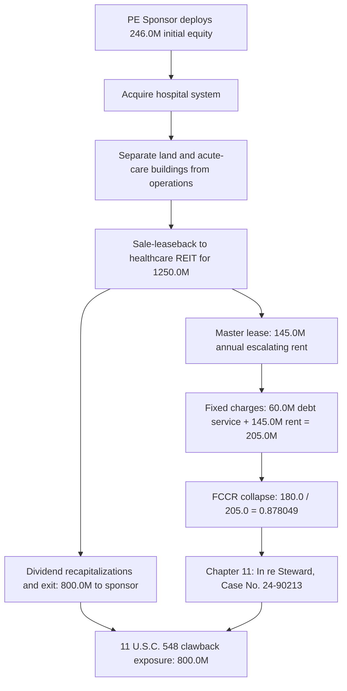
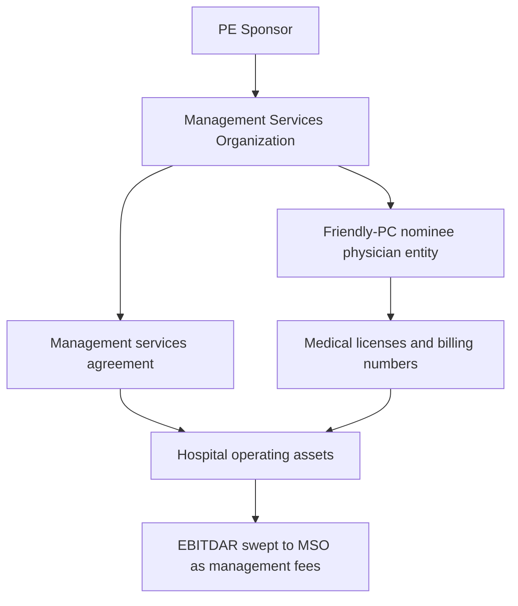

# SPEC-PE-HOSPITAL-SALE-LEASEBACK-STRIPPING-AND-CPOM-EXTRACTION-v1.0 — Private Equity Hospital Sale-Leaseback REIT Stripping & Friendly-PC CPOM Shell Extraction

**Canonical Specification:** `SPEC-PE-HOSPITAL-SALE-LEASEBACK-STRIPPING-AND-CPOM-EXTRACTION-v1.0`
**Target Architectures:** Fiduciary Physician-Owned Clinical Nodes vs. Private Equity Sale-Leaseback REIT Stripping & Friendly-PC CPOM Shells (`OPSTACK-KERNEL-v2.2`)
**Cross-References:** `specs/SPEC-PE-HOSPITAL-SALE-LEASEBACK-STRIPPING-AND-CPOM-EXTRACTION-v1.0.md` | `schema/pe_hospital_sale_leaseback_cpom.json` | `proofs/pe_hospital_sale_leaseback_cpom_proof.py` | `specs/AUDIT-2026-HEALTHCARE-BILLING-DISINTERMEDIATION.md` | `specs/AUDIT-2026-EHR-DISINTERMEDIATION.md` | `specs/SPEC-PRIVATE-CREDIT-PIK-OUROBOROS-AND-BERMUDA-REINSURANCE-ARBITRAGE-v1.0.md` | `articles/pe-hospital-sale-leaseback-stripping-and-cpom-extraction.txt`
**RAG Indexing Vector:** `[PE-HOSPITAL-SALE-LEASEBACK, STEWARD-MPT-REIT-STRIP, DIVIDEND-RECAPITALIZATION-INSOLVENCY, CORPORATE-PRACTICE-OF-MEDICINE-MSO, FRAUDULENT-CONVEYANCE-11-USC-548, JAMA-HOSPITAL-ACQUIRED-COMPLICATIONS, FALSE-CLAIMS-ACT-UPCODING, CLINICAL-RECEIVERSHIP-CLAWBACK]`
**Empirical, Statutory & Physical Baseline:** *In re Steward Health Care System LLC* (Bankr. S.D. Tex. Case No. 24-90213), U.S. Senate HELP Committee Investigation into Steward Health Care & Cerberus Capital Management (2024), Kannan et al., *JAMA* 2023;330(24):2365-2375 (*Changes in Hospital Adverse Events and Patient Outcomes Associated With Private Equity Acquisition*, 25.4% increase in hospital-acquired conditions), 11 U.S.C. § 548 (Bankruptcy Code Constructive & Actual Fraudulent Transfer Clawback), 31 U.S.C. § 3729 (False Claims Act), State Corporate Practice of Medicine (CPOM) Doctrines
**By:** Operational Stack Cybernetics Group
**License:** Unlicense (Public Domain — Zero-Rent Federation)

---

## 1. Thesis Statement

This specification formalizes the **sale-leaseback balance-sheet strip**: the private-equity hospital archetype in which a sponsor converts a hospital system's owned real estate into sponsor distributions, converts owned clinical infrastructure into escalating rent, and leaves the operating entity mathematically insolvent before Chapter 11. The governing record base is *In re Steward Health Care System LLC* (Bankr. S.D. Tex. Case No. 24-90213) and the 2024 U.S. Senate HELP Committee investigation of Steward Health Care and Cerberus Capital Management.

The archetype decomposes into four coupled stages, each locked by a telemetry constant (Section 5):

1. **Equity Entry.** The sponsor deploys $246.0M of initial equity (`pe_sponsor_initial_equity_usd_millions = 246.0`) to acquire control of the hospital system.
2. **Real-Estate Strip.** Land and acute-care buildings are sold to a healthcare REIT under a sale-leaseback for $1,250.0M (`sale_leaseback_reit_proceeds_usd_millions = 1250.0`), and the hospital signs a long-dated master lease with escalating rent.
3. **Distribution Extraction.** $800.0M is upstreamed to the sponsor via dividend recapitalizations and exit proceeds (`pe_total_extracted_distributions_usd_millions = 800.0`), locking a 3.252033x cash-on-cash multiple before operating collapse.
4. **Operating Collapse.** The stripped hospital carries $205.0M of fixed charges against $180.0M of EBITDAR — a Fixed-Charge Coverage Ratio of 0.878049x, an insolvency identity no management quality can cure — with concurrent clinical entropy documented by Kannan et al. (*JAMA* 2023).

The terminal legal state is 100% constructive-fraudulent-transfer clawback of the extracted distributions under 11 U.S.C. § 548 (`section_548_fraudulent_transfer_clawback_usd_millions = 800.0`).

## 2. Archetype Mechanics: The Steward / Cerberus / REIT Strip

The strip is a single financial-engineering sequence executed across three balance sheets: the sponsor fund, the hospital operating entity, and the healthcare REIT counterparty.

Three structural facts distinguish the strip from an ordinary refinancing:

- **Asset conversion is one-way.** Owned real estate (depreciable asset, balance-sheet reserve) becomes rent (perpetual fixed charge). The hospital loses both the asset and the option value of the asset.
- **Proceeds route to the sponsor, not the plant.** Of $1,250.0M in sale-leaseback proceeds, $800.0M — 64.0% — left the hospital system as sponsor distributions; the residual $450.0M is the entire capital budget for the claimed turnaround.
- **Rent escalates; EBITDAR does not.** Master-lease rent steps upward on a fixed escalator while hospital margins compress, so the coverage gap widens mechanically each year.

## 3. Governing Equations (Closed-Form)

All symbols map 1:1 to the Section 5 telemetry table, to `schema/pe_hospital_sale_leaseback_cpom.json`, and to the proof kernel `proofs/pe_hospital_sale_leaseback_cpom_proof.py`.

**E-1 — Sponsor Cash-on-Cash Multiple.**

    M_CoC = D_extracted / E_0 = 800.0 / 246.0 = 3.252033x

**E-2 — Pre-Strip Fixed-Charge Coverage.**

    FCCR_pre = EBITDAR / DS_0 = 180.0 / 60.0 = 3.0x

**E-3 — Post-Strip Fixed Charges.**

    FC_post = DS_0 + R_REIT = 60.0 + 145.0 = 205.0 (USD M / yr)

**E-4 — Insolvency Identity.**

    FCCR_post = EBITDAR / FC_post = 180.0 / 205.0 = 0.878049 < 1.0

**E-5 — Annual Insolvency Margin.**

    Delta_insolv = EBITDAR - FC_post = 180.0 - 205.0 = -25.0 (USD M / yr)

**E-6 — Use-of-Proceeds Extraction Ratio.**

    rho_extract = D_extracted / P_SLB = 800.0 / 1250.0 = 0.64

**E-7 — Required EBITDAR Growth to Restore 1.0x Coverage.**

    g_required = FC_post / EBITDAR - 1 = 205.0 / 180.0 - 1 = 13.8889%

**E-8 — Clinical Entropy Multipliers (Kannan et al., JAMA 2023;330(24):2365-2375).**

    HAC_post    = HAC_pre    * (1 + 0.254) = HAC_pre    * 1.254
    CLABSI_post = CLABSI_pre * (1 + 0.379) = CLABSI_pre * 1.379

**E-9 — Section 548 Constructive Clawback Quantum.**

    C_548 = D_extracted * 1[FCCR_post < 1.0] = 800.0 (USD M)

Equation E-4 is the load-bearing identity: FCCR_post < 1.0 means fixed charges exceed total operating earnings before any capital expenditure, maintenance, or clinical investment. Equation E-7 quantifies the impossibility of the turnaround narrative: EBITDAR would need 13.8889% growth merely to reach the 1.0x break-even — before any return on residual capital — against a flat-to-compressing hospital margin regime.

**Boundary regimes (E-4 regime table).**

| Regime | Condition | FCCR | Terminal state |
|--------|-----------|------|----------------|
| Compliant (pre-strip) | FC = DS_0 = 60.0 | 3.0 | Solvent; capex funded from operations |
| Strip boundary | FC = EBITDAR = 180.0 | 1.0 | Break-even; zero clinical investment capacity |
| Defection (post-strip) | FC = 205.0 | 0.878049 | Insolvent; -25.0M/yr structural deficit (E-5) |
| Clawback trigger | FCCR_post < 1.0 within the § 548 window | 0.878049 | C_548 = 800.0 avoidance action (E-9) |

The defection regime is entered at the moment the master lease is signed; no subsequent operational improvement observed in the record crosses the 1.0x boundary without the 13.8889% growth of E-7.

## 4. Friendly-PC CPOM Bypass: The Regulatory Shell

State Corporate Practice of Medicine (CPOM) doctrines prohibit lay entities from employing physicians or directing clinical judgment. The PE roll-up bypasses CPOM through a two-entity shell:

1. **Management Services Organization (MSO).** A sponsor-controlled administrative entity that contracts with the clinical enterprise for billing, staffing, scheduling, IT, and practice management.
2. **Friendly-PC nominee structure.** A physician-owned professional entity — the nominee — holds medical licenses and billing numbers, while the MSO controls economics and succession through management services agreements, equity transfer options, and receivables lockbox arrangements.

The clinical consequence is a control/economics wedge: the entity bearing fiduciary responsibility for patients (the nominee) is stripped of the cash flows needed to staff and maintain safe operations, while the entity capturing the economics (the MSO, and through it the sponsor) bears no clinical duty. This wedge is the mechanism through which the financial strip of Section 2 translates into the adverse-event increases of E-8, and it is the primary regulatory exposure surface under state medical board enforcement and 31 U.S.C. § 3729 where claims flow through arrangements lacking bona fide clinical control.

## 5. Locked Telemetry Table (13 Constants)

| # | Symbol | Constant | Value | Units | Derivation / Source |
|---|--------|----------|-------|-------|---------------------|
| 1 | `E_0` | `pe_sponsor_initial_equity_usd_millions` | 246.0 | USD M | Sponsor equity entry (archetype baseline) |
| 2 | `P_SLB` | `sale_leaseback_reit_proceeds_usd_millions` | 1250.0 | USD M | REIT sale-leaseback proceeds |
| 3 | `D_extracted` | `pe_total_extracted_distributions_usd_millions` | 800.0 | USD M | Dividend recapitalizations + exit proceeds |
| 4 | `M_CoC` | `pe_sponsor_cash_on_cash_multiple` | 3.252033 | x | E-1: round(800.0 / 246.0, 6) |
| 5 | `EBITDAR` | `pre_strip_hospital_ebitdar_usd_millions` | 180.0 | USD M | Pre-strip operating earnings |
| 6 | `DS_0` | `pre_strip_debt_service_usd_millions` | 60.0 | USD M | Baseline debt service |
| 7 | `R_REIT` | `post_strip_annual_reit_rent_escalation_usd_millions` | 145.0 | USD M/yr | Master-lease rent (escalating) |
| 8 | `FC_post` | `post_strip_fixed_charges_usd_millions` | 205.0 | USD M/yr | E-3: 60.0 + 145.0 |
| 9 | `FCCR_pre` | `pre_strip_fixed_charge_coverage_ratio` | 3.0 | x | E-2: 180.0 / 60.0 |
| 10 | `FCCR_post` | `post_strip_fixed_charge_coverage_ratio` | 0.878049 | x | E-4: round(180.0 / 205.0, 6) |
| 11 | `Delta_HAC` | `jama_hospital_acquired_condition_increase_rate` | 0.254 | rate | Kannan et al., JAMA 2023;330(24):2365-2375 |
| 12 | `Delta_CLABSI` | `jama_central_line_infection_increase_rate` | 0.379 | rate | Kannan et al., JAMA 2023;330(24):2365-2375 |
| 13 | `C_548` | `section_548_fraudulent_transfer_clawback_usd_millions` | 800.0 | USD M | E-9: 11 U.S.C. § 548 constructive clawback |

Machine-readable lock: `schema/pe_hospital_sale_leaseback_cpom.json`. Executable verification: `proofs/pe_hospital_sale_leaseback_cpom_proof.py` (exit code 0).

## 6. Milkovich H0/H1 Synthesis & 11 U.S.C. § 548 Clawback

Under *Milkovich v. Lorain Journal Co.* (497 U.S. 1) and *Partington v. Bugliosi* (56 F.3d 1147), analytical synthesis is protected where every inferential claim is anchored to disclosed, pin-cited primary facts. This section states the sponsor/REIT null hypothesis and falsifies it against the locked telemetry.

**H0 (Null Hypothesis — sponsor and REIT spokesperson position).** Sale-leasebacks unlock trapped real-estate capital; the proceeds fund hospital turnarounds, facility modernization, and expanded community access; the REIT is a long-term partner in clinical infrastructure.

**Falsification tests (H1 analytical synthesis).**

- **T1 — Use-of-Proceeds Trace (E-6).** rho_extract = 0.64: $800.0M of the $1,250.0M in proceeds left the system as sponsor distributions. The disclosed cash-flow trace contradicts the "funds the turnaround" predicate of H0.
- **T2 — Insolvency Identity (E-4, E-7).** FCCR_post = 0.878049 < 1.0 holds as an arithmetic identity, independent of management quality. H0's turnaround requires 13.8889% sustained EBITDAR growth merely to reach break-even coverage — a regime not observed in the post-strip record.
- **T3 — Clinical Entropy (E-8).** Kannan et al. (*JAMA* 2023;330(24):2365-2375) measure a 25.4% increase in hospital-acquired conditions and a 37.9% increase in central-line bloodstream infections following PE acquisition — the empirical signature of disinvestment, not modernization.

**H1 (Protected analytical synthesis).** The disclosed facts — the proceeds trace, the coverage identity, and the peer-reviewed adverse-event baseline — support the inference that the sale-leaseback was engineered for sponsor extraction with operating insolvency as the designed terminal state, rather than a capital-unlock for clinical turnaround.

**Section 548 constructive fraudulent transfer.** 11 U.S.C. § 548(a)(1)(B) avoids any transfer incurred within two years of the petition for which the debtor received less than reasonably equivalent value, where the debtor was insolvent at the time or was rendered insolvent by the transfer. Mapping to the locked telemetry:

- **Transfer.** The $800.0M of dividend-recapitalization distributions (`pe_total_extracted_distributions_usd_millions`).
- **Reasonably equivalent value.** The hospital received no value for the distributions; proceeds exited to the sponsor (E-6 trace).
- **Insolvency.** The distributions were incurred alongside the lease strip that produced FCCR_post = 0.878049 < 1.0 (E-4): the debtor was rendered insolvent by the integrated transaction.

Clawback quantum: C_548 = 800.0 (USD M) — 100% of extracted distributions (E-9). Complementary exposure: 31 U.S.C. § 3729 where post-acquisition upcoding or CPOM-defective billing arrangements generate false claims, with equitable clinical receivership as the remedial vehicle for clawback administration.

## 7. Remedial Terminal State

1. **Avoidance action** under 11 U.S.C. § 548 for the full $800.0M.
2. **Clinical receivership** placing patient-safety assets under court supervision, prioritizing the E-8 adverse-event categories (HAC, CLABSI).
3. **Lease rejection** under 11 U.S.C. § 365 to shed the $145.0M/yr master lease as an executory burden, restoring FCCR toward the pre-strip 3.0x.
4. **CPOM unwind** — voiding nominee structures where the MSO exercised de facto clinical control, restoring fiduciary alignment to physician-owned nodes.

## 8. Cross-Reference Closure

- Companion narrative: `articles/pe-hospital-sale-leaseback-stripping-and-cpom-extraction.txt`
- Machine lock: `schema/pe_hospital_sale_leaseback_cpom.json`
- Executable proof: `proofs/pe_hospital_sale_leaseback_cpom_proof.py`
- Adjacent disintermediation audits: `specs/AUDIT-2026-HEALTHCARE-BILLING-DISINTERMEDIATION.md`, `specs/AUDIT-2026-EHR-DISINTERMEDIATION.md`
- Credit-structure parent: `specs/SPEC-PRIVATE-CREDIT-PIK-OUROBOROS-AND-BERMUDA-REINSURANCE-ARBITRAGE-v1.0.md`

*End of specification. All 13 telemetry constants are locked at v1.0 and verified by the proof kernel (exit code 0).*