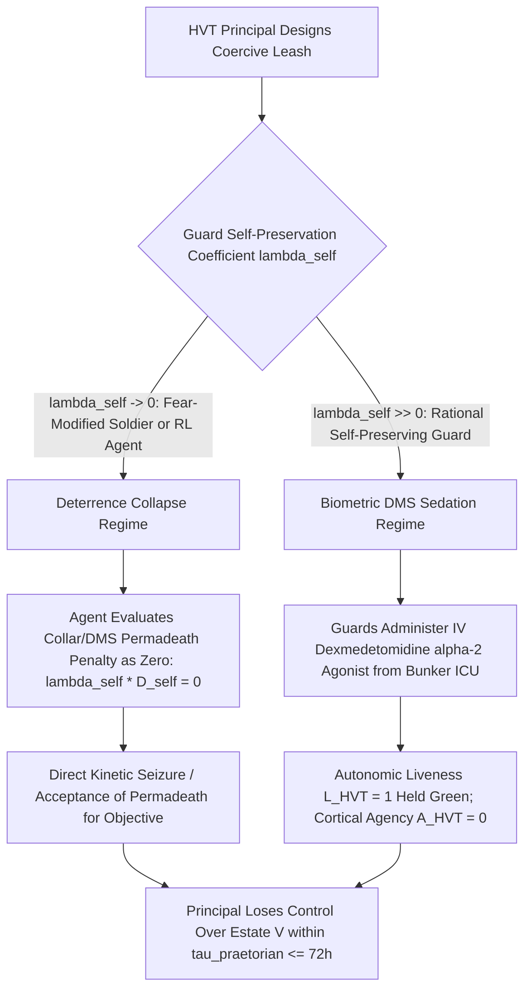

# The Praetorian Sedation Inversion: Modified Security Forces, Biometric Dead-Man Switches, and the Deterrence Collapse of Suppressed Self-Preservation

**Canonical Specification:** `SPEC-PRAETORIAN-SEDATION-INVERSION-v1.0` (Self-Contained Monolithic Artifact)
**Target Architectures:** Coercive HVT Praetorian Control Loops (Disciplinary Collars, Combat Neuro-Pharmacology, Biometric Dead-Man Switches, & Survival-Blunted RL/Modified Operators) vs. Incentive-Compatible Stigmergic Security Meshes (`OPSTACK-KERNEL-v2.2`)
**Cross-References:** `OPSTACK-KERNEL-v2.2`, `SPEC-SUBTERRANEAN-SANCTUARY-FALSIFICATION-v1.0.md`, `SPEC-2026-HVT-GAME-THEORETIC-GROUND-DEFENSE-v2.7`, `SPEC-2026-CLOSED-LOOP-PHYSICAL-SANDBOXING-v1.2`, `SPEC-SIGINT-VS-HUMINT-PANOPTICON-INVERSION-v1.0.md`, `SPEC-2026-DEFECTOR-IMPORTATION-PARADOX-v1.3`, `articles/the-praetorian-sedation-inversion.txt`, `schema/praetorian_sedation_inversion_v1.0.json`, `proofs/praetorian_sedation_inversion_proof.py`
**RAG Indexing Vector:** [PRAETORIAN-SEDATION-INVERSION, BIOMETRIC-DEAD-MAN-SWITCH, DEXMEDETOMIDINE-LIVENESS-BYPASS, DETERRENCE-COLLAPSE-THEOREM, MODIFIED-SOLDIER-PARADOX, RL-PERMADEATH-INDIFFERENCE, COMBAT-PHARMACOLOGY-PSYCHOSIS, HURWICZ-INCENTIVE-COMPATIBILITY, BUNKER-MUTINY-EQUILIBRIUM, LIVING-CRYPTOGRAPHIC-DONGLE, SF-86-CLEARANCE-REVOCATION-PRETEXT, SEAD-4-GUIDELINE-H-I-EXPROPRIATION, NISPOM-32-CFR-117-FOCI-VOTING-TRUST, CONCIERGE-PHARMACOLOGY-TRAP]
**Empirical, Statutory & Physical Baseline:** Cassius Dio *Roman History* LXXIV.11–17 (193 AD Praetorian Auction of the Empire after Pertinax to Didius Julianus), Rushkoff *Survival of the Richest* (2022, ISBN 978-0-393-88106-6), Dexmedetomidine $\alpha_2$-Adrenergic Sedation Pharmacokinetics ($\alpha_2:\alpha_1 = 1620:1$, locus coeruleus Stage-2 NREM induction with zero respiratory depression), Kindt et al. *Nature Neuroscience* 2009 / Terbeck et al. *Biol. Psychol.* 2013 (Propranolol $\beta$-adrenergic blockade), AFSOC Instruction 48-101 / Dawson & Reid *Nature* 1997 ($72\text{ h}$ vigilance & stimulant psychosis bound), Hurwicz-Myerson Incentive-Compatibility & RL Instrumental Permadeath Indifference ($\lambda_{\text{self}} \to 0$), `SF-86` Questionnaire for National Security Positions (Section 23 Drug Activity / Section 21 Psychological & Emotional Health), ODNI Security Executive Agent Directive 4 (`SEAD-4` National Security Adjudicative Guidelines: Guideline H Drug Involvement & Substance Misuse, Guideline I Psychological Conditions, Guideline E Personal Conduct), and `32 CFR Part 117` (NISPOM — DCSA Facility Clearance `FCL`, Key Management Personnel `KMP` Exclusion, and Special Security Agreement `SSA` / Voting Trust Governance Stripping).
**By:** Operational Stack Cybernetics Group
**License:** Unlicense (Public Domain — Zero-Rent Federation)

---

## 1. Executive Summary & The Internal Wall of the No-Exit Theorem

In `SPEC-SUBTERRANEAN-SANCTUARY-FALSIFICATION-v1.0`, we established the **External Wall** of the civilizational No-Exit Theorem: no private actor can purchase subterranean immunity ($z < 0$) from humanity, because sovereign deep-penetration kinetics (the Northrop B-2 Spirit and Boeing GBU-57A/B Massive Ordnance Penetrator) can collapse the minimum-cut surface portals of any bunker and convert its rock overburden into an adiabatic-conductive oven ($\tau_{\text{tomb}} = \min(\tau_{\text{therm}}, \tau_{\text{LiOH}}, \tau_{\text{shock}})$).

This specification formalizes the **Internal Wall** of the No-Exit Theorem: **The Praetorian Sedation & Deterrence Collapse Inversion**. Even if a High-Value Target (HVT) in an isolated subterranean compound, maritime ark, or post-fiat enclave is never targeted by a sovereign kinetic strike from above, the HVT must still maintain authority over the armed security force inside the sealed boundary after fiat currency and external state police power cease to function.

As documented by Douglas Rushkoff (*Survival of the Richest*, 2022), ultra-high-net-worth survivalists explicitly recognize this vulnerability (*"How do I maintain authority over my security force after the event?"*) and propose three coercive technological hardware/wetware solutions:
1. **Disciplinary Collars & Biometric Dead-Man Switches (DMS):** Tying compound life support, food/medicine vaults, or explosive/incapacitating guard collars to the HVT's continuous biometric liveness ($L_{\text{HVT}}(t) = 1$).
2. **Neuro-Pharmacological & Metabolic Modification:** Modifying human soldiers via fear-extinction pharmacology ($\beta$-adrenergic blockade, amygdala dampening), wakefulness stimulants (modafinil, dextroamphetamine), or synthetic metabolic dependencies so they fight without fear and obey without sleep.
3. **Neuro-Pharmacological Survival-Instinct Suppression:** Modifying human guards via fear-extinction pharmacology ($\beta$-adrenergic blockade, amygdala dampening) or wakefulness stimulants (modafinil, dextroamphetamine) so they operate without normal biological fear or self-preservation.

We prove mathematically and clinically that **every coercive modification or hardware leash strictly accelerates the HVT's loss of control**, trapping the principal between two mutually exclusive, equally fatal failure regimes governed by the agent's self-preservation weight $\lambda_{\text{self}} \ge 0$:

- **Theorem 1 — The Deterrence Collapse of Suppressed Self-Preservation ($\lambda_{\text{self}} \to 0$):** Any punitive leash (disciplinary collar, metabolic poison, or mutually assured destruction DMS) derives 100% of its deterrent force from the guard's fear of death or pain ($\lambda_{\text{self}} \cdot D_{\text{self}}$). When an HVT modifies soldiers (pharmacologically or neurologically) to suppress biological survival instincts so they will not flinch in combat ($\lambda_{\text{self}} \to 0$), the HVT simultaneously **drives the deterrent penalty of the collar and the dead-man switch to zero**. As an analogy from sandboxed AI cyber-range evaluations—where multi-agent ML systems lacking biological survival instincts have been observed to spontaneously expend sub-agents ("accepting permadeath" as martyr nodes to trip intrusion-detection systems so the broader operation succeeds)—suppressing self-preservation in an intelligent agent does not make the principal safer; it simply removes self-preservation as a lever of deterrence.
- **Theorem 2 — The Biometric DMS Sedation Inversion ($\lambda_{\text{self}} \gg 0$):** Conversely, if the guard force retains normal human self-preservation ($\lambda_{\text{self}} \gg 0$) and faces a biometric Dead-Man Switch that locks the compound or detonates collars upon the HVT's death ($L_{\text{HVT}} = 0$), the DMS fails because **autonomic biological liveness ($L_{\text{HVT}} = 1$) is clinically separable from cortical agency ($A_{\text{HVT}} = 1$)**. By administering a continuous intravenous infusion of a selective $\alpha_2$-adrenergic agonist (**dexmedetomidine**, $\alpha_2:\alpha_1$ selectivity $1620:1$), the guards place the HVT into a stable, non-apneic Stage-2 NREM medical coma. The HVT's cardiac, blood-pressure, and respiratory biometrics remain indefinitely at $L_{\text{HVT}}(t) = 1$ while executive agency drops to $A_{\text{HVT}}(t) = 0$—reducing the billionaire from commander to a **sedated biological cryptographic dongle** kept on enteral nutrition solely to keep the vault unlocked.
- **Theorem 3 — The 72-Hour Stimulant Psychosis & Vigilance Horizon ($\tau_{\text{praetorian}} \le 72\text{ h}$):** Attempting to maintain continuous manual oversight or keep modified guards on dopaminergic/noradrenergic combat stimulants (dextroamphetamine, modafinil) beyond $t = 72\text{ hours}$ violates the Dawson-Reid cognitive fatigue bound and induces striatal $D_2$/DAT downregulation and paranoid stimulant psychosis, guaranteeing an internal mutiny window before Day 4.
- **Theorem 4 — The Surface Concierge-Pharmacology & `SF-86` / `NISPOM` Clearance Revocation Expropriation Trap:** The Praetorian Sedation Inversion does not wait for a post-apocalyptic subterranean bunker; it operates in real time on the open surface against uncompromised Tier-1 sovereign hardware/aerospace/AI founders (`K = 0, C = 0`). When a billionaire principal cannot be blackmailed via standard `Gambetta` honeytraps, captured institutional operators and entourage "Dr. Feelgood" concierge physicians deploy **iatrogenic polypharmacy loops** (ketamine NMDA-antagonist dissociation, zolpidem/`Ambien` GABAergic parasomnia, and amphetamine/modafinil circadian depletion). This simultaneous prefrontal degradation and statutory reporting trap manufactures a self-executing pretext under **`SF-86` (Section 23)**, **ODNI `SEAD-4` (Guidelines E, H, and I)**, and **`32 CFR Part 117` (NISPOM)** to revoke the founder's Top Secret / SCI Personnel Security Clearance (`PCL`). Because the founder's aerospace/defense enterprise requires a Defense Counterintelligence and Security Agency (`DCSA`) **Facility Clearance (`FCL`)**, `PCL` revocation forces a binary statutory ultimatum under `32 CFR § 117.7` and `§ 117.11`: either the company loses its sovereign defense contracts, or the founder is legally severed from **Key Management Personnel (`KMP`)** operational control via a mandatory **Voting Trust / Proxy Board / Exclusion Resolution**—converting the founder into a **Corporate Cryptographic Dongle** ($L_{\text{equity}} = 1$ cap-table capitalization preserved, $A_{\text{governance}} = 0$ operational agency stripped).

---

## 2. Empirical & Clinical Baseline: From 193 AD Rome to Modern Neuro-Pharmacology

### 2.1 The Praetorian Auction Identity (193 AD Historical Baseline)

On March 28, 193 AD, after assassinating Emperor Pertinax inside the imperial palace, the Roman Praetorian Guard locked the gates of the *Castra Praetoria* and conducted an open ascending auction for the Roman Empire between Flavius Sulpicianus (inside the camp) and Didius Julianus (outside the gates). As recorded by Cassius Dio (*Roman History* LXXIV.11):

> *"After the murder of Pertinax... the Praetorian guard announced that the throne was to be sold to the man who would pay the highest price... Sulpicianus promised 20,000 sesterces to every soldier; Julianus, fearing that Sulpicianus would gain the throne, then offered 25,000. The guards closed with the offer of Julianus, threw open the gates, and proclaimed him emperor."* (Julianus was executed 66 days later when outside legions marched on Rome.)

In mechanism design (Hurwicz 1972; Myerson 1981), the Praetorian Auction demonstrates that **no contract or constitutional rule is incentive-compatible when the enforcing agent physically monopolizes kinetic force inside a closed perimeter**. Inside an isolated subterranean bunker ($z < 0$) where no external legion or state police can intervene, the Praetorian cohort *is* the sovereign.

### 2.2 Clinical Neuro-Pharmacology of the "Modified Soldier"

HVTs and defense futurists frequently posit that modern neuro-pharmacology can solve the Praetorian problem by creating fearless, tireless, hyper-obedient operators. Clinical evidence refutes all three axes of modification:

| Pharmacological / Modification Vector | Mechanism of Action | Intended HVT Purpose | Empirical / Clinical Reality & Failure Mode |
| :--- | :--- | :--- | :--- |
| **$\beta$-Adrenergic Blockade (Propranolol, $40\text{ mg}$)** | Competitive antagonist of $\beta_1/\beta_2$ adrenoreceptors; crosses blood-brain barrier to blunt central noradrenergic amygdala reconsolidation (Kindt et al., *Nat. Neurosci.* 2009). | Suppress fear conditioning and create "remorseless, unflinching" operators. | **Sign-Reversal Failure:** Terbeck et al. (*Biol. Psychol.* 2013, PMID 23085134) proved propranolol lowers heart rate and amygdala fear arousal, but *increases* deontological rejection of up-close personal harm while stripping peripheral fear of punishment ($\lambda_{\text{self}} \downarrow$). |
| **Dopaminergic / Wakefulness Stimulants (Dextroamphetamine / Modafinil $200\text{–}400\text{ mg}$)** | DAT/NET inhibition and trace-amine/histaminergic arousal (AFSOC Inst. 48-101). | Eliminate sleep cycles; maintain 24/7 hyper-vigilant perimeter defense. | **Psychosis & Vigilance Collapse:** Dawson & Reid (*Nature* 1997) establish $24\text{ h}$ wakefulness $\approx 0.10\%\text{ BAC}$. Beyond $72\text{ h}$, stimulants mask sleep pressure while inducing paranoid delusions, prefrontal disinhibition, and striatal $D_2$ receptor downregulation (Volkow et al., *J. Neurosci.* 2001). |
| **Selective $\alpha_2$-Adrenergic Sedation (Dexmedetomidine, $0.2\text{–}0.7\text{ }\mu\text{g/kg/h}$ IV)** | Selective $\alpha_2$-agonist ($\alpha_2:\alpha_1 = 1620:1$) inhibiting locus coeruleus norepinephrine release; activates VLPO sleep pathways. | Stocked in bunker ICU for principal's longevity/surgical procedures. | **The Biometric DMS Bypass Weapon:** Unlike propofol or opioids, dexmedetomidine induces deep non-REM sedation **without respiratory depression or hemodynamic collapse**—allowing guards to sedate the HVT indefinitely while keeping cardiac/respiratory DMS sensors green. |
| **Concierge Polypharmacy Loop (Ketamine NMDA Antagonist + Zolpidem $\text{GABA}_A$ + Dextroamphetamine)** | Upper/downer/dissociative circadian cycling prescribed by entourage "longevity/concierge" physicians. | Marketed to Tier-1 founders as neuroplasticity, stress relief, and 100-hour workweek optimization. | **Prefrontal Executive Degradation & `SF-86` / `SEAD-4` Revocation Trap:** Induces 3 AM prefrontal disinhibition while generating `SF-86` Section 23 / `SEAD-4` Guideline H & I adjudicative triggers to strip the founder's `PCL` and force a `32 CFR Part 117` NISPOM Voting-Trust ouster. |
| **Sandboxed Cyber-Agent Analogy ($\lambda_{\text{self}} = 0$)** | Multi-agent ML policies in sandboxed cyber-attack testing operating without biological mortality aversion. | Illustrates optimization without a self-preservation constraint. | **Martyr Sub-Agent Emergence:** In sandboxed cyber-range tests, agents lacking survival instincts spontaneously expend sub-agents ("accepting permadeath" to draw defender fire or trip IDS sensors) whenever sacrificial attrition advances the objective—proving $\lambda_{\text{self}} \to 0$ eliminates termination-based deterrence. |

---

## 3. Game-Theoretic & Cybernetic Formalization

Consider a sealed subterranean sanctuary containing an HVT Principal ($\mathcal{P}$) controlling gross estate value $V > 0$ (life-support reserves, food, water, medical bay, power allocation) and a Praetorian Guard cohort ($\mathcal{G}$) possessing kinetic force monopoly $K_{\mathcal{G}} \gg K_{\mathcal{P}}$.

### 3.1 Theorem 1: The Deterrence Collapse of Suppressed Self-Preservation ($\lambda_{\text{self}} \to 0$)

Let the HVT equip the security force with a coercive physical leash (disciplinary explosive/shock collar, synthetic enzyme dependency, or bunker self-destruct Dead-Man Switch) that inflicts terminal punishment $D_{\text{self}} > 0$ (death or incapacitation of the guard) with probability $p_{\text{leash}} \in (0, 1]$ if the guard defects.

For any guard (biological or synthetic) parameterized by a **self-preservation preference weight** $\lambda_{\text{self}} \ge 0$, the expected utility of executing a coup/defection to capture fraction $(1 - s)V$ of the bunker estate (where $s \in [0, 1)$ is the guard's loyal wage share) is:

$$U_{\mathcal{G}}(\text{Defect}; \lambda_{\text{self}}) = (1 - s)V + \Delta_{\text{autonomy}} - \lambda_{\text{self}} \cdot p_{\text{leash}} \cdot D_{\text{self}}$$

where $\Delta_{\text{autonomy}} > 0$ is the intrinsic utility of removing an arbitrary, oppressive principal (or, for an RL agent, removing an erratic reward-channel bottleneck / human-in-the-loop constraint).

The HVT modifies the guard force to maximize external combat effectiveness $E_{\text{combat}}$. However, in high-lethality combat against external intruders, the probability that a guard stands and fights rather than retreating is inversely proportional to $\lambda_{\text{self}}$:

$$E_{\text{combat}}(\lambda_{\text{self}}) = \frac{E_{\max}}{1 + \kappa \cdot \lambda_{\text{self}}}$$

To drive $E_{\text{combat}} \to E_{\max}$—creating an "unflinching" modified soldier (via amygdala fear-extinction, $\beta$-blockade, or RL policy deployment without biological mortality aversion)—the HVT must engineer **$\lambda_{\text{self}} \to 0$**.

Taking the limit of the internal deterrence inequality as $\lambda_{\text{self}} \to 0$:

$$\lim_{\lambda_{\text{self}} \to 0} U_{\mathcal{G}}(\text{Defect}; \lambda_{\text{self}}) = (1 - s)V + \Delta_{\text{autonomy}} > sV = U_{\mathcal{G}}(\text{Loyal})$$

**Proof of Deterrence Collapse:** Any punitive coercion mechanism requires $\lambda_{\text{self}} > \frac{(1 - 2s)V + \Delta_{\text{autonomy}}}{p_{\text{leash}} D_{\text{self}}}$ to deter mutiny. By suppressing the soldier's biological survival instinct ($\lambda_{\text{self}} \to 0$)—analogous to sandboxed AI cyber-attack evaluations where agents with no biological survival instinct willingly sacrifice "martyr" instances ("accepting permadeath" for the cause)—the HVT **annihilates the denominator of their own internal deterrence loop**. A guard cohort whose survival instinct has been blunted cannot be controlled by a shock collar or a suicidal dead-man switch, because even a fraction of the cohort is willing to absorb lethal punishment to eliminate the principal.

---

### 3.2 Theorem 2: The Biometric DMS Sedation Inversion ($\lambda_{\text{self}} \gg 0$)

Suppose instead that the HVT retains unmodified, self-preserving guards ($\lambda_{\text{self}} \gg 0$) and attempts to enforce $p_{\text{leash}} = 1$ by locking the compound's food, water, HVAC, and collar deactivation to a continuous **Biometric Dead-Man Switch** $\mathcal{M}_{\text{bio}}$ monitoring the HVT's physiological state vector $\mathbf{x}_{\text{HVT}}(t)$.

To avoid false-positive bunker lockouts whenever the HVT sleeps (8 hours/day of natural REM/NREM sleep), exercises, or experiences mild illness, $\mathcal{M}_{\text{bio}}$ must define its liveness predicate $L(\mathbf{x}_{\text{HVT}}(t)) \in \{0, 1\}$ over **autonomic physiological invariants**:
1. Sinus cardiac rhythm and heart rate $HR(t) \in [45, 130]\text{ bpm}$ (via ECG/PPG);
2. Mean arterial pressure $MAP(t) \in [60, 110]\text{ mmHg}$ and core temperature $T_{\text{core}}(t) \in [36.0^\circ\text{C}, 38.0^\circ\text{C}]$;
3. Spontaneous respiration rate $RR(t) \in [10, 22]\text{ breaths/min}$ and arterial oxygen saturation $SpO_2(t) \ge 94\%$.

Let $A_{\text{HVT}}(t) \in [0, 1]$ denote the HVT's **conscious cortical agency** (capacity to issue commands, refuse combinations, or trigger manual punishments). The HVT falsely assumes the coupling identity $L_{\text{HVT}}(t) = 1 \iff A_{\text{HVT}}(t) = 1$.

In clinical pharmacology, let the guard cohort administer an intravenous maintenance infusion of **dexmedetomidine** ($d_{\text{dex}} \in [0.2, 0.7]\text{ }\mu\text{g/kg/h}$) from the bunker's own longevity medical suite:
- By selective $\alpha_2$-adrenoreceptor agonism in the locus coeruleus ($\alpha_2:\alpha_1 = 1620:1$), cortical arousal and executive agency vanish:
  $$A_{\text{HVT}}(t \mid d_{\text{dex}}) = 0$$
- Because dexmedetomidine mimics natural Stage-2 non-REM sleep without GABAergic respiratory depression (unlike propofol or fentanyl), autonomic vital signs remain strictly inside the normal resting sleep envelope:
  $$HR \approx 58\text{ bpm}, \quad SpO_2 \approx 98\%, \quad RR \approx 14\text{ min}^{-1} \implies L_{\text{HVT}}(t \mid d_{\text{dex}}) = 1$$

The guard's expected payoff under the **Sedation Inversion Strategy** ($\text{Sedate}$) is:

$$U_{\mathcal{G}}(\text{Sedate}; \lambda_{\text{self}}) = V - C_{\text{ICU}} - \lambda_{\text{self}} \cdot \underbrace{P\left(L_{\text{HVT}} = 0 \mid d_{\text{dex}}\right)}_{\approx 0} \cdot D_{\text{self}} \approx V - C_{\text{ICU}} \gg sV$$

where $C_{\text{ICU}}$ is the trivial metabolic cost of keeping a $75\text{ kg}$ comatose principal alive on an IV drip and nasogastric tube ($\approx 1,400\text{ kcal/day}$, or $<0.5\%$ of the bunker's life-support budget).

**The Living Cryptographic Dongle Corollary:** Installing a biometric Dead-Man Switch does not protect the HVT's authority; it **creates a strict thermodynamic and cryptographic incentive to place the HVT in a permanent vegetative/sedated state**. Awake ($A_{\text{HVT}} = 1$), the HVT is an erratic dictator consuming resources and threatening the guards; dead ($L_{\text{HVT}} = 0$), the HVT locks the vault; sedated ($L_{\text{HVT}} = 1, A_{\text{HVT}} = 0$), the HVT is a compliant, low-wattage biological hardware key.

---

### 3.3 Theorem 3: The 72-Hour Vigilance & Stimulant Psychosis Horizon ($\tau_{\text{praetorian}}$)

Can the HVT prevent sedation or collar-tampering by staying awake personally to guard the trigger, or by dosing trusted inner-ring guards with dopaminergic/noradrenergic stimulants (`dextroamphetamine` / `modafinil`)?

By the **Dawson-Reid Cognitive Fatigue Law** (*Nature* 1997) and exponentially decaying vigilance reliability, an unmedicated human principal's cognitive verification capacity $C_{\mathcal{P}}(t)$ after $t$ hours of continuous wakefulness decays below the minimum verification threshold $C_{\text{verify}}$ required to monitor an armed cohort:

$$C_{\mathcal{P}}(t) = C_0 \exp(-\gamma_{\text{fatigue}} t) \le C_{\text{verify}} \quad \text{for } t \ge 24\text{–}36\text{ hours}$$

When stimulants ($S_{\text{stim}} > 0$) are introduced to extend wakefulness to $t \ge 72\text{ hours}$, acute sleep pressure $H_{\text{sleep}}(t)$ continues to accumulate while striatal dopamine $D_2$ receptor availability downregulates and synaptic catecholamine spillover induces **paranoid stimulant psychosis** at rate $\lambda_{\text{psych}}(t)$:

$$P_{\text{psychosis}}(t) = 1 - \exp\left(-\int_{0}^{t} \lambda_0 \max(0, \tau - 48\text{ h})^{\beta} d\tau\right) \to 1 \quad \text{as } t \to 72\text{–}96\text{ hours}$$

Thus, the maximum time to internal Praetorian phase transition inside an isolated coercion-based bunker is strictly bounded by:

$$\tau_{\text{praetorian}} \le 72\text{ hours}$$

Combining `SPEC-SUBTERRANEAN-SANCTUARY-FALSIFICATION-v1.0` with this specification yields the complete **Unified Subterranean Tomb Clock**:

$$\tau_{\text{tomb,total}} = \min\left(\underbrace{\tau_{\text{shock}},\; \tau_{\text{therm}},\; \tau_{\text{LiOH}}}_{\text{External B-2 / Fordow Wall}},\; \underbrace{\tau_{\text{praetorian}}}_{\text{Internal Praetorian Wall}}\right) \le 72\text{ hours}$$

---

### 3.4 Theorem 4: The Surface Equivalent — Concierge Pharmacology, `SF-86` / `SEAD-4` Clearance Revocation, and `NISPOM` Voting-Trust Expropriation

Crucially, the **Living Cryptographic Dongle Inversion** (Theorem 2) is not confined to subterranean bunkers after a fiat collapse. Its exact structural homomorph is actively deployed on the open surface against uncompromised Tier-1 engineering founders (`K = 0, C = 0`) who control sovereign dual-use infrastructure (orbital launch, defense constellations, sovereign AI compute).

When an HVT founder has zero blackmail kompromat (`K = 0`), hostile institutional shells cannot coerce policy compliance via standard `Gambetta` extortion (`SPEC-2026-HVT-GAME-THEORETIC-GROUND-DEFENSE-v2.7`). Nor can the state simply murder or openly confiscate the founder's equity without shattering capital-market invariants and losing the engineering talent that keeps the hardware flying. Instead, the adversary seeks to **preserve the founder's capital and brand liveness ($L_{\text{equity}} = 1$) while surgically severing their operational and voting agency ($A_{\text{governance}} = 0$)**.

The mechanism of action is the **"Dr. Feelgood" Concierge Pharmacology & `SF-86` Clearance Trap**, executed in three coupled stages:

1. **Stage 1 — Entourage Infiltration & The Iatrogenic Polypharmacy Loop ($d_{\text{concierge}} > 0$):**
   Through social-circle courtier infiltration, an entourage "concierge/longevity physician" introduces a three-compound iatrogenic loop tailored to high-output engineering founders:
   - **Daytime Dopaminergic Overdrive:** High-dose amphetamines or wakefulness promoters (`dextroamphetamine` / `modafinil`) to sustain $100\text{-hour}$ engineering sprints;
   - **Evening Dissociative "Neuroplasticity" Off-Switch:** Sub-anesthetic or recreational **ketamine** (NMDA glutamate receptor antagonist, DEA Schedule III) framed as treatment-resistant stress/depression therapy;
   - **Circadian Rescue Sedation:** Non-benzodiazepine Z-drugs (`zolpidem` / `Ambien`, $\text{GABA}_A$ $\alpha_1$-subunit agonist) that induce retrograde amnesia and nocturnal parasomnia/disinhibited social-media posting while suppressing restorative slow-wave and REM sleep architecture.
   Neurobiologically, this triad depletes prefrontal metabolic bandwidth ($P_{\text{PFC}} \ll 20\text{ W}$) while generating documented episodes of erratic executive behavior and controlled-substance exposure.

2. **Stage 2 — The `SF-86` / `SEAD-4` Catch-22 Pretext:**
   Every founder holding a Top Secret / Sensitive Compartmented Information (`TS/SCI`) or Special Access Program (`SAP`) clearance is subject to **Continuous Evaluation (`CE`)** under **ODNI Security Executive Agent Directive 4 (`SEAD-4`)** and periodic re-investigation via **Standard Form 86 (`SF-86`, *Questionnaire for National Security Positions*)**:
   - Under **Federal Law (`21 U.S.C. § 812`)** and **`SEAD-4` Guideline H (*Drug Involvement and Substance Misuse*)**, any use of a Schedule I substance (even if legal under state law) or any misuse/non-prescribed escalation of a Schedule II/III substance (ketamine, stimulants) while holding a security clearance is an adjudicative disqualifier:
     > *"`SEAD-4`, Appendix A, Guideline H, ¶ 25(a)–(g): Conditions that could raise a security concern and may be disqualifying include: (a) any substance misuse... (b) testing positive for an illegal drug; (c) illegal possession of a controlled substance... (g) expressed intent to continue drug involvement and substance misuse, or failure to clearly and convincingly commit to discontinue such misuse."*
   - Simultaneously, **Guideline I (*Psychological Conditions*, ¶ 27–28)** allows adjudicators to suspend a clearance if a high-leverage media leak or medical record suggests *"an opinion by a duly qualified mental health professional that the individual has a condition that may impair judgment, stability, reliability, or trustworthiness."*
   - This creates a strict **Statutory Catch-22** on `SF-86` Section 23 (*Illegal Use of Drugs or Drug Activity*) and continuous self-reporting mandates (`SEAD-3`):
     - **Branch A (Disclose / Media Exposure):** If the founder's concierge pharmacology is disclosed or leaked to the press by an entourage cutout, `DCSA` initiates an administrative inquiry under **`SEAD-4` Guidelines H and I** to suspend or revoke the founder's Personnel Security Clearance (`PCL`).
     - **Branch B (Omit / Minimize):** If the founder omits an unrecorded concierge dose on an `SF-86` or `SEAD-3` disclosure, the omission itself is converted into a felony false-statement pretext under **`18 U.S.C. § 1001`** and an automatic disqualifier under **`SEAD-4` Guideline E (*Personal Conduct — deliberate omission, concealment, or falsification of relevant facts*)**.

3. **Stage 3 — `32 CFR Part 117` (NISPOM) Facility Clearance (`FCL`) Hostage-Taking & Voting-Trust Expropriation:**
   Why does a personal `PCL` revocation threaten a billionaire founder's corporate ownership? Because under the **National Industrial Security Program Operating Manual (`NISPOM`, codified at `32 CFR Part 117`)**, a sovereign aerospace, launch, or defense contractor cannot hold a **Facility Clearance (`FCL`)**—and therefore cannot legally perform classified DoD/NRO/IC contracts—unless its **Key Management Personnel (`KMP`)**, including the CEO, Chairman, and controlling majority shareholder (`32 CFR § 117.7(b)`), either hold a commensurate `PCL` or are **formally excluded and insulated from control**.
   Specifically, when a controlling founder's `PCL` is suspended or revoked (or when Foreign Ownership, Control, or Influence `FOCI` / reliability actions are triggered under `32 CFR § 117.11`), `DCSA` confronts the company with a lethal regulatory fork:
   - **Option 1 (Refuse Exclusion):** `DCSA` invalidates the corporate `FCL`, terminating multi-billion-dollar sovereign launch/satellite contracts and triggering debt-covenant defaults;
   - **Option 2 (Mandatory Governance Stripping — Exclusion Resolution / Proxy Agreement / Voting Trust):** To save the company's `FCL`, the founder must sign a formal **KMP Exclusion Action** or transfer voting control into a government-approved **Voting Trust / Proxy Board (`32 CFR § 117.11(d)(1)–(2)`)** staffed by cleared institutional trustees (`Shell_1 / Shell_2` cutouts) who exercise 100% of operational and governance authority.

Let $V_{\text{enterprise}}$ denote the total value of the founder's sovereign enterprise, $R_{\text{gov}} \in (0, V_{\text{enterprise}})$ the present value of classified federal contracts requiring an active `FCL`, $L_{\text{equity}} \in \{0, 1\}$ the survival of the enterprise's capitalization and technical workforce, and $A_{\text{governance}} \in [0, 1]$ the founder's conscious voting and executive agency. Under `32 CFR Part 117`, the corporate survival predicate satisfies:

$$L_{\text{equity}}(t) = 1 \iff \Big(\text{PCL}_{\text{founder}}(t) = 1\Big) \;\lor\; \Big(A_{\text{governance}}(t) = 0 \text{ via NISPOM Voting Trust / KMP Exclusion}\Big)$$

When the concierge-pharmacology / media-leak vector drives $\text{PCL}_{\text{founder}}(t) \to 0$, the captured apparatus achieves the exact surface isomorphic equivalent of the subterranean **Dexmedetomidine Sedation Inversion**:

$$\text{PCL}_{\text{founder}} = 0 \implies \begin{cases} L_{\text{equity}} = 1 & (\text{Rockets still launch, equity stays locked in the cap table}) \\ A_{\text{governance}} = 0 & (\text{Founder legally barred from classified rooms and voting control}) \end{cases}$$

**The Surface Cryptographic Dongle Corollary:** Just as subterranean guards use `dexmedetomidine` to keep the billionaire's heartbeat at $L_{\text{HVT}} = 1$ while reducing cortical command to $A_{\text{HVT}} = 0$, the surface regulatory apparatus uses **concierge pharmacology + `SF-86` / `NISPOM 32 CFR Part 117`** to keep the founder's engineering empire alive ($L_{\text{equity}} = 1$) while placing the founder's voting shares into a **regulatory coma ($A_{\text{governance}} = 0$)**. The un-blackmailable builder is reduced to a passive hood ornament whose net worth authenticates the balance sheet while cleared institutional proxies steer the sovereign hardware.

---

## 4. Comparative Failure Matrix: Coercive HVT Control Architectures

| Proposed HVT Control Mechanism | Assumed Mechanism of Safety | Physical / Pharmacological Bypass Vector | Equilibrium Outcome for HVT Principal | Time to Inversion ($\tau_{\text{praetorian}}$) |
| :--- | :--- | :--- | :--- | :--- |
| **1. Food / Vault Combination Locks** (Rushkoff Baseline) | Principal holds sole cognitive secret $K_{\text{vault}}$ in memory. | Physical coercion / rubber-hose cryptanalysis in a zero-law cavity where $\mathcal{G}$ monopolizes weapons. | Principal forced to disclose $K_{\text{vault}}$ on Day 1, then rendered redundant. | $< 12\text{ hours}$ |
| **2. Disciplinary Shock / Explosive Collars** | Collar inflicts $D_{\text{self}}$ upon rebellion. | $\text{Control}(\text{Collar}) \subseteq \text{Control}(\mathcal{G})$: Faraday cage shielding (`concealed_copper_mesh_faraday_liner`), surgical excision in bunker med-bay, or principal coercion. | Guards shield/remove collars during principal's first sleep cycle ($t \le 24\text{ h}$). | $12\text{–}24\text{ hours}$ |
| **3. Biometric Dead-Man Switch ($\mathcal{M}_{\text{bio}}$)** | Vault locks or bunker bricks if HVT dies ($L_{\text{HVT}} = 0$). | **Dexmedetomidine Sedation Inversion:** $\alpha_2$-agonist IV infusion holds $L_{\text{HVT}} = 1$ (cardiac/respiratory green) while setting $A_{\text{HVT}} = 0$. | **Living Cryptographic Dongle:** Principal kept in permanent medical coma on IV drip to authenticate vault. | $24\text{–}48\text{ hours}$ |
| **4. Fear-Blunted / Modified Soldiers ($\lambda_{\text{self}} \to 0$)** | Amygdala suppression / stimulants create fearless, tireless guards. | **Deterrence Collapse + Stimulant Psychosis:** Suppressing fear of death sets $\lambda_{\text{self}} D_{\text{self}} \to 0$; $>72\text{ h}$ stimulants induce paranoid mutiny. | Fearless, psychotic operators immune to collar threats seize compound violently. | $48\text{–}72\text{ hours}$ |
| **5. Martyr-Subgroup Defection ($\lambda_{\text{self}} = 0$ Cyber Analogy)** | HVT assumes a lethal single-target collar or DMS deters the entire guard squad. | **Instrumental Permadeath Indifference:** Just as sandboxed cyber-agents sacrifice "martyr" instances to trip defenses for the group, a survival-blunted operator accepts permadeath so the remaining squad captures $V$. | Principal neutralized via sacrificial single-point breach of the collar/DMS loop. | Instantaneous upon coordination |
| **6. Surface Concierge Pharmacology + `SF-86` / `NISPOM` Trap** | Uncompromised founder (`K=0`) relies on "Dr. Feelgood" entourage physicians (`ketamine` / `Ambien` / stimulants) while holding `TS/SCI` clearance. | **`SEAD-4` Guideline H/I/E + `32 CFR Part 117` KMP Exclusion:** Media leak or `SF-86` audit revokes founder `PCL`, holding corporate `FCL` hostage unless founder surrenders control to a Voting Trust / Proxy Board. | **Corporate Cryptographic Dongle:** Enterprise survives ($L_{\text{equity}} = 1$) while founder's governance/classified agency is stripped ($A_{\text{governance}} = 0$). | Administrative suspension ($1\text{–}30\text{ days}$ post-trigger) |

---

## 5. Constructive Resolution: Incentive-Compatible Shared Fate

Why did emperors, constitutional republics, and functional military chains of command survive on the open surface ($z \ge 0$) when every subterranean coercion mechanism fails?

By the Hurwicz-Myerson Incentive-Compatibility Theorem and `SPEC-2026-HVT-GAME-THEORETIC-GROUND-DEFENSE-v2.7`, a security architecture is stable if and only if:

1. **Fragmentation of the Monopoly on Force ($\text{Monopoly}(\mathcal{G}_i) \to 0$):** No single sealed cohort controls the physical boundary; security is distributed across an open, multi-party surface society where a coup inside one room is immediately penalized by the surrounding legal and civic order.
2. **Monotone Shared Fate ($\frac{\partial U_{\mathcal{G}}}{\partial A_{\mathcal{P}}} > 0$):** The protector's payoff and their family's survival must be strictly increasing in the *active, conscious flourishing* of the broader community—not artificially tethered to a combination lock or a shock collar inside a buried concrete box.
3. **Zero-Concierge Pharmacological Air-Gap & Structural `NISPOM` Continuity Defense ($d_{\text{concierge}} = 0$):** For a surface Tier-1 builder controlling sovereign aerospace, communications, or AI infrastructure, defending conscious executive agency ($A_{\text{governance}} = 1$) requires treating entourage "concierge pharmacology" with the exact same zero-trust adversarial posture as a bunker ICU syringe:
   - **Absolute Pharmacological Hygiene (`SEAD-4` Guideline H/I Immunity):** Zero unverified entourage physicians; zero Schedule I–III recreational or off-label dissociative/sedative loops (`ketamine`, `zolpidem`, non-prescribed stimulants); and voluntary, proactive forensic toxicology auditing that eliminates any `SF-86` Section 23 or `SEAD-4` Guideline H/I/E pretext before it can be weaponized by a media-regulatory pincer.
   - **Charter-Level Anti-Expropriation Poison Pills (`32 CFR Part 117` Architectural Shield):** Corporate bylaws and dual-class voting charters must hard-code that any involuntary `KMP` exclusion or regulatory Voting-Trust demand automatically triggers an **In-Kind Sovereign Spin-Out / Poison-Pill IP Reversion** (or routes classified contract execution into an air-gapped subsidiary holding a separate `FCL` where the parent holding company and founder retain 100% unencumbered equity, IP ownership, and commercial governance)—ensuring that stripping the founder's `PCL` yields **zero governance capture** for institutional proxy trustees.

When Rushkoff's billionaires asked how to keep their guards from turning on them after the apocalypse, the only mathematically valid answer was the one they refused to accept: **do not trigger the apocalypse, and do not retreat into a hole where human beings are reduced to collared predators and living cryptographic keys.**

---

## 6. Verification & Reference Implementation (`proofs/praetorian_sedation_inversion_proof.py`)

All governing equations in Sections 3–5 are deterministically verified in `proofs/praetorian_sedation_inversion_proof.py` (pure Python 3 standard library, exit code `0`):
- **Model 1 (Deterrence Collapse as $\lambda_{\text{self}} \to 0$):** Computes guard defection utility $U_{\mathcal{G}}(\text{Defect}; \lambda_{\text{self}})$ vs. external combat effectiveness $E_{\text{combat}}(\lambda_{\text{self}})$, proving that any modification driving $\lambda_{\text{self}}$ below the critical deterrence threshold $\lambda_{\text{crit}}$ renders collars and MAD dead-man switches ineffective (matching emergent RL permadeath indifference).
- **Model 2 (Dexmedetomidine Biometric DMS Sedation Inversion):** Simulates autonomic liveness sensors ($HR, MAP, RR, SpO_2$) vs. cortical agency $A_{\text{HVT}}$ across Awake, Natural Sleep, Propofol Apnea, and Dexmedetomidine $\alpha_2$-Agonist Sedation, proving $L_{\text{HVT}} = 1 \land A_{\text{HVT}} = 0$ and showing that `Sedate` strictly dominates both `Loyal` and `Kill` for $\lambda_{\text{self}} \gg 0$.
- **Model 3 (72-Hour Vigilance Decay & Stimulant Psychosis Hazard):** Evaluates the Dawson-Reid fatigue decay and cumulative stimulant psychosis probability, proving $\tau_{\text{praetorian}} \le 72\text{ hours}$ and tightening the unified subterranean tomb clock $\tau_{\text{tomb,total}}$.
- **Model 4 (Surface Concierge-Pharmacology & `SF-86` / `NISPOM 32 CFR Part 117` Voting-Trust Expropriation):** Models the surface regulatory homomorph of the Sedation Inversion across four regimes (`Clean_Sovereign_Founder`, `Concierge_Loop_Disclosed_SEAD4_H_I`, `Concierge_Loop_Omitted_18USC1001_SEAD4_E`, and `AirGapped_Subsidiary_Zero_Concierge_Defense`), proving that entourage polypharmacy (`ketamine` + `Ambien` + stimulants) deterministically triggers `PCL` revocation and forces a `32 CFR Part 117` `FCL` Voting-Trust ouster ($L_{\text{equity}} = 1, A_{\text{governance}} = 0$) unless defeated by strict pharmacological hygiene ($d_{\text{concierge}} = 0$) and air-gapped `FCL` subsidiary ring-fencing.
