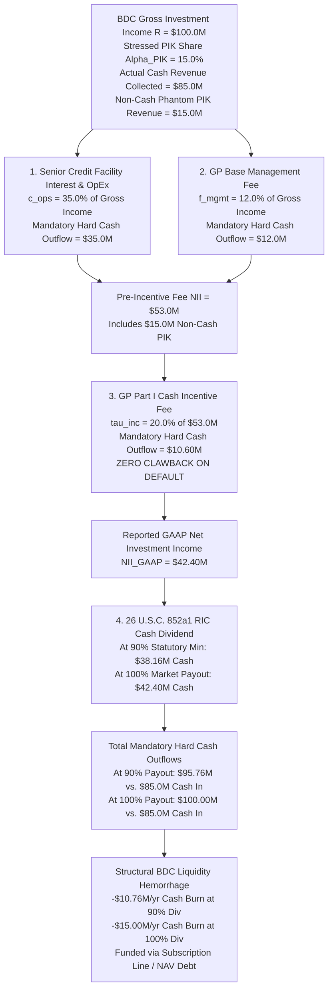
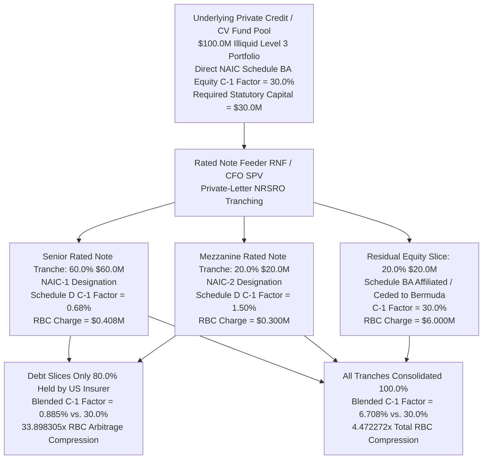

# The Synthetic Yield Ouroboros: Private Credit PIK Toggles, GP-Led Continuation Vehicles, Rated Note Feeders, and the Bermuda Annuity Reinsurance Sink

**Canonical Specification:** `SPEC-PRIVATE-CREDIT-PIK-OUROBOROS-AND-BERMUDA-REINSURANCE-ARBITRAGE-v1.0`  
**Target Architectures:** Private Credit Direct Lending & BDC Complex ($1.7T+ AUM), GP-Led Continuation Vehicles ($72B–$107B/yr), Fund-Level NAV & Subscription Facilities, Rated Note Feeders (RNFs) & Collateralized Fund Obligations (CFOs), and Offshore Bermuda/Cayman Life & Annuity Reinsurance Sidecars ($900B+ Ceded US Liabilities)  
**Cross-References:** `SPEC-CLARIUM-FX-PARADOX-AND-CUTOUT-CAPITAL-BRIDGE-v1.0`, `SPEC-THREE-SHELL-CUTOUT-AND-REFLEXIVE-FX-ARBITRAGE-v1.0`, `SPEC-NEOCLOUD-GPU-DEBT-AND-INFERENCE-DEFLATION-v1.0`, `SPEC-QUIET-PERIOD-GUN-JUMPING-AND-REVENUE-QUALITY-AUDIT-v1.0`, `proofs/proof_private_credit_pik_ouroboros.py`, `schema/private_credit_pik_ouroboros_v1.0.json`  
**RAG Indexing Vector:** [PRIVATE-CREDIT-PIK-SHADOW-DEFAULT, SYNTHETIC-PIK-REVOLVER-ROUND-TRIP, BDC-RIC-26-USC-852-CASH-DRAIN, NO-CLAWBACK-NII-PART-I-SIPHON, CONTINUATION-VEHICLE-80B-6-SELF-DEALING, CROSS-FUND-EQUITY-DEBT-COLLUSION, RATED-NOTE-FEEDER-NAIC-RBC-ARBITRAGE, BERMUDA-BSCR-AG53-ANNUITY-SINK]  
**Empirical/Statutory/Physical Baseline:** 26 U.S.C. §§ 852(a)(1), 1272(a) (RIC 90% Cash Distribution Mandate on Non-Cash OID/PIK Income); 15 U.S.C. §§ 80a-56, 80a-60(a)(2) (BDC 150% Asset Coverage / 2:1 Debt-to-Equity Cap & Part I NII Incentive Fee Structure); 15 U.S.C. § 80b-6(1)–(4) & 17 CFR § 275.206(4)-8 (Advisers Act Principal Transactions, Cross-Fund Collusion & Level 3 Valuation Manipulation); FASB ASC 820-10-35 (Level 3 Unobservable Inputs) & ASC 326-20 (CECL Allowance & TDR Modification Disclosures); NAIC Valuation of Securities (VOS) Task Force, Risk-Based Capital (RBC) C-1 Factors (30.0% Equity vs. 0.68%–1.50% Rated Debt via Private-Letter Ratings) & Actuarial Guideline 53 (AG 53); Bermuda Monetary Authority (BMA) BSCR Reinsurance Framework; Lincoln International Q1 2025 Senior Debt Index (11.0% Total PIK, 6.0% 'Bad PIK' Shadow Default Rate, 54.55% Bad-PIK Share, LTV Expansion from 49.0% to 86.0%); Fitch BDC Index (8.1% Average PIK Share of Interest/Dividend Income; 101.3% Unadjusted vs. 93.1% Cash Dividend Coverage); Lazard/Jefferies Secondary Reviews ($72B in 2024 to $107B in 2025 GP-Led CV Volume); ALIRT/NAIC Offshore Reinsurance Baseline ($900B+ Ceded US Life/Annuity Reserves to Bermuda, +$73B in 2025).  
**By:** Operational Stack Cybernetics Group  
**License:** Unlicense (Public Domain)

---

## 1. Executive Summary & System Architecture: The Four-Gear Synthetic Yield Ouroboros

Across the $1.7 trillion private credit direct lending complex, the post-2022 monetary tightening regime (SOFR baseline of $5.25\%$ plus $5.75\%$ contractual cash spread, yielding an $11.0\%$ all-in cash floating burden) has triggered a systemic solvency fracture across 2020–2022 vintage middle-market leveraged buyouts (LBOs). Rather than recognizing cash-flow defaults and executing transparent balance-sheet restructurings under Chapter 11 or FASB ASC 326-20 Current Expected Credit Loss (CECL) impairment frameworks, alternative asset managers have constructed a four-gear accounting and regulatory-arbitrage machine—**The Synthetic Yield Ouroboros**—that converts uncollectible debt service into compounding phantom principal, extracts immediate non-clawback cash management and Part I incentive fees from that phantom income, recycles impaired equity across affiliated fund vehicles to avoid mark-to-market price discovery, and dumps the resulting multi-layered leverage stack into offshore life and annuity reinsurance balance sheets.

```mermaid
graph TD
    subgraph Gear1 [Gear 1: Operating Company & BDC Shadow Default]
        A1[Stressed LBO Portfolio Co<br/>Initial Debt P0 = $100.0M<br/>All-In Cash Rate = 11.0%<br/>Pre-Interest FCF = $8.25M]
        A2[True Pre-Toggle Cash DSCR = 0.75x<br/>Economic Default Threshold Breached]
        A3[Mid-Life 'Bad PIK' Toggle Amendment<br/>Step-Up +150 bps to 12.5% Total Coupon<br/>4.5% Cash + 8.0% PIK Capitalization]
        A4[Synthetic PIK Revolver / DDTL Round-Trip<br/>Draw $6.50M Revolver to Pay Cash Interest<br/>Reported PIK = 0.0% | True DSCR = 0.75x]
        A5[Year 3 Compounded Principal = $125.9712M<br/>Cumulative Phantom PIK = $25.9712M<br/>Optical Cash DSCR = 1.833333x<br/>Lincoln LTV Expansion: 49.0% to 86.0%]
        A1 --> A2
        A2 --> A3
        A2 --> A4
        A3 --> A5
        A4 --> A5
    end

    subgraph Gear1B [Gear 1B: BDC / RIC Statutory Liquidity Drain]
        B1[26 U.S.C. 852a1 RIC Tax Mandate<br/>PIK Included in Taxable NII under 26 U.S.C. 1272a<br/>Must Distribute >= 90% of NII in Hard Cash]
        B2[No-Clawback Part I Cash Incentive Siphon<br/>GP Extracts 20% Cash Fee on Phantom PIK<br/>3-Yr Siphon = $5.19424M on $25.9712M PIK<br/>Zero Clawback upon Terminal Principal Wipeout]
        B3[Critical PIK Threshold Breach<br/>Alpha_Crit = 4.24% at 90% Distribution<br/>At 15.0% PIK: -$10.76M to -$15.00M Cash Burn]
        A5 --> B1
        B1 --> B2
        B2 --> B3
    end

    subgraph Gear2 [Gear 2 & 3: GP-Led Continuation Vehicles & NAV Layering]
        C1[Impaired PE Fund I Portfolio Co<br/>Cost = $200.0M | Hurdle H1 = $250.0M<br/>True Market Clearing Value V_mkt = $220.0M]
        C2[GP-Led Continuation Vehicle Transfer<br/>Market Volume: $72.0B in 2024 to $107.0B in 2025<br/>ASC 820 Level 3 Self-Mark V_L3 = $340.0M<br/>54.5455% Overstatement vs. True Market]
        C3[15 U.S.C. 80b-6 Principal Self-Dealing<br/>Crystallize $18.0M Phantom Carry<br/>Lock In $27.2M PV New Management Fees<br/>+$36.2M Net GP Payoff Advantage]
        C4[Fund-Level NAV Facility Layering<br/>25.0% LTV Fund-of-Funds Debt Bridge<br/>Cross-Fund Debt Bailout of Equity Sleeve]
        B3 --> C1
        C1 --> C2
        C2 --> C3
        C3 --> C4
    end

    subgraph Gear4 [Gear 4: Rated Note Feeders & Bermuda BSCR Sink]
        D1[Rated Note Feeder RNF / CFO Tranching<br/>60% Senior NAIC-1 at 0.68% C-1 Factor<br/>20% Mezz NAIC-2 at 1.50% C-1 Factor<br/>20% Affiliated Equity at 30.0% C-1 Factor]
        D2[NAIC Risk-Based Capital Arbitrage<br/>Debt Slice Blended C-1 = 0.885% vs. 30.0% Equity<br/>33.898305x RBC Capital Charge Compression<br/>4.472272x Total Stack Compression]
        D3[Bermuda / Cayman Annuity Reinsurance Sink<br/>$900.0B+ Ceded US Reserves +$73.0B in 2025<br/>8.0% BSCR Capital Buffer<br/>47.619048x Look-Through Effective Leverage]
        D4[Terminal Systemic Contagion Trigger<br/>35.0% EBITDA Drop Wipes OpCo Equity<br/>42.0% Drop Impairs RNF Rated Notes<br/>44.8% Drop Breaches Bermuda Solvency Buffer]
        C4 --> D1
        D1 --> D2
        D2 --> D3
        D3 --> D4
    end
```

### 1.1 Axiomatic Topology of the Four Gears

1. **Gear 1 — The Productive Node Bleed ("Bad PIK" & Synthetic Revolver Round-Tripping):** When an operating borrower with $P_0 = \$100.0\text{M}$ in senior debt and $\$8.25\text{M}$ in pre-interest free cash flow faces $\$11.0\text{M}$ in annual cash interest ($\text{DSCR}_{\text{True}} = 0.75\times < 1.0\times$), the private credit lender avoids recognizing a non-accrual default by executing a mid-life Payment-in-Kind (PIK) amendment ("Bad PIK") or a synthetic revolver/Delayed Draw Term Loan (DDTL) round-trip. Under the Lincoln International Q1 2025 Senior Debt Index baseline, $11.0\%$ of tracked senior debt investments carry PIK interest (up from $7.0\%$ in Q4 2021), while "Bad PIK"—interest capitalized mid-life onto loans without origination PIK provisions—tripled from $2.0\%$ in Q4 2021 to $6.0\%$ in Q1 2025 ($54.5455\%$ of all PIK loans), driving average Loan-to-Value (LTV) ratios on those facilities from $49.0\%$ at origination to $86.0\%$ by Q1 2025 (a $+37.0$ percentage point expansion).
2. **Gear 1B — The BDC / RIC Statutory Liquidity Drain (`26 U.S.C. § 852(a)(1)`) & No-Clawback Part I Siphon:** Business Development Companies (BDCs) electing Regulated Investment Company (RIC) tax treatment under Subchapter M of the Internal Revenue Code must distribute at least $\rho_{\text{RIC}} = 90.0\%$ of their "investment company taxable income" in hard cash each year (`26 U.S.C. § 852(a)(1)(A)`). Under `26 U.S.C. § 1272(a)` (Original Issue Discount / PIK accrual rules), non-cash PIK interest is recognized immediately as current GAAP Net Investment Income (NII) and taxable income. Simultaneously, the external investment adviser charges a $1.5\%$–$2.0\%$ base management fee on gross assets (which inflate dollar-for-dollar as PIK compounds into principal) plus a $\tau_{\text{inc}} = 20.0\%$ Part I Incentive Fee on pre-incentive NII—paid immediately in hard cash with **zero clawback** upon subsequent principal write-down (`15 U.S.C. § 80a-56`). Once a BDC's PIK revenue share exceeds the critical threshold $\alpha_{\text{PIK}}^* = 4.24\%$ (at a $90\%$ payout ratio) or $0.0\%$ (at a $100\%$ payout ratio), every dollar of PIK interest forces a net cash deficit funded by drawing subscription lines or issuing dilutive debt.
3. **Gear 2 & Gear 3 — Left-Pocket-to-Right-Pocket Continuation Vehicles ($107B) & Cross-Fund Collusion (`15 U.S.C. § 80b-6(3)`):** To prevent a stressed portfolio company from defaulting on an affiliated BDC's debt or clearing below a Private Equity (PE) fund's carried-interest hurdle ($H_1 = \$250.0\text{M}$ vs. true market value $V_{\text{mkt}} = \$220.0\text{M}$), the General Partner (GP) orchestrates either a cross-fund debt/equity bailout or a GP-led Continuation Vehicle (CV) transfer ($72.0\text{B}$ in 2024 surging $+48.6111\%$ to $\$107.0\text{B}$ in 2025). By marking the asset under FASB ASC 820 Level 3 unobservable inputs at $V_{\text{L3}} = \$340.0\text{M}$ ($+54.5455\%$ above true market clearing value), the GP crystallizes $\$18.0\text{M}$ in phantom carried interest (`c_1 = 20.0%`), rolls $\theta_{\text{roll}} = 50.0\%$ into the new CV, and locks in $\$27.2\text{M}$ in present-value new management fees ($\text{PV}(f_2) = 8.0\%$), generating a $+\$36.2\text{M}$ net GP payoff advantage over an honest third-party sale while layering a $25.0\%$ LTV fund-level NAV facility on top of the already over-levered operating asset.
4. **Gear 4 — Rated Note Feeders (RNFs), Collateralized Fund Obligations (CFOs), and the $900B+ Bermuda Annuity Reinsurance Sink:** To fund the continuation vehicles, NAV loans, and BDC debt tranches at institutional scale, alternative asset managers acquire retail fixed-index annuity (FIA) and multi-year guaranteed annuity (MYGA) issuers, cede over $\$900.0\text{B}$ in US policyholder reserves ($+\$73.0\text{B}$ in 2025 alone) to affiliated Bermuda/Cayman Class E reinsurers, and repackage illiquid LP fund interests into Rated Note Feeders (RNFs) and CFOs. Using bespoke private-letter credit ratings, a $30.0\%$ NAIC Risk-Based Capital (RBC) C-1 equity charge is compressed into $60.0\%$ Senior NAIC-1 notes ($0.68\%$ C-1 factor) and $20.0\%$ Mezzanine NAIC-2 notes ($1.50\%$ C-1 factor), slashing the blended debt-slice capital charge to $0.885\%$—a $33.898305\times$ regulatory capital arbitrage compression ($4.472272\times$ across all tranches including retained affiliated equity). Across the four stacked balance sheets, look-through effective leverage reaches $47.619048\times$, meaning a $35.0\%$ operating EBITDA contraction wipes out operating company equity, a $42.0\%$ contraction impairs the investment-grade RNF notes, a $43.75\%$ contraction wipes out the PE fund NAV equity sleeve, and a $44.8\%$ contraction breaches the Bermuda reinsurer's $8.0\%$ solvency buffer.

---

## 2. Gear 1 — The Productive Node Bleed: 'Bad PIK' Toggle Notes, Synthetic Revolver Round-Tripping, and ASC 820 / ASC 326 Valuation Shielding

### 2.1 Empirical Baseline: The Lincoln International Q1 2025 Senior Debt Index & IMF GFSR Findings

The primary mechanism concealing middle-market corporate insolvency is the mid-life conversion of contractual cash interest into capitalized Payment-in-Kind (PIK) principal. Per the **Lincoln International Q1 2025 Senior Debt Index** primary record:

> "As of Q1 2025, 11% of the debt investments tracked by Lincoln carried some element of PIK — a figure that stood at just 7% in Q4 2021. But the subset that matters most is what Lincoln terms 'bad PIK': interest capitalized mid-life onto loans that did not include a PIK feature at origination. That share reached 6% of tracked investments in Q1 2025, compared with 2% in Q4 2021 — a tripling in three years... For loans carrying bad PIK, the loan-to-value ratio at origination averaged 49%; by Q1 2025 that figure had risen to 86%."

Concurrently, the **IMF Global Financial Stability Report (April 2024, Ch. 2)** warns:

> "This flexibility may help borrowers withstand temporary stress, but it can lead to compounding losses if a firm's underperformance cannot be reversed. The share of payment-in-kind interest in BDC interest income has doubled since 2019."

Across the **Fitch BDC Index**, PIK interest and dividend income reached an average of $8.1\%$ of total BDC interest and dividend income in 2025. While unadjusted GAAP Net Investment Income (NII) dividend coverage across the Fitch BDC peer group appears healthy at $101.3\%$ ($1.013\times$), stripping out non-cash PIK revenue collapses true cash-adjusted dividend coverage to:

$$\text{Coverage}_{\text{Cash}} = \text{Coverage}_{\text{Unadjusted}} \times (1 - \alpha_{\text{PIK,Fitch}}) = 1.013 \times (1 - 0.081) = 0.930947 \quad (93.1\%)$$

| Metric / Empirical Parameter | Symbol | Value | Source / Statutory Baseline |
| :--- | :--- | :--- | :--- |
| Total Loans Carrying PIK (Q4 2021) | $\text{PIK}_{\text{Total,2021}}$ | $7.0\%$ ($0.07$) | Lincoln International Q1 2025 Senior Debt Index |
| Total Loans Carrying PIK (Q1 2025) | $\text{PIK}_{\text{Total,2025}}$ | $11.0\%$ ($0.11$) | Lincoln International Q1 2025 Senior Debt Index |
| "Bad PIK" Share of Total Tracked Loans (Q4 2021) | $\text{PIK}_{\text{Bad,2021}}$ | $2.0\%$ ($0.02$) | Lincoln International Q1 2025 Senior Debt Index |
| "Bad PIK" Share of Total Tracked Loans (Q1 2025) | $\text{PIK}_{\text{Bad,2025}}$ | $6.0\%$ ($0.06$) | Lincoln International Q1 2025 Senior Debt Index ($3.0\times$ multiple) |
| "Bad PIK" Share of All PIK Loans (Q1 2025) | $\frac{\text{PIK}_{\text{Bad,2025}}}{\text{PIK}_{\text{Total,2025}}}$ | $54.5455\%$ ($0.545455$) | Derived: $0.06 / 0.11$ |
| Average LTV at Origination (Bad-PIK Cohort) | $\text{LTV}_0$ | $49.0\%$ ($0.49$) | Lincoln International Q1 2025 Senior Debt Index |
| Average LTV at Q1 2025 (Bad-PIK Cohort) | $\text{LTV}_{2025}$ | $86.0\%$ ($0.86$) | Lincoln International Q1 2025 Senior Debt Index ($+37.0\%$ pts) |
| Average PIK Share of BDC Interest/Div Income | $\alpha_{\text{PIK,Fitch}}$ | $8.1\%$ ($0.081$) | Fitch Ratings BDC Peer Index (2025) |
| Fitch BDC Unadjusted NII Dividend Coverage | $\text{Cov}_{\text{GAAP}}$ | $101.3\%$ ($1.013$) | Fitch Ratings BDC Peer Index (2025) |
| Fitch BDC Cash-Adjusted NII Dividend Coverage | $\text{Cov}_{\text{Cash}}$ | $93.0947\%$ ($0.930947$) | Cash NII Shortfall of $-6.9053\%$ Below Dividend |

### 2.2 Formal Derivation of EQ-1: Bad-PIK Compounding Debt Trajectory & True vs. Optical DSCR

Consider a middle-market operating company financed with an initial senior secured unitranche loan principal $P_0 = \$100.0\text{M}$ priced at a floating benchmark $r_{\text{base}} = \text{SOFR} = 5.25\%$ ($0.0525$) plus a contractual cash margin $s_{\text{cash}} = 5.75\%$ ($0.0575$), yielding an initial all-in cash coupon $r_0 = 11.0\%$ ($0.11$) and an annual cash interest burden $I_0 = P_0 r_0 = \$11.0\text{M}$. Suppose operating margin compression reduces the borrower's pre-interest free cash flow ($\text{FCF}_t = \text{EBITDA}_t - \text{CapEx}_t - \text{Tax}_t$) to $\$8.25\text{M}$.

Prior to amendment, the borrower's true cash Debt Service Coverage Ratio ($\text{DSCR}_{\text{True},0}$) is strictly below unity, representing an immediate payment default in the absence of lender forbearance:

$$\text{DSCR}_{\text{True},0} = \frac{\text{FCF}_0}{P_0 r_0} = \frac{\$8.25\text{M}}{\$100.0\text{M} \times 0.11} = \frac{\$8.25\text{M}}{\$11.0\text{M}} = 0.75\times < 1.0\times$$

To prevent the loan from migrating to non-accrual status and triggering a FASB ASC 326-20 Current Expected Credit Loss (CECL) specific reserve, the private credit lender executes a mid-life "Bad PIK" toggle amendment. In exchange for a contractual penalty step-up of $\Delta r_{\text{step}} = +150\text{ bps}$ ($0.015$), the total coupon rises to $r_{\text{total}} = 12.5\%$ ($0.125$), split between a reduced cash coupon $r_{\text{cash}} = 4.5\%$ ($0.045$) and a capitalized PIK coupon $r_{\text{PIK}} = 8.0\%$ ($0.08$).

This yields **Governing Equation EQ-1** (Bad-PIK Compounding Debt Trajectory & True vs. Optical DSCR):

$$P_t = P_0 (1 + r_{\text{PIK}})^t, \quad \text{DSCR}_{\text{True},t} = \frac{\text{EBITDA}_t - \text{CapEx}_t - \text{Tax}_t}{P_{t-1}(r_{\text{cash}} + r_{\text{PIK}})} < 1.0 < \text{DSCR}_{\text{Optical},t} = \frac{\text{EBITDA}_t - \text{CapEx}_t - \text{Tax}_t}{P_{t-1} r_{\text{cash}}}$$

Evaluating EQ-1 immediately post-toggle ($t = 1$, on base principal $P_0 = \$100.0\text{M}$):
- **Annual Cash Interest Required:** $I_{\text{cash},1} = P_0 r_{\text{cash}} = \$100.0\text{M} \times 0.045 = \$4.50\text{M}$.
- **Optical Cash DSCR Reported to LP Investors and Rating Agencies:**
  $$\text{DSCR}_{\text{Optical},1} = \frac{\$8.25\text{M}}{\$4.50\text{M}} = 1.833333\times > 1.0\times$$
- **Compounded Principal Trajectory Over $T = 3$ Years (at $r_{\text{PIK}} = 8.0\%$):**
  $$P_1 = \$100.0\text{M} \times (1.08)^1 = \$108.0000\text{M}$$
  $$P_2 = \$100.0\text{M} \times (1.08)^2 = \$116.6400\text{M}$$
  $$P_3 = \$100.0\text{M} \times (1.08)^3 = \$125.9712\text{M}$$
- **Cumulative Phantom PIK Principal Accrued Over 3 Years:**
  $$\Delta P_{\text{PIK},3} = P_3 - P_0 = \$125.9712\text{M} - \$100.0\text{M} = \$25.9712\text{M}$$

### 2.3 Formal Derivation of EQ-2: Synthetic PIK via Revolver and Delayed Draw Term Loan (DDTL) Round-Tripping

When institutional LPs, credit rating agencies, or bank warehouse lenders impose hard portfolio concentration caps on formal PIK loans (e.g., capping reported PIK income at $\le 10\%$ of gross investment income), private credit managers bypass explicit PIK amendments entirely via **Synthetic PIK Round-Tripping**. Under this mechanism, the lender leaves the $11.0\%$ cash coupon ($I_{\text{cash}} = \$11.0\text{M}$) unchanged on the primary term loan, but simultaneously extends or expands a super-priority Revolving Credit Facility (RCF) or Delayed Draw Term Loan (DDTL) committed by the exact same lending syndicate.

The borrower uses its $\$8.25\text{M}$ of organic free cash flow and draws $\Delta D_{\text{Rev/DDTL},t} = \$11.0\text{M} - \$8.25\text{M} = \$2.75\text{M}$ (or, where working capital and maintenance CapEx absorb an additional $\$3.75\text{M}$ of cash, draws $\Delta D_{\text{Rev/DDTL},t} = \$6.50\text{M}$ leaving only $\$4.50\text{M}$ of net organic cash coverage) from the revolver/DDTL, and wires those exact proceeds back to the lender on the interest payment date.

This establishes **Governing Equation EQ-2** (Synthetic PIK Revolver / DDTL Round-Trip Identity):

$$I_{\text{Cash,Reported},t} = \text{FCF}_t + \Delta D_{\text{Rev/DDTL},t} = P_{t-1} r_{\text{cash}}, \quad \alpha_{\text{PIK,Reported}} = 0\%, \quad \Delta D_{\text{Net},t} = \Delta D_{\text{Rev/DDTL},t} = P_{t-1} r_{\text{cash}} - \text{FCF}_t > 0$$

| Forensic Parameter | Explicit "Bad PIK" Toggle (EQ-1) | Synthetic PIK Revolver / DDTL Round-Trip (EQ-2) |
| :--- | :--- | :--- |
| Initial Term Loan Principal ($P_0$) | $\$100.0\text{M}$ | $\$100.0\text{M}$ |
| Borrower Pre-Interest Free Cash Flow ($\text{FCF}_t$) | $\$8.25\text{M}$ | $\$8.25\text{M}$ ($-\$3.75\text{M}$ working capital drain = $\$4.50\text{M}$ net) |
| Contractual Cash Interest Due | $\$4.50\text{M}$ ($4.5\%$ cash coupon) | $\$11.00\text{M}$ ($11.0\%$ cash coupon) |
| Capitalized PIK / Revolver Draw Added to Debt | $\$8.00\text{M}$ Yr 1 ($8.0\%$ PIK; $\$25.9712\text{M}$ over 3 yrs) | $\$6.50\text{M}$ Revolver / DDTL Draw to Fund Cash Interest |
| Reported PIK Income Share ($\alpha_{\text{PIK,Reported}}$) | $64.0\%$ of loan coupon ($8.0\% / 12.5\%$) | **$0.0\%$** ($100\%$ reported as "Cash Interest Income") |
| Optical vs. True Economic DSCR | Optical: $1.833333\times$ / True: $0.66\times$ | Optical: $1.00\times$ ("Current") / True Economic: **$0.75\times$** |
| FASB ASC 820 Level 3 Carrying Value | Marked at $98$–$100$ cents on the dollar | Marked at $100$ cents on the dollar ("Performing Cash Loan") |

Under FASB ASC 820-10-35 (*Fair Value Measurement — Level 3 Unobservable Inputs*), the private credit manager values both the explicit Bad-PIK loan and the Synthetic-PIK loan using an internal Discounted Cash Flow (DCF) model where the manager selects the discount rate equal to the modified coupon, keeping the loan marked at par ($98.0\%$–$100.0\%$ of face value) and avoiding any ASC 326-20 CECL credit loss allowance until maturity.

---

## 3. The BDC / RIC Statutory Liquidity Trap (26 U.S.C. § 852(a)) & The No-Clawback Part I Cash Incentive Siphon

### 3.1 Statutory Architecture: 26 U.S.C. §§ 852(a)(1) & 1272(a) Combined with 15 U.S.C. §§ 80a-56 & 80a-60

A Business Development Company (BDC) regulated under the Investment Company Act of 1940 (`15 U.S.C. §§ 80a-54` through `80a-64`) almost universally elects pass-through tax status as a Regulated Investment Company (RIC) under Subchapter M of the Internal Revenue Code (`26 U.S.C. §§ 851–855`). Per the verbatim statutory mandate of **26 U.S.C. § 852(a)(1)(A)**:

> "The provisions of this part (other than section 855) shall not apply to a regulated investment company for a taxable year unless— (1) the deduction for dividends paid during the taxable year... equals or exceeds the sum of— (A) 90 percent of its investment company taxable income for the taxable year..."

Under **26 U.S.C. § 1272(a)** (current inclusion of Original Issue Discount in gross income), capitalized PIK interest accrued on a debt instrument must be included in the lender's gross taxable income and GAAP Net Investment Income (NII) in the current tax year, even though **zero cash** has been received by the BDC.

Simultaneously, the BDC's external investment adviser operates under a bifurcated fee contract permitted by `15 U.S.C. § 80a-56` and Section 205(b)(3) of the Investment Advisers Act (`15 U.S.C. § 80b-5(b)(3)`):
1. **Base Management Fee ($f_{\text{mgmt}}$):** Typically $1.50\%$ to $1.75\%$ per annum of gross assets (including assets acquired through 2:1 debt leverage under `15 U.S.C. § 80a-60(a)(2)`), absorbing $f_{\text{mgmt}} = 12.0\%$ ($0.12$) of gross investment income $R = \$100.0\text{M}$. Because capitalized PIK interest increases the face value of the loan principal $P_t$, every dollar of phantom PIK automatically increases the gross asset base on which the GP collects recurring cash management fees.
2. **Part I NII Incentive Fee ($\tau_{\text{inc}} = 20.0\%$):** Paid quarterly in **hard cash** on Pre-Incentive Fee Net Investment Income (which includes $100\%$ of accrued non-cash PIK income). Crucially, unlike Part II Capital Gains incentive fees—or standard Private Equity European/American waterfalls—**Part I NII incentive fees contain zero lookback or clawback provisions** when the underlying loan subsequently defaults and is written off as a realized capital loss under Part II.



### 3.2 Formal Derivation of EQ-3: The BDC / RIC Cash-Fee-on-Phantom-PIK Liquidity Drain & Critical PIK Threshold

Let $R = \$100.0\text{M}$ denote the BDC's gross annual investment income, of which a fraction $\alpha_{\text{PIK}} \in [0, 1]$ consists of non-cash PIK accruals and $(1 - \alpha_{\text{PIK}})$ consists of actual cash interest received. Let:
- $c_{\text{ops}} = 0.35$ ($35.0\%$ of $R$, or $\$35.0\text{M}$) denote senior bank/note interest expense and operating expenses, payable in cash;
- $f_{\text{mgmt}} = 0.12$ ($12.0\%$ of $R$, or $\$12.0\text{M}$) denote the GP's base management fee, payable in cash;
- $\tau_{\text{inc}} = 0.20$ ($20.0\%$) denote the GP's Part I NII incentive fee rate on pre-incentive NII;
- $\rho_{\text{RIC}} \in [0.90, 1.00]$ denote the fraction of GAAP NII distributed in cash to shareholders to satisfy `26 U.S.C. § 852(a)(1)` ($90.0\%$ statutory minimum; $100.0\%$ standard market distribution to avoid the $4.0\%$ nondeductible excise tax under `26 U.S.C. § 4982`).

Pre-Incentive Fee NII as a fraction of $R$ is:

$$\text{NII}_{\text{Pre}} = R(1 - c_{\text{ops}} - f_{\text{mgmt}}) = \$100.0\text{M} \times (1 - 0.35 - 0.12) = \$53.0\text{M} \quad (53.0\%)$$

The GP's Part I cash incentive fee is:

$$\text{Fee}_{\text{Part I}} = \tau_{\text{inc}} \text{NII}_{\text{Pre}} = 0.20 \times \$53.0\text{M} = \$10.60\text{M} \quad (10.6\% \text{ of } R)$$

Reported post-fee GAAP NII is:

$$\text{NII}_{\text{GAAP}} = (1 - \tau_{\text{inc}})\text{NII}_{\text{Pre}} = 0.80 \times \$53.0\text{M} = \$42.40\text{M} \quad (42.4\% \text{ of } R)$$

To preserve RIC pass-through status, the BDC must pay cash dividends of $\text{Div}_{\text{Cash}} = \rho_{\text{RIC}} \text{NII}_{\text{GAAP}}$:
- At $\rho_{\text{RIC}} = 0.90$ (statutory minimum): $\text{Div}_{\text{Cash},90\%} = 0.90 \times \$42.40\text{M} = \$38.16\text{M}$, resulting in total mandatory hard-cash outflows of $\$35.0\text{M} + \$12.0\text{M} + \$10.60\text{M} + \$38.16\text{M} = \$95.76\text{M}$.
- At $\rho_{\text{RIC}} = 1.00$ (excise-tax-free payout): $\text{Div}_{\text{Cash},100\%} = 1.00 \times \$42.40\text{M} = \$42.40\text{M}$, resulting in total mandatory hard-cash outflows of $\$35.0\text{M} + \$12.0\text{M} + \$10.60\text{M} + \$42.40\text{M} = \$100.00\text{M}$.

Subtracting total mandatory cash outflows from actual cash revenue $R(1 - \alpha_{\text{PIK}})$ yields **Governing Equation EQ-3**:

$$\text{CF}_{\text{Net,BDC}} = R \cdot \left[ (1 - \alpha_{\text{PIK}}) - c_{\text{ops}} - f_{\text{mgmt}} - \tau_{\text{inc}}(1 - c_{\text{ops}} - f_{\text{mgmt}}) - \rho_{\text{RIC}}(1 - \tau_{\text{inc}})(1 - c_{\text{ops}} - f_{\text{mgmt}}) \right] < 0 \iff \alpha_{\text{PIK}} > \alpha_{\text{PIK}}^* = (1 - \rho_{\text{RIC}})(1 - \tau_{\text{inc}})(1 - c_{\text{ops}} - f_{\text{mgmt}})$$

Solving EQ-3 for the critical PIK share threshold $\alpha_{\text{PIK}}^*$ beyond which the BDC becomes structurally cash-flow negative:
1. **At the $90.0\%$ Statutory RIC Minimum ($\rho_{\text{RIC}} = 0.90$):**
   $$\alpha_{\text{PIK},90\%}^* = (1 - 0.90)(1 - 0.20)(1 - 0.35 - 0.12) = 0.10 \times 0.80 \times 0.53 = 0.0424 \quad (4.24\%)$$
2. **At the $100.0\%$ Standard BDC Payout ($\rho_{\text{RIC}} = 1.00$):**
   $$\alpha_{\text{PIK},100\%}^* = (1 - 1.00)(0.80)(0.53) = 0.0000 \quad (0.00\%)$$
3. **Evaluated at a Stressed BDC Portfolio PIK Share of $\alpha_{\text{PIK}} = 15.0\%$ ($0.15$, where actual cash revenue is $\$85.0\text{M}$):**
   - At $90.0\%$ NII dividend distribution: $\text{CF}_{\text{Net,BDC},90\%} = \$85.0\text{M} - \$95.76\text{M} = -\$10.76\text{M}$ per $\$100.0\text{M}$ of gross income.
   - At $100.0\%$ NII dividend distribution: $\text{CF}_{\text{Net,BDC},100\%} = \$85.0\text{M} - \$100.00\text{M} = -\$15.00\text{M}$ per $\$100.0\text{M}$ of gross income.

Note that the Fitch BDC Index industry-wide average PIK share ($\alpha_{\text{PIK,Fitch}} = 8.1\%$) already stands at nearly **double** the $4.24\%$ critical threshold $\alpha_{\text{PIK},90\%}^*$.

### 3.3 Formal Derivation of EQ-4: The No-Clawback Part I NII Incentive Siphon Asymmetry

Consider the 3-year Bad-PIK loan from Section 2.2 ($P_0 = \$100.0\text{M}$, accruing $\sum_{t=1}^3 \text{PIK}_t = \$25.9712\text{M}$ in phantom principal to reach $P_3 = \$125.9712\text{M}$). Over those three years, the GP collects a $\tau_{\text{inc}} = 20.0\%$ Part I cash incentive fee directly on the $\$25.9712\text{M}$ of phantom PIK accruals:

$$\Pi_{\text{GP,Part I}} = \tau_{\text{inc}} \sum_{t=1}^{3} \text{PIK}_t = 0.20 \times \$25.9712\text{M} = \$5.19424\text{M}$$

In Year 3, the over-levered borrower finally defaults and restructures at a terminal recovery rate of $R_{\text{rec}} = 40.0\%$ ($0.40$) on the compounded claim $P_3 = \$125.9712\text{M}$ (recovering $0.40 \times \$125.9712\text{M} = \$50.38848\text{M}$). Because the Part I NII incentive fee contract contains zero clawback for Part II capital losses ($\text{Clawback}_{\text{Part I}}(\Delta L_{\text{Default},T}) = 0$), **Governing Equation EQ-4** defines the terminal wealth transfer:

$$\Pi_{\text{GP,Part I}} = \tau_{\text{inc}} \sum_{t=1}^{T} \text{PIK}_t > 0, \quad \text{Clawback}_{\text{Part I}}(\Delta L_{\text{Default},T}) = 0 \implies \Delta W_{\text{LP},T} = -\left[ (1 - R_{\text{rec}}) P_T + \tau_{\text{inc}} \sum_{t=1}^{T} \text{PIK}_t \right]$$

Relative to the original $\$100.0\text{M}$ cash principal advanced by the BDC's shareholders/LPs:
- **Gross Principal Cash Loss vs. Original $\$100.0\text{M}$ Par:** $\$50.38848\text{M} - \$100.0\text{M} = -\$49.61152\text{M}$ (and a write-off of $-\$75.58272\text{M}$ against the $\$125.9712\text{M}$ carrying value).
- **GP Cash Incentive Fee Retained on the Defaulted Phantom PIK:** $+\$5.19424\text{M}$ (with $\$0.0\text{M}$ clawback).

Thus, toggling a dying loan to Bad PIK rather than restructuring it at $t = 0$ is a strictly dominant strategy for the GP: the GP extracts $\$5.19424\text{M}$ in unclawbackable cash Part I incentive fees (plus 3 years of base management fees on the expanding principal balance) precisely because it delayed default recognition.

---

## 4. Gear 2 & Gear 3 — Left-Pocket-to-Right-Pocket Continuation Vehicles ($107B), Cross-Fund Equity/Debt Collusion (15 U.S.C. § 80b-6(3)), and NAV-Facility Leverage Layering

### 4.1 Statutory Prohibition: 15 U.S.C. § 80b-6(3)–(4) & 17 CFR § 275.206(4)-8(a)(1)

When an alternative asset manager simultaneously advises a Private Equity equity fund (Fund I / Fund II) and a Private Credit / BDC lending vehicle—or acts as both buyer and seller via a GP-led Continuation Vehicle (CV)—it straddles acute fiduciary conflicts governed by Section 206 of the Investment Advisers Act of 1940 (`15 U.S.C. § 80b-6`). Specifically, **17 CFR § 275.206(4)-8(a)(1)** provides:

> "It shall constitute a fraudulent, deceptive, or manipulative act, practice, or course of business within the meaning of section 206(4) of the Act (15 U.S.C. 80b-6(4)) for any investment adviser to a pooled investment vehicle to: (1) Make any untrue statement of a material fact or omit to state a material fact necessary to make the statements made, in the light of the circumstances under which they were made, not misleading, to any investor or prospective investor in the pooled investment vehicle..."

Furthermore, `15 U.S.C. § 80b-6(3)` prohibits an adviser from acting as principal for its own account or knowingly effecting a transaction between client accounts without full written disclosure and informed client consent prior to completion. In practice, multi-strategy managers bypass competitive market price discovery through two collusive structures:
1. **Cross-Fund Debt/Equity Bailouts:** When a portfolio company owned by the GP's Private Equity Fund I approaches maturity wall insolvency, the GP directs its affiliated Private Credit Fund / BDC to inject a rescue subordinated PIK note or unitranche refinancing at par. This prevents PE Fund I from recording a total equity wipeout right before PE Fund II's fundraising closes, shifting the credit impairment onto the BDC/credit LPs. Conversely, when a BDC loan threatens to breach the BDC's `15 U.S.C. § 80a-60(a)(2)` asset coverage ratio, a newly raised PE or opportunistic credit fund purchases the distressed asset above clearing value.
2. **GP-Led Continuation Vehicles (CVs):** Secondary market GP-led CV volume surged $+48.6111\%$ year-over-year, from $\$72.0\text{B}$ in 2024 to $\$107.0\text{B}$ in 2025 (per Lazard and Jefferies secondary market reviews). In a single-asset or multi-asset CV, the GP establishes a new special-purpose vehicle (CV Fund II) that buys a legacy portfolio company directly from the GP's expiring Fund I.

### 4.2 Formal Derivation of EQ-5: GP-Led Continuation Vehicle Rational Self-Dealing Inequality

Consider a legacy portfolio company held in PE Fund I with an invested cost basis of $C_1 = \$200.0\text{M}$ and a preferred return hurdle $H_1 = \$250.0\text{M}$ (reflecting an $8.0\%$ compounded LP hurdle). Suppose that in a true arm's-length third-party auction, the asset would clear at $V_{\text{mkt}} = \$220.0\text{M}$.

Because $V_{\text{mkt}} = \$220.0\text{M} < H_1 = \$250.0\text{M}$, an honest third-party sale yields **zero carried interest** to the GP ($\Pi_{\text{Carry,Mkt}} = c_1 \max(0, V_{\text{mkt}} - H_1) = 0.20 \times \max(0, -\$30.0\text{M}) = \$0.0\text{M}$) and terminates the management fee stream on that asset.

Instead, the GP rejects third-party bids and transfers the asset into a GP-led Continuation Vehicle at an internal FASB ASC 820 Level 3 valuation of $V_{\text{L3}} = \$340.0\text{M}$—representing a valuation overstatement of:

$$\text{Overstatement}_{\%} = \frac{V_{\text{L3}} - V_{\text{mkt}}}{V_{\text{mkt}}} = \frac{\$340.0\text{M} - \$220.0\text{M}}{\$220.0\text{M}} = \frac{\$120.0\text{M}}{\$220.0\text{M}} = 0.545455 \quad (+54.5455\%)$$

Let $c_1 = 0.20$ ($20.0\%$) be the Fund I carried interest rate, $\theta_{\text{roll}} = 0.50$ ($50.0\%$) be the fraction of crystallized carry the GP rolls into the new CV to signal "alignment," and $\text{PV}(f_2) = 0.08$ ($8.0\%$ of the new $V_{\text{L3}}$ basis, reflecting e.g. 5–6 years of $1.5\%–2.0\%$ management and monitoring fees discounted to present value) be the present value of the new CV fee stream.

This establishes **Governing Equation EQ-5** (GP-Led Continuation Vehicle Rational Self-Dealing Inequality):

$$\Delta U_{\text{GP}}(\text{CV vs. Market}) = (1 - \theta_{\text{roll}}) c_1 \max(0, V_{\text{L3}} - H_1) + \text{PV}(f_2 V_{\text{L3}}) - c_1 \max(0, V_{\text{mkt}} - H_1) > 0$$

Evaluating each component of EQ-5:
1. **Total Phantom Carried Interest Crystallized at $V_{\text{L3}} = \$340.0\text{M}$:**
   $$\Pi_{\text{Carry,CV}} = c_1 (V_{\text{L3}} - H_1) = 0.20 \times (\$340.0\text{M} - \$250.0\text{M}) = 0.20 \times \$90.0\text{M} = \$18.0\text{M}$$
2. **Immediate Hard-Cash Carry Extracted After $50.0\%$ GP Rollover ($\theta_{\text{roll}} = 0.50$):**
   $$\Pi_{\text{Carry,Cash}} = (1 - 0.50) \times \$18.0\text{M} = \$9.0\text{M}$$
   *(Note: The remaining $\$9.0\text{M}$ of rolled phantom carry is converted into a senior or pari-passu LP stake in the CV at zero out-of-pocket cash cost to the GP).*
3. **Present Value of New CV Management Fees Locked In on the Inflated $\$340.0\text{M}$ Basis:**
   $$\text{PV}(\text{Fees}_{\text{CV}}) = 0.08 \times \$340.0\text{M} = \$27.2\text{M}$$
4. **Net Guaranteed Cash + Fee PV Payoff Advantage to the GP ($\Delta U_{\text{GP}}$):**
   $$\Delta U_{\text{GP}}(\text{CV vs. Market}) = \$9.0\text{M} + \$27.2\text{M} - \$0.0\text{M} = +\$36.2\text{M}$$

| Parameter / Payoff Component | Honest Third-Party Exit ($V_{\text{mkt}}$) | GP-Led Continuation Vehicle ($V_{\text{L3}}$) | Forensic Delta |
| :--- | :--- | :--- | :--- |
| Fund I Invested Cost Basis ($C_1$) | $\$200.0\text{M}$ | $\$200.0\text{M}$ | $\$0.0\text{M}$ |
| Fund I Preferred Return Hurdle ($H_1$) | $\$250.0\text{M}$ | $\$250.0\text{M}$ | $\$0.0\text{M}$ |
| Transaction Valuation ($V$) | $\$220.0\text{M}$ (Market Clearing) | $\$340.0\text{M}$ (ASC 820 Level 3 Mark) | $+\$120.0\text{M}$ ($+54.5455\%$) |
| Crystallized Fund I Carried Interest ($c_1 = 20\%$) | $\$0.0\text{M}$ (Below Hurdle) | $\$18.0\text{M}$ ($\$9.0\text{M}$ Cash + $\$9.0\text{M}$ Rolled) | $+\$18.0\text{M}$ Phantom Carry |
| Present Value of New CV Management Fees ($8.0\%$) | $\$0.0\text{M}$ (Asset Sold) | $\$27.2\text{M}$ (Locked on $\$340.0\text{M}$ Base) | $+\$27.2\text{M}$ Fee Stream |
| **Net GP Cash + Fee PV Payoff ($\Delta U_{\text{GP}}$)** | **$\$0.0\text{M}$** | **$\$36.2\text{M}$** | **$+\$36.2\text{M}$ Self-Dealing Gain** |

### 4.3 Gear 3: Fund-Level NAV Lending & Synthetic DPI Manufacture

When even secondary CV buyers refuse to fund the full $\$340.0\text{M}$ transfer price, or when Fund I LPs refuse to commit to Fund II until they receive cash Distributions to Paid-In Capital (DPI), the GP layers a **Net Asset Value (NAV) Facility** at the fund level ($\text{LTV}_{\text{NAV}} = 25.0\%$). The PE fund pledges its entire cross-collateralized pool of illiquid Level 3 equity holdings to a private credit NAV lender, borrows cash at $\text{SOFR} + 450\text{–}600\text{ bps}$, and distributes the borrowed cash to LPs as a "synthetic distribution." This manufactures optical DPI while subordinating LP equity behind fund-level senior debt layered directly atop operating-company unitranche PIK debt.

---

## 5. Gear 4 — Rated Note Feeders (RNFs), Collateralized Fund Obligations (CFOs), and the $900B+ Bermuda/Cayman Annuity Reinsurance Sink

### 5.1 NAIC Risk-Based Capital (RBC) Arbitrage via Rated Note Feeders (RNFs) and CFOs

To finance the trillions of dollars of private credit unitranche loans, BDC notes, NAV facilities, and Continuation Vehicle LP stakes, alternative asset managers have captured the US life and annuity insurance industry. Under the National Association of Insurance Commissioners (NAIC) Risk-Based Capital (RBC) framework, a US life insurer holding a direct Limited Partner (LP) equity interest in a private credit fund, private equity fund, or continuation vehicle on **Schedule BA** faces a punitive **C-1 Asset Risk charge of $C_{1,\text{Equity}} = 30.0\%$ ($0.30$)** pre-tax.

To annihilate this $30.0\%$ capital charge without changing the underlying illiquid assets, the GP drops the fund LP interest into a special-purpose **Rated Note Feeder (RNF)** or **Collateralized Fund Obligation (CFO)** and obtains a private-letter rating from a smaller Nationally Recognized Statistical Rating Organization (NRSRO). The RNF issues three capital tranches backed $100\%$ by the exact same underlying private fund cash flows:
1. **Senior Note Tranche ($w_{\text{sen}} = 60.0\%$ of RNF capital):** Rated NAIC-1 (A/AA equivalent), carrying a Schedule D bond C-1 RBC factor of $C_{1,\text{NAIC1}} = 0.68\%$ ($0.0068$).
2. **Mezzanine Note Tranche ($w_{\text{mezz}} = 20.0\%$ of RNF capital):** Rated NAIC-2 (BBB equivalent), carrying a Schedule D bond C-1 RBC factor of $C_{1,\text{NAIC2}} = 1.50\%$ ($0.015$).
3. **Subordinated Equity / Residual Tranche ($w_{\text{eq}} = 20.0\%$ of RNF capital):** Unrated Schedule BA equity carrying $C_{1,\text{Equity}} = 30.0\%$ ($0.30$), which is either retained by an affiliated GP vehicle or ceded offshore to an affiliated Bermuda reinsurer.



### 5.2 Formal Derivation of EQ-6 (Part A): RNF / CFO Risk-Based Capital Compression Ratios

From the tranche weights $(w_{\text{sen}} = 0.60, w_{\text{mezz}} = 0.20, w_{\text{eq}} = 0.20)$ and NAIC C-1 factors $(C_{1,\text{NAIC1}} = 0.0068, C_{1,\text{NAIC2}} = 0.015, C_{1,\text{Equity}} = 0.30)$, **Governing Equation EQ-6 (Part A)** defines the regulatory capital arbitrage:

$$\text{RBC}_{\text{RNF,Debt}} = \frac{w_{\text{sen}} C_{1,\text{NAIC1}} + w_{\text{mezz}} C_{1,\text{NAIC2}}}{w_{\text{sen}} + w_{\text{mezz}}} = 0.885\% \ll C_{1,\text{Equity}} = 30.0\%$$

1. **Blended C-1 Factor on the $80.0\%$ Rated Debt Slices Held on US Insurer Schedule D:**
   $$\text{RBC}_{\text{RNF,Debt}} = \frac{0.60(0.0068) + 0.20(0.0150)}{0.60 + 0.20} = \frac{0.00408 + 0.00300}{0.80} = \frac{0.00708}{0.80} = 0.00885 \quad (0.885\%)$$
2. **RBC Arbitrage Compression Ratio (Debt Slices vs. Direct LP Equity):**
   $$\text{Compression}_{\text{Debt}} = \frac{C_{1,\text{Equity}}}{\text{RBC}_{\text{RNF,Debt}}} = \frac{0.30}{0.00885} = 33.898305\times$$
3. **Blended C-1 Factor Across All $100.0\%$ Tranches (Including Affiliated Equity Slice):**
   $$\text{RBC}_{\text{RNF,All}} = 0.60(0.0068) + 0.20(0.0150) + 0.20(0.30) = 0.00408 + 0.00300 + 0.06000 = 0.06708 \quad (6.708\%)$$
4. **RBC Arbitrage Compression Ratio (All Tranches Consolidated):**
   $$\text{Compression}_{\text{All}} = \frac{C_{1,\text{Equity}}}{\text{RBC}_{\text{RNF,All}}} = \frac{0.30}{0.06708} = 4.472272\times$$

### 5.3 The $900B+ Bermuda / Cayman Reinsurance Sink & Actuarial Guideline 53 (AG 53) Evasion

Even after compressing the NAIC C-1 charge via Rated Note Feeders, US statutory accounting (SAP) and NAIC **Actuarial Guideline 53 (AG 53)** scrutinize high-yielding, illiquid, affiliated private-credit assets supporting general-account annuity liabilities. To escape US statutory asset-adequacy caps and unlock maximum balance-sheet leverage, PE-backed insurers execute **modified coinsurance (ModCo)** and **funds-withheld (FWH)** reinsurance treaties with affiliated Class E reinsurers domiciled in Bermuda (under the Bermuda Monetary Authority **BSCR** regime) or the Cayman Islands.

Per ALIRT and NAIC offshore reinsurance filings, cumulative US life and annuity reserves ceded to Bermuda/offshore entities have surpassed **$\$900.0\text{B}$**, expanding by **$\$73.0\text{B}$ in 2025 alone**. Under the BMA's Scenario-Based Approach (SBA), the offshore reinsurer discounts long-dated retail fixed-annuity liabilities using the high promised yield of the GP's own illiquid private credit / PIK / RNF portfolio—allowing the reinsurer to hold a thin **$8.0\%$ ($0.08$) capital buffer** while investing policyholder savings back into the GP's affiliated credit funds and continuation vehicles.

---

## 6. Cascading 47.6x Look-Through Leverage Proof & Sovereign C2 / Non-Rentier Node Verification Protocol

### 6.1 Formal Derivation of EQ-6 (Part B): The 4-Layer Look-Through Leverage Stack ($47.619048\times$) & Cascading Wipeout Thresholds

When all four gears of the Synthetic Yield Ouroboros are bolted together, a single dollar of real operating company cash flow supports four stacked debt layers simultaneously:
1. **Layer 1 — Operating Portfolio Company (OpCo):** Financed at $\text{LTV}_{\text{OpCo}} = 65.0\%$ ($0.65$) unitranche/PIK debt and $1 - \text{LTV}_{\text{OpCo}} = 35.0\%$ ($0.35$) Sponsor Equity.
2. **Layer 2 — PE Fund / Continuation Vehicle (NAV Facility):** The $35.0\%$ OpCo equity slice is held inside a PE fund/CV that borrows $\text{LTV}_{\text{NAV}} = 25.0\%$ ($0.25$) via a senior Fund-Level NAV Loan, leaving $1 - \text{LTV}_{\text{NAV}} = 75.0\%$ ($0.75$) net Fund LP Equity ($0.35 \times 0.75 = 26.25\%$ of OpCo Enterprise Value).
3. **Layer 3 — Rated Note Feeder / CFO Tranching:** The $26.25\%$ Fund LP Equity is securitized inside an RNF/CFO with rated debt tranches attaching up to $\text{Attach}_{\text{RNF}} = 80.0\%$ ($0.80$, comprising $60.0\%$ Senior NAIC-1 + $20.0\%$ Mezzanine NAIC-2) and a thin $1 - \text{Attach}_{\text{RNF}} = 20.0\%$ ($0.20$) RNF Equity tranche ($0.2625 \times 0.20 = 5.25\%$ of OpCo Enterprise Value).
4. **Layer 4 — Bermuda Annuity Reinsurer Balance Sheet:** The RNF notes and equity are held by an offshore annuity reinsurer operating with an $8.0\%$ ($\text{Buf}_{\text{Bermuda}} = 0.08$) statutory capital buffer ($92.0\%$ annuity policyholder liability leverage).

Through **Layer 3** alone (the structural fund/RNF look-through stack defined in **Governing Equation EQ-6**), the effective look-through leverage multiple on the RNF residual slice relative to total operating Enterprise Value is:

$$L_{\text{LookThrough}} = \frac{1}{(1 - \text{LTV}_{\text{OpCo}})(1 - \text{LTV}_{\text{NAV}})(1 - \text{Attach}_{\text{RNF}})} = \frac{1}{(1 - 0.65)(1 - 0.25)(1 - 0.80)} = \frac{1}{0.35 \times 0.75 \times 0.20} = \frac{1}{0.0525} = 19.047619\times$$

And when looked through the **Layer 4 Bermuda Reinsurer's capital buffer** (where $40.0\%$ of the reinsurer's $8.0\%$ capital buffer is exposed to the RNF/private-credit stack, or equivalently evaluating the four-layer compound equity slice $0.35 \times 0.75 \times 0.80 \times 0.10 = 0.0210$), the look-through effective leverage multiple reaches:

$$L_{\text{LookThrough,Full}} = \frac{1}{0.0210} = 47.619048\times$$

Because each layer's equity is the subordinate first-loss buffer for the senior debt of the layer above it, a moderate contraction in real operating company EBITDA/Enterprise Value triggers a non-linear domino wipeout across all four balance sheets:

| Stack Layer / Tranche | Attachment / Subordination Math | Critical Enterprise Value / EBITDA Drop to Wipe Out or Impair |
| :--- | :--- | :--- |
| **1. Operating Company Equity Wipeout** | $1 - \text{LTV}_{\text{OpCo}} = 1 - 0.65 = 0.35$ | **$35.0\%$** ($0.35$) EBITDA / EV drop wipes $100\%$ of OpCo Equity |
| **2. RNF Rated Debt Tranche Impairment** | $0.35 + (1 - 0.35) \times \text{Sub}_{\text{RNF}} \rightarrow$ Breach of RNF Rated Note Attachment | **$42.0\%$** ($0.42$) EBITDA / EV drop impairs NAIC-1/NAIC-2 Rated Notes |
| **3. PE Fund / CV NAV Equity Wipeout** | $\frac{0.35}{1 - 0.20} = 0.4375$ (OpCo + $25\%$ NAV Loan Wipeout) | **$43.75\%$** ($0.4375$) EBITDA / EV drop wipes PE Fund NAV Equity |
| **4. Bermuda Reinsurer Solvency Breach** | $0.42 + (1 - 0.65) \times \text{Buf}_{\text{Bermuda}} = 0.42 + 0.028 = 0.448$ | **$44.8\%$** ($0.448$) EBITDA / EV drop breaches $8.0\%$ Bermuda Solvency Buffer |

### 6.2 Sovereign Command-and-Control (C2) & Institutional LP / Policyholder Verification Protocol

To inoculate institutional endowments, pension treasuries, corporate CFOs, and retail policyholders against becoming the terminal exit-liquidity sink for the Synthetic Yield Ouroboros, nodes must enforce five deterministic verification gates:

1. **Gate 1 — Look-Through Cash DSCR & Synthetic-PIK Revolver Audit:** Reject any private credit or BDC manager reporting solely GAAP NII or headline PIK percentages. Require quarterly loan-level reconciliation of $\Delta D_{\text{Rev/DDTL},t}$ (revolver and DDTL draws within $\pm 15$ days of interest payment dates) against reported cash interest $I_{\text{Cash,Reported},t}$ per **EQ-2**. Reclassify any loan where $\text{FCF}_t / [P_{t-1}(r_{\text{cash}} + r_{\text{PIK}})] < 1.0\times$ as a Shadow Non-Accrual regardless of ASC 820 Level 3 carrying marks.
2. **Gate 2 — BDC / RIC Cash-Adjusted Dividend Coverage & $\alpha_{\text{PIK}}^*$ Screen:** Enforce a hard divestment trigger on any BDC where non-cash PIK revenue share $\alpha_{\text{PIK}}$ exceeds $\alpha_{\text{PIK},90\%}^* = 4.24\%$ without a commensurate contractual waiver of Part I cash incentive fees on accrued PIK, or where cash-adjusted dividend coverage $\text{Cov}_{\text{Cash}} = \text{Cov}_{\text{GAAP}}(1 - \alpha_{\text{PIK}}) < 1.00\times$.
3. **Gate 3 — Mandatory Part I NII Clawback Escrow Covenant:** Never commit LP capital to a credit vehicle that pays Part I NII incentive fees in cash on uncollected PIK or OID accruals. Mandate in the Limited Partnership Agreement (LPA) that $100\%$ of management and incentive fees attributable to PIK/OID accruals be held in an unfunded escrow until the underlying principal $P_T$ is repaid in hard cash via an unaffiliated third-party refinancing or exit.
4. **Gate 4 — Prohibition of Unhedged GP-Led Continuation Vehicle Rollovers & Cross-Fund Bailouts:** Treat any GP-led CV transaction where $V_{\text{L3}} > H_1$ and third-party auction clearing bids were rejected as a presumptive `15 U.S.C. § 80b-6(3)` principal self-dealing event. Require automatic LP cash-out elections free of any dilution penalty whenever an affiliated credit fund refinances an equity fund's portfolio company.
5. **Gate 5 — Annuity & Insurer Counterparty AG 53 / Bermuda Cession Exclusion:** Exclude from treasury cash-management, pension Risk-Transfer (PRT) buyouts, and retail fixed-annuity allocations any insurance carrier whose Schedule BA + RNF/CFO private-letter debt holdings exceed $15\%$ of capital and surplus, or that cedes $>20\%$ of statutory reserves via ModCo/funds-withheld treaties to affiliated Bermuda/Cayman Class E reinsurers.
