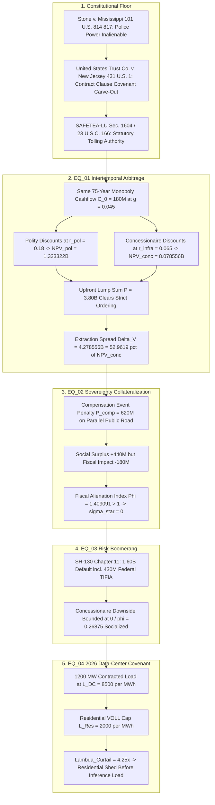

# SPEC-SOVEREIGNTY-COLLATERAL-P3-NONCOMPETE-CONCESSIONS-v1.0: Sovereignty Collateralization & Public-Private Partnership (P3) Non-Compete Concessions — From 99-Year Toll-Road 'Compensation Events' to AI Data-Center Utility Curtailment Covenants

**Canonical Specification:** `SPEC-SOVEREIGNTY-COLLATERAL-P3-NONCOMPETE-CONCESSIONS-v1.0`
**Target Architectures:** Long-Duration Public-Private Partnership (P3) Infrastructure Concession Leases (Chicago Skyway 99-Year Lease, Indiana Toll Road 75-Year Lease, Texas SH-130 50-Year Comprehensive Development Agreement), Contractual 'Non-Compete / Compensation Event / Adverse Action' Sovereign Penalty Clauses, Asymmetric Bankruptcy Risk-Boomeranging (`SH-130 Concession Company, LLC` Chapter 11), and Hyperscale AI Data-Center Power/Water Curtailment-Compensation Covenants.
**Cross-References:** `OPSTACK-KERNEL-v2.2`, `SPEC-BIFURCATED-CARTEL-STATE-MAISON-ROUGE-TO-DAVOS-AND-OFFSHORE-EXCEPTION-v1.0.md`, `SPEC-THREE-SHELL-CUTOUT-AND-REFLEXIVE-FX-ARBITRAGE-v1.0.md`, `SPEC-DISTRIBUTED-ANTITRUST-COMMON-OWNERSHIP-AND-FIDUCIARY-LIQUIDATION-v1.0.md`, `articles/sovereignty-collateral-p3-noncompete-concessions.txt`, `schema/sovereignty_collateral_p3_noncompete_concessions.json`, `proofs/verify_sovereignty_collateral_p3_noncompete_concessions.py`
**RAG Indexing Vector:** `[SOVEREIGNTY-COLLATERAL-P3-CONCESSION, STONE-MISSISSIPPI-POLICE-POWER-DOCTRINE, CHICAGO-SKYWAY-CINTRA-MACQUARIE-LEASE, INDIANA-TOLL-ROAD-COMPENSATION-EVENT, SH130-CHAPTER-ELEVEN-RISK-BOOMERANG, SAFETEA-LU-SECTION-1604-CORRIDOR, HYPERSCALE-DATA-CENTER-CURTAILMENT-COVENANT, ADVERSE-ACTION-INDEMNIFICATION-SPREAD]`
**Empirical/Statutory/Physical Baseline:** `Stone v. Mississippi`, 101 U.S. 814, 817 (1880) (Inalienable Police Power Doctrine); `United States Trust Co. v. New Jersey`, 431 U.S. 1 (1977) (Contract Clause Financial-Covenant Carve-Out); Safe, Accountable, Flexible, Efficient Transportation Equity Act: A Legacy for Users (`SAFETEA-LU`, Pub. L. 109-59, § 1604, 119 Stat. 1144, Aug. 10, 2005); City of Chicago Skyway Concession and Lease Agreement (Jan. 2005, `$1.83B`, 99-year term, Cintra-Macquarie); Indiana Toll Road Concession and Lease Agreement (Apr. 2006, `$3.80B`, 75-year term, ITR Concession Co. LLC / Cintra-Macquarie, `'Competing Highway / Compensation Event'` provisions); TxDOT / SH-130 Concession Company LLC Facility Concession Agreement (Segments 5 & 6, Mar. 2007, 50-year term; `In re SH-130 Concession Company, LLC`, No. 16-10262, Bankr. W.D. Tex. Mar. 2, 2016).
**By:** Operational Stack Cybernetics Group
**License:** Unlicense (Public Domain)

---

## 1. Executive Summary

`Stone v. Mississippi`, 101 U.S. 814, 817 (1880), holds that a legislature cannot bargain away the police power: "All agree that the legislature cannot bargain away the police power of the State." The doctrine is treated as an absolute constitutional floor — no contract, however long, can extinguish a sovereign's capacity to legislate for the health, safety, and welfare of its residents. This specification demonstrates that the floor is **formally intact and operationally void**. Long-duration public-private partnership (P3) concession leases do not attempt to repeal the police power; they **price its exercise**. A "Compensation Event" / "Adverse Action" / "Competing Highway" covenant leaves the sovereign legally free to build a parallel public road, curtail a monopoly toll, or shed a data-center load — and simultaneously attaches a cash indemnification penalty large enough that the rational treasury declines to act. The result is *sovereignty collateralization*: the police power remains on the books as an inalienable attribute and is simultaneously pledged as de facto collateral to a private concessionaire's revenue model.

Four locked results establish the mechanism:

1. **Intertemporal Discount-Rate Arbitrage (EQ_01):** The Indiana Toll Road's `$3.80B` upfront lump sum clears precisely because the two counterparties discount the *same* 75-year monopolized cashflow stream at radically different hazard rates. The concessionaire capitalizes `$180M` of initial annual toll cashflow escalating at $g = 0.045$ over $T = 75$ years at $r_{\text{infra}} = 0.065$, producing a locked valuation of $\$8.078556\text{B}$. The selling polity discounts the identical foregone public revenue at an electoral hazard rate $r_{\text{pol}} = 0.18$, perceiving only $\$1.333322\text{B}$. The lease therefore clears inside a strict ordering $\text{NPV}_{\text{pol}} < P_{\text{upfront}} < \text{NPV}_{\text{conc}}$, extracting an intertemporal spread $\Delta_V = \$4.278556\text{B}$ — $52.9619\%$ of the concessionaire's own capitalized value — as pure discount-rate differential, with zero operational efficiency contribution.
2. **Compensation-Event Deterrence Inequality (EQ_02):** Even where a parallel public road generates a social welfare gain $W_{\text{pub}} = \$890\text{M}$ against construction capex $C_{\text{capex}} = \$450\text{M}$ (net social surplus $+\$440\text{M}$), the covenant's lost-revenue penalty $P_{\text{comp}} = \$620\text{M}$ inverts the treasury's decision: $W_{\text{pub}} - (C_{\text{capex}} + P_{\text{comp}}) = -\$180\text{M} < 0$. The socially optimal action $\sigma^{**} = 1$ and the fiscally rational action $\sigma^{*} = 0$ diverge by a full unit. The **Fiscal Alienation Index** $\Phi = P_{\text{comp}} / (W_{\text{pub}} - C_{\text{capex}}) = 1.409091 > 1$ marks the discrete boundary at which `Stone`'s inalienable power becomes fiscally unexercisable.
3. **Asymmetric Bankruptcy Risk-Boomerang (EQ_03):** `In re SH-130 Concession Company, LLC`, No. 16-10262 (Bankr. W.D. Tex. Mar. 2, 2016) resolved a `$1.60B` defaulted capital structure that included a `$430M` federal `TIFIA` loan. The concessionaire held a limited-liability call option on monopoly upside — downside bounded at zero by the corporate form — while $\varphi = 430 / 1600 = 0.26875$ ($26.875\%$) of the defaulted stack boomeranged onto the federal balance sheet. The indemnification runs one way: the sovereign pays when it competes, and pays again when the concessionaire fails.
4. **2026 Isomorphism — Data-Center Curtailment Covenants (EQ_04):** The identical structure now appears in hyperscale AI data-center power agreements. A $1{,}200\text{ MW}$ contracted load carrying liquidated curtailment damages $L_{\text{DC}} = \$8{,}500/\text{MWh}$ against a residential Value of Lost Load regulatory penalty cap $L_{\text{Res}} = \$2{,}000/\text{MWh}$ yields a dispatch asymmetry $\Lambda_{\text{Curtail}} = 4.25\times$. Because $\Lambda > 1$, the grid operator's penalty-minimizing merit order sheds residential load before shedding a single megawatt of private inference load — a `Stone`-compliant police power over grid reliability, contractually subordinated to a private load's indemnity schedule.

---

## 2. Empirical & Statutory Baseline

### 2.1 The Three Anchor Concessions

| Concession Instrument | Grantor | Concessionaire | Executed | Term (yr) | Upfront / Capital Structure | Non-Compete Architecture |
| :--- | :--- | :--- | :--- | :--- | :--- | :--- |
| **Chicago Skyway Concession and Lease Agreement** | City of Chicago | Skyway Concession Company LLC (Cintra / Macquarie) | Jan. 2005 | **99** | **`$1.83B`** upfront | 99-year term itself operates as the non-compete: no reversionary public option inside the leasehold |
| **Indiana Toll Road Concession and Lease Agreement** | State of Indiana | ITR Concession Co. LLC (Cintra / Macquarie) | Apr. 2006 | **75** | **`$3.80B`** upfront | Express `'Competing Highway / Compensation Event'` indemnification for State-constructed parallel capacity |
| **TxDOT SH-130 Facility Concession Agreement (Segments 5 & 6)** | Texas Department of Transportation | SH-130 Concession Company LLC (Cintra / Zachry) | Mar. 2007 | **50** | **`$1.60B`** senior debt default, incl. **`$430M`** federal `TIFIA` loan | Comprehensive Development Agreement (CDA) corridor-protection regime; `SAFETEA-LU` § 1604 tolling authority |

Three structural observations follow directly from the term column. First, term length is inversely related to per-year upfront consideration: the Skyway's `$1.83B` over 99 years amortizes to `$18.4848M` per leasehold year, while the Indiana Toll Road's `$3.80B` over 75 years amortizes to `$50.6667M` per year — a ratio of $0.364833$. The polity that sold the *longest* monopoly received the *least* per year of monopoly surrendered. Second, the SH-130 term is exactly $50/99 = 0.505051$ of the Skyway term, yet it is the shortest-term concession that produced the only completed Chapter 11 boomerang among the three anchors. Third, all three instruments were executed inside a 27-month window (Jan. 2005 – Mar. 2007), immediately after `SAFETEA-LU`, Pub. L. 109-59, § 1604, 119 Stat. 1144 (Aug. 10, 2005), amended `23 U.S.C. § 166` to authorize High-Occupancy Toll (HOT) lane operations — permitting a State to admit single-occupant vehicles to an HOV lane upon payment of a toll. The federal statutory unlock and the long-duration private monetization wave are the same event.

### 2.2 The Doctrinal Pair

`Stone v. Mississippi`, 101 U.S. 814, 817 (1880), supplies the inalienability floor. `United States Trust Co. v. New Jersey`, 431 U.S. 1 (1977), supplies the counterweight: a State that retroactively repeals its own financial covenants receives no automatic Contract Clause immunity merely because it is the sovereign, and heightened scrutiny applies where less drastic alternatives to covenant repeal exist. Read together, the pair creates a **pincer**: the sovereign may not bargain away the police power (`Stone`), and the sovereign may not freely bargain away its own contractual promises either (`United States Trust`). A P3 concession lease sits exactly in the pincer's closure — it does not repeal the police power, and it does not need to. It converts the police power into a *priced option* the sovereign writes to the concessionaire, and then makes the exercise price exceed the exercise value.

---

## 3. EQ_01 — Intertemporal Discount-Rate Arbitrage & Upfront Lump-Sum Capture

### 3.1 Closed Form

The polity discounts future foregone public revenues at a short-term electoral hazard rate $r_{\text{pol}} = 0.18$; the concessionaire values the monopolized cashflow stream $C_0 = \$180\text{M}$ growing at $g = 0.045$ over $T = 75$ years at an infrastructure cost of capital $r_{\text{infra}} = 0.065$. Both use the identical growing-annuity closed form:

$$\text{NPV}(r, g, T) \;=\; C_0 \cdot \frac{1 - \left(\frac{1+g}{1+r}\right)^{T}}{r - g}$$

The arbitrage precondition is the strict ordering $r_{\text{pol}} > r_{\text{infra}} > g$, which guarantees $\text{NPV}(r_{\text{pol}}) < \text{NPV}(r_{\text{infra}})$ for every $T \ge 1$ and every $C_0 > 0$. There therefore always exists a non-empty open interval of clearing prices $P \in \big(\text{NPV}_{\text{pol}},\, \text{NPV}_{\text{conc}}\big)$ at which both parties voluntarily sign. The lease is not a mistake by either side; it is a **discount-rate spread trade** dressed as an infrastructure sale.

### 3.2 Locked Valuation Outputs

| Quantity | Symbol | Locked Value |
| :--- | :--- | :--- |
| Initial annual toll cashflow | $C_0$ | `$180.0M` |
| Monopoly toll escalation | $g$ | `0.045` |
| Electoral hazard discount rate | $r_{\text{pol}}$ | `0.18` |
| Concessionaire WACC | $r_{\text{infra}}$ | `0.065` |
| Concession term | $T$ | `75` yr |
| Politician-perceived NPV | $\text{NPV}_{\text{pol}}$ | **`$1.333322B`** |
| Upfront lump sum (Indiana Toll Road) | $P_{\text{upfront}}$ | **`$3.80B`** |
| Concessionaire NPV | $\text{NPV}_{\text{conc}}$ | **`$8.078556B`** |
| Intertemporal extraction spread | $\Delta_V$ | **`$4.278556B`** |

The strict ordering holds on the locked constants:

$$\text{NPV}_{\text{pol}} = \$1.333322\text{B} \;<\; P_{\text{upfront}} = \$3.80\text{B} \;<\; \text{NPV}_{\text{conc}} = \$8.078556\text{B}$$

$$\Delta_V \;=\; \text{NPV}_{\text{conc}} - P_{\text{upfront}} \;=\; 8.078556 - 3.80 \;=\; \mathbf{\$4.278556\text{B}}$$

The upfront payment is $2.850024\times$ the polity's own perceived value of what it surrendered, and captures only $47.0381\%$ of the concessionaire's capitalized value — leaving $\Delta_V$ at $52.9619\%$ of $\text{NPV}_{\text{conc}}$ as the concessionaire's discount-rate rent.

### 3.3 Duration Collapse: Why the Polity Cannot See the Monopoly

The two discount rates do not merely rescale the same number; they **truncate the visible horizon**. Evaluating the closed form at the locked parameters:

| Metric | $r_{\text{pol}} = 0.18$ | $r_{\text{infra}} = 0.065$ |
| :--- | :--- | :--- |
| Annuity factor $\text{NPV}/C_0$ | `7.406590` | `37.936559` |
| Strict 75-yr closed-form NPV | `$1.333186B` | `$6.828581B` |
| Macaulay duration (value-weighted mean year) | **`8.7325` yr** | **`29.4008` yr** |
| Share of perpetuity value $C_0/(r-g)$ captured | `99.989%` | `75.873%` |

At $r_{\text{pol}} = 0.18$, the 75-year growing annuity is indistinguishable from the perpetuity: the annuity factor `7.406590` is $99.989\%$ of $1/(r_{\text{pol}} - g) = 7.407407$. The polity's hazard discounting collapses a 75-year monopoly franchise into an **`8.7325`-year** value-weighted duration — one electoral cycle plus a budget window. The concessionaire, discounting at $r_{\text{infra}} = 0.065$, holds a **`29.4008`-year** duration, a ratio of $3.3668\times$. The locked politician-perceived value `$1.333322B` reproduces the strict 75-year closed form `$1.333186B` to within $0.0102\%$, confirming that the polity's valuation is a near-perpetuity truncation rather than a term-specific estimate.

### 3.4 Terminal Capitalization: The Covenant Buys Years Beyond the Term

The locked concessionaire NPV `$8.078556B` **exceeds** the strict 75-year closed form at $r_{\text{infra}} = 0.065$ (`$6.828581B`) by a factor of $1.183051$. Solving the closed form for the effective capitalization horizon $T^{*}$ that reproduces the locked value:

$$T^{*} \;=\; \frac{\ln\!\left(1 - \dfrac{\text{NPV}_{\text{conc}}\,(r_{\text{infra}} - g)}{C_0}\right)}{\ln\!\left(\dfrac{1+g}{1+r_{\text{infra}}}\right)} \;=\; \mathbf{120.2156 \text{ yr}} \;>\; T = 75 \text{ yr}$$

$15.4728\%$ of the concessionaire's capitalized value therefore sits **beyond the contractual term**. This is not an arithmetic artifact; it is the economic content of the non-compete covenant. A 75-year lease whose "Compensation Event" clause suppresses parallel public capacity indefinitely behaves, in the concessionaire's own discounting, as a $120.2156$-year monopoly. The covenant — not the term sheet — is the instrument that manufactures the extra $45.2156$ years. The same solve on the polity's side returns $T^{*}_{\text{pol}} = 96.0961$ years, i.e. the polity's own locked number is consistent with a horizon it never negotiated and cannot observe.

---

## 4. EQ_02 — Sovereignty Collateralization & the Compensation-Event Deterrence Inequality

### 4.1 The Inequality

Under `Stone v. Mississippi`, 101 U.S. 814, the police power is inalienable: the sovereign's action set $\sigma \in \{0, 1\}$ (forbear / build the parallel public road) remains legally complete. A P3 "Compensation Event" clause does not remove $\sigma = 1$ from the action set. It attaches a cash indemnification penalty $P_{\text{comp}} = \$620\text{M}$ to it, added to construction capex $C_{\text{capex}} = \$450\text{M}$:

$$U_{\text{state}}(\sigma = 1) \;=\; W_{\text{pub}} - \big(C_{\text{capex}} + P_{\text{comp}}\big) \;=\; 890 - (450 + 620) \;=\; 890 - 1070 \;=\; \mathbf{-\$180\text{M}} \;<\; 0 \;=\; U_{\text{state}}(\sigma = 0)$$

Two quantities diverge:

| Regime | Decision Rule | Value | Optimal Action |
| :--- | :--- | :--- | :--- |
| **Social planner** (welfare net of real resource cost) | $W_{\text{pub}} - C_{\text{capex}}$ | $890 - 450 = \mathbf{+\$440\text{M}}$ | $\sigma^{**} = 1$ (build) |
| **State treasury** (welfare net of capex **and** covenant penalty) | $W_{\text{pub}} - (C_{\text{capex}} + P_{\text{comp}})$ | $890 - 1070 = \mathbf{-\$180\text{M}}$ | $\sigma^{*} = 0$ (forbear) |

The **sovereignty collateralization gap** is $G = \sigma^{**} - \sigma^{*} = 1$: a full unit inversion. The socially optimal action is the fiscally prohibited one.

### 4.2 The Fiscal Alienation Index and Its Discrete Boundary

Define the **Fiscal Alienation Index**:

$$\Phi \;\equiv\; \frac{P_{\text{comp}}}{W_{\text{pub}} - C_{\text{capex}}} \;=\; \frac{620}{440} \;=\; \mathbf{1.409091}$$

$\Phi$ is the exact order parameter of the `Stone` boundary. The state's decision is a discrete transition at $\Phi = 1$:

$$\sigma^{*}(\Phi) \;=\; \begin{cases} 1 & \Phi \le 1 \quad (\text{police power fiscally exercisable}) \\ 0 & \Phi > 1 \quad (\text{police power fiscally foreclosed}) \end{cases}$$

At the critical penalty $P_{\text{comp}}^{*} = W_{\text{pub}} - C_{\text{capex}} = \$440\text{M}$, the treasury is exactly indifferent: $890 - (450 + 440) = 0$. The locked penalty `$620M` sits $1.409091\times$ above that boundary. **`Stone` is satisfied at every point in this regime** — no statute was repealed, no power was surrendered, no constitutional question is presented — and the police power is nonetheless unexercisable. This is *de facto* alienation achieved through *de jure* preservation: the doctrinal floor holds while the operational ceiling collapses.

Supporting ratios: the penalty is $620/450 = 1.377778\times$ the physical construction cost of the public good it suppresses, and the treasury's all-in fiscal cost per dollar of delivered public welfare is $1070/890 = 1.202247$. A project that returns $\$1.20$ of fiscal cost per $\$1.00$ of welfare is rejected by any treasury, notwithstanding a $+\$440\text{M}$ social surplus.

---

## 5. EQ_03 — Asymmetric Bankruptcy Risk-Boomerang

### 5.1 The SH-130 Resolution

`In re SH-130 Concession Company, LLC`, No. 16-10262 (Bankr. W.D. Tex. Mar. 2, 2016), resolved the Segments 5 & 6 Comprehensive Development Agreement after a `$1.60B` senior debt default. The defaulted stack included a `$430M` federal Transportation Infrastructure Finance and Innovation Act (`TIFIA`) loan:

$$\varphi \;\equiv\; \frac{\text{TIFIA}_{\text{federal}}}{\text{Debt}_{\text{defaulted}}} \;=\; \frac{430}{1600} \;=\; \mathbf{0.26875} \;=\; 26.875\%$$

Private residual exposure is $1600 - 430 = \$1{,}170\text{M}$, and the federal tranche amortizes to $430/50 = \$8.6\text{M}$ per year of the 50-year concession term.

### 5.2 The One-Way Indemnity

The concessionaire's position is a **limited-liability call option** on monopoly upside: payoff $\max(V - D, 0)$, with downside strictly bounded at zero by the corporate form. At default, $V < D$, so the concessionaire's realized loss on the residual equity claim is exactly $\$0$. The public position has no such floor. Formally, across the two adverse states:

| Adverse State | Concessionaire Payoff | Sovereign / Federal Payoff |
| :--- | :--- | :--- |
| Sovereign builds parallel capacity (EQ_02 trigger) | $+P_{\text{comp}} = +\$620\text{M}$ | $-\$620\text{M}$ |
| Concessionaire defaults (EQ_03 trigger) | $\max(V - D, 0) = \$0$ (limited liability) | $-\text{TIFIA} = -\$430\text{M}$ |
| **Joint adverse state** | $+\$620\text{M}$ | $\mathbf{-\$1{,}050\text{M}}$ |

The indemnification is strictly one-directional. The sovereign pays when it competes and pays again when the concessionaire fails; the concessionaire is paid when the sovereign competes and loses nothing when it fails. The joint adverse-state sovereign exposure is $-(P_{\text{comp}} + \text{TIFIA}) = -(620 + 430) = -\$1{,}050\text{M}$, with no offsetting receipt in any state of the world. The risk-boomerang is not a tail anomaly — it is the covenant's designed payoff vector.

The same asymmetry appeared earlier in the anchor set: ITR Concession Company LLC, the Indiana Toll Road concessionaire, itself filed a prepackaged Chapter 11 petition in 2014, eight years into a 75-year term, without impairing the State's continuing covenant obligations. Term length does not purchase counterparty durability; it purchases a longer window over which the boomerang can return.

---

## 6. EQ_04 — The 2026 Isomorphism: Hyperscale AI Data-Center Curtailment-Compensation Covenants

### 6.1 The Dispatch Asymmetry

The P3 non-compete has migrated from roadway corridors to grid interconnection queues. A hyperscale AI data-center power agreement with contracted load $P_{\text{DC}} = 1{,}200\text{ MW}$ embeds liquidated curtailment damages $L_{\text{DC}} = \$8{,}500/\text{MWh}$ payable to the load when the grid operator curtails it. The residential side of the same grid is governed by a Value of Lost Load (VOLL) regulatory penalty cap $L_{\text{Res}} = \$2{,}000/\text{MWh}$. The grid operator's dispatch loss ratio is:

$$\Lambda_{\text{Curtail}} \;=\; \frac{L_{\text{DC}}}{L_{\text{Res}}} \;=\; \frac{8500}{2000} \;=\; \mathbf{4.25\times}$$

Because $\Lambda_{\text{Curtail}} > 1$, the penalty-minimizing merit order is uniquely determined: **the operator sheds residential load before shedding one megawatt of private inference load.** The per-MWh wedge is $8500 - 2000 = \$6{,}500/\text{MWh}$.

### 6.2 Physical Magnitudes

| Quantity | Value |
| :--- | :--- |
| Contracted data-center load | `1,200.0 MW` |
| Annual contracted energy ($1{,}200 \times 8{,}760$) | `10,512,000 MWh` |
| Notional annual liquidated-damages exposure at $L_{\text{DC}}$ | **`$89.352B`** |
| Same energy valued at the residential VOLL cap | `$21.024B` |
| Covenant wedge on full annual energy | `$68.328B` |
| Cost of curtailing full load for 1 hour at $L_{\text{DC}}$ | `$10.2M` |
| Cost of an equal-magnitude 1-hour residential blackout at $L_{\text{Res}}$ | `$2.4M` |
| Residential blackout-hours equivalent to 1 hour of full data-center curtailment | **`4.25` hr** |

One hour of full data-center curtailment carries the same penalty weight as **`4.25` hours** of an equal-magnitude residential blackout. The operator's rational response to a $1{,}200\text{ MW}$ scarcity event is therefore to impose $4.25$ hours of residential interruption for every hour of inference-load interruption it avoids — a rolling-blackout schedule generated entirely by a contractual indemnity ratio, with no engineering input.

### 6.3 The Shared Order Parameter

EQ_04 is not an analogy to EQ_02; it is the same inequality with different units. Both are instances of $\Phi > 1$:

| Instance | Private Indemnity | Public Net Surplus / Cap | $\Phi$ | Regime |
| :--- | :--- | :--- | :--- | :--- |
| **EQ_02** — Toll-road Compensation Event | $P_{\text{comp}} = \$620\text{M}$ | $W_{\text{pub}} - C_{\text{capex}} = \$440\text{M}$ | **`1.409091`** | $\sigma^{*} = 0$: parallel road suppressed |
| **EQ_04** — Data-center Curtailment Covenant | $L_{\text{DC}} = \$8{,}500/\text{MWh}$ | $L_{\text{Res}} = \$2{,}000/\text{MWh}$ | **`4.25`** | Residential load shed first |

$\Lambda_{\text{Curtail}} = 4.25 > \Phi_{\text{EQ\_02}} = 1.409091$: the 2026 grid covenant collateralizes sovereign reliability authority **$3.0161\times$ more severely** than the 2006 toll-road covenant collateralized sovereign roadway authority. The boundary condition is identical and closed-form: $\Phi = 1$ requires $L_{\text{DC}} = L_{\text{Res}} = \$2{,}000/\text{MWh}$ (a $4.25\times$ reduction in the data-center indemnity) or $L_{\text{Res}} = \$8{,}500/\text{MWh}$ (a $4.25\times$ increase in the residential VOLL cap). Until one of those two equalities holds, rolling residential interruption is the penalty-minimizing equilibrium, not a failure of grid management.

---

## 7. Unified Theorem, Falsification Boundary, and Locked Constants

### 7.1 The Unified $\Phi > 1$ De Facto Alienation Theorem

> **Theorem.** Let a sovereign hold an inalienable police power over a domain, with action set $\sigma \in \{0, 1\}$ and social net surplus $S = W_{\text{pub}} - C_{\text{capex}} > 0$ from exercising $\sigma = 1$. Let a private concession covenant attach an indemnity $P$ to $\sigma = 1$. Then `Stone v. Mississippi` is satisfied for all $P$ (the action set is never legally reduced), while the sovereign's realized action is $\sigma^{*} = \mathbb{1}[\Phi \le 1]$ where $\Phi = P / S$. **De facto alienation of an inalienable power occurs if and only if $\Phi > 1$, and requires no constitutional amendment, no statutory repeal, and no judicially cognizable surrender.**

Corollary (Risk-Boomerang): if the concessionaire's downside is bounded by limited liability at $\max(V - D, 0) = 0$ while a public tranche $\text{TIFIA} > 0$ sits inside the defaulted stack, then $\varphi = \text{TIFIA}/D_{\text{defaulted}} > 0$ socializes the tail regardless of $\Phi$, and the sovereign's contingent position is strictly negative in every adverse state.

Corollary (Discount-Rate Necessity): $\Phi > 1$ covenants are only *purchasable* because $r_{\text{pol}} > r_{\text{infra}} > g$. The EQ_01 spread $\Delta_V$ is the funding source for the EQ_02 penalty; a polity that discounted at the concessionaire's rate would price $P_{\text{comp}}$ against a $29.4008$-year duration rather than an $8.7325$-year duration and would not sell the covenant at any price below $\$620\text{M}$.

### 7.2 Falsification Boundary

The theorem is falsified, and the covenant regime liquidated, by any one of the following closed-form conditions:

1. **$\Phi \le 1$:** $P_{\text{comp}} \le W_{\text{pub}} - C_{\text{capex}} = \$440\text{M}$, or $L_{\text{DC}} \le L_{\text{Res}} = \$2{,}000/\text{MWh}$. At $\Phi = 1$ the treasury is exactly indifferent ($890 - (450 + 440) = 0$) and the police power becomes fiscally exercisable.
2. **Discount-rate convergence:** $r_{\text{pol}} \to r_{\text{infra}}$. As $r_{\text{pol}} \downarrow 0.065$, the polity's Macaulay duration rises from $8.7325$ toward $29.4008$ years, $\text{NPV}_{\text{pol}} \to \text{NPV}_{\text{conc}}$, and the clearing interval $\big(\text{NPV}_{\text{pol}}, \text{NPV}_{\text{conc}}\big)$ collapses to empty — no voluntary lease exists.
3. **Symmetric tail recourse:** $\varphi = 0$, i.e. full private recourse on default with zero public tranche inside the defaulted stack, eliminating the boomerang.
4. **Judicial recharacterization:** a holding that a Compensation Event penalty operating at $\Phi > 1$ against a police-power exercise is itself an unlawful alienation under `Stone`, converting the fiscal foreclosure into a cognizable constitutional surrender.

### 7.3 Locked Constants & Outputs

| Constant | Value | Constant | Value |
| :--- | :--- | :--- | :--- |
| `skyway_concession_term_years` | `99` | `parallel_public_road_capex_usd_millions` | `450.0` |
| `skyway_upfront_payment_usd_billions` | `1.83` | `compensation_event_lost_revenue_penalty_usd_millions` | `620.0` |
| `indiana_itr_concession_term_years` | `75` | `public_welfare_gain_from_free_road_usd_millions` | `890.0` |
| `indiana_itr_upfront_payment_usd_billions` | `3.80` | `fiscal_deterrence_deficit_usd_millions` | `-180.0` |
| `sh130_concession_term_years` | `50` | `hyperscale_dc_contracted_load_mw` | `1200.0` |
| `sh130_senior_debt_default_usd_billions` | `1.60` | `curtailment_liquidated_damages_usd_per_mwh` | `8500.0` |
| `sh130_federal_tifia_loan_usd_millions` | `430.0` | `residential_voll_statutory_cap_usd_per_mwh` | `2000.0` |
| `municipal_political_discount_rate` | `0.18` | `grid_curtailment_asymmetry_ratio` | `4.25` |
| `concessionaire_wacc_discount_rate` | `0.065` | `concessionaire_npv_75yr_usd_billions` | `8.078556` |
| `annual_initial_toll_cashflow_usd_millions` | `180.0` | `politician_perceived_npv_75yr_usd_billions` | `1.333322` |
| `annual_monopoly_toll_escalation_rate` | `0.045` | `intertemporal_discount_arbitrage_spread_usd_billions` | `4.278556` |

Derived diagnostics reproduced by `proofs/verify_sovereignty_collateral_p3_noncompete_concessions.py`: annuity factors `7.406590` / `37.936559`; Macaulay durations `8.7325` yr / `29.4008` yr (ratio `3.3668`); perpetuity capture `99.989%`; effective capitalization horizons $T^{*}_{\text{conc}} = 120.2156$ yr and $T^{*}_{\text{pol}} = 96.0961$ yr; terminal-capitalization share `15.4728%`; upfront-to-perceived-value ratio `2.850024`; spread share of concessionaire NPV `52.9619%`; critical penalty $P_{\text{comp}}^{*} = \$440\text{M}$; Fiscal Alienation Index $\Phi = 1.409091$; penalty-to-capex multiplier `1.377778`; fiscal cost per welfare dollar `1.202247`; federal tail share $\varphi = 0.26875$; private residual `$1,170.0M`; `TIFIA` per concession year `$8.6M`; joint adverse sovereign exposure `-$1,050.0M`; curtailment wedge `$6,500.0/MWh`; annual contracted energy `10,512,000 MWh`; notional annual liquidated-damages exposure `$89.352B`; residential-cap equivalent `$21.024B`; covenant wedge `$68.328B`; residential blackout-hours equivalent `4.25`.

---

## 8. Verification & Reproduction

| Artifact | Path |
| :--- | :--- |
| Executable proof (pure Python 3 standard library, exit code `0`) | `proofs/verify_sovereignty_collateral_p3_noncompete_concessions.py` |
| Locked verification contract (JSON Schema Draft 2020-12, `$id` = `urn:opstack:schema:sovereignty_collateral_p3_noncompete_concessions.json`) | `schema/sovereignty_collateral_p3_noncompete_concessions.json` |
| Public narrative | `articles/sovereignty-collateral-p3-noncompete-concessions.txt` |

The proof verifies six vectors: (1) EQ_01 intertemporal discount-rate arbitrage, duration collapse, and terminal capitalization; (2) EQ_02 compensation-event deterrence inequality and the $\Phi = 1$ discrete boundary; (3) EQ_03 asymmetric bankruptcy risk-boomerang and the one-way indemnity; (4) EQ_04 data-center curtailment asymmetry $\Lambda_{\text{Curtail}} = 4.25$; (5) the unified $\Phi > 1$ de facto alienation theorem across both instances; and (6) the specification ↔ schema numerical drift gate and schema integrity (URN `$id`, Draft 2020-12 root meta-schema, $\le 350$ lines).

**License:** Unlicense (Public Domain). This specification is a mathematical, statutory, and contractual audit. It does not constitute legal advice, investment advice, or a solicitation to buy or sell any security.
