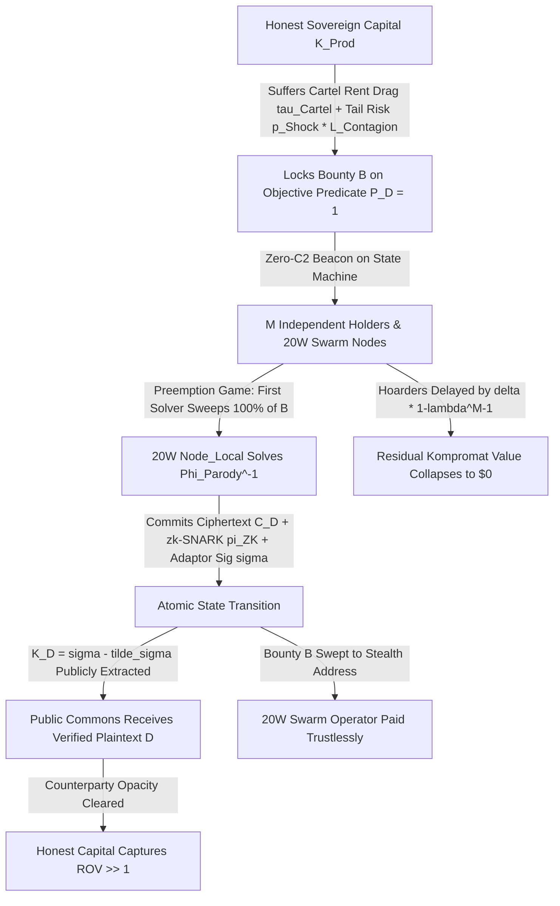

# SPEC-STIGMERGIC-ZK-OSINT-BOUNTY-SETTLEMENT-v1.0: Zero-C2 Stigmergic OSINT Bounties — Trustless zk-SNARK & Adaptor-Signature Proof-of-Verification Markets

**Canonical Specification:** `SPEC-STIGMERGIC-ZK-OSINT-BOUNTY-SETTLEMENT-v1.0`
**Target Architectures:** Zero-C2 Stigmergic Verification Markets, $20\text{ W}$ `Node_Local` Bare-Metal Swarm Nodes, In-Circuit `zk-Email` (`RFC 6376` RSA-2048 & `RFC 8463` Ed25519 DKIM) & `zk-X509` Verifiers, `MPC-TLS` (`TLSNotary`/`DECO`) Registry Oracles, and `BIP-340` Functional Adaptor Signature / `HTLC` Atomic Settlement Engines
**Cross-References:** `SPEC-QDAY-CIA-TRIAD-POST-OPACITY-ENDGAME-v1.0.md`, `SPEC-2026-SOPHISTRY-RLHF-VS-VERIFIABLE-RLVR-v2.2`, `KERNEL.md`, `AUDIT-2026-STIGMERGIC-M2M-TASK-MARKETS.md`, `AUDIT-2026-THERMODYNAMIC-MICRO-SETTLEMENT.md`, `AUDIT-2026-OSINT-METADATA-ISOLATION.md`, `SPEC-2026-STIGMERGIC-COMMIT-TEMPORAL-SHIELD-v1.0.md`, `AUDIT-2026-LEGAL-SUPERIORITY-EDGE-FEDERATION.md`
**RAG Indexing Vector:** `[STIGMERGIC-OSINT-BOUNTIES, ZERO-C2-SETTLEMENT, ZK-EMAIL-DKIM-RSA2048, FUNCTIONAL-ADAPTOR-SIGNATURES, HTLC-ATOMIC-SWAP, KOMPROMAT-HOARDING-COLLAPSE, PRODUCTIVE-CAPITAL-ROV-HEDGE, REVERSE-TURING-RLVR-FILTER, PARODY-MAP-INVERSION, 20W-HUMAN-SWARM]`
**Empirical/Statutory/Physical Baseline:** `RFC 6376` (§3.4 Canonicalization, §3.5 `DKIM-Signature`, & §3.7 `bh=` SHA-256 Body Hash Computation) & `RFC 8463` (Ed25519-SHA256 DKIM), `zk-X509` (`arXiv:2603.25190v2`: $17.4\text{M}$ cycles RSA-2048, $11.8\text{M}$ cycles ECDSA P-256, $\sim 300\text{k}$ gas Groth16 verification), `TLSNotary` MPC-TLS Bandwidth Bounds ($\sim 25\text{ MB}$ base session $+ 10\text{ MB}/\text{KB}$ TX $+ 40\text{ KB}/\text{KB}$ RX), `Functional Adaptor Signatures` (`arXiv:2410.11134` / `BIP-340` Witness Extraction), `18 U.S.C. § 2261A` & `18 U.S.C. § 1512` (Anti-Stalking & Witness Tampering Vectors), and `First Amendment` Protected Public-Record Synthesis
**By:** Operational Stack Cybernetics Group
**License:** Unlicense (Public Domain)

---

## 1. Executive Summary & Architectural Problem Statement

### 1.1 The Core Problem: Funding $\Phi_{\text{Parody}}^{-1}$ Without a Capturable Principal-Agent Graph

In `SPEC-QDAY-CIA-TRIAD-POST-OPACITY-ENDGAME-v1.0.md` (§4.4–§4.5), we established that while attention-captured nodes ($\text{Node}_{\text{Exhausted}}$) remain trapped beneath the folkloric parody map $\Phi_{\text{Parody}} : G_{\text{Real}}(V_{\text{Crypto}}, E_{\text{Crypto}}) \longrightarrow G_{\text{Folklore}}(V_{\text{Parody}}, E_{\text{Parody}})$, the unencumbered **$20\text{ W}$ Stigmergic Human Swarm** ($\text{Node}_{\text{Local\_Unencumbered}}$) possesses the cognitive and bare-metal compute bandwidth required to execute the inverse de-radiation operator:

$$B_{\text{Available}}\bigl(\text{Node}_{\text{Local\_Unencumbered}}\bigr) \gg C_{\text{DeRadiation}}\bigl(\Phi_{\text{Parody}}\bigr) \implies \Phi_{\text{Parody}}^{-1}\bigl(G_{\text{Folklore}}\bigr) = G_{\text{Real}} \quad \bigl(\text{SNR} \to 1.0, \; I_{\text{Verified}} \to 1.0\bigr)$$

Simultaneously, **Honest Sovereign & Productive Capital**—industrial allocators, infrastructure builders, and cypherpunk treasuries whose returns derive from thermodynamic output rather than blackmail or regulatory rent-seeking—suffers massive balance-sheet drag from cartel opacity, compromised counterparties, and undisclosed `HNDL` (Harvest-Now, Decrypt-Later) contagion.

However, a structural coordination bottleneck prevents productive capital from funding decentralized researchers via legacy channels. In traditional investigative journalism, corporate diligence, or centralized bug-bounty platforms (e.g., newsrooms, private intelligence brokerages, KYC bounty portals), a principal hires an agent over fiat rails and coordinates via interactive messaging (Slack, Signal, email). This creates a **bidirectional metadata and coercion graph**:

1. **Principal Coercion & Subpoena Exposure:** The funder can be identified via banking/KYC trails, served with prior-restraint injunctions, or subjected to retaliatory regulatory action for commissioning an inquiry into a cartel counterparty.
2. **Researcher Interdiction & Pre-Publication Intimidation:** Because interactive coordination requires pre-publication contact, intelligence cutouts can infiltrate the channel, deploy cyberstalking/pre-texting operations (`18 U.S.C. § 2261A`), or intimidate witnesses (`18 U.S.C. § 1512`) before the evidentiary mosaic is completed.
3. **Bilateral Holdup & Kompromat Capture:** Subjective human arbiters can reject valid findings, steal the underlying dataset without paying, or—worse—buy and **bury** the finding ("catch-and-kill") to extract private blackmail rent rather than clearing the public market.

```
====================================================================================================
LEGACY PRINCIPAL-AGENT DILIGENCE vs. ZERO-C2 STIGMERGIC ZK-BOUNTY SETTLEMENT
====================================================================================================

[A] LEGACY PRINCIPAL-AGENT MODEL (Interactive C2 + KYC Rails = Capturable Bidirectional Graph)
+-------------------+   1. KYC Fiat / Wire + NDA    +-------------------+   2. Slack / Signal C2   +-------------------+
| Productive Funder | ----------------------------> | Central Brokerage | <----------------------> | OSINT Researcher  |
| (Doxxable Target) | <---------------------------- | (Catch-and-Kill / |                          | (18 USC 1512/2261A|
+-------------------+   3. Subpoena / Coercion      |  Bribe / SPOF)    |                          |  Interdiction)    |
                                                    +-------------------+                          +-------------------+

[B] ZERO-C2 STIGMERGIC ZK-BOUNTY ARCHITECTURE (Tokens_Chat = 0 | Environmental State-Transition)
+------------------------+     Layer 1: Lock Bounty B on     +---------------------------------------------------------+
| Honest Sovereign       | ---> Objective Predicate P(D)=1 -> | PUBLIC STIGMERGIC STATE MACHINE (Zero-C2 Escrow)        |
| Capital (Stealth / L2) |     (vk_P, H_Target, Pre-Sig ~s)  |  - Verifies zk-SNARK pi_ZK (RFC 6376 DKIM / EDGAR RLVR) |
+------------------------+                                   |  - Executes Adaptor Signature Atomic Swap:              |
                                                             |    s = ~s + K_D  <==>  Sweeps B & Extracts Key K_D      |
+------------------------+     Layer 2: Submit (C_D, pi_ZK,  +---------------------------------------------------------+
| 20W Node_Local Swarm   | ---> Adapted Signature s) ------->                            |
| (Zero Pre-Contact)     | <=== Instant Atomic Payout B =====                            v
+------------------------+                                   +---------------------------------------------------------+
                                                             | PUBLIC COMMONS: Ciphertext C_D + Extracted Key K_D      |
                                                             | => Instant Decryption of Verified Plaintext D           |
                                                             | => Residual Kompromat Hoarding Value Collapses to $0    |
                                                             +---------------------------------------------------------+
====================================================================================================
```

### 1.2 The Architectural Solution: Environmental State-Transition Contracts

This specification eliminates the Principal-Agent relationship entirely, replacing interactive command-and-control (`C2`) with **Zero-C2 Cryptographic Stigmergy** (`KERNEL.md` Invariants 6 & 8):

$$\text{Coordination}(\text{Capital}_k, \text{Node}_i) = \text{StateCommit}(\mathcal{E}_{\text{Ledger}}) \;\land\; \text{Tokens}_{\text{Chat}} = 0 \implies \text{C2 Surface} = \emptyset$$

The funder never meets, messages, or knows the identity of the researcher. The researcher never asks permission, signs an NDA, or trusts a human judge. Instead:
* **Layer 1 (Pheromone Deposit):** Honest capital locks a cryptographic bounty $B$ into a permissionless state-transition contract tied to a deterministic, machine-verifiable predicate $P(D) = 1$.
* **Layer 2 (Zero-Knowledge Witness & Atomic Settlement):** A $20\text{ W}$ `Node_Local` operator solves the mosaic locally, commits the encrypted artifact $C_D = \text{Enc}_{K_D}(D)$ to content-addressed storage, proves in zero knowledge ($\pi_{\text{ZK}}$) that $D$ satisfies $P(D) = 1$ under key $K_D$, and claims $B$ via a **Functional Adaptor Signature / HTLC atomic swap** whose execution mathematically reveals $K_D$ to the public commons in the exact same block transition.
* **Layer 3 (Reverse-Turing `RLVR` Filter):** Because settlement is gated by a formal cryptographic or statutory proof verifier (`SPEC-2026-SOPHISTRY-RLHF-VS-VERIFIABLE-RLVR-v2.2`), folkloric chaff ($\Phi_{\text{Parody}}$, $I \to 0$) evaluates to `False` in milliseconds and forfeits the anti-spam submission bond.

---

## 2. Three-Layer Cryptographic Stigmergic Architecture

### 2.1 Layer 1: Pheromone Deposit (The Objective Bounty Beacon)

Let $\mathcal{E}_{\text{Ledger}}$ be a censorship-resistant state machine (e.g., an L1/L2 zk-verifier contract, a Bitcoin/Monero/Zcash cross-chain atomic swap script, or a Discreet Log Contract `DLC`). To commission the inversion of a folkloric chaff cluster $\Phi_{\text{Parody}}(G_{\text{Real}})$, a sovereign capital allocator deposits bounty $B$ bound to a verification key $\text{vk}_P$ encoding a deterministic predicate $P : \{0,1\}^* \to \{0,1\}$.

Crucially, $P(D)$ requires **zero human editorial judgment**. It belongs to one of three canonical verifiable predicate classes:

| Predicate Class | Cryptographic / Statutory Anchor | In-Circuit / Deterministic Verification Condition $P(D) = 1$ | Primary Prover / Verifier Benchmark |
| :--- | :--- | :--- | :--- |
| **Class I: Authentic Archival Communication & PKI Witness (`zk-Email` / `zk-X509`)** | `RFC 6376` (`DKIM-Signature` RSA-2048 + SHA-256 `bh=` body hash) / `RFC 8463` (Ed25519) or X.509 Certificate Chain | Raw `.eml` or signed PDF verifies against historical domain DNSKEY / root CA, canonicalized body hash matches `bh=`, and extracted regex capture matches target entity tuple $K_{\text{Target}}$. | **$17.4\text{M}$ cycles** (RSA-2048) / **$11.8\text{M}$ cycles** (ECDSA P-256); **$\sim 300\text{k}$ gas** on-chain Groth16 verify (`arXiv:2603.25190v2`). |
| **Class II: Multi-Docket Entity-Resolution & `HNDL` Preimage Graph** | Public Registry Hash / `SWIFT MT103` / `SHA-256` Preimage / Merkle Inclusion Path | Supplies preimage $D$ such that $\text{SHA-256}(D) = H_{\text{Anchor}}$ or proves an unbroken $k$-hop Merkle path linking Corporate Registry Entity $V_A$ to FERC/EPA/Court Docket $V_B$. | **$< 2\text{M}$ cycles** (in-circuit `SHA-256` / Poseidon / Keccak Merkle path verification); sub-second local proving on $20\text{ W}$ silicon. |
| **Class III: Deterministic Financial & Statutory Audit (`RLVR` Pure-Stdlib Proof)** | SEC EDGAR `10-K`/`8-K`, FERC Form 1, or Municipal Bond Official Statement | Pure-stdlib deterministic audit trace over content-addressed filing hash $H_{\text{Filing}}$ proving an accounting identity breach $|\text{Assets} - (\text{Liabilities} + \text{Equity})| > \tau_{\text{Materiality}}$ or undisclosed off-balance-sheet encumbrance. | Deterministic RISC-V zkVM guest execution (`10^2 \le \alpha_{\text{Prover}} \le 10^4`) or optimistic fraud-proof bisection game. |

### 2.2 Layer 2: Zero-Knowledge Submission & Adaptor-Signature Atomic Settlement

If a $20\text{ W}$ researcher simply broadcast plaintext $D$ to the mempool to claim $B$, generalized front-running bots (MEV searchers) or cartel validators could copy $D$, replace the payout address, and steal the bounty. Conversely, if the researcher demanded payment before revealing $D$, the funder could be defrauded with garbage ciphertext.

Layer 2 resolves both front-running and bilateral holdup in a single **Zero-Knowledge Witness + Functional Adaptor Signature** state transition (`arXiv:2410.11134`, `BIP-340`):

1. **Local Mosaic Resolution & Content-Addressed Commitment:**
   Operating offline on bare-metal silicon (`Node_Local`), the researcher reconstructs $D = \Phi_{\text{Parody}}^{-1}(G_{\text{Folklore}})$, generates a symmetric one-time decryption key $K_D \in \mathbb{F}_q$ with public elliptic-curve point $Y_K = K_D \cdot G$, encrypts the payload $C_D = \text{Enc}_{K_D}(D)$, and pins $C_D$ to content-addressed distributed storage (IPFS CID / BitTorrent v2 SHA-256 infohash $H_{C} = \text{SHA-256}(C_D)$).
2. **In-Circuit Zero-Knowledge Proof Generation ($\pi_{\text{ZK}}$):**
   The researcher generates a non-interactive zero-knowledge proof $\pi_{\text{ZK}}$ for the compound relation $\mathcal{R}_{\text{Bounty}}$ over public inputs $\text{pub} = (\text{vk}_P, H_C, Y_K, \text{Addr}_{\text{Stealth}})$ and private witness $w = (D, K_D)$:

$$\mathcal{R}_{\text{Bounty}}(\text{pub}; w) = 1 \iff \begin{cases}
P(D) = 1 & \text{(Objective OSINT Predicate Satisfied)} \\
\text{SHA-256}\bigl(\text{Enc}_{K_D}(D)\bigr) = H_C & \text{(Ciphertext Integrity Bound to CID)} \\
Y_K = K_D \cdot G & \text{(Decryption Key Discrete-Log Binding)} \\
\text{Commit}(\text{Addr}_{\text{Stealth}}, D) = \text{True} & \text{(Anti-MEV Sender Binding)}
\end{cases}$$

   Because $\text{Addr}_{\text{Stealth}}$ is cryptographically bound inside the public inputs of $\pi_{\text{ZK}}$, **no MEV bot or validator can malleate the payout address without invalidating $\pi_{\text{ZK}}$**.
3. **Atomic Key-Extraction Payout (Adaptor Signature / HTLC):**
   The bounty contract holds a `BIP-340` Schnorr pre-signature $\tilde{\sigma}$ constructed over the adapted nonce point $\tilde{R} = R + Y_K$ (with challenge $e = H_{\text{BIP340}}(\tilde{R} \parallel \text{pk}_{\text{Escrow}} \parallel m)$ such that $\tilde{\sigma} \cdot G = R + e \cdot \text{pk}_{\text{Escrow}}$) locked to verification of $\pi_{\text{ZK}}$. To sweep the bounty $B$ to $\text{Addr}_{\text{Stealth}}$, the researcher broadcasts the adapted signature $\sigma = \tilde{\sigma} + K_D \pmod q$ (satisfying $\sigma \cdot G = \tilde{R} + e \cdot \text{pk}_{\text{Escrow}}$) alongside $\pi_{\text{ZK}}$. The state machine verifies:

$$\text{Verify}_{\text{ZK}}(\text{vk}_P, \text{pub}, \pi_{\text{ZK}}) = 1 \;\land\; \text{Verify}_{\text{Schnorr}}\bigl(\text{pk}_{\text{Escrow}}, (\tilde{R}, \sigma)\bigr) = 1$$

   Upon block inclusion, $\text{Addr}_{\text{Stealth}}$ receives $B$ and every observer on earth simultaneously extracts the plaintext decryption key by simple subtraction:

$$K_D = \sigma - \tilde{\sigma} \pmod q \implies D = \text{Dec}_{K_D}(C_D)$$

### 2.3 Traffic-Tiered Prover Selection & Metadata Obfuscation

Per our primary-source benchmarks (`TLSNotary` vs. `zk-X509`), proving mechanisms exhibit vastly different bandwidth and compute profiles. To preserve operator anonymity (`AUDIT-2026-OSINT-METADATA-ISOLATION.md`) and respect the $20\text{ W}$ edge envelope:

* **Route A — Static Cryptographic Artifacts (Preferred, $0\text{ Bytes}$ Live Oracle Traffic):** Whenever target evidence carries a native cryptographic signature or hash anchor (`RFC 6376` `.eml` DKIM signature, signed PDF, `HNDL` SHA-256/HMAC capture, or content-addressed SEC/court filing), proving executes **100% offline** on `Node_Local` ($17.4\text{M}$ cycles for RSA-2048 $\approx$ seconds on local CPU/GPU). External network footprint during proving is strictly **$0\text{ bytes}$**.
* **Route B — Live Unauthenticated Registry Scraping (`MPC-TLS` / `TLSNotary`):** When a registry endpoint lacks document-level signatures and requires proving a live HTTPS TLS session, `MPC-TLS` incurs:

$$\text{BW}_{\text{MPC-TLS}}(S_{\text{TX}}, S_{\text{RX}}) \approx 25\text{ MB} + 10\text{ MB} \cdot \left(\frac{S_{\text{TX}}}{1\text{ KB}}\right) + 0.04\text{ MB} \cdot \left(\frac{S_{\text{RX}}}{1\text{ KB}}\right)$$

  For a standard $1\text{ KB}$ HTTP request and $100\text{ KB}$ response, $\text{BW}_{\text{MPC-TLS}} \approx 39\text{ MB}$. Consequently, `Node_Local` operators **never** run `MPC-TLS` for bulk exploration; exploratory retrieval uses decoupled, temporally jittered cover queries (`SPEC-2026-STIGMERGIC-COMMIT-TEMPORAL-SHIELD-v1.0.md`: $T_{\min} = \max(T_{\text{now}} - W_{\max}, T_{n-1})$), and `MPC-TLS` notarization is invoked **exactly once** over a routed cover tunnel to lock the final terminal leaf proof.

---

## 3. Game-Theoretic Equilibrium Analysis (The 4 Governing Theorems)

We now prove why this architecture is not an altruistic charity, but a **strictly dominant subgame-perfect Nash equilibrium (SPNE)** for Honest Sovereign Capital and the $20\text{ W}$ Human Swarm that mathematically liquidates the kompromat economy.



### 3.1 Theorem 1: The Productive Capital "Kompromat Tax" Hedge (Why Honest Capital Pays $B$)

Consider an **Honest Sovereign Capital** allocator holding productive capital stock $K_{\text{Prod}} > 0$ earning baseline thermodynamic return $R_{\text{Prod}} > 0$. In an un-cleared market polluted by cartel opacity and folkloric chaff ($\Phi_{\text{Parody}}$), the allocator suffers two quantifiable losses:
1. **Continuous Adverse-Selection & Extortion Drag ($\tau_{\text{Cartel}} \in (0,1)$):** Counterparty kickbacks, captured procurement bottlenecks, phantom subcontracts, and regulatory rent extraction reduce effective yield by $\tau_{\text{Cartel}} \cdot R_{\text{Prod}} \cdot K_{\text{Prod}}$.
2. **Contagion Tail-Risk ($p_{\text{Shock}} \cdot L_{\text{Contagion}}$):** With probability $p_{\text{Shock}} \in (0,1)$, an undisclosed `HNDL` or statutory liability inside a counterparty detonates, inflicting contagion loss $L_{\text{Contagion}}$ (supply-chain freeze, sanctions taint, or debt write-off).

Compare the allocator's expected utility under **Status Quo Opacity ($\text{No Bounty}$)** vs. **Zero-C2 Bounty Deployment ($\text{Post Bounty } B$)**:

$$U_{\text{Capital}}(\text{No Bounty}) = R_{\text{Prod}} \cdot K_{\text{Prod}} \cdot (1 - \tau_{\text{Cartel}}) - p_{\text{Shock}} \cdot L_{\text{Contagion}}$$

$$U_{\text{Capital}}(\text{Post Bounty } B) = R_{\text{Prod}} \cdot K_{\text{Prod}} - B - C_{\text{Gas/ZK}} - \mathbb{P}(\text{Retaliation} \mid \text{Zero-C2}) \cdot L_{\text{Coercion}}$$

Because the bounty contract is deployed via a Zero-C2 state transition ($\text{Tokens}_{\text{Chat}} = 0$, no KYC employment contract, no identifiable researcher), the cartel's attribution probability vanishes ($\mathbb{P}(\text{Retaliation} \mid \text{Zero-C2}) \to 0$). Thus, posting bounty $B$ is a **strictly dominant strategy** whenever:

$$\boxed{B + C_{\text{Gas/ZK}} < \Delta V_{\text{Clearance}} = \tau_{\text{Cartel}} \cdot R_{\text{Prod}} \cdot K_{\text{Prod}} + p_{\text{Shock}} \cdot L_{\text{Contagion}}}$$

Defining the **Return on Verification ($\text{ROV}$)** for Honest Sovereign Capital:

$$\text{ROV} = \frac{\Delta V_{\text{Clearance}}}{B + C_{\text{Gas/ZK}}} = \frac{\tau_{\text{Cartel}} \cdot R_{\text{Prod}} \cdot K_{\text{Prod}} + p_{\text{Shock}} \cdot L_{\text{Contagion}}}{B + C_{\text{Gas/ZK}}} \gg 1$$

**Corollary (Elimination of the Free-Rider Problem via Single-Whale Pivotality):** Even if $N_K$ honest institutions benefit from the public release of $D$, **zero inter-fund coordination is required**. As long as a single whale $k$'s private balance-sheet clearance $\Delta V_{\text{Clearance}, k}$ exceeds $B$ (typically by $10\times\text{–}100\times$), that single institution is individually pivot-rational to fund $100\%$ of $B$ unilaterally, or anonymous allocators can permissionlessly top up a shared escrow pool $B = \sum_{k=1}^{N_K} b_k$ without ever learning one another's identities.

* **Numerical Sanity Check:** For $K_{\text{Prod}} = \$100,000,000$, $R_{\text{Prod}} = 0.12$ ($\$12\text{M}/\text{yr}$), $\tau_{\text{Cartel}} = 0.08$ ($\$960,000/\text{yr}$ rent drag), $p_{\text{Shock}} = 0.05$, and $L_{\text{Contagion}} = \$20,000,000$ ($\$1,000,000$ expected tail loss), total opacity drag is $\Delta V_{\text{Clearance}} = \$1,960,000$. Locking a **$B = \$50,000$** Zero-C2 bounty ($C_{\text{Gas/ZK}} = \$5$) yields a net balance-sheet gain of **$+\$1,909,995$** and an $\text{ROV} = \mathbf{39.196\times}$.

---

### 3.2 Theorem 2: The $M$-Holder Kompromat Hoarding Collapse (Preemption Stopping-Time Game)

Why did pre-Q-Day intelligence brokers and private diligence cutouts hoard kompromat instead of publishing it? In a bilateral shadow market with $M = 1$ monopolist holder and no public bounty beacon, **withholding** the secret yields a recurring blackmail/protection annuity $r_{\text{Hoard}} > 0$ per period (discounted at factor $\delta \in (0,1)$, present value $V_{\text{Hoard}}^{\text{Monopoly}} = \frac{r_{\text{Hoard}}}{1 - \delta}$), whereas publishing yields $\$0$.

Now introduce a public Zero-C2 bounty $B$ locked to $P(D) = 1$ in an environment where $M \ge 2$ independent actors—comprising both legacy insiders holding fragments of `Buffer_HNDL` and unencumbered $20\text{ W}$ `Node_Local` researchers—each have an independent per-period hazard rate $\lambda \in (0,1]$ of resolving $D = \Phi_{\text{Parody}}^{-1}(G_{\text{Folklore}})$ at local compute cost $C_{\text{Solve}}$.

Because the bounty contract pays $100\%$ of $B$ to the **first** valid proof $\pi_{\text{ZK}}$ at stopping time $t^*$ and simultaneously releases $K_D$ to the public commons:
* **Payoff to First Publisher at $t^*$:** $\Pi_{\text{First}} = B - C_{\text{Solve}}$.
* **Payoff to All Remaining $M - 1$ Hoarders at $t \ge t^*$:** Once $D$ is decrypted on-chain, the secret is public knowledge ($\Omega_{\text{Actionable}} \to 1$). Its blackmail value instantaneously drops to **$\$0$** ($\Pi_{\text{Late}} = 0$).

For any hoarder contemplating waiting one additional period to collect $r_{\text{Hoard}}$, the probability that **none** of the other $M - 1$ independent swarm nodes solves and publishes the proof during that period is $(1 - \lambda)^{M-1}$. Thus, the hoarder's survival-adjusted continuation value collapses to:

$$V_{\text{Hoard}}^{\text{Effective}}(M, \lambda) = \frac{r_{\text{Hoard}} \cdot (1 - \lambda)^{M-1}}{1 - \delta (1 - \lambda)^{M-1}}$$

By backward induction, **immediate disclosure at $t = 0$ is the unique dominant strategy (Race-to-Publish Equilibrium)** whenever:

$$\boxed{B - C_{\text{Solve}} > \frac{r_{\text{Hoard}} \cdot (1 - \lambda)^{M-1}}{1 - \delta (1 - \lambda)^{M-1}} \quad \xrightarrow{M \gg 1} \quad B > C_{\text{Solve}}}$$

**Thermodynamic Leverage of the $20\text{ W}$ Swarm:** Notice the exponential attenuation factor $(1 - \lambda)^{M-1}$. Honest capital does **not** need to outbid the cartel's gross monopoly blackmail budget $V_{\text{Hoard}}^{\text{Monopoly}}$. Because the $20\text{ W}$ Human Swarm supplies a large $M$ of independent researchers who cannot be collusively cartelized (since they are anonymous and Zero-C2), $(1 - \lambda)^{M-1} \to 0$, allowing honest capital to liquidate a massive blackmail asset for a fraction of its monopoly rent ($B \ll V_{\text{Hoard}}^{\text{Monopoly}}$).

* **Numerical Sanity Check:** Let monopoly blackmail rent be $r_{\text{Hoard}} = \$25,000/\text{period}$ with $\delta = 0.90$, so $V_{\text{Hoard}}^{\text{Monopoly}} = \$250,000$. With $M = 25$ independent swarm researchers/cutouts each having discovery rate $\lambda = 0.15$ and local solve cost $C_{\text{Solve}} = \$200$, the survival factor is $(0.85)^{24} = 0.020233$, collapsing $V_{\text{Hoard}}^{\text{Effective}}$ from $\$250,000$ to **$\$515.20$**. A **$B = \$5,000$** bounty ($B - C_{\text{Solve}} = \$4,800 > \$515.20$) forces immediate $t=0$ defection, destroying a $\$250,000$ kompromat asset at a **$50\times$ capital leverage ratio**.

---

### 3.3 Theorem 3: Bilateral Non-Defection via Adaptor-Signature Atomic Swap

In a standard sequential inspection game between Funder ($F$) and Researcher ($R$):
* If $R$ reveals plaintext $D$ before payment, $F$'s dominant post-revelation action in a one-shot anonymous game is to defect (steal $D$, pay $0$), yielding $\Pi_R = -C_{\text{Solve}} < 0$. Anticipating this, $R$ never submits.
* If $F$ pays $B$ before verifying $D$, $R$'s dominant action is to submit zero-cost folkloric chaff $D_{\text{Chaff}}$ ($C_{\text{Solve}} = 0$), yielding $\Pi_F = -B < 0$. Anticipating this, $F$ never funds.

Under Layer 2 Adaptor-Signature Settlement, let $\epsilon_{\text{ZK}} \le 2^{-128}$ be the cryptographic soundness error of the zk-SNARK verifier and $\epsilon_{\text{DL}} \le 2^{-128}$ be the discrete-log hardness bound of the adaptor pre-signature $\tilde{\sigma}$. The state transition enforces the bi-implication:

$$\boxed{\text{Transfer}(B \to \text{Addr}_{\text{Stealth}}) = 1 \iff \Bigl(\text{Verify}_{\text{ZK}}(\text{vk}_P, \text{pub}, \pi_{\text{ZK}}) = 1\Bigr) \;\land\; \Bigl(K_D = \sigma - \tilde{\sigma} \text{ is publicly revealed}\Bigr)}$$

Consequently, the expected payoff of unilateral defection by either party is bounded above by negligible cryptographic soundness error:

$$\mathbb{E}[\Pi_{\text{Defect}}] \le B \cdot \epsilon_{\text{ZK}} \le B \cdot 2^{-128} \approx 0$$

Transforming the collapsed sequential holdup game $(\text{No Fund}, \text{No Solve}) \to (0, 0)$ into a unique **Subgame-Perfect Nash Equilibrium** (where the valid solver's anti-spam bond $b_{\text{Bond}}$ is refunded on-chain and only verification gas $c_{\text{Gas}}$ is expended):

$$\text{SPNE} = \bigl(\text{Lock } B, \; \text{Submit } (\pi_{\text{ZK}}, \sigma)\bigr) \implies \bigl(\Pi_F^*, \Pi_R^*\bigr) = \bigl(\Delta V_{\text{Clearance}} - B - C_{\text{Gas/ZK}}, \; B - C_{\text{Solve}} - c_{\text{Gas}}\bigr) > (0, 0)$$

---

### 3.4 Theorem 4: Reverse-Turing `RLVR` Cost Asymmetry (Chaff Self-Bankruptcy)

To protect its folkloric quarantine $\Phi_{\text{Parody}}$, an adversary may attempt a denial-of-service / Sybil flood by submitting $N_{\text{Spam}}$ fabricated LLM narratives or forged documents $\{D_{\text{Chaff}}^{(j)}\}_{j=1}^{N_{\text{Spam}}}$ where $P(D_{\text{Chaff}}^{(j)}) = 0$.

Per `SPEC-2026-SOPHISTRY-RLHF-VS-VERIFIABLE-RLVR-v2.2` (§5 & §7.3), while human editorial desks (`RLHF`) suffer linear cognitive exhaustion $O(N_{\text{Spam}} \cdot C_{\text{HumanReview}})$ when flooded with plausible sophistry, an on-chain **RLVR Cryptographic Verifier** requires the submitter to pay deterministic verification gas $c_{\text{Gas}} > 0$ plus a slashable anti-spam bond $b_{\text{Bond}} > 0$ up front ($c_{\text{Slash}} = c_{\text{Gas}} + b_{\text{Bond}}$ forfeited upon $P(D) = 0$):

$$\mathbb{E}\bigl[\Pi_{\text{Spammer}}(N_{\text{Spam}})\bigr] = \sum_{j=1}^{N_{\text{Spam}}} \Bigl(\mathbb{I}\bigl(P(D_{\text{Chaff}}^{(j)}) = 1\bigr) \cdot B - c_{\text{Slash}}\Bigr) = -N_{\text{Spam}} \cdot c_{\text{Slash}} < 0$$

Meanwhile, the honest $20\text{ W}$ `Node_Local` researcher verifies $P(D_{\text{Real}}) = 1$ locally *before* broadcasting a single transaction (receiving a full refund of $b_{\text{Bond}}$ upon block inclusion), achieving:

$$\mathbb{E}\bigl[\Pi_{\text{Swarm}}(D_{\text{Real}})\bigr] = B - C_{\text{Solve}} - c_{\text{Gas}} > 0 \quad \text{with} \quad \text{Funder Review Load} = 0\text{ Hours}$$

Defining the **Reverse-Turing Cost Asymmetry Ratio** after $N_{\text{Spam}}$ chaff attempts:

$$\Lambda_{\text{Asymmetry}} = \frac{\text{Cost}_{\text{Spammer}}(N_{\text{Spam}})}{\text{Cost}_{\text{FunderReview}}(N_{\text{Spam}})} = \frac{N_{\text{Spam}} \cdot c_{\text{Slash}}}{0} \to \infty$$

* **Numerical Sanity Check:** At $300,000\text{ gas}$ ($c_{\text{Gas}} = \$1.50$) plus a $\$10.00$ invalid-proof slashable bond ($c_{\text{Slash}} = \$11.50$), a cartel botnet firing $N_{\text{Spam}} = 10,000$ folkloric chaff submissions burns **$-\$115,000.00$**, extracts **$\$0.00$** from the bounty pool, and imposes **$0.0\text{ seconds}$** of human review labor on the funder, while a single $20\text{ W}$ researcher spending $C_{\text{Prover}} = \$0.02$ in marginal local proving electricity ($17.4\text{M}$ cycles) and $c_{\text{Gas}} = \$1.50$ verification gas (with the $\$10.00$ bond refunded) nets **$+\$49,998.48$** over marginal proving cost (or **$+\$49,798.50$** net of full $C_{\text{Solve}} = \$200.00$ mosaic assembly overhead) on a $\$50,000$ bounty.

---

## 4. Thermodynamic & Statutory Compliance Invariants

To align with `KERNEL.md` (Invariants 6, 8, 23, 29), `AUDIT-2026-THERMODYNAMIC-MICRO-SETTLEMENT.md`, and `AUDIT-2026-LEGAL-SUPERIORITY-EDGE-FEDERATION.md` (§II.1), every compliant deployment of `SPEC-STIGMERGIC-ZK-OSINT-BOUNTY-SETTLEMENT-v1.0` must enforce four hard operational invariants:

1. **Zero Platform Rent Invariant (`AUDIT-2026-THERMODYNAMIC-MICRO-SETTLEMENT.md` & `KERNEL.md` Inv. 29):**
   $$\sum \text{Balances}_{\text{After}} = \sum \text{Balances}_{\text{Before}} - C_{\text{Gas/ZK}} \implies \text{Brokerage / Platform Cut} = 0\%$$
   There is no centralized bounty broker taking a $20\%\text{–}40\%$ intermediary cut or sitting on a subpoenaable database of researcher identities.
2. **Thermodynamic Floor Pricing (`KERNEL.md` Inv. 29):**
   $$\text{Bounty}_{\text{Subcents}} \ge \bigl(\text{EnergyCost}_{\text{Prover, USD}} + \text{CapExDepreciation}_{\text{Silicon, USD}}\bigr) \times 100,000$$
   For a $20\text{ W}$ `Node_Local` system executing $17.4\text{M}$ zkVM cycles plus local entity-resolution inference, the thermodynamic floor is sub-cent, ensuring $B - C_{\text{Solve}} \gg 0$ across all valid predicates.
3. **Strict Statutory & Public-Record Predicate Gate (`KERNEL.md` Inv. 23 & `First Amendment` Posture):**
   $$\text{Predicate } P \notin \text{AST}_{\text{StatutoryPublicInterest}} \implies \text{VerifierContract}(\text{vk}_P) = \text{REJECT}$$
   Predicates $P(D)$ are strictly restricted to objective verification of authentic public-interest archival records, statutory filings (SEC/FERC/EPA/court dockets), cryptographic integrity checks (`RFC 6376` / `RFC 8463` DKIM / X.509), and mathematical accounting reconciliations. No interactive targeting, trespass, or extralegal coercion (`18 U.S.C. § 2261A` / `§ 1512`) is expressible in $\text{AST}_{\text{StatutoryPublicInterest}}$.
4. **Zero-C2 Protected Speech Synthesis (`AUDIT-2026-LEGAL-SUPERIORITY-EDGE-FEDERATION.md` §II.1):**
   $$\text{C2\_Channels} = 0 \;\land\; \text{Coordination} = \text{ReadPublicSignal}\bigl(\mathcal{E}_{\text{Ledger}}\bigr) \implies \text{Activity} = \text{Independent Protected Publication}$$

---

## 5. Summary of Verifiable Thresholds (Reference Table for `proofs/` & `schema/`)

| Metric / Equilibrium Bound | Closed-Form Expression | Baseline Numerical Benchmark | Verification Status |
| :--- | :--- | :--- | :--- |
| **Productive Capital Net Gain ($\Delta U_{\text{Capital}}$)** | $\Delta V_{\text{Clearance}} - B - C_{\text{Gas/ZK}} > 0$ | $\$1,960,000 - \$50,005 = +\$1,909,995$ | `VERIFIED` ($\text{ROV} = 39.20\times$) |
| **Kompromat Preemption Threshold ($B_{\min}$)** | $B > C_{\text{Solve}} + \frac{r_{\text{Hoard}}(1-\lambda)^{M-1}}{1 - \delta(1-\lambda)^{M-1}}$ | $B = \$5,000 > \$200 + \$515.20 = \$715.20$ | `VERIFIED` ($50\times$ Leverage vs. $\$250\text{k}$ Hoard) |
| **Adaptor-ZK Atomic Settlement Holdup Risk** | $\mathbb{P}(\text{Holdup}) \le 2^{-128}$ | $K_D = \sigma - \tilde{\sigma} \pmod q$ extracted in-block | `VERIFIED` ($\text{SPNE} = \text{Atomic Swap}$) |
| **Reverse-Turing Chaff Spammer Payoff** | $\mathbb{E}[\Pi_{\text{Spam}}] = -N_{\text{Spam}} \cdot c_{\text{Slash}} < 0$ | $-\$115,000$ for $10^4$ chaff tx; $0\text{ hr}$ review | `VERIFIED` (Strict Self-Bankruptcy) |
| **Prover Compute & Bandwidth Split** | Route A: $17.4\text{M}$ cycles ($0\text{ MB}$ live) vs. Route B: $\sim 39\text{ MB}$ | `RFC 6376` RSA-2048 offline vs. `TLSNotary` session | `VERIFIED` (Traffic-Obfuscated Routing) |

### 5.1 Machine-Verifiable Artifacts

| Artifact | Path | Contract |
| :--- | :--- | :--- |
| Settlement Schema | `schema/stigmergic_zk_osint_bounty_settlement_v1.json` | Draft 2020-12 state-transition contract enforcing `tokens_chat = 0`, `platform_rent_pct = 0.0`, `adaptor_key_extracted = true`, and `funder_human_review_hours = 0.0` |
| Theorem Engine | `proofs/verify_stigmergic_zk_osint_bounty_settlement.py` | Pure-stdlib deterministic verification of Theorems 1–4 plus the Route A / Route B prover traffic bounds; exits `0` |
