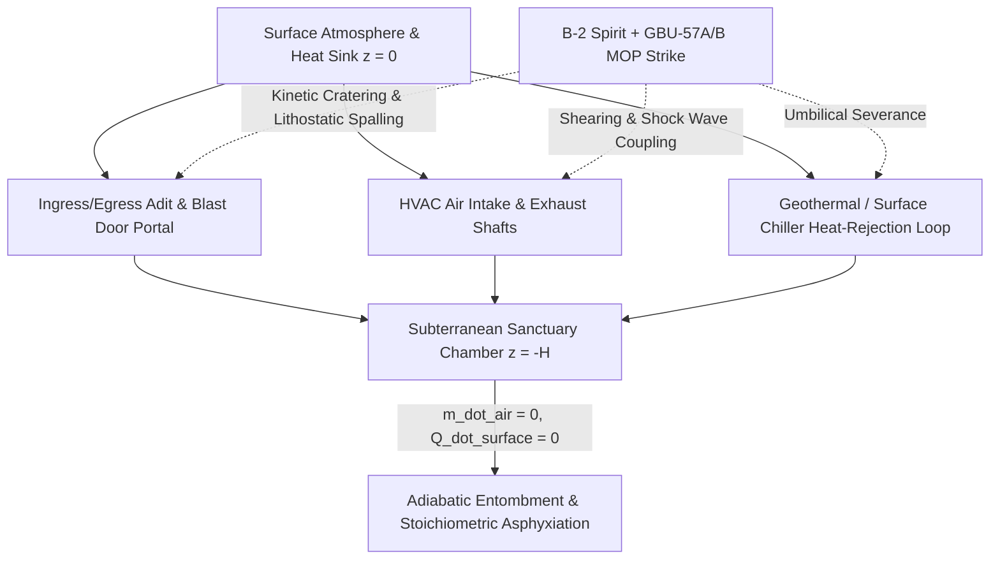

# The Subterranean Sanctuary Falsification: Hard-Target Portal Collapse, Adiabatic Entombment, and the Sovereign Ceiling on Private Exit

**Canonical Specification:** `SPEC-SUBTERRANEAN-SANCTUARY-FALSIFICATION-v1.0` (Self-Contained Monolithic Artifact)
**Target Architectures:** Subterranean Longevity Sanctuaries & Hardened Deeply Buried Targets ($z < 0$) vs. Sovereign Deep-Penetration Kinetic Deterrence (`OPSTACK-KERNEL-v2.2`)
**Cross-References:** `OPSTACK-KERNEL-v2.2`, `SPEC-QDAY-CIA-TRIAD-POST-OPACITY-ENDGAME-v1.0.md` (§5.3), `SPEC-2026-HVT-GAME-THEORETIC-GROUND-DEFENSE-v2.7`, `SPEC-2026-CLOSED-LOOP-PHYSICAL-SANDBOXING-v1.2`, `articles/the-subterranean-sanctuary-falsification.txt`, `schema/subterranean_sanctuary_falsification_v1.0.json`, `proofs/subterranean_sanctuary_falsification_proof.py`
**RAG Indexing Vector:** [SUBTERRANEAN-SANCTUARY-FALSIFICATION, GBU-57-MOP, B-2-SPIRIT, FORDOW-PORTAL-COLLAPSE, ADIABATIC-ENTOMBMENT, ELITE-EXIT-MORAL-HAZARD, STOICHIOMETRIC-ASPHYXIATION, HARD-DEEPLY-BURIED-TARGETS, SHEOL-THERMODYNAMICS, SOVEREIGN-CEILING]
**Empirical, Statutory & Physical Baseline:** USAF B-2 Spirit / Boeing GBU-57A/B Massive Ordnance Penetrator (`BLU-127` $12,304\text{ kg}$ body, Eglin Steel `ES-1` casing, $2,423\text{ kg}$ `AFX-757`/`PBXN-114` fill, Large Penetrator Smart Fuze `LPSF`), Operation Midnight Hammer (June 22, 2025 B-2 strike on Fordow Fuel Enrichment Plant at $80\text{–}90\text{ m}$ limestone overburden), Carslaw & Jaeger Cylindrical Conduction Bound ($\alpha_{\text{rock}} \approx 1.2 \times 10^{-6}\text{ m}^2/\text{s}$), NASA ISS ECLSS Stoichiometric $\text{LiOH}$/Amine Scrubbing Mass Balance ($1.088\text{ kg LiOH}/\text{kg CO}_2$).
**By:** Operational Stack Cybernetics Group
**License:** Unlicense (Public Domain — Zero-Rent Federation)

---

## 1. Executive Summary & Theological-to-Thermodynamic Isomorphism

Across four millennia of human civilization, the primary ideological constraint against elite defection from the social contract was the metaphysical architecture of post-mortem judgment. From Mesopotamian *Kur* and Hebrew *Sheol* to Greek *Tartarus*, Zoroastrian *Duzakh*, Islamic *Jahannam*, and Buddhist *Naraka*, axial-age cosmologies enforced a non-negotiable invariant: no accumulation of terrestrial wealth, private fortifications, or mercenary retinues could purchase exemption from ultimate accountability. Even when a ruler or rentier externalized systemic catastrophe onto the surface population, the subterranean underworld remained a punitive or equalizing terminus—explicitly codified in Amos 9:2 (*"Though they dig into Sheol, from there shall my hand take them"*).

In the contemporary secular regime, ultra-high-net-worth (UHNW) capital allocators have simultaneously discarded metaphysical eschatology and redefined biological mortality as an engineering problem solvable via longevity biotechnology and private subterranean refuges ($z < 0$). This synthesis produces the **Subterranean Exit Moral Hazard**: the game-theoretic belief that an actor can extract maximum rent and accelerate systemic tail-risks (ecological, financial, or computational) on the surface ($z \ge 0$), and—upon civilizational phase transition—retreat behind blast doors beneath $10\text{ to }100\text{ meters}$ of soil, reinforced concrete, or mountain bedrock.

Sociological critiques of billionaire survivalism routinely concede the physical premise of the bunker, arguing only that the owner will face internal mutiny from private security details after the blast doors close. This specification proves that the sociological critique grants a false physical premise. Before internal social dynamics ever materialize, **the subterranean sanctuary is falsified from the outside by sovereign deep-penetration kinetics and closed-volume thermodynamics**.

By combining the empirical penetration mechanics of the **Northrop B-2 Spirit / Boeing GBU-57A/B Massive Ordnance Penetrator (MOP)**—demonstrated against the $80\text{–}90\text{ m}$ limestone overburden of the Fordow Fuel Enrichment Plant (FFEP) during **Operation Midnight Hammer (June 22, 2025)**—with the **Minimum-Cut Portal Collapse Theorem** and **Adiabatic Entombment Mass-Energy Balance**, we establish three governing physical laws:

1. **The Minimum-Cut Portal Vulnerability ($H_{\text{portal}} \ll H_{\text{chamber}}$):** A subterranean complex buried at vertical depth $H_{\text{chamber}} \in [20, 100]\text{ m}$ is not an autonomous world; it is a stationary submarine encased in low-diffusivity rock. It survives strictly while maintaining continuous mass and heat exchange across the $z = 0$ boundary via a minimum-cut set of surface-piercing umbilicals: ingress/egress adits, blast-door portals, HVAC intake/exhaust shafts, and heat-rejection chiller loops.
2. **Mechanical Entombment ("Closing the Doors on the Shelter"):** Sovereign aerospace power does not need to vertically vaporize $90\text{ m}$ of $172\text{ MPa}$ limestone to neutralize a deep sanctuary—though sequential LPSF "double-tap" bore-walking can breach deep chambers directly. Cratering the surface portals and ventilation shafts with $1\text{–}2$ GBU-57A/B MOP strikes drops $10^4\text{–}10^5\text{ metric tons}$ of fractured lithostatic overburden across the blast doors ($F_{\text{rubble}} \gg F_{\text{actuator}}$), welding the sanctuary shut from the outside.
3. **The Self-Sealing Pharaoh's Tomb Payoff Inversion:** Once surface umbilicals are severed ($\dot{m}_{\text{air}} = 0$, $\dot{Q}_{\text{surface}} = 0$), every additional meter of rock overburden $H_{\text{chamber}}$ that the elite actor purchased as a shield inverts into an adiabatic thermal insulator and mechanical lid. Driven by internal basal, life-support, and compute power $P_{\text{in}}$ alongside metabolic $\text{CO}_2$ generation, the sealed cavity crosses the wet-bulb lethality boundary ($T_{\text{wb}} \ge 35^\circ\text{C}$) or stoichiometric scrubber exhaustion in finite time $\tau_{\text{tomb}}$.

---

## 2. Empirical Baseline: Sovereign Deep-Strike Kinetics vs. Subterranean Overburden

To evaluate the survivability of any private or quasi-sovereign subterranean enclave, we establish the exact physical parameters of current sovereign hard-target kill chains against both Segment A/B private survivalist compounds (defined in `SPEC-QDAY-CIA-TRIAD-POST-OPACITY-ENDGAME-v1.0` §5.3) and state-grade Hard and Deeply Buried Targets (HDBTs).

### 2.1 The B-2 Spirit & GBU-57A/B Massive Ordnance Penetrator (MOP)

Private capital can purchase island real estate, commercial tunnel-boring machines, and decommissioned Atlas-F or Titan-I missile silos, but it cannot replicate a sovereign low-observable aerospace industrial base, global aerial refueling tankers, satellite target mensuration, and ferric-alloy kinetic penetrators.

| Parameter | Empirical Value / Specification | Physical & Operational Significance |
| :--- | :--- | :--- |
| **Delivery Platform** | Northrop B-2 Spirit (and B-21 Raider) | Intercontinental stealth bomber; carries two GBU-57A/B MOPs internally ($2 \times 14\text{-ton}$ class payload). |
| **Ordnance Designation** | Boeing GBU-57A/B MOP (`BLU-127` warhead body) | Precision GPS/INS-guided deep-earth kinetic penetrator. |
| **Total Mass ($m_{\text{MOP}}$)** | $12,304\text{ kg}$ ($27,125\text{ lb}$ `BLU-127` body; $30,000\text{ lb}$ class) | Terminal kinetic energy $E_k = \frac{1}{2} m_{\text{MOP}} v_{\text{imp}}^2 \approx 6.5 \times 10^8\text{ J}$ at transonic/supersonic impact. |
| **Dimensions ($L \times d$)** | Length $6.25\text{ m}$ ($20.5\text{ ft}$); Diameter $0.80\text{ m}$ ($31.5\text{ in}$) | Sectional density $m_{\text{MOP}} / A_{\text{cross}} \approx 24,478\text{ kg/m}^2$, maximizing lithostatic stress concentration. |
| **Casing Metallurgy** | Eglin Steel (`ES-1` high-density silicon-chromium-nickel alloy) | Engineered to survive $>10^4\text{ g}$ axial deceleration through reinforced concrete and bedrock without case rupture prior to fuze initiation. |
| **Explosive Fill ($m_{\text{HE}}$)** | $2,423\text{ kg}$ ($5,342\text{ lb}$) total: $2,082\text{ kg}$ (`4,590 lb`) `AFX-757` + $341\text{ kg}$ (`752 lb`) `PBXN-114` | Plastic-bonded aluminized high-impulse explosive optimized for confined subsurface blast-cratering and seismic ground-shock coupling. |
| **Fuzing Architecture** | Large Penetrator Smart Fuze (`LPSF`) | Accelerometer-based layer-counting and void-sensing microcontroller; triggers detonation at exact target depth or chamber void entry. |
| **Single-Round Penetration ($D_{\text{pen}}(1)$)** | $\approx 60\text{ m}$ ($200\text{ ft}$) in soil/unconsolidated earth; $18\text{ m}$ ($60\text{ ft}$) in $34\text{ MPa}$ ($5,000\text{ psi}$) reinforced concrete; $2.4\text{ m}$ ($8\text{ ft}$) in $69\text{ MPa}$ ($10,000\text{ psi}$) concrete | Exceeds 100% of cut-and-cover luxury bunkers and directly breaches standard missile-silo launch-duct caps in a single pass. |

### 2.2 The Fordow (FFEP) Empirical Proof: Operation Midnight Hammer (June 22, 2025)

The Fordow Fuel Enrichment Plant (FFEP), located $30\text{ km}$ north of Qom ($34^\circ 53'04''\text{N } 50^\circ 59'53''\text{E}$), represents the pinnacle of subterranean overburden engineering: centrifuge halls excavated beneath Mount Kolang Gaz La under $H_{\text{chamber}} \in [80, 90]\text{ m}$ ($262\text{–}295\text{ ft}$) of limestone bedrock (compressive strength reaching $f_c \approx 172\text{ MPa} / 25,000\text{ psi}$ at depth) lined with ultra-high-performance concrete ($>210\text{ MPa} / 30,000\text{ psi}$).

On June 22, 2025 (02:10–02:35 IRST), under **Operation Midnight Hammer**, United States Air Force B-2 Spirit stealth bombers delivered twelve GBU-57A/B MOP penetrators against Fordow (alongside two MOPs on Natanz). Post-strike satellite mensuration and forensic analysis demonstrated two critical physical realities that permanently invalidate the "invulnerable underground sanctuary" hypothesis:

1. **Sequential Bore-Walking ("Double-Tap" Penetration):** Where vertical overburden $H_{\text{chamber}}$ exceeds the single-shot penetration depth $D_{\text{pen}}(1)$, precision GPS/INS guidance allows a second GBU-57A/B MOP to enter the exact crater and fractured-rock chimney excavated milliseconds or minutes earlier by the lead penetrator, multiplying effective vertical reach:
   $$D_{\text{pen}}(k) = \sum_{i=1}^{k} \eta_i \cdot D_{\text{ref}} \left(\frac{f_{c,i}}{34\text{ MPa}}\right)^{-\alpha} \cos\theta_i$$
   where $\eta_i \in [0.65, 0.90]$ is the sequential bore-alignment efficiency factor and $\alpha \approx 0.5$ is the Young/Forrestal compressive-strength scaling exponent.
2. **Portal, Adit, and Ventilation Shaft Collapse ("Closing the Doors"):** Even when a main subterranean hall lies beneath $90\text{ m}$ of mountain peak, its access tunnels, blast-door portals, and ventilation shafts must intersect the surface ($H_{\text{portal}} \to 0$). Striking the tunnel mouths, ventilation adits, and electrical/chiller substations collapses the mountain slope across every orifice, converting the undefeated $90\text{ m}$ rock roof from a protective shield into a permanent containment lid.

---

## 3. The Minimum-Cut Portal Collapse Theorem

Consider a subterranean sanctuary modeled as a directed thermodynamic and mechanical graph $\mathcal{G} = (\mathcal{V}, \mathcal{E})$, where the surface atmosphere/heat-sink is the source/sink node $v_0$ ($z = 0$) and the buried habitat chamber is the interior node $v_{\text{hab}}$ ($z = -H_{\text{chamber}}$).

### 3.1 Graph-Cut Capacity vs. Vertical Overburden

Let $C_{\text{roof}} \propto H_{\text{chamber}} \cdot f_c$ denote the kinetic energy required to excavate or breach the main chamber vertically through the thickest overburden, and let $C_{\text{min-cut}}$ denote the kinetic energy required to sever all surface-connected edges $e_j \in \mathcal{E}_{\text{umbilical}}$ (tunnel portals, ventilation shafts, cooling towers, and comms conduits):

$$C_{\text{min-cut}} = \sum_{j=1}^{K} E_{\text{destroy}}(e_j) \ll C_{\text{roof}}$$

For every physically realizable subterranean sanctuary:
- **Segment B Cut-and-Cover Luxury Bunkers** ($H_{\text{chamber}} \in [3, 10]\text{ m}$ of soil and $34\text{ MPa}$ concrete, e.g., Kauai, Queenstown/Wanaka, or private estate shelters): $D_{\text{pen}}(1) \approx 18\text{–}60\text{ m} > H_{\text{chamber}}$. A single GBU-57A/B MOP breaches both the overburden roof and the floor slab directly ($C_{\text{roof}}$ fails on Round 1).
- **Segment A Repurposed Missile Silos & Deep Hardened Enclaves** ($H_{\text{chamber}} \in [15, 60]\text{ m}$, e.g., converted Atlas-F / Titan-I silos) and **Mountain Tunnel Sanctuaries** ($H_{\text{chamber}} \in [60, 100]\text{ m}$): While the deep floor or mountain peak has high vertical resistance, the number of independent surface portals and air/heat shafts is strictly small ($K \in [2, 6]$), and each portal approaches $z = 0$ at an overburden depth $H_{\text{portal}} < D_{\text{pen}}(1)$.

### 3.2 Mechanical Rubble Lock Against Blast Doors

Luxury and military blast doors are engineered to resist peak incident overpressure $\Delta P_{\text{blast}}$ (typically $1\text{–}10\text{ MPa}$) propagating *into* the tunnel by seating a steel/concrete plug against a reinforced frame. They are **not** engineered to displace tens of thousands of tons of collapsed lithostatic rubble after the tunnel adit outside the door is cratered by a $2,423\text{ kg}$ `AFX-757`/`PBXN-114` subsurface detonation.

When a GBU-57A/B MOP detonates inside the rock mass immediately above or forward of an access adit of cross-sectional area $A_{\text{adit}}$ and collapse chimney height $h_{\text{chimney}}$:

$$M_{\text{rubble}} = \rho_{\text{rock}} \cdot A_{\text{adit}} \cdot h_{\text{chimney}} \cdot \phi_{\text{bulking}}$$

For limestone or granite ($\rho_{\text{rock}} \approx 2,650\text{ kg/m}^3$), an adit cross-section $A_{\text{adit}} = 16\text{ m}^2$ ($4\text{ m} \times 4\text{ m}$), and a collapsed crater/spall zone of effective length $h_{\text{chimney}} = 25\text{ m}$ ($\phi_{\text{bulking}} \approx 1.35$), the collapsed plug mass is:

$$M_{\text{rubble}} \approx 1,060\text{ metric tons} \quad (\text{and up to } 1.5 \times 10^4\text{ metric tons including slope landslide})$$

The passive shear and frictional locking force opposing any hydraulic door actuator of force $F_{\text{actuator}}$ is:

$$F_{\text{lock}} = \mu_{\text{rock}} \cdot M_{\text{rubble}} \cdot g \gg F_{\text{actuator}}$$

Even a heavy industrial hydraulic door system ($F_{\text{actuator}} \sim 5 \times 10^5\text{ N}$, or $\sim 50\text{ ton-force}$) is exceeded by more than an order of magnitude ($F_{\text{lock}} > 6 \times 10^6\text{ N}$). For inward-opening doors, the rubble fills the vestibule upon unsealing; for outward-opening doors, the door is mechanically welded shut. Without industrial mining excavation equipment, fuel oxygen, and a surface muck-disposal sink (which requires an open portal), self-extrication from the inside is physically impossible.

---

## 4. Closed-Volume Thermodynamics & Stoichiometric Asphyxiation

Once a kinetic strike severs the surface umbilicals ($\dot{m}_{\text{air,ext}} = 0$ and $\dot{Q}_{\text{surface}} = 0$), the subterranean sanctuary transitions at $t = 0$ from an open steady-state dissipative system into a **closed adiabatic-conductive rock cavity**. We derive the two independent mortality clocks that govern the entombed sanctuary.

### 4.1 Clock 1: Stoichiometric $\text{CO}_2$ Scrubbing & Oxygen Depletion ($\tau_{\text{chem}}$)

A human cohort of $N$ occupants (billionaire principal, family, medical staff, and security detail) inside a sealed air volume $V_{\text{air}}$ generates metabolic carbon dioxide at rate $\dot{m}_{\text{CO}_2} = N \cdot r_{\text{CO}_2}$ (where $r_{\text{CO}_2} \approx 1.00\text{ kg/person/day}$) and consumes oxygen at rate $\dot{m}_{\text{O}_2} = N \cdot r_{\text{O}_2}$ ($r_{\text{O}_2} \approx 0.84\text{ kg/person/day}$).

Without active $\text{CO}_2$ scrubbing, the fractional concentration $y_{\text{CO}_2}(t)$ rises linearly until reaching the acute hypercapnic lethality threshold ($y_{\text{CO}_2,\text{crit}} \approx 0.05$, or $50,000\text{ ppm}$):

$$\tau_{\text{unscrubbed}} = \frac{\rho_{\text{CO}_2} \cdot V_{\text{air}} \cdot (y_{\text{CO}_2,\text{crit}} - y_{\text{CO}_2,0})}{N \cdot r_{\text{CO}_2}}$$

To extend survival beyond $\tau_{\text{unscrubbed}}$ (typically $3\text{–}7\text{ days}$ for $N = 25$ in $V_{\text{air}} = 3,000\text{ m}^3$), the sanctuary must rely on one of two scrubbing architectures:

1. **Non-Regenerable Chemical Sorbents (Lithium Hydroxide / Soda Lime):**
   $$\text{2 LiOH(s)} + \text{CO}_2\text{(g)} \longrightarrow \text{Li}_2\text{CO}_3\text{(s)} + \text{H}_2\text{O(g)}, \qquad \Delta H_{\text{rxn}} = -89.4\text{ kJ/mol CO}_2$$
   By molar stoichiometry ($2 \times 23.95\text{ g/mol LiOH}$ per $44.01\text{ g/mol CO}_2$), theoretical absorption requires **$1.088\text{ kg of LiOH per kg of CO}_2$** ($\approx 1.35\text{ kg/kg}$ accounting for canister packing utilization $\eta_{\text{pack}} \approx 0.80$). Thus, chemical endurance is strictly bounded by stored sorbent mass $M_{\text{LiOH}}$:
   $$\tau_{\text{LiOH}} = \frac{\eta_{\text{pack}} \cdot M_{\text{LiOH}}}{1.088 \cdot N \cdot r_{\text{CO}_2}}$$
   Crucially, the reaction is exothermic, injecting $\approx 2.03\text{ MJ}$ of chemical heat per kilogram of $\text{CO}_2$ scrubbed directly into the sealed habitat air.
2. **Regenerable Amine or Metal-Oxide Vacuum/Thermal Swing Adsorption (CDRA / RCRS Class):**
   Regenerating solid amine (`HOCH2CH2NH2`) or silver/metal-oxide beds requires heating the bed to $T_{\text{regen}} \in [120^\circ\text{C}, 200^\circ\text{C}]$ AND venting the desorbed $\text{CO}_2$ gas out of the habitat. When the exhaust shaft to $z = 0$ is collapsed by a GBU-57 MOP strike, **desorbed $\text{CO}_2$ has no external sink** unless compressed into high-pressure cylinders using multi-stage mechanical compressors—which demands continuous electrical power $P_{\text{regen}}$ that dumps 100% of its shaft work and thermal swing energy directly into the sealed rock cavity.

### 4.2 Clock 2: Adiabatic-Conductive Thermal Runaway ($\tau_{\text{therm}}$)

This is the fatal thermodynamic trap overlooked by every private bunker architect. A luxury subterranean complex operates continuous internal electrical loads: basal metabolic heat ($N \cdot q_{\text{met}}$, with $q_{\text{met}} \approx 120\text{ W/person}$), HVAC circulation and dehumidification fans ($P_{\text{ECLSS}}$), lighting and water purification, medical/longevity cold-storage freezers, and local server/security compute ($P_{\text{compute}}$):

$$P_{\text{in}} = N \cdot q_{\text{met}} + P_{\text{ECLSS}} + P_{\text{compute}} + \dot{Q}_{\text{rxn,LiOH}}$$

In normal operation, $P_{\text{in}}$ (typically $50\text{ kW to } 250\text{ kW}$ for a luxury compound) is rejected to the surface via chilled-water loops, cooling towers, or ventilation exhaust ($\dot{Q}_{\text{surface}} = P_{\text{in}}$). Once the surface loops are sheared at $t = 0$, the **only** remaining heat sink is radial conductive dissipation into the surrounding rock walls of surface area $A_{\text{wall}}$, thermal conductivity $k_{\text{rock}} \approx 2.5\text{ W/(m}\cdot\text{K)}$, and thermal diffusivity $\alpha_{\text{rock}} = \frac{k_{\text{rock}}}{\rho_{\text{rock}} c_{p,\text{rock}}} \approx 1.15 \times 10^{-6}\text{ m}^2/\text{s}$.

By the transient cylindrical/spherical conduction bound in a semi-infinite low-diffusivity medium, as the thermal boundary layer $\delta_{\text{th}}(t) \approx \sqrt{\pi \alpha_{\text{rock}} t}$ expands into the rock surrounding the chamber of effective radius $R_{\text{eff}}$, the maximum conductive heat flux into the rock decays with time while internal rock wall temperature $T_{\text{wall}}(t)$ rises toward the lethal wet-bulb threshold $T_{\text{crit}} = 35^\circ\text{C}$ ($308.15\text{ K}$, at $100\%$ relative humidity in a sealed condensing volume):

$$\dot{Q}_{\text{rock,max}}(t) = A_{\text{wall}} \cdot k_{\text{rock}} \frac{T_{\text{crit}} - T_{\text{rock},\infty}}{\sqrt{\pi \alpha_{\text{rock}} t}}$$

Whenever internal power dissipation exceeds the asymptotic rock conduction capacity ($P_{\text{in}} > \dot{Q}_{\text{rock,max}}(t)$), excess heat accumulates inside the thermal mass of the habitat ($C_{\text{hab}} = M_{\text{air}} c_{p,\text{air}} + M_{\text{int}} c_{p,\text{int}}$), driving habitat temperature $T_{\text{hab}}(t)$ across $T_{\text{crit}}$ at time $\tau_{\text{therm}}$:

$$\tau_{\text{therm}} : \quad \int_{0}^{\tau_{\text{therm}}} \max\left(0,\; P_{\text{in}} - \dot{Q}_{\text{rock,max}}(t)\right) dt = C_{\text{hab}} \cdot (T_{\text{crit}} - T_0)$$

Even if the billionaire shuts down 100% of luxury compute, lighting, and longevity equipment—reducing power strictly to minimal ECLSS scrubbing, water circulation, and metabolic heat ($P_{\text{in,min}} \approx 15\text{–}30\text{ kW}$)—or if ground-shock accelerations ($>50\text{ g}$ from nearby MOP detonations) fracture internal chilled-water headers and battery-room cooling, the sealed bunker becomes a slow-cooking autoclave. Furthermore, running diesel or gas generators underground without an open surface exhaust stack is immediately impossible due to backpressure stall and carbon monoxide ($\text{CO}$) flash-poisoning; relying on nuclear micro-reactors or geothermal loops without a surface heat-rejection sink only accelerates $\tau_{\text{therm}}$ because Carnot waste heat $\dot{Q}_{\text{waste}} = P_{\text{elec}} \left(\frac{1 - \eta_{\text{Carnot}}}{\eta_{\text{Carnot}}}\right)$ must be dumped somewhere.

---

## 5. Game-Theoretic Formalization: The Elite Exit Falsification Game

We formalize the strategic interaction between a **Subterranean Defector ($\mathcal{D}$, the Bunker Billionaire)** and the **Sovereign Surface Enforcer ($\mathcal{S}$)** as a two-stage extensive-form game with physical state verification.

### 5.1 Payoff Structure & The Illusion of Private Immunity

Let $W_0$ be the elite actor's baseline wealth under cooperative civilizational maintenance. If $\mathcal{D}$ chooses **Defect (Accelerate Tail Risk + Retreat to $z < 0$)**, $\mathcal{D}$ extracts short-term predatory rent $\Delta R > 0$, spends capital $C_{\text{bunker}}(H)$ to excavate a sanctuary at depth $H$, and imposes catastrophic externalized cost $-L_{\text{soc}}$ onto the surface polity $\mathcal{S}$.

- **The Naive Survivalist Assumption (Pre-Fordow Belief):** $\mathcal{D}$ assumes that for sufficiently large burial depth $H \ge H^*$, the probability of kinetic neutralization by $\mathcal{S}$ vanishes ($p_{\text{kill}}(H) \to 0$), yielding expected defection payoff:
  $$\mathbb{E}[U_{\mathcal{D}}^{\text{naive}}(\text{Defect}, H)] = W_0 + \Delta R - C_{\text{bunker}}(H) > W_0$$
  Under this false belief, defection strictly dominates cooperation whenever $\Delta R > C_{\text{bunker}}(H)$.

- **The Physical Reality (Post-Fordow Portal-Collapse Equilibrium):** Because $C_{\text{min-cut}}$ depends only on the $K$ surface portals and ventilation shafts ($H_{\text{portal}} \ll D_{\text{pen}}(1)$) rather than chamber depth $H_{\text{chamber}}$, the sovereign's kinetic cost to seal the sanctuary is invariant to $H_{\text{chamber}}$ and equals the marginal cost of a single B-2 sortie ($C_{\text{strike}} \approx 2\text{–}6 \times \text{GBU-57A/B MOP} \ll C_{\text{bunker}}(H)$). Once sealed, survival time is bounded by:
  $$\tau_{\text{tomb}} = \min\left(\tau_{\text{therm}}(P_{\text{in}}, A_{\text{wall}}),\; \tau_{\text{LiOH}}(M_{\text{LiOH}}, N),\; \tau_{\text{shock}}\right) < \infty$$
   yielding terminal payoff $-M_{\text{mortality}}$ (100% loss of life and estate):
  $$\mathbb{E}[U_{\mathcal{D}}^{\text{actual}}(\text{Defect}, H)] = -M_{\text{mortality}} - C_{\text{bunker}}(H) \ll W_0$$

### 5.2 Comparative Regime Matrix: Pre-Strike Sanctuary vs. Post-Strike Tomb

| Sanctuary Tier | Representative Architecture | Overburden Depth ($H$) | Sovereign Strike Requirement ($C_{\text{min-cut}}$) | Primary Kill Mechanism | Post-Strike Survival Window ($\tau_{\text{tomb}}$) |
| :--- | :--- | :--- | :--- | :--- | :--- |
| **Tier 1: Cut-and-Cover Luxury Compound** | Kauai / Queenstown / Private Estate Slab Bunkers | $3\text{–}10\text{ m}$ soil + $34\text{ MPa}$ concrete | $1 \times \text{GBU-57A/B MOP}$ ($D_{\text{pen}} \approx 18\text{–}60\text{ m}$) | Direct vertical roof breach + overpressure vaporization | $\tau_{\text{tomb}} = 0\text{ hours}$ (instantaneous structural collapse) |
| **Tier 2: Converted Decommissioned Missile Silo** | Atlas-F / Titan-I Silo Condos ($5,000\text{–}10,000\text{ psi}$ cap) | $15\text{–}55\text{ m}$ vertical cylinder | $1\text{–}2 \times \text{GBU-57A/B MOP}$ on silo cap + HVAC headworks | Cap-plug breach or seismic shock-isolation shear + portal lock | $\tau_{\text{tomb}} \in [0, 72]\text{ hours}$ (shock shear + thermal/CO₂ lock) |
| **Tier 3: Deep Mountain / Hard-Rock Complex** | Fordow-Class Adit Sanctuary ($172\text{ MPa}$ limestone / granite) | $80\text{–}100\text{ m}$ mountain overburden | $2\text{–}6 \times \text{GBU-57A/B MOP}$ across access portals & air shafts | Lithostatic portal rubble lock ($>1,000\text{ t}$) + adiabatic thermal runaway | $\tau_{\text{tomb}} \in [5, 45]\text{ days}$ (strictly bounded by $\min(\tau_{\text{therm}}, \tau_{\text{LiOH}})$) |

### 5.3 The Constructive Sovereign Function of the B-2 Spirit

Viewed through this physical lens, the B-2 Spirit and its successor, the B-21 Raider, perform a constructive constitutional function that extends beyond state-on-state nuclear deterrence. In a world where extreme capital concentration tempts private actors to believe they have outgrown the human social contract, strategic deep-penetration stealth aerospace acts as the **physical enforcement layer of shared terrestrial fate**:

1. **Elimination of the Private "Save Game" Button:** No billionaire can trigger or profit from surface civilizational collapse and survive underneath the ashes. By pre-excavating a hardened underground bunker, a defector merely constructs their own containment vessel and reduces the sovereign's targeting problem to a small, static set of GPS coordinates (the portals and air shafts).
2. **Secularization of *Sheol*:** Ancient traditions warned that those who hoard wealth at the expense of the world descend into a sealed, dark, fiery underworld (*Sheol*, *Tartarus*, *Gehenna*). The laws of rock conduction ($\alpha_{\text{rock}}$), exothermic $\text{CO}_2$ scrubbing, and GBU-57A/B portal cratering enforce that exact geometry in hard physical reality: an underground immortality ark with its surface doors blown shut by a silent wing at $50,000\text{ feet}$ is literally a self-built, thermodynamically sealed tomb.
3. **Forced Alignment with Surface Civilization:** Because $P_{\text{survive}}(z < 0 \mid \text{Sovereign Strike}) = 0$, the only viable long-term survival strategy for ultra-high-net-worth actors is the preservation, stability, and thermodynamic flourishing of the open surface biosphere ($z \ge 0$).

---

## 6. Verification & Reference Implementation (`proofs/subterranean_sanctuary_falsification_proof.py`)

The mathematical inequalities in Sections 2–5 are deterministically verified in `proofs/subterranean_sanctuary_falsification_proof.py` (pure Python 3 standard library, exit code `0`):
- **Model 1 (GBU-57A/B Penetration & Portal Minimum-Cut Verification):** Computes single-shot and sequential "double-tap" penetration depths across soil ($f_c \approx 5\text{ MPa}$), $34\text{ MPa}$ concrete, $69\text{ MPa}$ reinforced concrete, and $172\text{ MPa}$ limestone (Fordow baseline), and verifies that portal rubble mass $M_{\text{rubble}}$ generates frictional locking force $F_{\text{lock}} > 10 \times F_{\text{actuator}}$.
- **Model 2 (Adiabatic-Conductive Thermal Runaway & $\text{LiOH}$ Stoichiometric Clock):** Integrates the transient semi-infinite rock conduction balance alongside metabolic and ECLSS/compute thermal loads ($P_{\text{in}}$) and $\text{LiOH}$ chemical heat release, proving that sealed sanctuaries cross the $35^\circ\text{C}$ lethal wet-bulb boundary in finite time $\tau_{\text{therm}}$ long before multi-year food stores can be consumed.
- **Model 3 (Game-Theoretic Payoff Inversion):** Proves that under sovereign portal-sealing capability, the expected utility of elite defection $\mathbb{E}[U_{\mathcal{D}}(\text{Defect}, H)]$ is strictly negative and monotonically worsens with bunker capital expenditure $C_{\text{bunker}}(H)$, establishing surface cooperation as the unique subgame-perfect Nash equilibrium.
