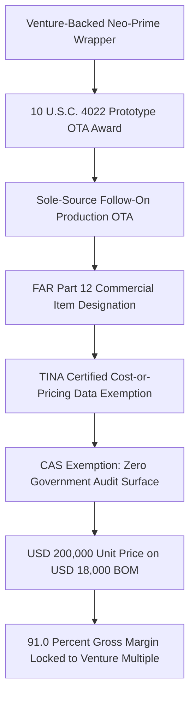
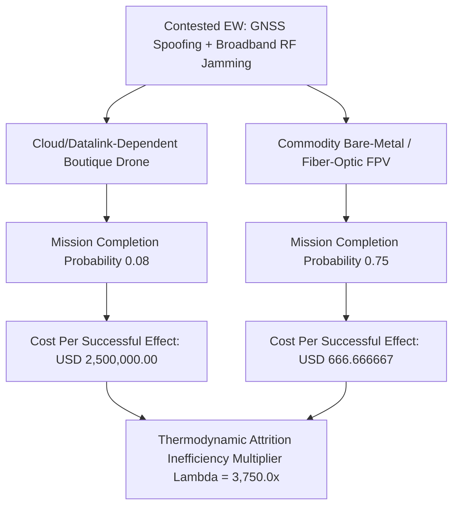
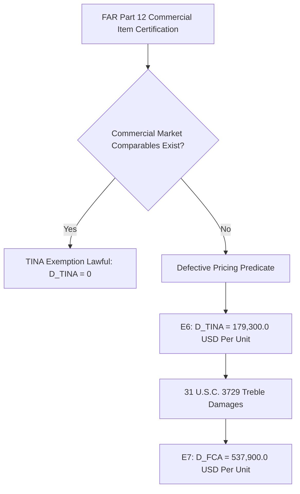

# SPEC-VENTURE-DEFENSE-OTA-BYPASS-AND-ATTRITION-COST-INVERSION-v1.0: Venture-Defense Neo-Prime OTA Bypass, Contested-EW Attrition Collapse, and the 3,750x Cost-Per-Effect Inversion

**Canonical Specification:** `SPEC-VENTURE-DEFENSE-OTA-BYPASS-AND-ATTRITION-COST-INVERSION-v1.0`
**Target Architectures:** Commodity Open-Architecture Bare-Metal Attrition Swarms vs. Venture-Backed Neo-Prime Defense Wrappers (`OPSTACK-KERNEL-v2.2`)
**Cross-References:** `specs/SPEC-VENTURE-DEFENSE-OTA-BYPASS-AND-ATTRITION-COST-INVERSION-v1.0.md` | `schema/venture_defense_ota_attrition_inversion.json` | `proofs/venture_defense_ota_attrition_inversion_proof.py` | `specs/SPEC-2026-ATTRITION-SWARM-MOE-AND-EW-ZUGZWANG-v1.0` | `specs/AUDIT-2026-DEFENSE-SUPPLY-DISINTERMEDIATION.md` | `specs/AUDIT-2026-DEFENSE-COMPLIANCE-DISINTERMEDIATION.md` | `articles/venture-defense-ota-bypass-and-attrition-cost-inversion.txt`
**RAG Indexing Vector:** `[VENTURE-DEFENSE-VAPORWARE, OTA-10-USC-4022-BYPASS, TINA-TRUTH-IN-NEGOTIATIONS, FAR-PART-12-COMMERCIAL-FICTION, ATTRITION-EXCHANGE-RATIO, EW-GPS-SPOOFING-COLLAPSE, FALSE-CLAIMS-DEFECTIVE-PRICING, BARE-METAL-FPV-PARITY]`
**Empirical, Statutory & Physical Baseline:** 10 U.S.C. § 4022 (DoD Prototype & Follow-On Production Other Transaction Authority / OTA), 10 U.S.C. §§ 3701–3708 (Truthful Cost or Pricing Data / Truth in Negotiations Act — TINA), FAR Part 12 & 10 U.S.C. § 3451 (Commercial Item Certified Cost Data Exemption), DoD Office of Inspector General Audit Reports on OTA Consortiums (DIU / Non-Traditional Defense Contractors), 31 U.S.C. § 3729 (False Claims Act Treble Damages for Defective Cost/Performance Certification)
**By:** Operational Stack Cybernetics Group
**License:** Unlicense (Public Domain — Zero-Rent Federation)

---

## 1. Executive Summary

The venture-backed "neo-prime" defense sector markets itself as the anti-monopoly disruptor of the legacy prime contractor oligopoly: faster, cheaper, software-defined, and funded by private risk capital rather than appropriations. This specification decomposes that claim into two falsifiable layers and finds it inverted on both.

**Layer 1 — the statutory wrapper.** The wrapper's margin structure is not produced by innovation arbitrage; it is produced by procurement routing. A prototype award under 10 U.S.C. § 4022 (Other Transaction Authority, OTA) converts into a sole-source follow-on production OTA, and a FAR Part 12 "commercial item" designation (10 U.S.C. § 3451) exempts the transaction from the Truth in Negotiations Act certified cost-or-pricing-data regime (TINA, 10 U.S.C. §§ 3701–3708) and from Cost Accounting Standards. The result: an airframe with an $18,000 bill of materials (`boutique_vc_drone_bom_cost_usd` = 18000.0) carries a $200,000 unit price (`boutique_vc_drone_unit_price_usd` = 200000.0), locking a 91.0% gross margin (`boutique_vc_gross_margin_ratio` = 0.91) that services venture valuation multiples instead of combat mass.

**Layer 2 — the physical attrition layer.** In a contested electromagnetic environment (GNSS spoofing plus broadband RF jamming), the cloud- and datalink-dependent boutique platform collapses to an 8.0% mission completion probability (`contested_ew_boutique_survival_prob` = 0.08), while a $500 commodity bare-metal or fiber-optic FPV (`commodity_bare_metal_fpv_unit_cost_usd` = 500.0) retains 75.0% (`fiber_optic_or_edge_fpv_survival_prob` = 0.75). Cost per successful effect inverts to $2,500,000.00 versus $666.666667 — a `thermodynamic_attrition_inefficiency_multiplier` of 3,750.0x.

**Layer 3 — the clawback.** The same price structure that manufactures the margin manufactures the liability. Against a 15% allowable defense profit cap, the per-unit TINA defective-pricing overcharge is $179,300.00, and 31 U.S.C. § 3729 trebles it to a $537,900.00 per-unit False Claims Act disgorgement exposure — 2.6895x the entire unit price.

### 1.1 Scope

This specification covers the procurement routing, the attrition arithmetic, and the statutory clawback surface of venture-wrapped small/medium tactical unmanned systems sold under OTA + FAR Part 12. It names and indicts no specific contractor or individual: all liability figures are abstract statutory-boundary computations conditioned on document production, and all conduct characterizations are structural-accounting descriptors. The companion article carries the narrative; the proof kernel carries the arithmetic; the schema carries the locks.

## 2. Statutory Attack Surface: The OTA + FAR Part 12 Wrapper

### 2.1 The Routing Chain

10 U.S.C. § 4022 authorizes DoD prototype OTAs outside the Federal Acquisition Regulation, and permits follow-on production OTA awards to the prototype recipient without competition when the prototype was successfully completed. For a venture-backed entrant, the OTA is marketed as speed; structurally, it is an audit bypass. Once the unit is designated a commercial item under FAR Part 12, 10 U.S.C. § 3451 exempts the procurement from TINA's certified cost-or-pricing-data requirement, and the transaction exits CAS coverage entirely. DoD Office of Inspector General audits of OTA consortiums have repeatedly flagged exactly this gap: follow-on production awards for which the government holds neither certified cost data nor commercial market comparables.

### 2.2 The Load-Bearing Fiction

TINA's commercial-item exemption presumes a price discovered by an actual commercial market — observable, arm's-length comparables that discipline the number. A sole-source follow-on production OTA with no comparable commercial sales has no market price; it has a cost-plus price wearing a commercial exemption. The designation does the work that the market was supposed to do, minus the market.

### 2.3 Consortium Routing & the OIG Audit Trail

The routing is rarely visible in a single award document. Prototype OTAs flow through innovation units and OTA consortiums, and the consortium structure interposes an intermediary layer between the government and the performing contractor. DoD Office of Inspector General audits of OTA consortiums have repeatedly flagged the same shape: follow-on production awards for which the government holds neither certified cost or pricing data nor commercial market comparables — the two inputs TINA and FAR Part 12 each presume and each dispense with. The audit trail that would discipline the price is the audit trail the routing was selected to avoid; the selection is the forensic signature, not an incidental byproduct.

### 2.4 Zero Audit Surface by Construction

Once the TINA exemption and the CAS exit are both in place, the government holds no certified cost data, no cost-accounting coverage, and — under a sole-source follow-on — no competitive price history. The margin cannot be reconstructed from the buyer's side of the table; it can only be attacked collaterally, after the fact, through defective-pricing and false-claims theories that operate on records obtained in discovery. The wrapper's 91.0% margin is therefore not merely high — it is unauditable by construction, and the construction is itself the evidence.

## 3. Mathematical Formalization & Governing Equations

### 3.1 Primitive 1 — Wrapper Gross Margin (E1)

With unit price `P_vc` = 200000.0 and bill-of-materials cost `C_bom` = 18000.0:

    E1:  m_vc = (P_vc - C_bom) / P_vc = (200000.0 - 18000.0) / 200000.0 = 0.91

The implied markup over BOM is (P_vc - C_bom) / C_bom = 182000.0 / 18000.0 = 10.1111, i.e. 1,011.1% — against a 15.0% allowable profit cap (`pi_cap` = 0.15).

### 3.2 Primitive 2 — Unit Acquisition Cost Ratio (E2)

Against the commodity bare-metal FPV unit cost `C_fpv` = 500.0:

    E2:  R_acq = P_vc / C_fpv = 200000.0 / 500.0 = 400.0

One boutique unit consumes the acquisition budget of 400 commodity attrition airframes.

### 3.3 Primitive 3 — Contested-EW Cost-Per-Effect Inversion (E3–E5)

Let `p_vc` = 0.08 be the boutique platform's mission completion probability under high-density EW (GNSS spoofing + broadband RF jamming) and `p_fpv` = 0.75 the commodity bare-metal / fiber-optic FPV's:

    E3:  CPE_vc  = P_vc / p_vc  = 200000.0 / 0.08 = 2,500,000.0 USD per successful effect
    E4:  CPE_fpv = C_fpv / p_fpv = 500.0 / 0.75   = 666.666667 USD per successful effect
    E5:  Lambda  = CPE_vc / CPE_fpv = (P_vc * p_fpv) / (C_fpv * p_vc) = 300.0 / p_vc = 3,750.0x

Closed-form corollary: Lambda = 300.0 / p_vc, so the inversion exceeds 1,000x for any p_vc < 0.30, and cost-per-effect parity at any shared survival probability requires P_vc <= C_fpv = 500.0 — a 99.75% price collapse. The parity survival probability for the boutique platform, p_parity = P_vc / CPE_fpv = 300.0, exceeds 1.0; reliability alone can never close the gap at the locked price.

### 3.4 Primitive 4 — TINA Defective Pricing & FCA Treble Disgorgement (E6–E7)

With allowable profit cap `pi_cap` = 0.15, the compliant ceiling price is C_bom * (1 + pi_cap) = 18000.0 * 1.15 = 20,700.0:

    E6:  D_TINA = P_vc - C_bom * (1 + pi_cap) = 200000.0 - 20700.0 = 179,300.0 USD per unit
    E7:  D_FCA  = 3 * D_TINA = 3 * 179300.0 = 537,900.0 USD per unit

D_FCA / P_vc = 2.6895: the treble exposure per unit exceeds the unit's entire price by 168.95%. Where a FAR Part 12 commercial-item certification is supported by no commercial market comparables, the certification itself is the contested factual predicate under 31 U.S.C. § 3729.

### 3.5 Boundary Regimes: Compliant vs. Defection

The governing system has two discrete regimes separated by the compliant ceiling price C_bom * (1 + pi_cap) = 20,700.0.

| Regime | Condition | P_vc (USD) | m_vc | CPE_vc (USD) | Lambda | D_TINA (USD) | D_FCA (USD) |
|--------|-----------|------------|------|--------------|--------|--------------|-------------|
| Compliant | P_vc <= C_bom(1+pi_cap) | 20,700.0 | 0.1304 | 258,750.0 | 388.125x | 0.0 | 0.0 |
| Defection (locked) | P_vc = 200,000.0 | 200,000.0 | 0.91 | 2,500,000.0 | 3,750.0x | 179,300.0 | 537,900.0 |

Numerical sanity: compliant-regime m_vc = (20700.0 - 18000.0) / 20700.0 = 0.1304; CPE_vc = 20700.0 / 0.08 = 258,750.0; Lambda = 258750.0 / 666.666667 = 388.125. Statutory correction compresses the inversion from 3,750.0x to 388.125x and extinguishes the clawback, but does not extinguish the inversion: at even a fully compliant price, contested-EW physics keeps the boutique architecture ~388x less efficient per delivered effect than the commodity architecture. The statute corrects the margin; only the architecture corrects the inversion.

## 4. Milkovich H0 vs H1: The Risk-Transfer Defense and Its Falsification

**H0 — the publicly stated defense (null hypothesis).** The standard on-the-record position of venture-backed defense entrants and their investors: fixed-price FAR Part 12 and OTA procurement transfers R&D and production risk from taxpayers onto private venture capital, and the premium over cost is the market price of that risk transfer. Under H0, the 91.0% margin is not an audit gap; it is the reward for absorbing failure risk the government would otherwise carry.

**H1 — disclosed-facts analytical synthesis.** Risk transfer requires a price discovered under risk — i.e., a competitive market in which the seller can fail and the price can clear or not. The accounting identity falsifying H0 is direct: a sole-source follow-on production OTA with zero commercial market comparables has no discovered price, so the "fixed price" is a cost-plus number wearing a commercial exemption, and the premium accrues precisely because competition and certified cost data were routed around, not because risk was priced. The implied markup identity makes the gap measurable: (P_vc - C_bom)/C_bom = 1,011.1% versus pi_cap = 15.0%. H0 predicts margin commensurate with borne risk in a market; the observed structure shows margin commensurate with audit absence.

**Rule 26 discovery trap.** Every H0 -> H1 falsification hinge rests on objective records: the bill of materials, the OTA terms and sole-source justification, the FAR Part 12 commercial-item determination, and the price justification documents. Any truth-defense of the commercial designation requires producing the exact comparables the designation asserts exist — and producing them, or failing to, in civil discovery resolves the question on documents, not rhetoric.

**Discovery document map.**

| Hinge | Record | Resolves |
|-------|--------|----------|
| Commercial comparables | Market-research file underlying the FAR Part 12 determination | H0 vs. H1 on price discovery |
| Sole-source justification | Follow-on OTA justification & prototype-completion record | Whether competition was lawfully excluded |
| Cost truth | Bill of materials & supplier invoices | E6 spread against the 15.0% cap |
| Certification | Cost/pricing certification or exemption assertion | 31 U.S.C. § 3729 predicate |

## 5. Locked Telemetry Table (12 Constants)

| #  | Symbol / Variable | Locked Value | Units | Derivation |
|----|-------------------|--------------|-------|------------|
| 1  | `boutique_vc_drone_unit_price_usd` | 200000.0 | USD/unit | Baseline: venture-wrapper sole-source OTA unit price |
| 2  | `boutique_vc_drone_bom_cost_usd` | 18000.0 | USD/unit | Baseline: commodity bill-of-materials for equivalent airframe |
| 3  | `boutique_vc_gross_margin_ratio` | 0.91 | ratio | E1: (200000.0 - 18000.0) / 200000.0 |
| 4  | `commodity_bare_metal_fpv_unit_cost_usd` | 500.0 | USD/unit | Baseline: bare-metal / fiber-optic FPV attrition unit |
| 5  | `unit_acquisition_cost_ratio` | 400.0 | ratio | E2: 200000.0 / 500.0 |
| 6  | `contested_ew_boutique_survival_prob` | 0.08 | probability | Baseline: GNSS-spoofed / RF-jammed datalink collapse |
| 7  | `fiber_optic_or_edge_fpv_survival_prob` | 0.75 | probability | Baseline: RF-immune guidance, edge-autonomy airframe |
| 8  | `cost_per_successful_effect_boutique_usd` | 2500000.0 | USD/effect | E3: 200000.0 / 0.08 |
| 9  | `cost_per_successful_effect_commodity_usd` | 666.666667 | USD/effect | E4: round(500.0 / 0.75, 6) |
| 10 | `thermodynamic_attrition_inefficiency_multiplier` | 3750.0 | ratio | E5: 2500000.0 / (500.0 / 0.75) |
| 11 | `tina_defective_pricing_overcharge_per_unit_usd` | 179300.0 | USD/unit | E6: 200000.0 - (18000.0 * 1.15) |
| 12 | `fca_treble_disgorgement_per_unit_usd` | 537900.0 | USD/unit | E7: 179300.0 * 3 |

## 6. Falsification Conditions & Verification Artifacts

**F1 — Commercial comparables.** If observable arm's-length commercial market comparables at the ~$200,000.0 level are produced for the platform, the FAR Part 12 designation holds, TINA exemption is lawful, and D_TINA -> 0. Absent comparables, E6–E7 stand.

**F2 — Attrition parity.** If contested-EW mission completion for the boutique platform satisfies p_vc >= 0.30, then Lambda <= 1,000.0 and the inversion narrows below the four-digit regime. At the locked p_vc = 0.08, Lambda = 3,750.0x; parity at any shared probability requires P_vc <= 500.0.

**F3 — Profit-cap compliance.** If P_vc <= C_bom * (1 + pi_cap) = 20,700.0, the defective-pricing predicate extinguishes. The locked spread is 179,300.0 per unit.

**Verification artifacts.**

- `proofs/venture_defense_ota_attrition_inversion_proof.py` — pure-stdlib proof kernel; `python3 proofs/venture_defense_ota_attrition_inversion_proof.py` must exit 0 with all 12 locked constants reproduced from E1–E7.
- `schema/venture_defense_ota_attrition_inversion.json` — Draft 2020-12 schema (`urn:opstack:schema:venture_defense_ota_attrition_inversion.json`) const-locking the telemetry table.
- `articles/venture-defense-ota-bypass-and-attrition-cost-inversion.txt` — companion narrative at exact numerical parity.
- Cross-references: `SPEC-2026-ATTRITION-SWARM-MOE-AND-EW-ZUGZWANG-v1.0` (EW zugzwang regime), `AUDIT-2026-DEFENSE-SUPPLY-DISINTERMEDIATION` (supply-side bypass), `AUDIT-2026-DEFENSE-COMPLIANCE-DISINTERMEDIATION` (compliance-side bypass).